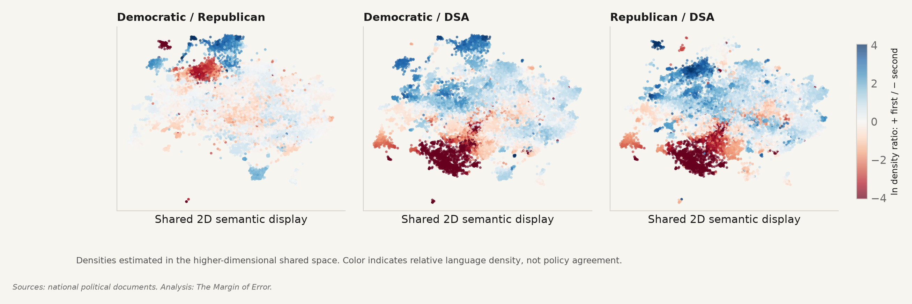

<div align="center">
  <h1>Democratic, Republican, and DSA Platforms</h1>
  <p>National policy documents, structured claims, and political language, 2000–2026.</p>
  <p>
    <a href="#overview">Overview</a> ·
    <a href="#results-and-downloads">Results &amp; data</a> ·
    <a href="#sources-and-coverage">Sources</a> ·
    <a href="#methods">Methods</a> ·
    <a href="#reproduce">Reproduce</a>
  </p>
</div>

---

## Overview

A source-first comparison of **national Democratic Party, Republican Party, and
Democratic Socialists of America documents**, covering January 1, 2000 through
October 26, 2026. Candidate campaigns, state parties, and local DSA chapters are
outside this comparison.

**Libertarian expansion in progress:** 11 adopted national editions have been
recovered, with 2020/2024 reuse recorded separately. New inference is isolated;
the completed three-party results below are unchanged. See the
[four-party scope and reproduction notes](docs/national_four_party_analysis.md).

The current work turns source text into discrete, self-contained claims using
**local Gemma plus separately identified, source-bound assistant corrections**,
then applies topic classification, embeddings, UMAP, and
kernel-density analysis to those claims rather than the original passages.

**Status:** the exploratory full-source comparison analyzes **26,483 eligible
claims from 135 documents**. All 2,623 chunks have effective dispositions:
161 source-bound corrections address reviewed errors and all 27 failed model
chunks, while preserving original model outcomes. No historically flagged
candidate lacks a superseding correction. The 142-block targeted review is not
a representative sample or corpus-wide semantic certification. The selected
sample and passage-based baseline remain separate.

<p align="center">
  
</p>

*Full eligible-claim analysis after targeted source corrections. Density differences describe
language in this input, not ideological distance or policy agreement.*

## Results and downloads

| Analysis | Status | Read | Complete download |
|---|---|---|---|
| Full claim-based comparison | Completed after targeted repairs; 26,483 claims from 135 documents | [Report](report/national_claim_analysis.md) | [Claims, complete sources, raw replies, history, corrections and results](data/analysis/national_claims/full/claim_documents.zip) |
| Claim-based selected sample | Completed; 199 claims from 25 documents; not representative | [Report](report/national_claim_analysis_sample.md) | [Claims and source texts](data/analysis/national_claims/reviewed_sample/claim_documents.zip) |
| Passage-based baseline | Completed; separate analytical input | [Report](report/national_platform_analysis.md) | [Source archive](data/analysis/national_platforms/source_documents.zip) |

Selected [expanded-view topic shares](data/analysis/national_claims/full/topic_emphasis.csv),
using equal document/fallback-bundle weights:

| Topic | Democratic | Republican | DSA |
|---|---:|---:|---:|
| Social welfare | 7.9% | 6.4% | 11.3% |
| Labor and employment | 3.0% | 1.3% | 7.5% |
| Defense and veterans | 6.9% | 8.4% | 4.1% |
| International affairs | 9.1% | 7.9% | 6.9% |

These are exploratory machine-classified language shares, not agreement measures
or manually validated policy codes. Unclassified claims remain in the denominator;
period and source-type composition differ between organizations.

Downloads contain actual text, not metadata alone. The source archive preserves
**478 complete-text records and 85 deduplicated original PDFs**, including
supplementary and excluded evidence; these are not 478 independent modeled documents.
The full claim job covers **135 eligible documents in 2,623 chunks**, with a hard
maximum of **240 source words per chunk**. The [extraction summary](data/analysis/national_claims/full/extraction_summary.json),
[chunk dispositions](data/analysis/national_claims/full/block_status.csv), and
[targeted review log](data/analysis/national_claims/full/semantic_review.csv)
retain original model failures and identified exclusions.
The [source-bound corrections](data/analysis/national_claims/full/source_repairs/)
preserve their exact basis and replacement selections; all superseded candidates
remain in the download.
The [reproducibility audit](data/analysis/national_claims/reproducibility_audit.json)
records the successful second offline run, archive checks, and input/output hashes.

For individual tables, see the [claim corpus](data/analysis/national_claims/full/),
[selected-sample topics and results](data/analysis/national_claims/reviewed_sample/),
and [baseline passages and chronology](data/analysis/national_platforms/).

## Sources and coverage

| Organization | Expanded-view documents | Adopted platforms/programs in strict view |
|---|---:|---:|
| Democratic Party | 7 | 7 |
| Republican Party | 6 | 6 |
| DSA | 122 | 3 |

The expanded view includes explicitly labeled DSA national resolutions and
statements where comprehensive platforms are unavailable. The strict view retains
adopted platforms/programs only. Democratic and Republican historical texts are
labeled American Presidency Project reproductions, not party-hosted originals.
Republican reuse of the 2016 platform in 2020 adds no independent observation.

<p align="center">
  
</p>

**The full final 2015 DSA strategy remains unrecovered.** Recovered adopted
priorities and the later strategy summary are different documents, not substitutes.
Empty years indicate missing recovered publications, not an absence of positions.
Drafts, proposals, voting results, and later annotations are not automatically
treated as final adopted wording.

The [source ledger](data/manual/national_platform_sources.csv),
[historical search and gap log](data/manual/national_platform_search_disposition.csv),
and [coverage inventory](data/analysis/national_platforms/coverage.csv) retain
dates, provenance, adoption qualifications, and exclusions.

## Methods

Gemma receives bounded source chunks and limited reference-only context, never an
entire long document. Claims should preserve actors, mechanisms, modality, time,
conditions, and reported-speaker attribution. Raw replies, original model wording,
source hashes, and exact evidence offsets remain downloadable. Same-model revision,
structural checks, and targeted assistant review are **not semantic certification or fact-checking**;
identified fidelity problems and within-document duplicates are excluded explicitly.
Targeted source repairs supply 1,041 replacement claims and supersede 1,078 original
candidates without changing raw replies. The eligible input contains 25,442
model-origin and 1,041 assistant-origin claims, with explicit provenance rather
than treating corrections as Gemma output. Thirteen zero-claim corrections
dispose of non-policy or context-only inventions. Unidentified semantic errors
may remain in the analytical input.

Claim text feeds the pinned GTE encoder and MiniLM/CAP topic classifier. Both
tokenizers enforce their limits without silent truncation. UMAP/KDE sampling
balances organizations, and each document or predefined DSA fallback-period bundle
receives equal aggregate weight. Expanded and strict views fit separately;
their coordinates are not directly comparable. Pooled results mix periods and genres.

See [claim extraction and local analysis](docs/national_claim_analysis.md) for
model revisions, chunking, cache/retry behavior, review limitations, and commands.
The [baseline report](report/national_platform_analysis.md#methods-and-reproduction)
documents the separate passage-based method and its
[offline reproducibility audit](data/analysis/national_platforms/reproducibility_audit.json).

## Reproduce

Use Python 3.12 or later and `uv`, from the repository root:

```bash
uv sync --frozen

# Reproduce the full eligible-claim comparison.
# Explicitly allow downloading its pinned models on the first run.
uv run python -m dsa_analysis.national_claim_analysis --download-model

# Reproduce the completed selected-sample claim analysis.
uv run python -m dsa_analysis.national_claim_analysis --reviewed-sample --download-model

# Reproduce the separate passage-based baseline.
uv run dsa-analysis national-platform-analysis --download-model
```

Omit `--download-model` once the models are cached. Full extraction uses a separate
local MLX environment; follow the [Gemma instructions](docs/national_claim_analysis.md#run-locally).
Full claim analysis refuses unfinished extraction. Source fetching is explicit and
is not part of the default offline analysis.

```bash
uv run python -m unittest tests.test_national_claim_corpus tests.test_national_claim_analysis -q
```

## Repository guide

| Location | Contents |
|---|---|
| [`src/dsa_analysis/`](src/dsa_analysis/) | Extraction, corpus preparation, analysis, and command-line code |
| [`data/manual/`](data/manual/) | Curated source ledgers and research qualifications |
| [`data/analysis/`](data/analysis/) | Complete-text exports, claims, provenance, and analytical tables |
| [`report/`](report/) · [`figures/`](figures/) | Reports and charts, separated by analysis |
| [`docs/`](docs/) · [`tests/`](tests/) | Methods, reproduction guides, and regression tests |
| [`files/research_archive/`](files/research_archive/) | Preserved legacy candidate-research captures and working artifacts |

The earlier [candidate and Democratic-primary study](docs/candidate_analysis.md)
is preserved separately and must not be conflated with the national comparison.
Original authors and publishers retain their rights. GitHub hosts the research
artifacts; **website publication remains on hold**.
