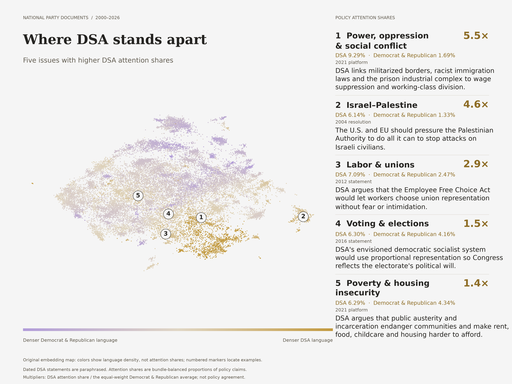

<div align="center">
  <h1>Democratic, Republican, and DSA Platforms</h1>
  <p>
    <a href="#overview">Overview</a> ·
    <a href="#explore-the-evidence">Analyses</a> ·
    <a href="methodology.md">Methodology</a> ·
    <a href="#setup">Setup</a> ·
    <a href="https://www.themarginoferror.com/party-platforms/">Live site</a>
  </p>
</div>

---

## Overview

What do Democrats, Republicans, and the Democratic Socialists of America
emphasize in their national policy documents?

This project compares **26,069 claims from 135 documents**, covering
January 1, 2000 through October 26, 2026. It groups related claims into
24 topics and displays 21 substantive issues. The comparison measures
**attention and political language**, not agreement, voter preferences, or
ideological distance.

<p align="center">
  <a href="figures/substack/where-dsa-stands-apart.png">
    
  </a>
</p>

The five callouts use DSA's **September 2026 Workers Deserve More program**.
The map and attention ratios summarize the full historical corpus, not just
current platforms. [Values and source statements](figures/article/dsa_vs_major_parties_lead.json).

## Explore the evidence

**National platforms:** [interactive maps and issue comparisons](https://www.themarginoferror.com/party-platforms/),
[all-issues overview](figures/substack/all-issues-overview.png), and
[full report](docs/reports/national_claim_analysis.md).
The [plain-language methodology](methodology.md) explains the sources, weighting,
attention ratios, and how to read the maps.

**DSA's internal groups:** [caucus and network comparison](docs/reports/dsa_caucus_analysis.md)
uses thirteen primary statements in a separate snapshot.
Its [methods](docs/dsa_caucus_analysis.md) and
[complete download](data/analysis/dsa_caucuses/dsa_caucus_analysis.zip)
are separate from the national-party analysis.

**Sources and coverage:** [document ledger](data/manual/national_platform_sources.csv),
[coverage inventory](data/analysis/national_platforms/coverage.csv), and
[historical search and gaps](data/manual/national_platform_search_disposition.csv).
DSA resolutions and statements supplement its sparse historical platforms;
an adopted-platforms-only comparison is retained as a sensitivity check.

## Working with the charts

All publishing images live in **[`figures/`](figures/README.md)**:
[Substack](figures/substack/README.md) uses `#F5F5F5`, and
[The Margin of Error](figures/margin-of-error/README.md) uses `#F7F5F0`.
Matching versions preserve chart values, labels, and dimensions.

The [complete ratio table](figures/data/attention-share-ratios.csv) includes
Democratic/Republican, DSA/Democratic, DSA/Republican, and
DSA/the equal-weight Democratic–Republican average.
A ratio of 2 means twice the weighted attention share, not twice the support
for a policy.

## Results and downloads

**[Download the complete national analysis](https://github.com/hanshanley/dsa/releases/download/claim-source-cleaned-platforms-2026-10-31/claim_documents.zip)**:
report, analytical figures, tables, claims, complete source texts, raw model
replies, and correction history. Unzip it and open `report.md`.
[Checksum and archive details](data/analysis/national_claims/full/claim_documents.download.json).

For direct inspection: [analyzed claims](data/analysis/national_claims/full/analysis_claims.csv),
[all preserved claim records](data/analysis/national_claims/full/claims.csv),
[complete source texts](data/analysis/national_claims/full/complete_sources.csv),
and [weighted issue shares](data/analysis/national_claims/full/topics/shares.csv).
Excluded and superseded claims remain available; downloads are not metadata-only.

## Setup

Use Python 3.12 or later and `uv`, from the repository root:

```bash
uv sync --frozen
uv run python -m dsa_analysis.national_claim_analysis --download-model
```

This runs the claim-based comparison using the prepared corpus; it does not
repeat source collection or claim extraction. Omit `--download-model` once
the models are cached. See the [technical reproduction guide](docs/national_claim_analysis.md)
for extraction, topic analysis, and validation commands.

## Data integrity

Claims are extracted locally with Gemma and checked against their sources,
with separately identified assistant corrections. These checks are not an
independent human audit; errors and historical coverage gaps may remain.
Attention shares balance documents or predefined source bundles, not document
length. The maps show language density, not policy agreement.

Code is in [`src/`](src/), tables and source texts in
[`data/analysis/`](data/analysis/), and reports in
[`docs/reports/`](docs/reports/README.md).
The [earlier candidate study](docs/candidate_analysis.md) and
[Libertarian expansion](docs/national_four_party_analysis.md) are separate
from the three-party comparison. Original authors and publishers retain
their rights.
