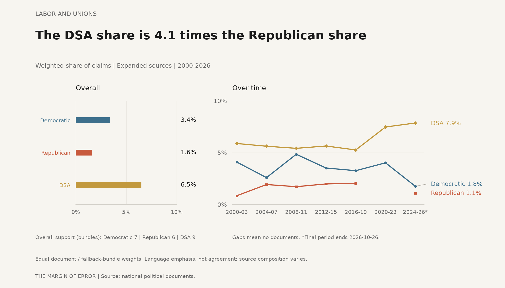
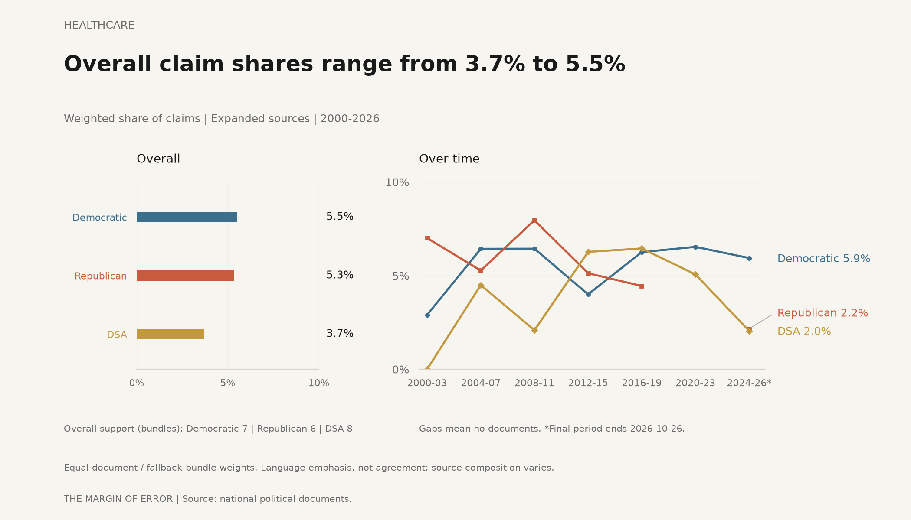
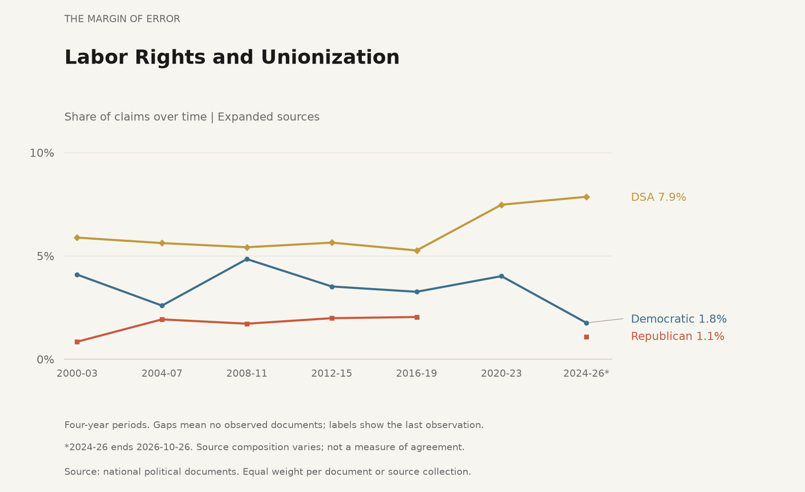
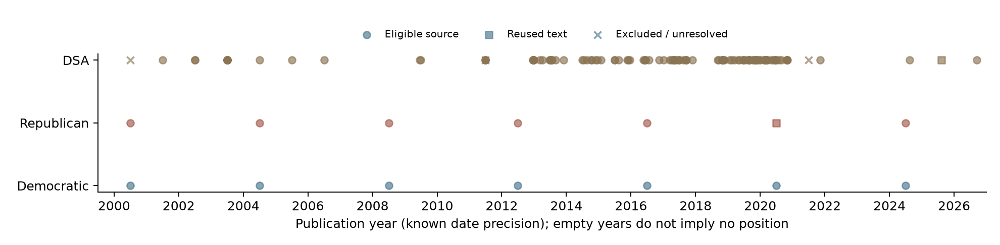

<div align="center">
  <h1>Democratic, Republican, and DSA Platforms</h1>
  <p>National policy documents, structured claims, and political language, 2000–2026.</p>
  <p>
    <a href="#overview">Overview</a> ·
    <a href="#results-and-downloads">Results &amp; data</a> ·
    <a href="#sources-and-coverage">Sources</a> ·
    <a href="#methods">Methods</a> ·
    <a href="#reproduce">Reproduce</a>
  </p>
</div>

---

## Overview

A source-first comparison of **national Democratic Party, Republican Party, and
Democratic Socialists of America documents**, covering January 1, 2000 through
October 26, 2026. Candidate campaigns, state parties, and local DSA chapters are
outside this comparison.

The current work turns source text into discrete, self-contained claims using
**local Gemma plus separately identified, source-bound assistant corrections**,
then uses cached embeddings to discover **24 shared topics**, extract distinctive
keywords, compare overall topic shares and relative emphasis, and track those
topics over time. CAP classification and semantic-density maps remain supporting
analyses rather than the main result.

The temporal analysis also discovers **64 period-specific topics independently
within seven periods**. It separates changing shares of the 24 pooled topics
from changes in the themes discovered within each period, without treating
cluster matching as proof of issue emergence or disappearance.

**Status:** the exploratory full-source comparison analyzes **26,483 eligible
claims from 135 documents**, with strict and expanded topic distributions and
four-year observed-document trends covering **2000–2026**. The figures use named
topics reviewed against their representative claims. All 24 labels are reviewed;
13 have explicitly attributed source-bound assistant revisions, with original
Gemma replies preserved. All 64 period-specific labels are also reviewed, with
34 attributed assistant revisions and unchanged original replies. This bounded
evidence review is not independent human certification.

All 2,623 extraction chunks have effective dispositions:
161 source-bound corrections address reviewed errors and all 27 failed model
chunks, while preserving original model outcomes. No historically flagged
candidate lacks a superseding correction. The 142-block targeted review is not
a representative sample or corpus-wide semantic certification. Earlier pilot
and passage-based results are retained below as historical references.

<p align="center">
  
</p>

*For the piece: labor and unions, with the overall comparison and timeline
together. Shares use equal document/fallback-bundle weights and describe
language emphasis, not policy agreement.*

The article figure set covers **labor, taxes, public education, reproductive
rights and gender-affirming care, healthcare, and Israel-Palestine**. These are
selected illustrations, not a ranking of the strongest contrasts. Each graphic
has a data-derived headline, paired overall/time panels on the same percentage
scale, compact titles, and direct group labels. Missing periods stay gaps.
The supporting charts show 21 subjects from the 24 fitted clusters. The Democratic,
Republican and DSA party-identity clusters are omitted from charts and substantive
rankings, but their claims remain in all denominators and the full assignments and
review records remain downloadable. Remaining shares are not renormalized.

Overall comparisons now use aligned organization columns with printed shares;
relative-emphasis figures show unsmoothed percentage-point gaps rather than heatmaps.
The [detailed density comparisons](report/national_claim_analysis.md#detailed-density-comparisons)
pair larger individual maps with numbered, source-linked claim examples and exact
representative density contrasts—not vague floating keyword labels.

**Wider clustering and positions:** four large, source-linked atlases cover all
21 substantive subjects: [all three groups](figures/national_claims/full/topics/positions/all_groups.png),
[Democratic–Republican](figures/national_claims/full/topics/positions/democratic_vs_republican.png),
[Democratic–DSA](figures/national_claims/full/topics/positions/democratic_vs_dsa.png), and
[Republican–DSA](figures/national_claims/full/topics/positions/republican_vs_dsa.png).
Each combines a numbered semantic map with individualized summaries and weighted
topic shares; pairwise versions also state the documented policy distinctions.
The [full evidence review](report/national_claim_analysis.md#group-positions-on-the-shared-clustering)
binds 63 group summaries and 63 pairwise distinctions to 2,952 bundle-diverse sampled
claims. These describe observed documents across years, not an exhaustive or current
consensus. Pair-map colors show topic-share gaps, not ideological distance.

## Results and downloads

| Current result | Scope | Outputs |
|---|---|---|
| Full claim-based comparison | 26,483 eligible claims from 135 documents; Democratic, Republican, and DSA | [Actual analyzed claims (CSV)](data/analysis/national_claims/full/analysis_claims.csv) · [Full report](report/national_claim_analysis.md) |
| Overall learned-topic distributions | 24 fitted clusters, 21 displayed subjects; strict and expanded views; unchanged equal document/fallback-bundle denominators | [Topic distributions and evidence](report/national_claim_analysis.md#learned-topic-distributions-and-relative-emphasis) · [All shares](data/analysis/national_claims/full/topics/shares.csv) |
| Relative topic emphasis | Each group versus equally weighted other groups, plus pairwise comparisons; all support warnings retained | [Ranked contrasts](data/analysis/national_claims/full/topics/contrasts.csv) |
| Topics over time | Seven four-year periods from 2000 through the partial 2024–2026 period; fixed taxonomy and explicit evidence gaps | [Time charts](report/national_claim_analysis.md#topics-over-time) · [Period shares](data/analysis/national_claims/full/topics/temporal_shares.csv) · [Coverage](data/analysis/national_claims/full/topics/temporal_coverage.csv) |
| Independently discovered period themes | 64 period-qualified topics; each fit uses only its own period's evidence | [Period-by-period analysis](report/national_claim_analysis.md#independently-discovered-topics-within-each-period) · [Period shares](data/analysis/national_claims/full/topics/evolution/shares.csv) · [Fit diagnostics](data/analysis/national_claims/full/topics/evolution/period_fits.json) · [Source examples](data/analysis/national_claims/full/topics/evolution/representatives.csv) |
| Figures for the piece | Six selected policy subjects; overall and time comparison in one graphic; strict and expanded | [Expanded article figures](figures/national_claims/full/topics/expanded/piece/) · [Strict article figures](figures/national_claims/full/topics/strict/piece/) · [Website versions](figures/national_claims/full/themarginoferror/topics/expanded/piece/) |
| Individual issue comparisons | One overall chart and one timeline per topic, comparing all three groups; strict and expanded views | [Expanded issue charts](figures/national_claims/full/topics/expanded/issues/) · [Strict issue charts](figures/national_claims/full/topics/strict/issues/) |
| Publication-ready figures | Restrained house style and individual cards; PNG-only, without internal workflow annotations or text metadata | [Substack versions](figures/national_claims/full/) · [The Margin of Error versions](figures/national_claims/full/themarginoferror/) |

**One complete download:** [Report, all figures, result tables, claims, complete
sources, raw replies, history and corrections](https://github.com/hanshanley/dsa/releases/download/claim-beside-bar-summaries-2026-10-31/claim_documents.zip).
Unzip it and open `report.md`: its figure and result-table links point to the
included files. PNG figures include both the new topic/time analyses and
the supporting CAP/KDE results. Default figures use Substack's warm-paper
background; `figures/themarginoferror/` contains the matching website versions.
Both versions are included in the same complete download.
The complete ZIP is hosted as a GitHub release asset; no claims or source evidence
have been removed. Superseded SVG copies are excluded from the PNG-only publication.
Its [checksum and size](data/analysis/national_claims/full/claim_documents.download.json)
are tracked. The publication exporter rebuilds the identical ZIP offline from
the committed evidence, figures and report when the local archive is absent.

### Inspect the actual claims

**Start here: [all 26,483 claims used in the analysis (CSV)](data/analysis/national_claims/full/analysis_claims.csv).**
The `claim_text` and `text` columns contain the actual claim wording. Each row also
includes the organization, document title and dates, source URL, quoted evidence,
source offsets, quality flags, and model/correction provenance.

For the complete extraction record, including excluded, superseded, or duplicate
candidates, open [all 27,720 preserved claim records (CSV)](data/analysis/national_claims/full/claims.csv)
or [the same records as JSONL](data/analysis/national_claims/full/claims.jsonl).
The `analysis_eligible`, `duplicate_of`, and repair fields distinguish records
used in the results from retained history. These are large files; download them
and open them in a spreadsheet or editor if the repository preview is unavailable.

[Complete source texts](data/analysis/national_claims/full/complete_sources.csv)
and [representative claims for each learned topic](data/analysis/national_claims/full/topics/representatives.csv)
provide the original context and a smaller starting point for reading.

### Overall learned-topic distributions

The claim embeddings now support a shared, corpus-wide topic taxonomy, not just
selected regions of a density map. The expanded and adopted-platforms-only views
use the **same topic assignments** and equal document/fallback-bundle weights.
Distinctive keywords, representative claims, and
[reviewed labels with exact provenance](data/analysis/national_claims/full/topics/label_review.json)
are downloadable. Original local-Gemma responses remain unchanged; source-bound
assistant revisions correct misleading labels and are identified explicitly.

For a concrete expanded-view comparison, the learned **labor rights and
unionization** topic accounts for **6.50% of DSA**, **3.44% of Democratic** and
**1.60% of Republican** weighted claims. The **Israeli-Palestinian conflict**
topic accounts for **5.78%, 1.08% and 1.16%**, respectively; **public education**
accounts for **2.41%, 5.37% and 4.97%**. These are pooled 2000–2026 language
shares, not annual estimates or support for the same policies. The linked shares
and representative evidence show the denominators and underlying wording.



Individual issue charts show **absolute weighted shares**. Separately, positive
log2 ratios in the contrast tables mean a larger share than the equally weighted other
organizations; +1 is approximately twice the share away from the disclosed
smoothing floor. These are **relative language emphases**, not agreement or
ideological distance. All contrasts remain ranked, including rare or
single-bundle topics, with explicit support and sensitivity warnings.
Some learned clusters concern political narratives or organizing, not a single
policy subject; their representative claims retain that distinction.
The selected 24-topic partition has low separation (cosine silhouette 0.058)
and moderate balanced-refit agreement (adjusted Rand 0.606–0.628); it is an
exploratory organizational aid, not a definitive policy taxonomy.

See the [full report, both views and source-linked topic evidence](report/national_claim_analysis.md#learned-topic-distributions-and-relative-emphasis),
[all weighted shares](data/analysis/national_claims/full/topics/shares.csv),
[ranked contrasts and warnings](data/analysis/national_claims/full/topics/contrasts.csv),
and [representative claims with exact source evidence](data/analysis/national_claims/full/topics/representatives.csv).
The complete claim/source ZIP includes these topic artifacts and every figure.
The [methods](docs/national_claim_analysis.md#learned-topics-and-relative-emphasis)
explain discovery, local labeling, and reproducibility.

**Over time:** the report also tracks the same topics in four-year
adoption/publication periods, with strict and expanded views, document/bundle
support, and missing periods left as gaps. Temporal relative-emphasis tables use
fixed comparison groups, not a silently changing baseline.

For example, on the **fixed pooled taxonomy**, DSA's labor-and-union share is
**5.26% in 2016–2019, 7.47% in 2020–2023 and 7.86% in 2024–2026**; Democratic
shares are **3.26%, 4.02% and 1.76%**. Each Democratic period has one document;
DSA has one, two and two weighting bundles, respectively. These are observed
language-share changes with changing source composition, not annual population
estimates. The last period is partial and Republican 2020–2023 remains missing.

**Period-specific discovery:** separate PCA/clustering and keyword extraction
within each period allow themes and cluster counts to differ, rather than
assuming the pooled taxonomy captures every period equally well. The report
analyzes each period's observed shares, source support and representative
claims. Adjacent-period embedding similarities are only candidate thematic
links—not evidence of topics being born, dying, splitting or merging.
The 2004–2007 and 2008–2011 density fits each retain only two substantive
clusters and leave about 44% of claims unclustered; those limitations and
unclustered shares remain visible. Missing Republican documents in 2020–2023
are not replaced with the reused 2016 platform.



### Broad CAP reference topics

Selected [expanded-view CAP topic shares](data/analysis/national_claims/full/topic_emphasis.csv),
using equal document/fallback-bundle weights:

| Topic | Democratic | Republican | DSA |
|---|---:|---:|---:|
| Social welfare | 7.9% | 6.4% | 11.3% |
| Labor and employment | 3.0% | 1.3% | 7.5% |
| Defense and veterans | 6.9% | 8.4% | 4.1% |
| International affairs | 9.1% | 7.9% | 6.9% |

These are exploratory machine-classified language shares, not agreement measures
or manually validated policy codes. Unclassified claims remain in the denominator;
period and source-type composition differ between organizations.

Downloads contain actual text, not metadata alone. The source archive preserves
**478 complete-text records and 85 deduplicated original PDFs**, including
supplementary and excluded evidence; these are not 478 independent modeled documents.
The full claim job covers **135 eligible documents in 2,623 chunks**, with a hard
maximum of **240 source words per chunk**. The [extraction summary](data/analysis/national_claims/full/extraction_summary.json),
[chunk dispositions](data/analysis/national_claims/full/block_status.csv), and
[targeted review log](data/analysis/national_claims/full/semantic_review.csv)
retain original model failures and identified exclusions.
The [source-bound corrections](data/analysis/national_claims/full/source_repairs/)
preserve their exact basis and replacement selections; all superseded candidates
remain in the download.
The [reproducibility audit](data/analysis/national_claims/reproducibility_audit.json)
records the successful second offline run, archive checks, and input/output hashes.
The separate [topic-stage replay audit](data/analysis/national_claims/full/topics/replay_audit.json)
verifies the current topic/time tables, named PNG figures, and every combined
archive member without new model inference.

For individual tables, see the [full claim corpus](data/analysis/national_claims/full/)
and [current topic and temporal results](data/analysis/national_claims/full/topics/).

### Earlier analyses (historical references)

These are not the current full-source results:

- **Archived 199-claim pilot:** 25 documents, not representative and not the current dataset.
  [Pilot report](report/national_claim_analysis_sample.md) ·
  [Pilot claims and complete source texts](data/analysis/national_claims/reviewed_sample/claim_documents.zip).
- **Passage-based baseline:** separate analytical input, before the claim-based comparison.
  [Baseline report](report/national_platform_analysis.md) ·
  [Complete source archive](data/analysis/national_platforms/source_documents.zip).

**Libertarian expansion is deferred and low priority.** Its partial extraction is
preserved for later resumption; it is not included in the results above. See the
[four-party scope notes](docs/national_four_party_analysis.md).

## Sources and coverage

| Organization | Expanded-view documents | Adopted platforms/programs in strict view |
|---|---:|---:|
| Democratic Party | 7 | 7 |
| Republican Party | 6 | 6 |
| DSA | 122 | 3 |

The expanded view includes explicitly labeled DSA national resolutions and
statements where comprehensive platforms are unavailable. The strict view retains
adopted platforms/programs only. Democratic and Republican historical texts are
labeled American Presidency Project reproductions, not party-hosted originals.
Republican reuse of the 2016 platform in 2020 adds no independent observation.

<p align="center">
  
</p>

**The full final 2015 DSA strategy remains unrecovered.** Recovered adopted
priorities and the later strategy summary are different documents, not substitutes.
Empty years indicate missing recovered publications, not an absence of positions.
Drafts, proposals, voting results, and later annotations are not automatically
treated as final adopted wording.

The [source ledger](data/manual/national_platform_sources.csv),
[historical search and gap log](data/manual/national_platform_search_disposition.csv),
and [coverage inventory](data/analysis/national_platforms/coverage.csv) retain
dates, provenance, adoption qualifications, and exclusions.

## Methods

Gemma receives bounded source chunks and limited reference-only context, never an
entire long document. Claims should preserve actors, mechanisms, modality, time,
conditions, and reported-speaker attribution. Raw replies, original model wording,
source hashes, and exact evidence offsets remain downloadable. Same-model revision,
structural checks, and targeted assistant review are **not semantic certification or fact-checking**;
identified fidelity problems and within-document duplicates are excluded explicitly.
Targeted source repairs supply 1,041 replacement claims and supersede 1,078 original
candidates without changing raw replies. The eligible input contains 25,442
model-origin and 1,041 assistant-origin claims, with explicit provenance rather
than treating corrections as Gemma output. Thirteen zero-claim corrections
dispose of non-policy or context-only inventions. Unidentified semantic errors
may remain in the analytical input.

Claim text feeds the pinned GTE encoder and MiniLM/CAP topic classifier. Both
tokenizers enforce their limits without silent truncation. UMAP/KDE sampling
balances organizations, and each document or predefined DSA fallback-period bundle
receives equal aggregate weight. Expanded and strict KDE views fit separately;
their KDE coordinates are not directly comparable. Learned-topic shares instead
use one shared expanded-corpus taxonomy. Pooled results mix periods and genres.

See [claim extraction and local analysis](docs/national_claim_analysis.md) for
model revisions, chunking, cache/retry behavior, review limitations, and commands.
The [baseline report](report/national_platform_analysis.md#methods-and-reproduction)
documents the separate passage-based method and its
[offline reproducibility audit](data/analysis/national_platforms/reproducibility_audit.json).

## Reproduce

Use Python 3.12 or later and `uv`, from the repository root:

```bash
uv sync --frozen

# Reproduce the full eligible-claim comparison.
# Explicitly allow downloading its pinned models on the first run.
uv run python -m dsa_analysis.national_claim_analysis --download-model

# Reproduce the completed selected-sample claim analysis.
uv run python -m dsa_analysis.national_claim_analysis --reviewed-sample --download-model

# Reproduce the separate passage-based baseline.
uv run dsa-analysis national-platform-analysis --download-model
```

Omit `--download-model` once the models are cached. Full extraction uses a separate
local MLX environment; follow the [Gemma instructions](docs/national_claim_analysis.md#run-locally).
Full claim analysis refuses unfinished extraction. Source fetching is explicit and
is not part of the default offline analysis.

```bash
uv run python -m unittest tests.test_national_claim_corpus tests.test_national_claim_analysis -q
```

## Repository guide

| Location | Contents |
|---|---|
| [`src/dsa_analysis/`](src/dsa_analysis/) | Extraction, corpus preparation, analysis, and command-line code |
| [`data/manual/`](data/manual/) | Curated source ledgers and research qualifications |
| [`data/analysis/`](data/analysis/) | Complete-text exports, claims, provenance, and analytical tables |
| [`report/`](report/) · [`figures/`](figures/) | Reports and charts, separated by analysis |
| [`docs/`](docs/) · [`tests/`](tests/) | Methods, reproduction guides, and regression tests |
| [`files/research_archive/`](files/research_archive/) | Preserved legacy candidate-research captures and working artifacts |

The earlier [candidate and Democratic-primary study](docs/candidate_analysis.md)
is preserved separately and must not be conflated with the national comparison.
Original authors and publishers retain their rights. GitHub hosts the research
artifacts; **website publication remains on hold**.
