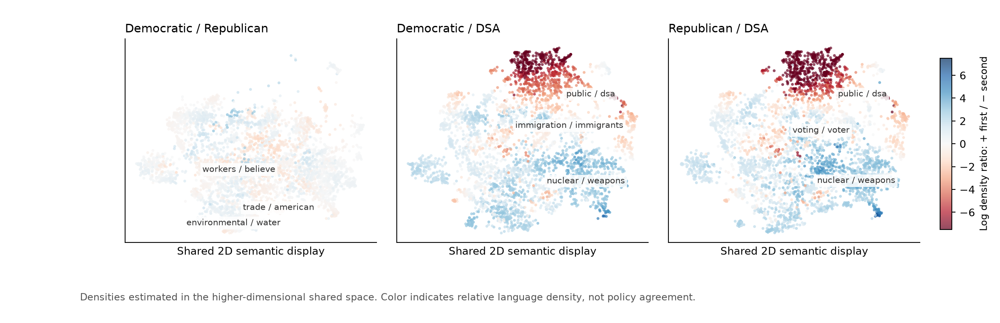

<div align="center">
  <h1>Democratic, Republican, and DSA Platforms</h1>
  <p>National policy documents and political language, 2000–2026.</p>
  <p>
    <a href="#national-platforms-since-2000">Overview</a> ·
    <a href="#explore-the-evidence">Evidence</a> ·
    <a href="#sources-and-coverage">Sources</a> ·
    <a href="#methods">Methods</a> ·
    <a href="#setup">Setup</a>
  </p>
</div>

---

## National platforms since 2000

A source-first comparison of **national Democratic Party, Republican Party, and
Democratic Socialists of America documents**, covering January 1, 2000 through
October 26, 2026. The study compares policy language and emphasis, with reviewed
examples distinguishing shared subjects from different policy proposals.
Candidate campaigns, state parties, and local DSA chapters are outside this study.

<p align="center">
  
</p>

The panels compare recoverable language in a shared semantic representation.
They are not a left–right scale, agreement scores, or a continuous history of
organizational positions. Periods and document types are pooled.

## Explore the evidence

**Analysis:** [National platform report](report/national_platform_analysis.md),
including source-backed healthcare, energy, and immigration examples;
[document chronology](data/analysis/national_platforms/expanded/document_chronology.csv)
and [language-change figure](figures/national_platforms/document_change.png).

**Full documents:** [Download the source bundle](data/analysis/national_platforms/source_documents.zip)
with **478 complete-text records, 85 deduplicated original PDFs**, separately
scoped model texts, and a hash/provenance manifest. The
[complete-source table](data/analysis/national_platforms/complete_sources.csv)
and [passage corpus](data/analysis/national_platforms/passages.csv) contain actual
text, not metadata alone. Archive records also include excluded and supplementary
evidence; they are not 478 independent modeled documents.

**Coverage and checks:** [Source ledger](data/manual/national_platform_sources.csv),
[period-specific search and gap log](data/manual/national_platform_search_disposition.csv),
[coverage inventory](data/analysis/national_platforms/coverage.csv), and
[reproducibility audit](data/analysis/national_platforms/reproducibility_audit.json).
Separate [expanded](data/analysis/national_platforms/expanded/) and
[platforms/programs-only](data/analysis/national_platforms/strict/) tables retain
the sensitivity comparison.

## Sources and coverage

| Organization | Expanded-view documents | Model passages |
|---|---:|---:|
| Democratic Party | 7 | 2,333 |
| Republican Party | 6 | 2,376 |
| DSA | 122 | 1,539 |

Democratic and Republican historical texts are labeled American Presidency
Project reproductions, not party-hosted originals. The 2020 Republican platform
reuses the 2016 text without adding a duplicate observation.

The expanded DSA corpus combines adopted platforms/programs with explicitly
labeled national resolutions and statements. The strict comparison retains
**three DSA platforms/programs and 309 passages**, alongside the same Democratic
and Republican documents. Historical fallback evidence is not presented as
recovered comprehensive platforms.

<p align="center">
  
</p>

Historical recovery includes DSA priorities and resolutions from 2001 onward,
the adopted 2021 platform, and supplementary convention documents from 2015,
2017, and 2019. All 61 documents linked from the 2019 final results are preserved.
The [historical inventories](data/analysis/national_platforms/) retain full texts,
adoption qualifications, superseded summaries, and exclusions.

**The full final 2015 DSA strategy remains unrecovered.** Its recovered adopted
priorities are a different document; the 2016 strategy publication explicitly
identifies itself as a summary. Proposals, voting results, and later annotations
are not automatically final adopted wording. Empty years mean missing recovered
publications, not an absence of organizational positions.

## Methods

Quality-screened passages are embedded with a pinned multilingual GTE model.
Document-stratified, equal-sized organization samples fit a shared UMAP
representation, followed by pairwise kernel-density comparisons. DSA fallback
statements are grouped into predefined period bundles so numerous short texts
cannot mechanically outweigh a platform.

Each document or period bundle receives equal aggregate density weight within
its organization. The two-dimensional map is for display; density estimation uses
the selected higher-dimensional representation. Expanded and strict views fit
separately, so their coordinates and numerical density scales are not directly
comparable. Shared wording is not proof of shared policy.

See the [report's methods](report/national_platform_analysis.md#methods-and-reproduction)
for model revision, segmentation, sampling, bandwidth, and exploratory-region checks.
Source URLs, hashes, dates, and paragraph/page locators remain traceable.

An isolated [local Gemma claim-extraction pilot](docs/national_claim_pilot.md)
completed 60 source blocks on a Mac. Local inference works, but source-fidelity
issues prevent unattended rollout. Its source-linked candidates and complete audit
bundle do not replace these passage-based results or fit a new KDE.

## Setup

Use Python 3.12 or later and `uv`. From the repository root:

```bash
uv sync --frozen

# First run: explicitly permit downloading the pinned embedding model.
uv run dsa-analysis national-platform-analysis --download-model

# Subsequent runs: use local model/cache and preserved source-text exports.
uv run dsa-analysis national-platform-analysis
```

The default analysis does not fetch sources or run the candidate pipeline.
It can use the checked-in, hash-verified complete-text exports when raw captures
are absent. Source collection is explicit:

```bash
uv run dsa-analysis national-platform-analysis --fetch-only
# Collect sources and analyze in one run:
uv run dsa-analysis national-platform-analysis --fetch
```

The focused regression suite is:

```bash
uv run python -m unittest tests.test_national_platforms tests.test_national_platform_kde tests.test_official_platform_kde tests.test_organizational_context_corpus -q
```

## Earlier research

The [candidate and Democratic-primary study](docs/candidate_analysis.md) is
preserved separately, including its campaign comparisons, questionnaires,
state/local platform analysis, methods, and reproduction commands. Its coverage
and results must not be conflated with the national three-party corpus.

## Data integrity and publication

Complete source texts and scoped model inputs remain separate. Drafts,
uncertain versions, duplicates, and supplementary proposals are screened rather
than silently promoted into adopted policy. Original authors and publishers
retain their rights.

The recorded offline audit verifies source and text hashes, cache reuse, and
byte-identical tables, PNG figures, and document archive with source fetching,
extraction, and network connections disabled. GitHub hosts the research
artifacts; publication to The Margin of Error remains on hold.
