# DSA caucuses: programs, strategy and attention

**1,357 eligible normalized claims; 13 flagship statements.** Snapshot collected November 1, 2026.

This compares documented political language, not membership, influence or agreement. Guides are discovery-only; local drafts and regional coalitions remain separate supplements.

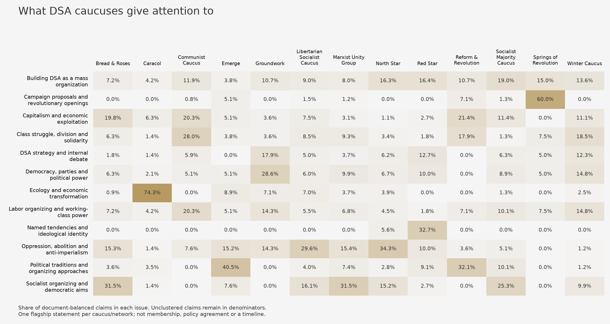

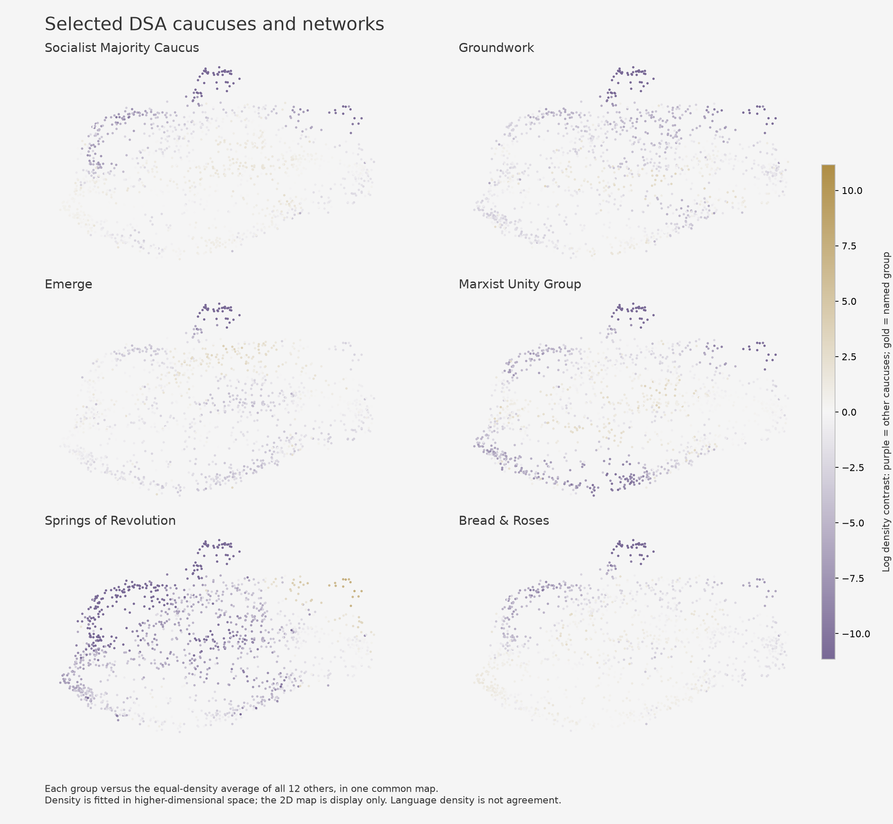

## Largest attention share in each subject

These are shares of extracted claims, not measures of support or caucus size. The baseline gives each of the other twelve groups equal weight. Small claim counts and different statement styles can produce large contrasts.

| Subject | Highest-share caucus/network | Attention share | Other groups, averaged | Ratio |
|---|---|---:|---:|---:|
| Building DSA as a mass organization | Socialist Majority Caucus | 19.0% | 10.6% | 1.80× |
| Campaign proposals and revolutionary openings | Springs of Revolution | 60.0% | 1.4% | 42.20× |
| Capitalism and economic exploitation | Reform & Revolution | 21.4% | 7.7% | 2.79× |
| Class struggle, division and solidarity | Communist Caucus | 28.0% | 6.9% | 4.03× |
| DSA strategy and internal debate | Groundwork | 17.9% | 5.0% | 3.55× |
| Democracy, parties and political power | Groundwork | 28.6% | 6.7% | 4.29× |
| Ecology and economic transformation | Caracol | 74.3% | 2.9% | 25.25× |
| Labor organizing and working-class power | Communist Caucus | 20.3% | 7.4% | 2.74× |
| Named tendencies and ideological identity | Red Star | 32.7% | 0.5% | 69.91× |
| Oppression, abolition and anti-imperialism | North Star | 34.3% | 9.9% | 3.46× |
| Political traditions and organizing approaches | Emerge | 40.5% | 6.2% | 6.58× |
| Socialist organizing and democratic aims | Bread & Roses | 31.5% | 9.1% | 3.45× |

## Source-backed subjects

### Building DSA as a mass organization

The sources debate DSA's role in building a larger socialist organization. Groundwork emphasizes its potential to become a mass party; Winter emphasizes a coordinated workers' movement; Bread & Roses describes a pre-party role. A shared focus on DSA should not be read as agreement about its destination.

Primary-source examples by caucus

- **Bread & Roses:** Until class struggle and unity can support a mass working-class party, Bread and Roses sees DSA as a pre-party organization, one of many groups developing the forces necessary to build that party. ([source](https://breadandrosesdsa.org/where-we-stand/); `bread-roses-stand-normalized-f0cfe3a3bb4b-repair-1506b9e47451-002`).
- **Caracol:** Commitment to endorsing, supporting, and seeking out candidates and proposals for DSA elections that understand and are aligned with degrowth ecosocialist principles. ([source](https://caracoldsa.org/points-of-unity/); `caracol-unity-normalized-24a76a56c71e-006`).
- **Communist Caucus:** The DSA has a great potential for promoting and unifying working class struggles. ([source](https://communistcaucus.com/our-statement/); `communist-statement-normalized-b6880bc8bc15-002`).
- **Emerge:** Given its strategic position between movements, labor, and the state, DSA should be a connective tissue of the left ecosystem and a strong collaborator and leader. ([source](https://dsaemerge.org/points-of-unity/); `emerge-unity-normalized-ca50c7db133d-007`).
- **Groundwork:** Democratic Socialists of America's public reach, formal political power, and ability to turn ordinary people into organizers now give it the unique potential to build the mass party. ([source](https://www.groundworkdsa.com/); `groundwork-unity-normalized-65b25d66946b-006`).
- **Libertarian Socialist Caucus:** DSA is an organization opposed to imperialism and genocide. ([source](https://dsa-lsc.org/lsc-pou/); `lsc-unity-normalized-1e93d88b8f90-repair-06bc3b7f1dda-010`).
- **Marxist Unity Group:** Marxist Unity Group will work to increase Democratic Socialists of America acting as a nationwide organization. ([source](https://www.marxistunity.com/); `mug-unity-normalized-59695f27499b-001`).
- **North Star:** Some DSA members bring a democratic socialist perspective to other community organizations. ([source](https://www.dsanorthstar.org/principles.html); `northstar-principles-normalized-9d420ba17dc5-005`).
- **Red Star:** DSA can support a Revolutionary movement. ([source](https://redstarcaucus.org/points-of-unity/); `redstar-unity-normalized-c58067952af9-009`).
- **Reform & Revolution:** DSA is being built into a force capable of carrying out a socialist transformation of society. ([source](https://reformandrevolution.org/points-of-unity/); `reform-revolution-unity-normalized-43b09f96fc58-002`).
- **Socialist Majority Caucus:** Today, DSA must sow the seeds of a democratic socialist future by building relationships with a variety of leftist parties and mass organizations around the world. ([source](https://www.socialistmajority.com/pointsofunity); `smc-unity-normalized-eac0b70157d6-009`).
- **Springs of Revolution:** The Building a United Front Toward 2028 resolution proposes that DSA explore building a broad Left-Labor electoral coalition capable of organizing the foundation of independence from the duopoly. ([source](https://sordsa.org/platform/); `sor-platform-normalized-fa2d5bd72ccd-repair-a04d7ce9cc1d-002`).
- **Winter Caucus:** The DSA must take a leading role in building up a highly-coordinated and independent workers’ movement that can lay the groundwork for a mass socialist party, one that is capable of unifying forces and linking single-issue campaigns for higher pay, better housing, and universal healthcare to the overall goal of advancing socialism. ([source](https://wintercaucus.org/); `winter-principles-normalized-b5b6635b69cb-001`).

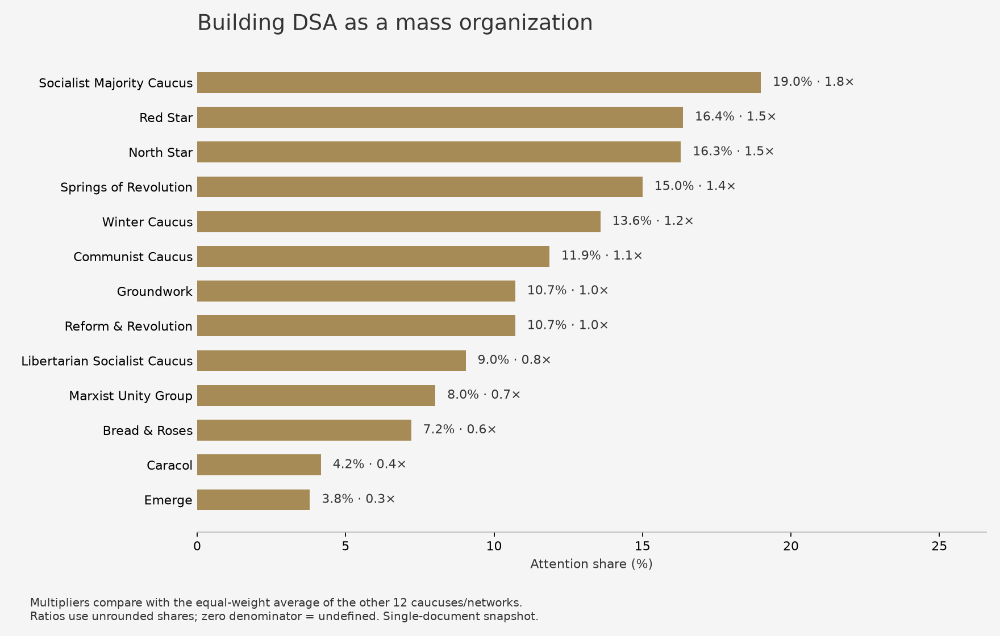

[All caucus-pair ratios](../../figures/substack/caucuses/topic-005-all-ratios.png)

### Campaign proposals and revolutionary openings

Springs of Revolution's proposals on repression and movement resilience appear alongside other revolutionary organizing strategies, including Reform & Revolution's simultaneous mass and revolutionary-core work. Proposal language and the word 'revolution' partly drive this heterogeneous cluster. It is not a single adopted policy or a distinct ideological camp.

Primary-source examples by caucus

- **Communist Caucus:** Reforms can be helpful for revolutionary organizing. ([source](https://communistcaucus.com/our-statement/); `communist-statement-normalized-9c246c38b35b-008`).
- **Emerge:** Antifascist organizing is fundamental to building bonds in ongoing collective struggle and keeping attuned to possibilities for revolutionary breaks. ([source](https://dsaemerge.org/points-of-unity/); `emerge-unity-normalized-ad2a6c3d40d9-003`).
- **Libertarian Socialist Caucus:** Support for movements to gain counterpower and autonomy within the imperial system to the extent that those movements embody a liberatory vision. ([source](https://dsa-lsc.org/lsc-pou/); `lsc-unity-normalized-35b53ef3803a-007`).
- **Marxist Unity Group:** Demand a New Republic and finish Reconstruction. ([source](https://www.marxistunity.com/); `mug-unity-normalized-017e90c0a13e-011`).
- **Reform & Revolution:** Reform & Revolution aims to address crises of organization, leadership, and consciousness by simultaneously building mass campaigns and broader socialist organizations while developing a revolutionary core within those struggles. ([source](https://reformandrevolution.org/points-of-unity/); `reform-revolution-unity-normalized-43b09f96fc58-repair-ec007c1afb96-001`).
- **Socialist Majority Caucus:** Popular movements against oppression are being built and powerful coalitions are being formed. ([source](https://www.socialistmajority.com/pointsofunity); `smc-unity-normalized-ac7d6af55f92-002`).
- **Springs of Revolution:** Springs of Revolution's R-22 resolution proposes developing strategies to protect the movement and build resilience against state repression. ([source](https://sordsa.org/platform/); `sor-platform-normalized-f5d3038dcc57-repair-d78b40c53be6-010`).

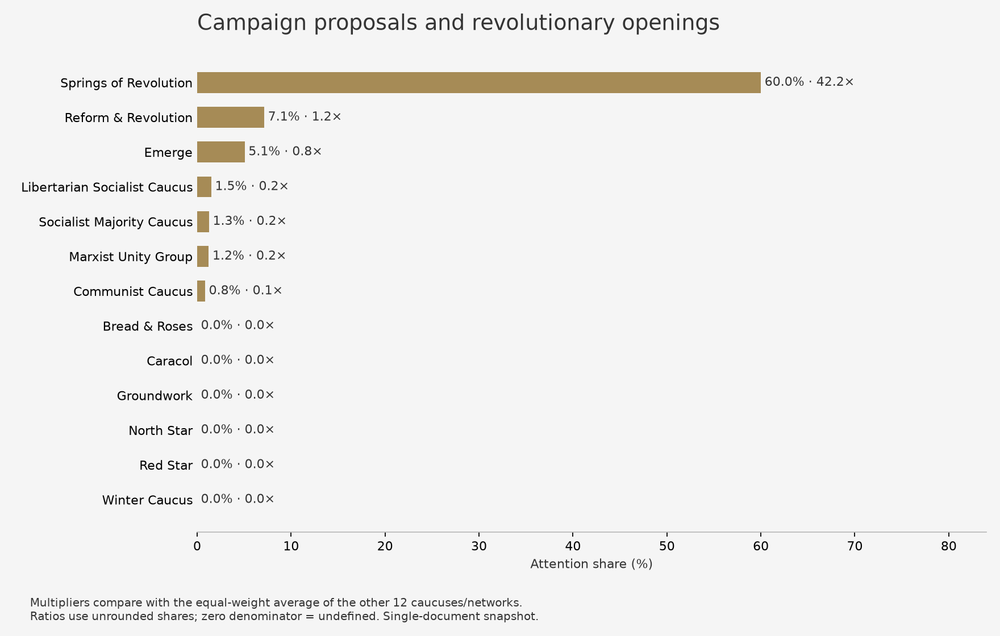

[All caucus-pair ratios](../../figures/substack/caucuses/topic-011-all-ratios.png)

### Capitalism and economic exploitation

The statements describe capitalism through exploitation, class division, and concentrated economic power. Caracol connects accumulation to externalized social and ecological costs; Emerge describes exploitation of the working class. Sharing this vocabulary does not imply agreement on how to replace capitalism.

Primary-source examples by caucus

- **Bread & Roses:** Capitalism pits workers against each other. ([source](https://breadandrosesdsa.org/where-we-stand/); `bread-roses-stand-normalized-94fdaca6d7cf-repair-67e3989fbe5a-012`).
- **Caracol:** The dynamic of exploitation within capitalism—the profit motive—drives endless accumulation of capital wealth by externalizing its social and ecological costs. ([source](https://caracoldsa.org/points-of-unity/); `caracol-unity-normalized-81776b57931e-003`).
- **Communist Caucus:** Capitalism can be overthrown. ([source](https://communistcaucus.com/our-statement/); `communist-statement-normalized-8191326fd5d7-repair-1ac419aeb5a7-011`).
- **Emerge:** The working class is exploited by the capitalist class. ([source](https://dsaemerge.org/points-of-unity/); `emerge-unity-normalized-8c6058dfae96-004`).
- **Groundwork:** Only an unapologetic left can point mass outrage where it belongs: at capitalists. ([source](https://www.groundworkdsa.com/); `groundwork-unity-normalized-ec231206d820-013`).
- **Libertarian Socialist Caucus:** Capitalist systems rely on social domination. ([source](https://dsa-lsc.org/lsc-pou/); `lsc-unity-normalized-77b67a994999-004`).
- **Marxist Unity Group:** The maximum program refers to a world free of the market, borders, classes, and all other oppressive structures that exist under capitalism, which is communism. ([source](https://www.marxistunity.com/); `mug-unity-normalized-59d2666b9b2b-repair-390cb095d5ee-003`).
- **North Star:** Opposition to predatory capitalism in which the capitalist class controls obscene levels of wealth and capital and monopolizes economic decision-making to serve its own private interests. ([source](https://www.dsanorthstar.org/principles.html); `northstar-principles-normalized-54adb32d925d-002`).
- **Red Star:** Crises are continually generated by inept governance that attempts to suppress class conflict and prop up an unsustainable capitalism or hegemony by force. ([source](https://redstarcaucus.org/points-of-unity/); `redstar-unity-normalized-c58067952af9-005`).
- **Reform & Revolution:** Society is divided between the ruling class, who own the means of production, and the working class, who live by the sale of their labor and their bodies. ([source](https://reformandrevolution.org/points-of-unity/); `reform-revolution-unity-normalized-6200d2e67ce6-007`).
- **Socialist Majority Caucus:** Mass socialist politics involves organizing millions of everyday working-class and oppressed people to fight capitalism. ([source](https://www.socialistmajority.com/pointsofunity); `smc-unity-normalized-0fbe43ccb3d2-017`).
- **Winter Caucus:** Capitalism is a system based on exploitation. ([source](https://wintercaucus.org/); `winter-principles-normalized-dd788078316e-001`).

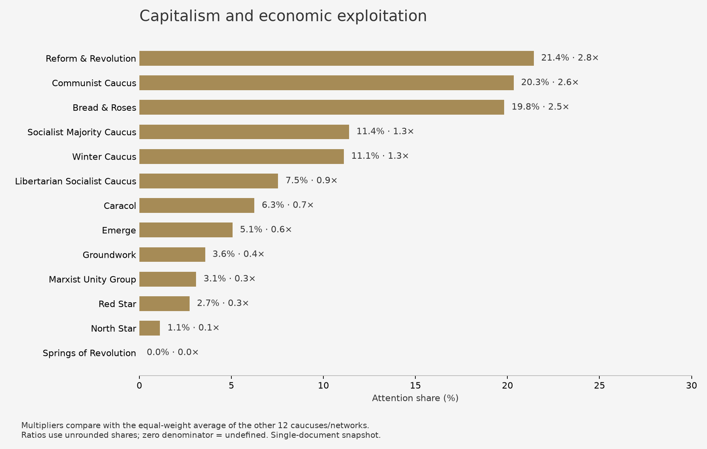

[All caucus-pair ratios](../../figures/substack/caucuses/topic-002-all-ratios.png)

### Class struggle, division and solidarity

Class struggle is a framework for understanding political change and the divisions organizing must confront. Reform & Revolution describes history through class struggle, while Winter says liberation must involve the whole working class. The cluster also contains debate over oppression, constitutional institutions, and the limits of coalitions.

Primary-source examples by caucus

- **Bread & Roses:** Winning socialism will require a protracted struggle against the ruling class in the United States. ([source](https://breadandrosesdsa.org/where-we-stand/); `bread-roses-stand-normalized-e36b27da7765-001`).
- **Caracol:** The current image of modern technology is unsustainable and oppressive to the working class. ([source](https://caracoldsa.org/points-of-unity/); `caracol-unity-normalized-f129988b9983-007`).
- **Communist Caucus:** Opposition to all institutions that block working class power. ([source](https://communistcaucus.com/our-statement/); `communist-statement-normalized-930f6e629469-repair-379a66db9be3-002`).
- **Emerge:** Present society rests on division of the working class through identity-based oppression, upheld by the carceral state. ([source](https://dsaemerge.org/points-of-unity/); `emerge-unity-normalized-099ea339d91b-001`).
- **Groundwork:** Giving up on state power consigns the global working class to ecocidal suffering and death. ([source](https://www.groundworkdsa.com/); `groundwork-unity-normalized-ec231206d820-006`).
- **Libertarian Socialist Caucus:** Agitation for the recognition of a shared struggle with the working classes of the global periphery. ([source](https://dsa-lsc.org/lsc-pou/); `lsc-unity-normalized-35b53ef3803a-010`).
- **Marxist Unity Group:** Marxist Unity asserts there can be no question of submitting to a political order that exists to divide and conquer the working class, that slices up the government and divorces it from the will of the people—that is set in stone and almost impossible to amend. ([source](https://www.marxistunity.com/); `mug-unity-normalized-3889e67bf8e5-002`).
- **North Star:** Neoliberal policies—austerity, privatization, deregulation and corporate-dominated globalization—have led to the devastation of large swaths of the working class. ([source](https://www.dsanorthstar.org/principles.html); `northstar-principles-normalized-fa3def30a3b4-006`).
- **Red Star:** The Class includes all members of the working class and all oppressed peoples. ([source](https://redstarcaucus.org/points-of-unity/); `redstar-unity-normalized-9673a411d2e2-005`).
- **Reform & Revolution:** History is viewed as the unfolding of class struggle. ([source](https://reformandrevolution.org/points-of-unity/); `reform-revolution-unity-normalized-d917483a0e91-004`).
- **Socialist Majority Caucus:** A popular front alone cannot liberate the working class from capitalism. ([source](https://www.socialistmajority.com/pointsofunity); `smc-unity-normalized-c786139dab63-005`).
- **Springs of Revolution:** Movement growth occurs through ruptures that emerge from the anger of the working class. ([source](https://sordsa.org/platform/); `sor-platform-normalized-a03ba66ea9cd-004`).
- **Winter Caucus:** Recognition that struggles for liberation concern – and must be waged by – the entire working class. ([source](https://wintercaucus.org/); `winter-principles-normalized-94acd8b35d22-007`).

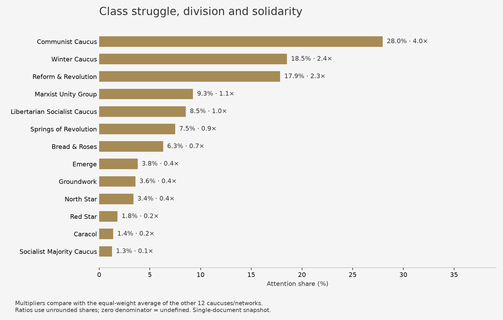

[All caucus-pair ratios](../../figures/substack/caucuses/topic-006-all-ratios.png)

### DSA strategy and internal debate

These claims address how DSA should change its organization and electoral practice. Groundwork emphasizes bottom-up democratic mechanisms; Marxist Unity Group proposes independent legislative caucuses even on a Democratic ballot line; Bread & Roses seeks independence from the Democratic apparatus. Critiques of internal culture and organizational limits also enter this broad theme.

Primary-source examples by caucus

- **Bread & Roses:** An oppositional electoral strategy independent from the Democratic Party apparatus must reject the idea that socialists can capture the Democratic Party and instead seek to break unions and social movements from their dependence on the Democratic Party establishment. ([source](https://breadandrosesdsa.org/where-we-stand/); `bread-roses-stand-normalized-f0cfe3a3bb4b-repair-1506b9e47451-003`).
- **Caracol:** Support for DSA’s Green New Deal Principles and a commitment to expand upon them with their work, as they omit points critical to addressing the climate and broader ecological crisis. ([source](https://caracoldsa.org/points-of-unity/); `caracol-unity-normalized-6800278eeca7-001`).
- **Communist Caucus:** The DSA must be strategic without becoming dogmatic. ([source](https://communistcaucus.com/our-statement/); `communist-statement-normalized-31fa52549faa-005`).
- **Groundwork:** Building the democratic mechanisms whose lack has paralyzed DSA for years can change DSA from patchwork to party. ([source](https://www.groundworkdsa.com/); `groundwork-unity-normalized-e9a0ffb803a8-004`).
- **Libertarian Socialist Caucus:** DSA members should not allow their politics to passively fall by the wayside during their work within unions. ([source](https://dsa-lsc.org/lsc-pou/); `lsc-unity-normalized-720dd14e6b72-002`).
- **Marxist Unity Group:** Even if DSA candidates are elected on a Democratic ballot line, they should form their own legislative caucuses, vote as a bloc, and refuse to join the Democratic Party caucus. ([source](https://www.marxistunity.com/); `mug-unity-normalized-9c51fd022b2f-repair-610bdcd3d7fb-003`).
- **North Star:** Factions in DSA should not put the interest of the caucus above the interest of the movement as a whole. ([source](https://www.dsanorthstar.org/principles.html); `northstar-principles-normalized-ca051df9faac-007`).
- **Red Star:** At present, DSA does not meet standards for a revolutionary party, but it has potential. ([source](https://redstarcaucus.org/points-of-unity/); `redstar-unity-normalized-7014899746ed-001`).
- **Socialist Majority Caucus:** DSA’s greatest weakness is that it sometimes treats its members terribly. ([source](https://www.socialistmajority.com/pointsofunity); `smc-unity-normalized-5977862370f5-006`).
- **Springs of Revolution:** The unified-endorsement amendment proposes abolishing DSA's two-tier endorsement process, which separates local chapter endorsements from the NPC's national endorsement. ([source](https://sordsa.org/platform/); `sor-platform-normalized-86648a8a08d8-repair-680af1e0c78b-006`).
- **Winter Caucus:** In many places, DSA lacks the strength to properly engage in electoral politics. ([source](https://wintercaucus.org/); `winter-principles-normalized-dc2e3722830f-001`).

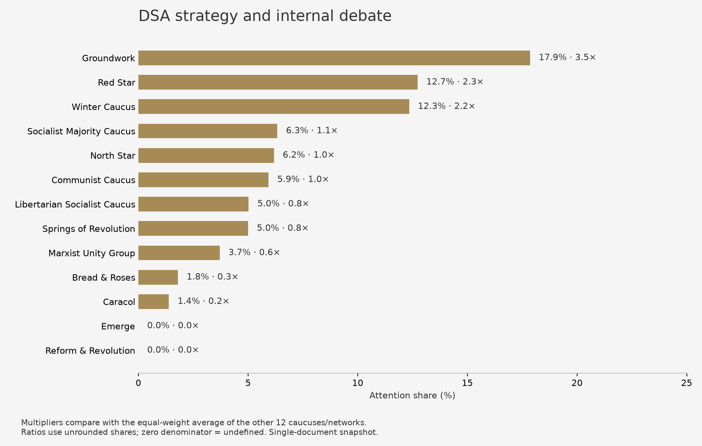

[All caucus-pair ratios](../../figures/substack/caucuses/topic-010-all-ratios.png)

### Democracy, parties and political power

This overlapping theme combines organizational democracy with winning political power. Bread & Roses stresses member deliberation and voting; Socialist Majority discusses governing power and transformational reforms. These are related vocabularies, not interchangeable models of democracy or a consensus on the state.

Primary-source examples by caucus

- **Bread & Roses:** A democratic organization is one in which members have power through collective political deliberation and voting. ([source](https://breadandrosesdsa.org/where-we-stand/); `bread-roses-stand-normalized-ae1db508b4cc-003`).
- **Caracol:** Support for democratic control over technological research, development, manufacturing, and rollout. ([source](https://caracoldsa.org/points-of-unity/); `caracol-unity-normalized-f129988b9983-009`).
- **Communist Caucus:** Organizing as a class improves the ability to force politicians to act. ([source](https://communistcaucus.com/our-statement/); `communist-statement-normalized-aed2cc21eef3-005`).
- **Emerge:** Organizing aims to erode relationships of domination and build collective power. ([source](https://dsaemerge.org/points-of-unity/); `emerge-unity-normalized-8c6058dfae96-011`).
- **Groundwork:** Prioritizing organizing can enable mass participation and recruitment into the party. ([source](https://www.groundworkdsa.com/); `groundwork-unity-normalized-ec231206d820-003`).
- **Libertarian Socialist Caucus:** Advocacy for proportional representation in elected leadership. ([source](https://dsa-lsc.org/lsc-pou/); `lsc-unity-normalized-f688e3588c9e-022`).
- **Marxist Unity Group:** Support for the right of the working class to take power by any means necessary. ([source](https://www.marxistunity.com/); `mug-unity-normalized-017e90c0a13e-004`).
- **North Star:** Belief in the deepening and extension of democracy. ([source](https://www.dsanorthstar.org/principles.html); `northstar-principles-normalized-b7b2cb9ad1ae-005`).
- **Red Star:** The goal is to build a democratic mass organization capable of sustaining and exploiting crises in favor of the organization. ([source](https://redstarcaucus.org/points-of-unity/); `redstar-unity-normalized-9673a411d2e2-001`).
- **Socialist Majority Caucus:** The group can achieve a radical democratization of politics, the economy, and society, in part, through winning governing power and passing transformational reforms for oppressed and working-class people. ([source](https://www.socialistmajority.com/pointsofunity); `smc-unity-normalized-0fbe43ccb3d2-005`).
- **Springs of Revolution:** The unified-endorsement amendment proposes standardizing endorsement criteria across chapters. ([source](https://sordsa.org/platform/); `sor-platform-normalized-86648a8a08d8-repair-680af1e0c78b-008`).
- **Winter Caucus:** The Democratic Party functions as a mechanism by which the ruling class can diffuse any popular energies that could be harnessed for building a truly democratic society. ([source](https://wintercaucus.org/); `winter-principles-normalized-4150ccdd10c9-006`).

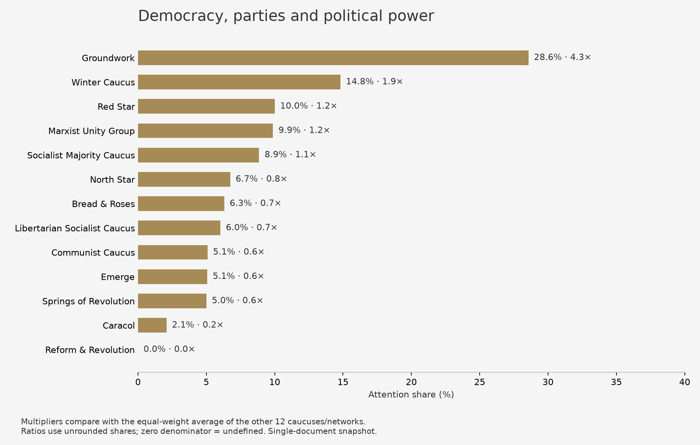

[All caucus-pair ratios](../../figures/substack/caucuses/topic-003-all-ratios.png)

### Ecology and economic transformation

Caracol explicitly links degrowth and ecosocialism; North Star connects economic democracy to environmental responsibility; Emerge calls for a just global transition rather than green growth for the West. The cluster includes broader language about material outcomes and transformation, not environmental claims alone.

Primary-source examples by caucus

- **Bread & Roses:** A need to make decisions about priorities and then commit to carrying them out. ([source](https://breadandrosesdsa.org/where-we-stand/); `bread-roses-stand-normalized-ae1db508b4cc-011`).
- **Caracol:** Securing a livable planet for future generations necessitates integrating degrowth and ecosocialism. ([source](https://caracoldsa.org/points-of-unity/); `caracol-unity-normalized-2408e4f1853a-006`).
- **Emerge:** The Global South is exploited by the Global North. ([source](https://dsaemerge.org/points-of-unity/); `emerge-unity-normalized-8c6058dfae96-005`).
- **Groundwork:** Only the state can operate at the speed and scale to transform the economy from an engine of extinction to a tool of liberation. ([source](https://www.groundworkdsa.com/); `groundwork-unity-normalized-ec231206d820-005`).
- **Libertarian Socialist Caucus:** The Industrial Workers of the World (IWW) stated that one must “build the new world in the shell of the old”. ([source](https://dsa-lsc.org/lsc-pou/); `lsc-unity-normalized-7223fc95d24d-008`).
- **Marxist Unity Group:** Resilient forms of production, distribution and habitation will be established. ([source](https://www.marxistunity.com/); `mug-unity-normalized-f83d18ca4f25-010`).
- **North Star:** Democratizing the economy entails environmental responsibility, with an eye to the global future and not the immediate bottom line. ([source](https://www.dsanorthstar.org/principles.html); `northstar-principles-normalized-f41831d856c8-002`).
- **Socialist Majority Caucus:** Material outcomes include real changes to people's lives. ([source](https://www.socialistmajority.com/pointsofunity); `smc-unity-normalized-0fbe43ccb3d2-013`).
- **Winter Caucus:** The endless pursuit of profit threatens humanity with economic crisis, ecological catastrophe, and war. ([source](https://wintercaucus.org/); `winter-principles-normalized-dd788078316e-004`).

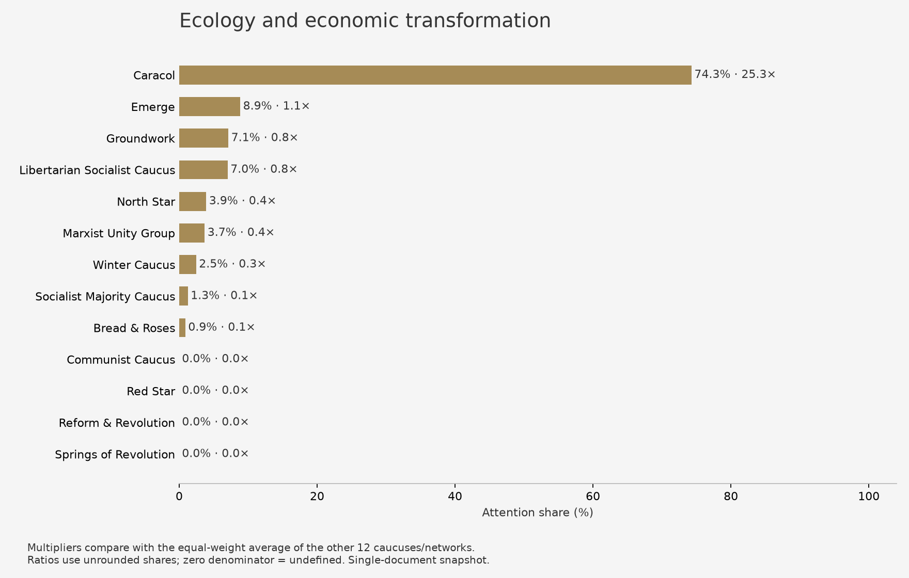

[All caucus-pair ratios](../../figures/substack/caucuses/topic-009-all-ratios.png)

### Labor organizing and working-class power

Union activity and other organizing are presented as foundations of working-class power. Socialist Majority stresses collective action on the shop floor; Marxist Unity Group emphasizes militant, democratic unions; the Communist Caucus discusses labor and tenant organizations. This cluster extends beyond workplace-only policy.

Primary-source examples by caucus

- **Bread & Roses:** To legitimately represent the working class, a mass working-class party that contests elections and builds movements must be born out of a level of class struggle and unity far greater than exists today. ([source](https://breadandrosesdsa.org/where-we-stand/); `bread-roses-stand-normalized-f0cfe3a3bb4b-repair-1506b9e47451-001`).
- **Caracol:** Commitment to developing messaging and campaigns centering or otherwise incorporating degrowth ideas, policies, and approaches for building working-class power. ([source](https://caracoldsa.org/points-of-unity/); `caracol-unity-normalized-24a76a56c71e-007`).
- **Communist Caucus:** Creating and sustaining bases of class power could mean building organizations such as new labor or tenant unions. ([source](https://communistcaucus.com/our-statement/); `communist-statement-normalized-d8da97b9420d-002`).
- **Emerge:** The working class must be actively built and unified through local organizing work, street movements, electoral projects, and coalition building. ([source](https://dsaemerge.org/points-of-unity/); `emerge-unity-normalized-ca50c7db133d-006`).
- **Groundwork:** Prioritizing organizing can unite divided sections of the working class. ([source](https://www.groundworkdsa.com/); `groundwork-unity-normalized-ec231206d820-002`).
- **Libertarian Socialist Caucus:** Support for direct and concerted action that coordinates work both inside and outside the labor movement as a means of developing broader solidarity and power. ([source](https://dsa-lsc.org/lsc-pou/); `lsc-unity-normalized-bef6839ef1ae-009`).
- **Marxist Unity Group:** Within the labor movement, the Marxist Unity Group would fight the existing labor bureaucracy, build militant and democratic unions, and strive to win these unions to socialist politics. ([source](https://www.marxistunity.com/); `mug-unity-normalized-7ec0e28ba926-008`).
- **North Star:** To build the working-class solidarity necessary for victory, the voices of those who are under attack need to be uplifted and centered. ([source](https://www.dsanorthstar.org/principles.html); `northstar-principles-normalized-e0542e35f60c-006`).
- **Red Star:** A party cannot be formed from the ideological commitment of a few alone; it needs the unity of those who lead in each sphere of struggle working alongside one another to cohere a vanguard to protect the class. ([source](https://redstarcaucus.org/points-of-unity/); `redstar-unity-normalized-0c85f370e6db-007`).
- **Reform & Revolution:** To resist this tendency, the working class organizes into unions and political parties to fight for its immediate interests, including better wages and working conditions. ([source](https://reformandrevolution.org/points-of-unity/); `reform-revolution-unity-normalized-6200d2e67ce6-010`).
- **Socialist Majority Caucus:** Workers can overcome divisions, develop class consciousness, and build supermajorities that win material gains through collective action on the shop floor. ([source](https://www.socialistmajority.com/pointsofunity); `smc-unity-normalized-c96bc3c8db08-001`).
- **Springs of Revolution:** Movement growth occurs through deep, intentional organizing that identifies, agitates, and escalates on key working class issues. ([source](https://sordsa.org/platform/); `sor-platform-normalized-a03ba66ea9cd-005`).
- **Winter Caucus:** Building a full-fledged political organization encompassing more than elections will provide coherence and direction to workers' struggles, causing them to take on a class, rather than merely sectional, character. ([source](https://wintercaucus.org/); `winter-principles-normalized-49b0068e0ed3-002`).

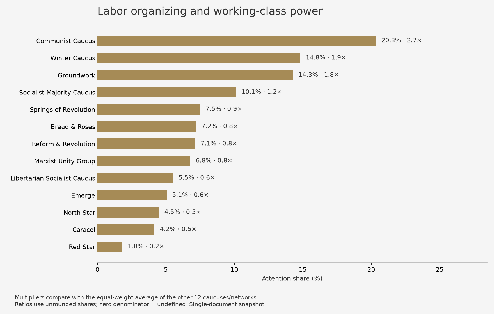

[All caucus-pair ratios](../../figures/substack/caucuses/topic-004-all-ratios.png)

### Named tendencies and ideological identity

This small identity-heavy cluster centers on Red Star's self-description and North Star's own principles. Red Star describes itself as Marxist-Leninist, while North Star affirms democratization and opposition to oppression. Shared source-name wording contributes to the grouping; it is not evidence that these tendencies agree or share a separate substantive policy.

Primary-source examples by caucus

- **North Star:** North Star is opposed to militarism and imperialism. ([source](https://www.dsanorthstar.org/principles.html); `northstar-principles-normalized-be94b051122a-repair-e8138c590248-007`).
- **Red Star:** Red Star is Marxist-Leninist. ([source](https://redstarcaucus.org/points-of-unity/); `redstar-unity-normalized-a2813758e838-009`).

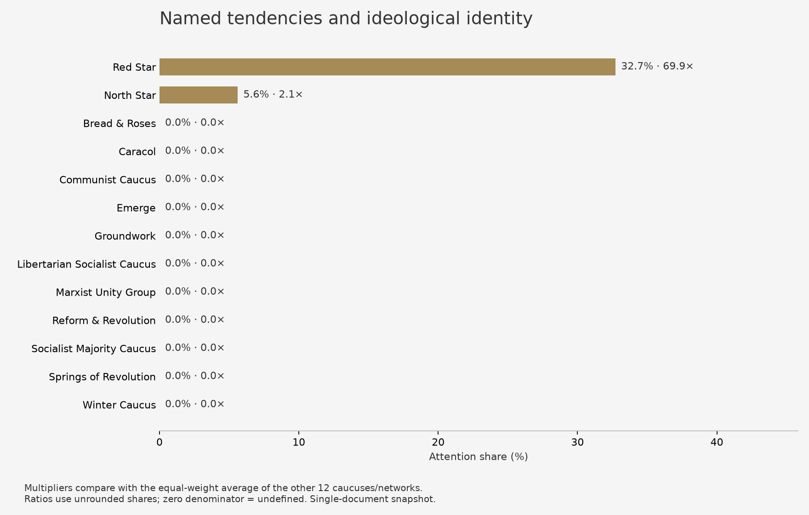

[All caucus-pair ratios](../../figures/substack/caucuses/topic-012-all-ratios.png)

### Oppression, abolition and anti-imperialism

The theme connects opposition to domestic oppression with international domination. LSC calls for abolition of policing and incarceration; Bread & Roses discusses anti-oppression campaigns; the Communist Caucus connects class power to opposing imperialist violence. The breadth of this cluster prevents treating it as a single foreign-policy position.

Primary-source examples by caucus

- **Bread & Roses:** Support for building struggles against mass incarceration, police brutality, restrictions on reproductive rights, gender violence, job and housing discrimination, and deportations, particularly when they can mobilize large numbers of people. ([source](https://breadandrosesdsa.org/where-we-stand/); `bread-roses-stand-normalized-679dfb544c7b-repair-06bc4fb7986c-001`).
- **Caracol:** Support for the democratic expenditure of society’s productive surplus, known as Dépense. ([source](https://caracoldsa.org/points-of-unity/); `caracol-unity-normalized-10bf48bb79c5-005`).
- **Communist Caucus:** Development of class power stems from collective opposition to the U.S. government’s capacity to build empire and inflict imperialist violence. ([source](https://communistcaucus.com/our-statement/); `communist-statement-normalized-d8d96388277f-006`).
- **Emerge:** Diverse social forces should be stitched together to organize a mass front against global imperialism and domestic carceral fascism. ([source](https://dsaemerge.org/points-of-unity/); `emerge-unity-normalized-8c6058dfae96-010`).
- **Groundwork:** Only an unapologetic left can stop the fascist scapegoating of trans people, immigrants, women, and near everyone else. ([source](https://www.groundworkdsa.com/); `groundwork-unity-normalized-ec231206d820-012`).
- **Libertarian Socialist Caucus:** Support for the unconditional abolition of policing and incarceration. ([source](https://dsa-lsc.org/lsc-pou/); `lsc-unity-normalized-ea7342a48a3a-006`).
- **Marxist Unity Group:** Commitment to fight the Constitution to win a democratic socialist republic in North America. ([source](https://www.marxistunity.com/); `mug-unity-normalized-6d56c04fa4e4-001`).
- **North Star:** Opposition to militarism and imperialism. ([source](https://www.dsanorthstar.org/principles.html); `northstar-principles-normalized-c7a56b0a73e5-005`).
- **Red Star:** Anti-imperialism must be at the core of the future party. ([source](https://redstarcaucus.org/points-of-unity/); `redstar-unity-normalized-de4b6ac7187f-007`).
- **Reform & Revolution:** The current period is characterized by crises of organization, leadership, and consciousness, which together form a Triple Crisis. ([source](https://reformandrevolution.org/points-of-unity/); `reform-revolution-unity-normalized-43b09f96fc58-012`).
- **Socialist Majority Caucus:** The authoritarian right wing in the United States—and its primary political vehicle, the Republican Party—pose a historic threat to democracy, racial equality, trans rights and bodily autonomy, and the fundamental rights of all working people. ([source](https://www.socialistmajority.com/pointsofunity); `smc-unity-normalized-c786139dab63-001`).
- **Winter Caucus:** Opposition to identity politics is not because of opposition to struggles for the liberation of groups from particular forms of oppression, or denial of the existence of those oppressions. ([source](https://wintercaucus.org/); `winter-principles-normalized-94acd8b35d22-006`).

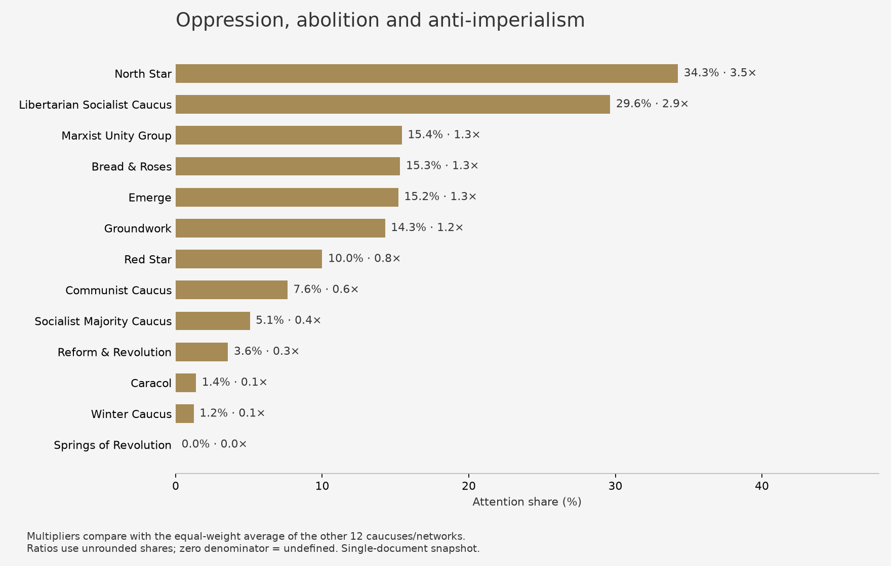

[All caucus-pair ratios](../../figures/substack/caucuses/topic-008-all-ratios.png)

### Political traditions and organizing approaches

This heterogeneous cluster includes Marxist and materialist self-description alongside organizing methods. Reform & Revolution names its revolutionary Marxist tradition; Red Star invokes dialectical and historical materialism. Repeated normalization wording such as 'the group' also contributes to this cluster, so its share is not a clean measure of ideology.

Primary-source examples by caucus

- **Bread & Roses:** The group opposes ultra-left tactics that substitute adventures organized by a small cadre of activists for a mass, organized working-class movement. ([source](https://breadandrosesdsa.org/where-we-stand/); `bread-roses-stand-normalized-41f65cba3f1c-004`).
- **Caracol:** The group is committed to creating a post-growth, ecosocialist world democratically. ([source](https://caracoldsa.org/points-of-unity/); `caracol-unity-normalized-26f6493663c5-011`).
- **Emerge:** The group pursues transformative justice. ([source](https://dsaemerge.org/points-of-unity/); `emerge-unity-normalized-f5e94f87dfc9-013`).
- **Libertarian Socialist Caucus:** The group identifies as revolutionary socialists first and foremost. ([source](https://dsa-lsc.org/lsc-pou/); `lsc-unity-normalized-77b67a994999-001`).
- **Marxist Unity Group:** Marxist Unity Group supports integrating locals into larger state-level organizations. ([source](https://www.marxistunity.com/); `mug-unity-normalized-59695f27499b-006`).
- **North Star:** A goal to develop links with a wide range of left-wing, socialist, and progressive organizations around the world. ([source](https://www.dsanorthstar.org/principles.html); `northstar-principles-normalized-dfdd2cb07622-008`).
- **Red Star:** The group adheres to dialectical and historical materialism. ([source](https://redstarcaucus.org/points-of-unity/); `redstar-unity-normalized-f3f966fe34ba-002`).
- **Reform & Revolution:** The group stands in the revolutionary tradition of Marxism and scientific socialism. ([source](https://reformandrevolution.org/points-of-unity/); `reform-revolution-unity-normalized-43b09f96fc58-004`).
- **Socialist Majority Caucus:** The group practices materialist politics. ([source](https://www.socialistmajority.com/pointsofunity); `smc-unity-normalized-0fbe43ccb3d2-009`).
- **Winter Caucus:** Winter will build member-funded and -directed organizations. ([source](https://wintercaucus.org/); `winter-principles-normalized-c821bcb6baf6-repair-233219e2c0f2-002`).

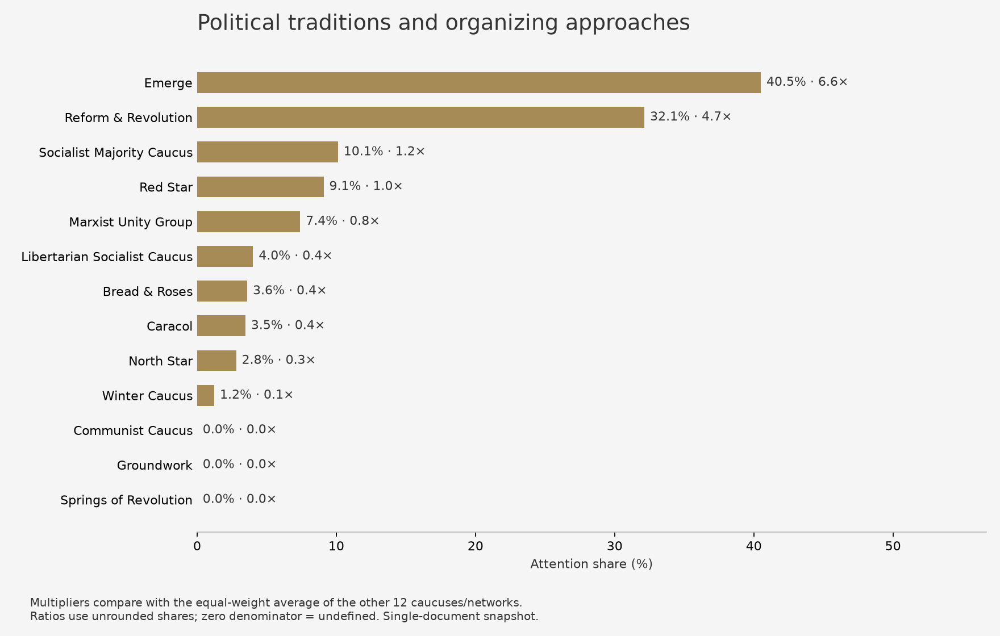

[All caucus-pair ratios](../../figures/substack/caucuses/topic-007-all-ratios.png)

### Socialist organizing and democratic aims

This broad cluster links socialist organizing to democratic goals. Bread & Roses emphasizes a united multiracial working-class movement; North Star puts democracy at the core of socialism. Labor organizing, electoral work, and international coordination appear together, rather than forming one agreed strategy.

Primary-source examples by caucus

- **Bread & Roses:** Socialists strive to build a united multiracial working-class movement. ([source](https://breadandrosesdsa.org/where-we-stand/); `bread-roses-stand-normalized-94fdaca6d7cf-repair-67e3989fbe5a-015`).
- **Caracol:** Commitment to producing socialist analysis from a degrowth perspective. ([source](https://caracoldsa.org/points-of-unity/); `caracol-unity-normalized-24a76a56c71e-005`).
- **Emerge:** When socialists are elected, they can popularize demands, legislate to increase working class power, and expose the repressive mechanisms of bourgeois democracy from within. ([source](https://dsaemerge.org/points-of-unity/); `emerge-unity-normalized-ad2a6c3d40d9-004`).
- **Libertarian Socialist Caucus:** Socialists should organize openly for a democratic, worker-led labor movement. ([source](https://dsa-lsc.org/lsc-pou/); `lsc-unity-normalized-bef6839ef1ae-003`).
- **Marxist Unity Group:** Commitment to construct the socialist order under the democratic leadership of a victorious socialist party. ([source](https://www.marxistunity.com/); `mug-unity-normalized-6d56c04fa4e4-011`).
- **North Star:** Democratic socialism has democracy at its core. ([source](https://www.dsanorthstar.org/principles.html); `northstar-principles-normalized-b7b2cb9ad1ae-004`).
- **Red Star:** The group recognizes the role of a party with a socialist and democratic character in cohering the vanguard. ([source](https://redstarcaucus.org/points-of-unity/); `redstar-unity-normalized-f3f966fe34ba-006`).
- **Socialist Majority Caucus:** Socialists should participate in independent political organizations, unions, tenant associations, and other mass organizations to reach, organize, and politicize working people in different ways. ([source](https://www.socialistmajority.com/pointsofunity); `smc-unity-normalized-ac7d6af55f92-005`).
- **Winter Caucus:** If socialists are to confront capitalism and imperialism, then socialists must organize as a global movement. ([source](https://wintercaucus.org/); `winter-principles-normalized-186138e25cd5-003`).

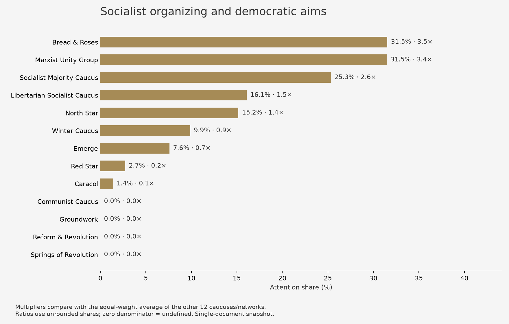

[All caucus-pair ratios](../../figures/substack/caucuses/topic-001-all-ratios.png)

## Coverage and qualifications

| Caucus/network | Eligible claims | Statement date | Primary statement |
|---|---:|---|---|
| Socialist Majority Caucus | 79 | 2024-06-14 | [Socialist Majority Caucus: Points of Unity](https://www.socialistmajority.com/pointsofunity) |
| Groundwork | 28 | Not stated | [Groundwork: Groundwork Points of Unity](https://www.groundworkdsa.com/) |
| Emerge | 79 | Not stated | [Emerge: Points of Unity](https://dsaemerge.org/points-of-unity/) |
| Marxist Unity Group | 162 | Not stated | [Marxist Unity Group: Seven Points of Unity](https://www.marxistunity.com/) |
| Springs of Revolution | 40 | Not stated | [Springs of Revolution: Platform](https://sordsa.org/platform/) |
| Bread & Roses | 111 | Not stated | [Bread & Roses: Where We Stand](https://breadandrosesdsa.org/where-we-stand/) |
| Libertarian Socialist Caucus | 199 | Not stated | [Libertarian Socialist Caucus: Points of Unity](https://dsa-lsc.org/lsc-pou/) |
| Caracol | 144 | Not stated | [Caracol: Points of Unity](https://caracoldsa.org/points-of-unity/) |
| Communist Caucus | 118 | Not stated | [Communist Caucus: Our Statement](https://communistcaucus.com/our-statement/) |
| North Star | 178 | 2023-06 | [North Star: Statement of Principles](https://www.dsanorthstar.org/principles.html) |
| Red Star | 110 | Not stated | [Red Star: Points of Unity](https://redstarcaucus.org/points-of-unity/) |
| Winter Caucus | 81 | Not stated | [Winter Caucus: Statement of Principles](https://wintercaucus.org/) |
| Reform & Revolution | 28 | 2026-01-18 | [Reform & Revolution: Points of Unity](https://reformandrevolution.org/points-of-unity/) |

## Methods and complete data

Attention shares equalize documents within each caucus; all eligible claims, including unclustered material, remain in denominators. Directed ratios use unrounded shares, without smoothing. A zero denominator is undefined. The combined baseline averages other caucuses equally, not by membership or claim count.

One document per group does not support sampling error bars or a historical trend. Known statement dates are distinct from the retrieval date. The source ledger records networks, local/regional supplements, an adoption-uncertain draft, and unrecovered groups.

Extraction attempted all 144 bounded chunks. 8 model chunks failed validation; 0 remain without usable recovery. 123 candidate claims were flagged in targeted source review. Failed chunks and flagged originals do not enter attention-share denominators. 162 source-bound assistant corrections are separately identified and included when eligible. Original responses, failed dispositions, evidence and retry history are retained. Source-fidelity revision and targeted assistant review are not independent human gold.

Attention is measured only among eligible extracted claims, not all words or every position in the original statements. Extraction failures and exclusions can change the shares. Statement dates and writing styles differ; this is not a contemporaneous roster or a ranking of caucus strength. Learned topics summarize overlapping language, not mutually exclusive ideological camps.

The selected 12-topic model has an original-embedding cosine silhouette of 0.068. That weak separation calls for coarse, overlapping interpretations, not precise ideological boundaries; the complete download includes the candidate fits and balanced-refit sensitivity results.

[Methods](../../docs/dsa_caucus_analysis.md) · [Complete claims and evidence](../../data/analysis/dsa_caucuses/comparison/analysis_claims.csv) · [All directed attention ratios](../../data/analysis/dsa_caucuses/comparison/attention_share_ratios.csv) · [Complete analysis download](../../data/analysis/dsa_caucuses/dsa_caucus_analysis.zip)
