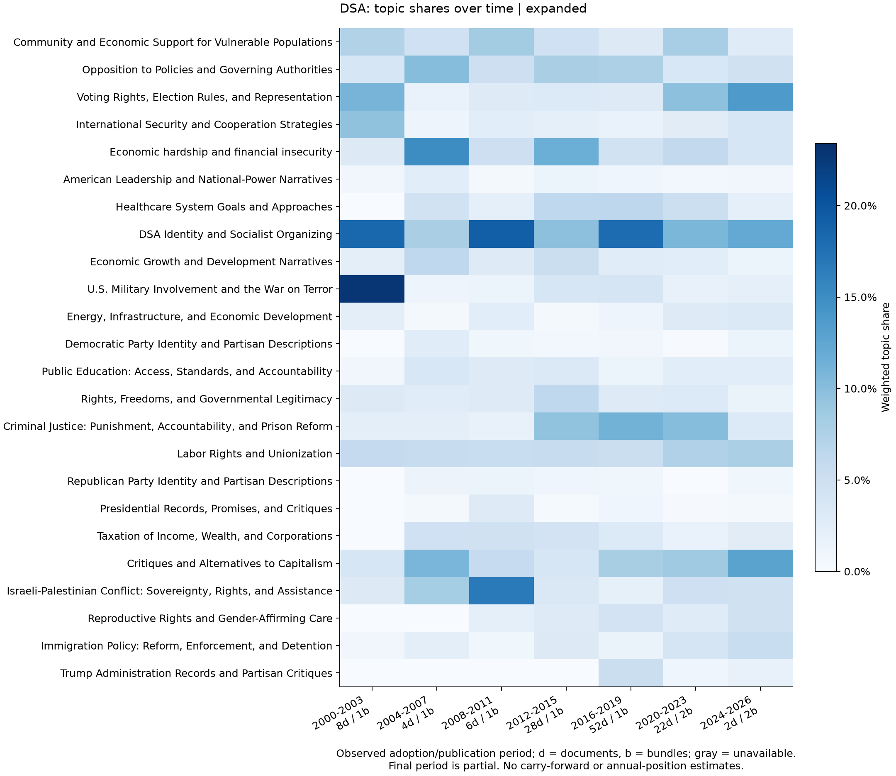
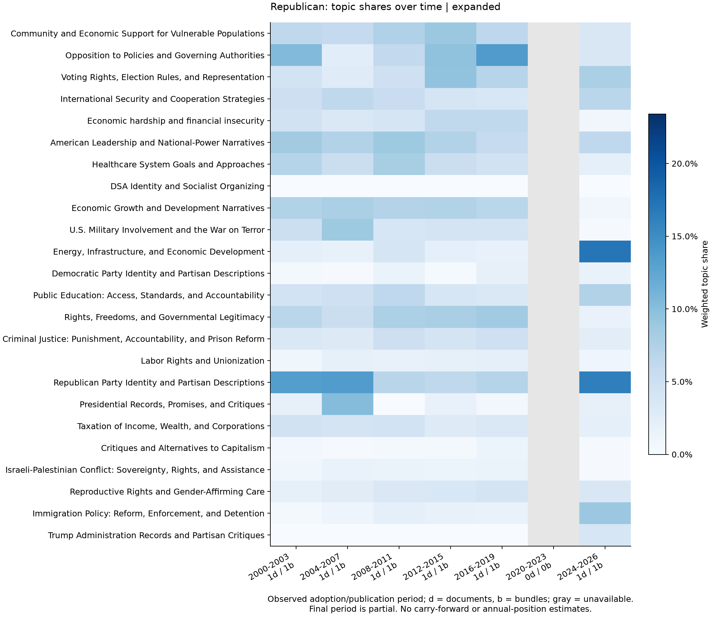
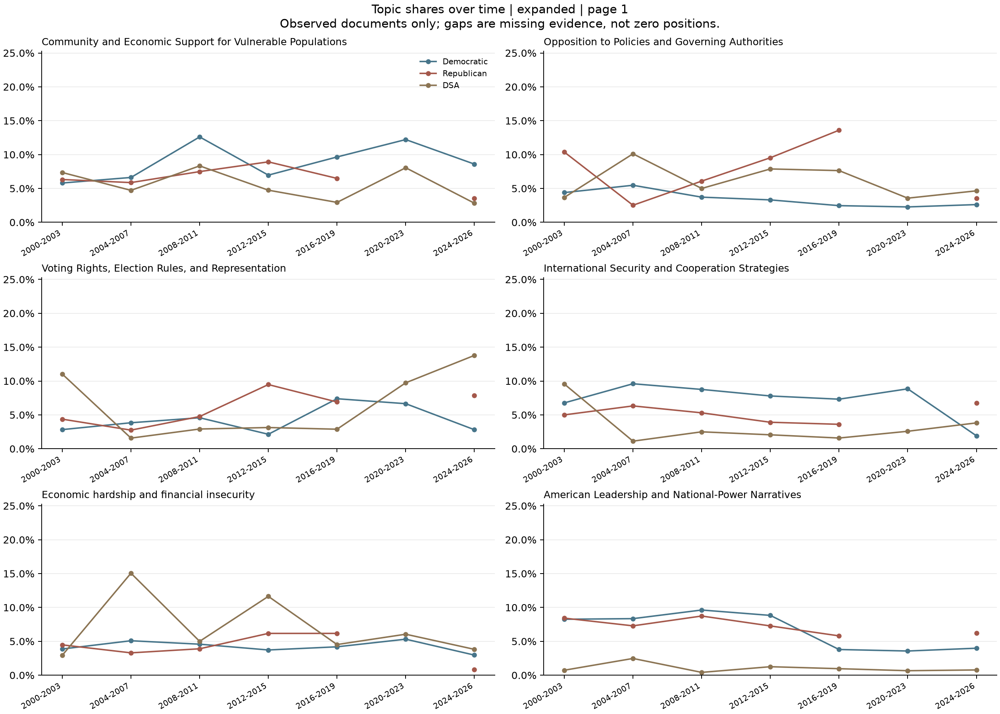
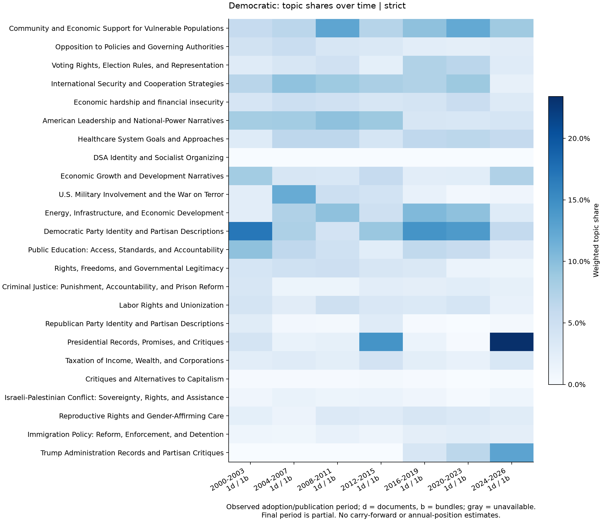
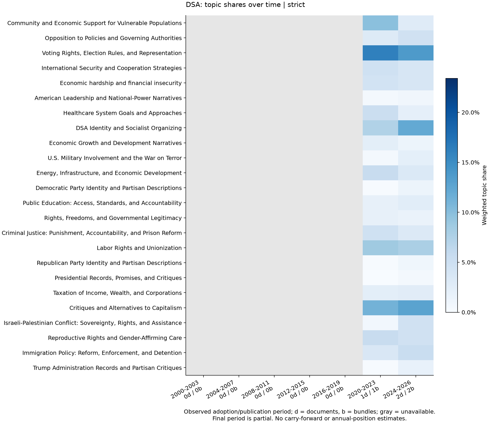
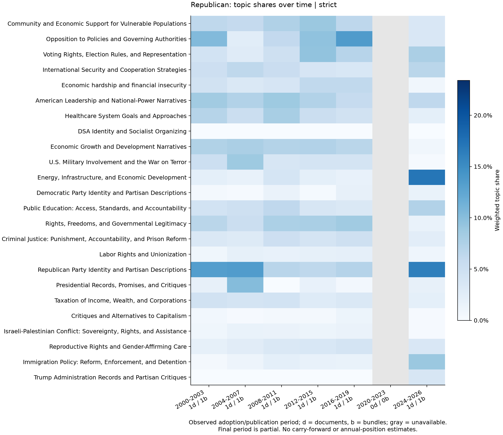
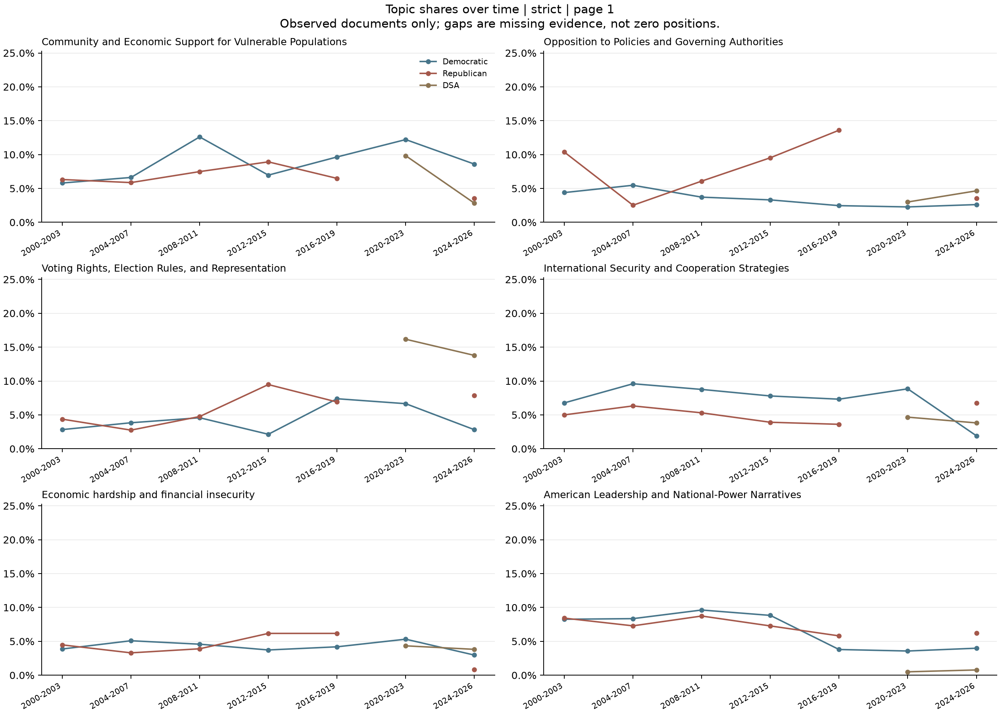

# National platforms: claim-based analysis

<!-- learned-topics:start -->
## Learned topic distributions and relative emphasis

**24 learned topics; 0 unclustered claims. 24/24 named labels available.**

One shared expanded-corpus taxonomy is used for both views. Shares give each document/fallback bundle equal weight within its organization, including unclustered claims in the denominator. The reference for each group is the equally weighted mean of the other groups, not the larger pooled claim corpus.

Log2 ratios use a 0.0001 share floor: +1 is approximately twice the topic share away from the floor. All contrasts remain ranked, including fragile ones. Zero shares, low bundle support, smoothing sensitivity and leave-one-bundle-out instability are warnings, not grounds for silent exclusion. These are exploratory language-emphasis differences, not agreement, significance, or ideological distance.

Discovery uses PCA with **weighted_kmeans**. Low density-cluster coverage triggers a weighted K-means fallback; K-means gives each group equal mass and each within-group bundle equal mass. HDBSCAN itself is unweighted. Parameter and balanced-refit diagnostics are downloaded. K-means partitions claims even at fuzzy topic boundaries; topics can mix subtopics and opposing positions. Period/genre composition differs. Model summaries are evidence-bound interpretations, not independently certified classifications or fact-checks.

[All shares](../data/analysis/national_claims/full/topics/shares.csv) · [All ranked contrasts and warnings](../data/analysis/national_claims/full/topics/contrasts.csv) · [Topic assignments](../data/analysis/national_claims/full/topics/assignments.csv) · [Representative claims and exact source evidence](../data/analysis/national_claims/full/topics/representatives.csv) · [Fit diagnostics](../data/analysis/national_claims/full/topics/candidate_fits.csv) · [Balanced refits](../data/analysis/national_claims/full/topics/balanced_refits.csv)

**Label evidence review:** 24/24 topics reviewed against their actual representative claims; 13 labels have explicitly identified source-bound assistant revisions. Original Gemma replies and validation failures remain unchanged. This is assistant review, not independent human certification.

[Label review and exact provenance](../data/analysis/national_claims/full/topics/label_review.json)

**Measured fit limitations:** PCA retains 59.9% of embedding variance; original-space cosine silhouette is 0.058. Balanced-refit adjusted Rand indices are 0.628, 0.606 (1 would mean identical partitions). These are exploratory topic partitions; separation and refit diagnostics do not certify a definitive policy taxonomy.

### Expanded distribution

Largest relative-emphasis ratios (all support levels remain eligible):

| Group | Topic | Share | Other-group mean | Difference (pp) | log2 ratio | Warnings |
|---|---|---:|---:|---:|---:|---|
| Democratic | Democratic Party Identity and Partisan Descriptions | 10.3% | 0.9% | +9.39 | +3.48 | none |
| Democratic | Presidential Records, Promises, and Critiques | 6.7% | 1.7% | +5.02 | +1.97 | none |
| Democratic | Trump Administration Records and Partisan Critiques | 3.3% | 0.9% | +2.36 | +1.82 | bundle_sensitive_rank |
| Republican | Republican Party Identity and Partisan Descriptions | 10.6% | 0.9% | +9.67 | +3.58 | none |
| Republican | Rights, Freedoms, and Governmental Legitimacy | 6.3% | 3.2% | +3.10 | +0.98 | none |
| Republican | American Leadership and National-Power Narratives | 7.3% | 3.8% | +3.49 | +0.94 | none |
| DSA | DSA Identity and Socialist Organizing | 13.2% | 0.0% | +13.23 | +9.83 | low_bundle_support;smoothing_sensitive |
| DSA | Critiques and Alternatives to Capitalism | 8.3% | 0.4% | +7.94 | +4.37 | none |
| DSA | Israeli-Palestinian Conflict: Sovereignty, Rights, and Assistance | 5.8% | 1.1% | +4.66 | +2.36 | none |

Pairwise contrast panels:

### Strict distribution

Largest relative-emphasis ratios (all support levels remain eligible):

| Group | Topic | Share | Other-group mean | Difference (pp) | log2 ratio | Warnings |
|---|---|---:|---:|---:|---:|---|
| Democratic | Democratic Party Identity and Partisan Descriptions | 10.3% | 0.9% | +9.37 | +3.45 | none |
| Democratic | Presidential Records, Promises, and Critiques | 6.7% | 1.5% | +5.21 | +2.15 | none |
| Democratic | Trump Administration Records and Partisan Critiques | 3.3% | 0.9% | +2.35 | +1.80 | none |
| Republican | Republican Party Identity and Partisan Descriptions | 10.6% | 0.8% | +9.72 | +3.66 | none |
| Republican | Rights, Freedoms, and Governmental Legitimacy | 6.3% | 2.5% | +3.78 | +1.33 | none |
| Republican | Opposition to Policies and Governing Authorities | 7.6% | 3.8% | +3.82 | +1.01 | bundle_sensitive_rank |
| DSA | DSA Identity and Socialist Organizing | 10.6% | 0.0% | +10.59 | +9.51 | low_bundle_support;smoothing_sensitive |
| DSA | Critiques and Alternatives to Capitalism | 12.3% | 0.4% | +11.89 | +4.93 | none |
| DSA | Labor Rights and Unionization | 8.1% | 2.5% | +5.61 | +1.69 | none |

Pairwise contrast panels:

### Topics over time

The same topic assignments are tracked in four-year adoption/publication periods. Within each period, each document/fallback bundle has equal group weight. Adoption dates take precedence when recorded; original date precision is retained. Missing periods remain gaps: neither reused platforms nor absent publications are carried forward as new independent observations. The final period is partial.

Relative time-series contrasts require all configured comparison groups for group-versus-rest baselines; pairwise contrasts require both organizations. These charts describe the changing composition of observed documents, not annual party positions or causal changes. One-document periods are visibly counted and flagged in the downloadable tables.

[Period coverage and support](../data/analysis/national_claims/full/topics/temporal_coverage.csv) · [All period shares](../data/analysis/national_claims/full/topics/temporal_shares.csv) · [Time-specific relative emphasis](../data/analysis/national_claims/full/topics/temporal_contrasts.csv) · [Adjacent observed-period changes](../data/analysis/national_claims/full/topics/temporal_changes.csv) · [Exact date choices](../data/analysis/national_claims/full/topics/temporal_document_dates.csv) · [Date exclusions](../data/analysis/national_claims/full/topics/temporal_exclusions.csv)

#### Expanded time views

All topic-trend pages: [1](../figures/national_claims/full/topics/expanded/time_trends_1.png) · [2](../figures/national_claims/full/topics/expanded/time_trends_2.png) · [3](../figures/national_claims/full/topics/expanded/time_trends_3.png) · [4](../figures/national_claims/full/topics/expanded/time_trends_4.png)

Fixed-baseline relative-emphasis time charts: [democratic](../figures/national_claims/full/topics/expanded/time_democratic_relative.png) · [dsa](../figures/national_claims/full/topics/expanded/time_dsa_relative.png) · [republican](../figures/national_claims/full/topics/expanded/time_republican_relative.png)

#### Strict time views

All topic-trend pages: [1](../figures/national_claims/full/topics/strict/time_trends_1.png) · [2](../figures/national_claims/full/topics/strict/time_trends_2.png) · [3](../figures/national_claims/full/topics/strict/time_trends_3.png) · [4](../figures/national_claims/full/topics/strict/time_trends_4.png)

Fixed-baseline relative-emphasis time charts: [democratic](../figures/national_claims/full/topics/strict/time_democratic_relative.png) · [dsa](../figures/national_claims/full/topics/strict/time_dsa_relative.png) · [republican](../figures/national_claims/full/topics/strict/time_republican_relative.png)

### Topic summaries and evidence

#### topic-001: Energy, Infrastructure, and Economic Development

Claims concern investment, energy production, infrastructure, and economic development. Democratic examples emphasize clean energy and public investment; Republican examples include reducing fossil-fuel restrictions and technological approaches to petroleum dependence. A DSA example calls for democratic economic restructuring. Other examples address rural investment and affordable housing.

**Caveat:** A broad investment-and-development cluster, not exclusively an energy topic. Shared subject matter does not imply a shared policy stance.

**Label provenance:** source-bound assistant revision of the preserved Gemma response; see the label-review record.

**Distinctive phrases:** energy, clean, infrastructure, american, economy, natural, sustainable, promote, trade, global

| View | Group | Share | Claims | Documents | Bundles |
|---|---|---:|---:|---:|---:|
| expanded | Democratic | 6.7% | 792 | 7 | 7 |
| expanded | Republican | 4.8% | 265 | 6 | 6 |
| expanded | DSA | 2.1% | 80 | 21 | 9 |
| strict | Democratic | 6.7% | 792 | 7 | 7 |
| strict | Republican | 4.8% | 265 | 6 | 6 |
| strict | DSA | 4.0% | 41 | 3 | 3 |

| Group | Full representative claim | Source and locator |
|---|---|---|
| Democratic | Commitment to eliminate tens of billions of dollars in subsidies for oil and gas companies. (`democratic-2024-normalized-92fa6cad93aa-003`) | [2024 Democratic Party Platform](https://www.presidency.ucsb.edu/documents/2024-democratic-party-platform) scoped characters 42913:43499 |
| DSA | Commitment to fight to restructure the U.S. economy in a democratic direction. (`dsa-2009-priorities-normalized-69ef366c0cec-004`) | [2009 convention national priorities resolution](https://dlarchive.dsausa.org/wp-content/uploads/2018/12/DL_2010_V037_03.pdf) scoped characters 1653:3096 |
| Republican | Commitment to end market-distorting restrictions on oil, natural gas, and coal. (`republican-2024-normalized-007a594371a0-012`) | [2024 Republican Party Platform](https://www.presidency.ucsb.edu/documents/2024-republican-party-platform) scoped characters 15857:16203 |
| Democratic | Commitment to invest in the American heartland and rural communities. (`democratic-2020-normalized-e2e95c8e92fd-001`) | [2020 Democratic Party Platform](https://www.presidency.ucsb.edu/documents/2020-democratic-party-platform) scoped characters 46121:47422 |
| Democratic | Commitment to fight to implement the most significant investments in America in generations. (`democratic-2024-normalized-acb049933b3f-012`) | [2024 Democratic Party Platform](https://www.presidency.ucsb.edu/documents/2024-democratic-party-platform) scoped characters 21884:22348 |
| Democratic | Commitment to invest significant new resources in clean energy generation and distribution. (`democratic-2020-normalized-aab0c6ab7f9f-008`) | [2020 Democratic Party Platform](https://www.presidency.ucsb.edu/documents/2020-democratic-party-platform) scoped characters 90178:90902 |
| Democratic | Commitment to protect and grow the global economy. (`democratic-2016-normalized-355accb7d3ef-006`) | [2016 Democratic Party Platform](https://www.presidency.ucsb.edu/documents/2016-democratic-party-platform) scoped characters 169126:169400 |
| Democratic | Commitment to promote economic opportunity and prosperity in the Americas. (`democratic-2016-normalized-755f6fab8c61-006`) | [2016 Democratic Party Platform](https://www.presidency.ucsb.edu/documents/2016-democratic-party-platform) scoped characters 166287:167091 |
| Republican | Commitment to put American workers first. (`republican-2024-normalized-048e2be2d61f-011`) | [2024 Republican Party Platform](https://www.presidency.ucsb.edu/documents/2024-republican-party-platform) scoped characters 14099:14347 |
| Democratic | Commitment to invest in advanced energy technologies to build the clean energy economy and create millions of new, good “Green Collar” American jobs. (`democratic-2008-normalized-3b4380265be8-006`) | [2008 Democratic Party Platform](https://www.presidency.ucsb.edu/documents/2008-democratic-party-platform) scoped characters 130268:131484 |
| Republican | Commitment to aggressively support technological advances to reduce petroleum dependence. (`republican-2008-normalized-dd4b307d1b57-006`) | [2008 Republican Party Platform](https://www.presidency.ucsb.edu/documents/2008-republican-party-platform) scoped characters 98266:98650 |
| Democratic | Commitment to increase the U.S. supply of affordable housing. (`democratic-2008-normalized-aece53525f28-repair-6b93c1abe4b1-009`) | [2008 Democratic Party Platform](https://www.presidency.ucsb.edu/documents/2008-democratic-party-platform) scoped characters 32612:34070 |

#### topic-002: Community and Economic Support for Vulnerable Populations

Multiple groups express commitment to supporting communities and vulnerable populations through increased resources and programs. This includes investment in low-income communities, rural areas, and communities of color, as well as support for foster care and adoptive families. Claims also address the need to preserve programs benefiting the working poor and improve infrastructure.

**Distinctive phrases:** housing, programs, veterans, resources, communities, funding, local, public, help, federal

| View | Group | Share | Claims | Documents | Bundles |
|---|---|---:|---:|---:|---:|
| expanded | Democratic | 8.9% | 1104 | 7 | 7 |
| expanded | Republican | 6.4% | 643 | 6 | 6 |
| expanded | DSA | 5.5% | 260 | 48 | 9 |
| strict | Democratic | 8.9% | 1104 | 7 | 7 |
| strict | Republican | 6.4% | 643 | 6 | 6 |
| strict | DSA | 5.2% | 66 | 3 | 3 |

| Group | Full representative claim | Source and locator |
|---|---|---|
| Democratic | Commitment to increase funding for programs that support the creation and preservation of affordable housing options for essential workers. (`democratic-2024-normalized-51d7cbe64123-005`) | [2024 Democratic Party Platform](https://www.presidency.ucsb.edu/documents/2024-democratic-party-platform) scoped characters 69540:70730 |
| DSA | Support for securing adequate compensation and living standards, as well as effective infrastructure, healthcare, and institutions in communities and abroad. (`dsa-2021-adopted-normalized-e66dc1af24d6-005`) | [2021 adopted DSA Political Platform - immutable December 2021 snapshot](https://web.archive.org/web/20211230205416id_/https://www.dsausa.org/dsa-political-platform-from-2021-convention/) scoped characters 25750:26880 |
| Republican | Support for better meeting state needs. (`republican-2008-normalized-fd4bbde75007-008`) | [2008 Republican Party Platform](https://www.presidency.ucsb.edu/documents/2008-republican-party-platform) scoped characters 126725:127315 |
| Republican | Support for offering training, transportation, and child care services to help people become self-sufficient. (`republican-2004-normalized-8eb776d9223a-009`) | [2004 Republican Party Platform](https://www.presidency.ucsb.edu/documents/2004-republican-party-platform) scoped characters 251901:252254 |
| Republican | Commitment to establish stronger public-private partnerships for safety net providers and hospitals in rural and underserved communities. (`republican-2000-normalized-76e7e2418f31-008`) | [2000 Republican Party Platform](https://www.presidency.ucsb.edu/documents/2000-republican-party-platform) scoped characters 92920:93402 |
| Democratic | Commitment to fight to train and support the workforce in community-based settings. (`democratic-2016-normalized-a86063b3af32-002`) | [2016 Democratic Party Platform](https://www.presidency.ucsb.edu/documents/2016-democratic-party-platform) scoped characters 117668:118077 |
| Democratic | Support for directing more federal resources to lifting up communities that have been left out and left behind. (`democratic-2016-normalized-a9bcc4d230c7-011`) | [2016 Democratic Party Platform](https://www.presidency.ucsb.edu/documents/2016-democratic-party-platform) scoped characters 65372:65998 |
| DSA | Commitment to work with coalitions to preserve programs that benefit the working poor and most vulnerable. (`dsa-2012-fiscal-normalized-2b868cee0576-005`) | [Reject the Fiscal Cliff](https://www.dsausa.org/wp-json/wp/v2/statement/355) scoped characters 5512:5999 |
| Democratic | Commitment to drive increased resources to communities with the highest need, including those with the highest concentrations of low-income students, impoverished urban areas impacted by gentrification, and rural areas. (`democratic-2020-normalized-5e55d1004289-004`) | [2020 Democratic Party Platform](https://www.presidency.ucsb.edu/documents/2020-democratic-party-platform) scoped characters 204524:205189 |
| Republican | Support for the efforts of foster and adoptive families. (`republican-2008-normalized-8aa7aa1bad1e-012`) | [2008 Republican Party Platform](https://www.presidency.ucsb.edu/documents/2008-republican-party-platform) scoped characters 147575:148226 |
| Democratic | Commitment to invest in low-income communities, urban and rural areas, and communities of color by strengthening the Community Reinvestment Act. (`democratic-2020-normalized-562fcd433911-007`) | [2020 Democratic Party Platform](https://www.presidency.ucsb.edu/documents/2020-democratic-party-platform) scoped characters 121179:121503 |
| Democratic | Commitment to support and supplement the struggling foster care system. (`democratic-2008-normalized-9fc71187ff8d-007`) | [2008 Democratic Party Platform](https://www.presidency.ucsb.edu/documents/2008-democratic-party-platform) scoped characters 138517:139956 |

#### topic-003: Labor Rights and Unionization

These claims concern policies related to labor rights, specifically the ability of workers to organize and collectively bargain. Positions vary, with some advocating for expanded rights for all workers, including those currently unprotected, and others supporting 'right-to-work' laws. Multiple groups express support for strengthening unions and protecting workers' rights to strike.

**Distinctive phrases:** workers, labor, union, wage, unions, work, minimum wage, worker, minimum, pay

| View | Group | Share | Claims | Documents | Bundles |
|---|---|---:|---:|---:|---:|
| expanded | Democratic | 3.4% | 399 | 7 | 7 |
| expanded | Republican | 1.6% | 159 | 6 | 6 |
| expanded | DSA | 6.5% | 311 | 49 | 9 |
| strict | Democratic | 3.4% | 399 | 7 | 7 |
| strict | Republican | 1.6% | 159 | 6 | 6 |
| strict | DSA | 8.1% | 71 | 3 | 3 |

| Group | Full representative claim | Source and locator |
|---|---|---|
| Democratic | Commitment to fight for labor laws that facilitate the collective bargaining process. (`democratic-2012-normalized-18cc338046ac-010`) | [2012 Democratic Party Platform](https://www.presidency.ucsb.edu/documents/2012-democratic-party-platform) scoped characters 47039:48229 |
| DSA | Support for labor rights for all, regardless of immigration status. (`dsa-2021-adopted-normalized-6b522fa83bc9-008`) | [2021 adopted DSA Political Platform - immutable December 2021 snapshot](https://web.archive.org/web/20211230205416id_/https://www.dsausa.org/dsa-political-platform-from-2021-convention/) scoped characters 64302:64494 |
| Republican | Support the enactment of a National Right-to-Work law to promote worker freedom and greater economic liberty. (`republican-2012-normalized-9b00c73c5686-008`) | [2012 Republican Party Platform](https://www.presidency.ucsb.edu/documents/2012-republican-party-platform) scoped characters 35273:36184 |
| Democratic | Commitment to fight to raise wages for working people and improve job quality and security. (`democratic-2020-normalized-4521936cc397-001`) | [2020 Democratic Party Platform](https://www.presidency.ucsb.edu/documents/2020-democratic-party-platform) scoped characters 31987:33381 |
| Democratic | Commitment to continue to fight for a strong labor movement. (`democratic-2012-normalized-c23a3db91fb4-003`) | [2012 Democratic Party Platform](https://www.presidency.ucsb.edu/documents/2012-democratic-party-platform) scoped characters 100171:101045 |
| Democratic | Commitment to strengthen labor rights for more than 20 million public-sector employees in the United States by passing the Public Service Freedom to Negotiate Act. (`democratic-2020-normalized-c00aaa88c694-007`) | [2020 Democratic Party Platform](https://www.presidency.ucsb.edu/documents/2020-democratic-party-platform) scoped characters 35689:36005 |
| Democratic | Commitment to allow unions to organize and lift up workers. (`democratic-2008-normalized-aece53525f28-008`) | [2008 Democratic Party Platform](https://www.presidency.ucsb.edu/documents/2008-democratic-party-platform) scoped characters 32612:34070 |
| Democratic | Commitment to make it easier for public and private workers to exercise their right to organize and join unions. (`democratic-2016-normalized-7ba2e6e4e2f2-002`) | [2016 Democratic Party Platform](https://www.presidency.ucsb.edu/documents/2016-democratic-party-platform) scoped characters 9736:10261 |
| DSA | Support for protecting all workers’ rights to strike and form a union. (`dsa-2024-program-normalized-f23d4047d972-002`) | [Workers Deserve More 2024](https://program.dsausa.org/wp-content/uploads/2024/08/DSA_2024Program.pdf) scoped characters 7352:8203 |
| Democratic | Support for codifying a right to organize for domestic workers, farm workers, and other unprotected laborers. (`democratic-2024-normalized-8af3eb44deaa-005`) | [2024 Democratic Party Platform](https://www.presidency.ucsb.edu/documents/2024-democratic-party-platform) scoped characters 18243:19386 |
| DSA | Support for the right to strike for all workers. (`dsa-2021-adopted-normalized-8861a9fa1bd2-009`) | [2021 adopted DSA Political Platform - immutable December 2021 snapshot](https://web.archive.org/web/20211230205416id_/https://www.dsausa.org/dsa-political-platform-from-2021-convention/) scoped characters 24555:24590 |
| Democratic | Support for increased funding for efforts to protect workers' rights. (`democratic-2004-normalized-7fe56cf462ee-010`) | [2004 Democratic Party Platform](https://www.presidency.ucsb.edu/documents/2004-democratic-party-platform) scoped characters 60446:61419 |

#### topic-004: Economic Growth and Development Narratives

Multiple claims address economic growth as a central goal, with some linking it to infrastructure investment and job creation. Both Democratic and Republican claims emphasize economic growth as a means to improve living standards and reduce poverty, though they differ on the methods to achieve it. Democrats specifically highlight infrastructure and clean energy as drivers of growth, while Republicans focus on deregulation and economic freedom.

**Caveat:** Includes retrospective records and asserted economic relationships, not only policy proposals. The extracted causal assertions are not fact-checked here.

**Label provenance:** source-bound assistant revision of the preserved Gemma response; see the label-review record.

**Distinctive phrases:** economic, economy, energy, jobs, thanked, thanked contributions, growth, percent, richer, contributions

| View | Group | Share | Claims | Documents | Bundles |
|---|---|---:|---:|---:|---:|
| expanded | Democratic | 4.8% | 578 | 7 | 7 |
| expanded | Republican | 6.2% | 667 | 6 | 6 |
| expanded | DSA | 3.0% | 177 | 46 | 9 |
| strict | Democratic | 4.8% | 578 | 7 | 7 |
| strict | Republican | 6.2% | 667 | 6 | 6 |
| strict | DSA | 1.6% | 17 | 3 | 3 |

| Group | Full representative claim | Source and locator |
|---|---|---|
| Democratic | Investments in infrastructure and manufacturing are helping millions of people thrive. (`democratic-2024-normalized-484cf745805e-012`) | [2024 Democratic Party Platform](https://www.presidency.ucsb.edu/documents/2024-democratic-party-platform) scoped characters 26108:26821 |
| DSA | The United States economy can be restructured in an ecologically sustainable direction and one that provides good jobs at good wages only if the federal government invests significantly in infrastructure development, alternative energy, and mass-transit technologies. (`dsa-2009-priorities-normalized-e439cbeb16b4-003`) | [2009 convention national priorities resolution](https://dlarchive.dsausa.org/wp-content/uploads/2018/12/DL_2010_V037_03.pdf) scoped characters 5541:6944 |
| Republican | Cutting tax rates, simplifying the tax code, deregulating industries, and opening world markets to American enterprise resulted in tremendous growth in the 1980s. (`republican-2000-normalized-79e5ffd6ad69-015`) | [2000 Republican Party Platform](https://www.presidency.ucsb.edu/documents/2000-republican-party-platform) scoped characters 6170:6843 |
| Democratic | President Obama and Democrats around the country are fighting back from the deepest economic crisis since the Great Depression by laying the foundations for an economy that out-educates, out-builds, and out-innovates the rest of the world. (`democratic-2012-normalized-952aa542eb75-007`) | [2012 Democratic Party Platform](https://www.presidency.ucsb.edu/documents/2012-democratic-party-platform) scoped characters 169318:169935 |
| Republican | By balancing environmental goals with economic growth and job creation, the American economy has made possible the investment needed to safeguard natural resources, protect endangered species, and create healthier living conditions. (`republican-2008-normalized-62e53c9c4a9e-005`) | [2008 Republican Party Platform](https://www.presidency.ucsb.edu/documents/2008-republican-party-platform) scoped characters 103314:103888 |
| Democratic | President Obama and Democrats around the country are fighting back from the deepest economic crisis since the Great Depression by growing the middle class. (`democratic-2012-normalized-952aa542eb75-006`) | [2012 Democratic Party Platform](https://www.presidency.ucsb.edu/documents/2012-democratic-party-platform) scoped characters 169318:169935 |
| Democratic | When women and girls are healthy, educated, and able to participate economically, their families and communities prosper, poverty decreases, and economies grow. (`democratic-2016-normalized-0db34fffef9d-003`) | [2016 Democratic Party Platform](https://www.presidency.ucsb.edu/documents/2016-democratic-party-platform) scoped characters 151572:152604 |
| Democratic | When women and girls are healthy, educated, and able to participate economically, their families and communities prosper, poverty decreases, and economies grow. (`democratic-2024-normalized-3f92cb29beb8-004`) | [2024 Democratic Party Platform](https://www.presidency.ucsb.edu/documents/2024-democratic-party-platform) scoped characters 272534:273282 |
| Republican | Economic growth allows people to lift their lives out of poverty. (`republican-2004-normalized-d0360dc943ed-012`) | [2004 Republican Party Platform](https://www.presidency.ucsb.edu/documents/2004-republican-party-platform) scoped characters 66567:66961 |
| Democratic | Countries like Germany, Spain and Brazil have reaped the benefits of economic growth from clean energy. (`democratic-2008-normalized-0db7badf177c-009`) | [2008 Democratic Party Platform](https://www.presidency.ucsb.edu/documents/2008-democratic-party-platform) scoped characters 38350:39296 |
| Democratic | Growing economic ties between the United States, Mexico, and Canada can address environmental and social issues of common concern. (`democratic-2000-normalized-40f95e67a678-005`) | [2000 Democratic Party Platform](https://www.presidency.ucsb.edu/documents/2000-democratic-party-platform) scoped characters 142697:143836 |
| Republican | Economic freedom expands the prosperity pie. (`republican-2008-normalized-d1ed35d0f511-005`) | [2008 Republican Party Platform](https://www.presidency.ucsb.edu/documents/2008-republican-party-platform) scoped characters 68577:69006 |

#### topic-005: Rights, Freedoms, and Governmental Legitimacy

Claims invoke dignity, rights, freedom, self-determination, and legitimate government. Examples range from Democratic commitments to civil and cultural rights and DSA support for oppressed peoples' self-determination to Republican statements about inherent rights and consent of the governed.

**Caveat:** A broad principles-and-rights cluster. The Republican account of pre-existing rights is not a constitutional philosophy established for every group.

**Label provenance:** source-bound assistant revision of the preserved Gemma response; see the label-review record.

**Distinctive phrases:** right, rights, honor, government, liberty, people, respect, human right, freedom, constitution

| View | Group | Share | Claims | Documents | Bundles |
|---|---|---:|---:|---:|---:|
| expanded | Democratic | 3.3% | 347 | 7 | 7 |
| expanded | Republican | 6.3% | 651 | 6 | 6 |
| expanded | DSA | 3.0% | 186 | 56 | 8 |
| strict | Democratic | 3.3% | 347 | 7 | 7 |
| strict | Republican | 6.3% | 651 | 6 | 6 |
| strict | DSA | 1.6% | 15 | 2 | 2 |

| Group | Full representative claim | Source and locator |
|---|---|---|
| Democratic | Commitment to continue to honor treaty and trust obligations and respect cultural rights. (`democratic-2012-normalized-48ae95fce867-011`) | [2012 Democratic Party Platform](https://www.presidency.ucsb.edu/documents/2012-democratic-party-platform) scoped characters 81282:82098 |
| DSA | Support for self-determination for all oppressed people. (`dsa-2021-adopted-normalized-3a5ba8ba26bb-001`) | [2021 adopted DSA Political Platform - immutable December 2021 snapshot](https://web.archive.org/web/20211230205416id_/https://www.dsausa.org/dsa-political-platform-from-2021-convention/) scoped characters 17354:17741 |
| Republican | Commitment to consistently act in accord with the greatest values of the country – freedom and opportunity for all. (`republican-2004-normalized-81ee1b93e20b-013`) | [2004 Republican Party Platform](https://www.presidency.ucsb.edu/documents/2004-republican-party-platform) scoped characters 3355:3751 |
| Democratic | Commitment to advance the ability of all persons to live with dignity, security, and respect, regardless of who they are or who they love. (`democratic-2020-normalized-33dbf90bb2e3-001`) | [2020 Democratic Party Platform](https://www.presidency.ucsb.edu/documents/2020-democratic-party-platform) scoped characters 257854:258637 |
| Democratic | Commitment to return the Nation to its best traditions, including a commitment to government by law. (`democratic-2008-normalized-e9dff83589f8-014`) | [2008 Democratic Party Platform](https://www.presidency.ucsb.edu/documents/2008-democratic-party-platform) scoped characters 158242:158579 |
| Democratic | Commitment to redress the systemic injustices that have long plagued society. (`democratic-2020-normalized-77dee5aebf82-002`) | [2020 Democratic Party Platform](https://www.presidency.ucsb.edu/documents/2020-democratic-party-platform) scoped characters 3590:3945 |
| Democratic | Support for restoring the ethic of public service through service in the military, reserve forces, or diplomatic corps that keep the nation free and safe. (`democratic-2008-normalized-c45994410b23-006`) | [2008 Democratic Party Platform](https://www.presidency.ucsb.edu/documents/2008-democratic-party-platform) scoped characters 90785:91502 |
| Democratic | Commitment to continue to honor both religious freedom and other civil rights, not put them at war with one another. (`democratic-2024-normalized-1e0b4a5c659c-009`) | [2024 Democratic Party Platform](https://www.presidency.ucsb.edu/documents/2024-democratic-party-platform) scoped characters 186917:187231 |
| Democratic | Commitment to continue to press for human rights, the rule of law, and political freedom. (`democratic-2000-normalized-93fadee8da59-006`) | [2000 Democratic Party Platform](https://www.presidency.ucsb.edu/documents/2000-democratic-party-platform) scoped characters 147542:148412 |
| Republican | Affirmation of the inherent dignity and worth of all people. (`republican-2004-normalized-8d20cde354c0-002`) | [2004 Republican Party Platform](https://www.presidency.ucsb.edu/documents/2004-republican-party-platform) scoped characters 265883:266781 |
| Republican | The only just government is one that governs with the consent of the governed. (`republican-2012-normalized-a59fcef5e8a6-008`) | [2012 Republican Party Platform](https://www.presidency.ucsb.edu/documents/2012-republican-party-platform) scoped characters 3587:4102 |
| Republican | Government does not confer rights to life, liberty, and property, but is instituted by men to protect the rights that man already possesses. (`republican-2008-normalized-92a9f5c7906a-006`) | [2008 Republican Party Platform](https://www.presidency.ucsb.edu/documents/2008-republican-party-platform) scoped characters 52431:52879 |

#### topic-006: American Leadership and National-Power Narratives

Claims describe America's international role, national strength, ideals, competitiveness, and relations with allies. Democratic and Republican examples often portray U.S. leadership positively; a DSA example criticizes the scale of military spending. These are claims about national identity and power, not a single agreed foreign-policy program.

**Caveat:** Political narrative and national identity overlap with foreign-policy language.

**Label provenance:** source-bound assistant revision of the preserved Gemma response; see the label-review record.

**Distinctive phrases:** america, united states, united, states, american, world, americans, american people, people, country

| View | Group | Share | Claims | Documents | Bundles |
|---|---|---:|---:|---:|---:|
| expanded | Democratic | 6.6% | 718 | 7 | 7 |
| expanded | Republican | 7.3% | 697 | 6 | 6 |
| expanded | DSA | 1.0% | 54 | 23 | 8 |
| strict | Democratic | 6.6% | 718 | 7 | 7 |
| strict | Republican | 7.3% | 697 | 6 | 6 |
| strict | DSA | 0.7% | 5 | 2 | 2 |

| Group | Full representative claim | Source and locator |
|---|---|---|
| Democratic | The United States is strongest when its partners are strong. (`democratic-2024-normalized-306753327989-006`) | [2024 Democratic Party Platform](https://www.presidency.ucsb.edu/documents/2024-democratic-party-platform) scoped characters 232787:233374 |
| DSA | The United States today spends more on its armed forces than does the rest of the world combined. (`dsa-2007-economic-justice-normalized-53bb7ce424c7-006`) | [An Economic Justice Agenda - adopted November 2007](https://www.dsausa.org/wp-json/wp/v2/strategy/612) scoped characters 3286:3751 |
| Republican | In an American century, America will have the strongest economy and the strongest military in the world. (`republican-2012-normalized-7815bee1d725-005`) | [2012 Republican Party Platform](https://www.presidency.ucsb.edu/documents/2012-republican-party-platform) scoped characters 151956:152467 |
| Democratic | America leads with purpose. (`democratic-2016-normalized-37111ca02619-017`) | [2016 Democratic Party Platform](https://www.presidency.ucsb.edu/documents/2016-democratic-party-platform) scoped characters 133798:134369 |
| Democratic | Through collective effort, Americans can overcome challenges. (`democratic-2012-normalized-db94890967e2-008`) | [2012 Democratic Party Platform](https://www.presidency.ucsb.edu/documents/2012-democratic-party-platform) scoped characters 63857:64224 |
| Democratic | The United States shares its deepest values with democracies. (`democratic-2008-normalized-9444e34d73ce-004`) | [2008 Democratic Party Platform](https://www.presidency.ucsb.edu/documents/2008-democratic-party-platform) scoped characters 109102:109568 |
| Republican | Affirmation of America's role in leading the world toward greater freedom, opportunity, and prosperity. (`republican-2004-normalized-a269dca8c6eb-001`) | [2004 Republican Party Platform](https://www.presidency.ucsb.edu/documents/2004-republican-party-platform) scoped characters 70595:71734 |
| Republican | America represents a set of ideals that speak to the highest aspirations of humanity. (`republican-2008-normalized-b2da0054c741-007`) | [2008 Republican Party Platform](https://www.presidency.ucsb.edu/documents/2008-republican-party-platform) scoped characters 140908:141272 |
| Republican | America is preserving the peace by working with more than 80 allied nations and international institutions to isolate and confront terrorists and outlaw regimes. (`republican-2004-normalized-76b5fb08ee36-004`) | [2004 Republican Party Platform](https://www.presidency.ucsb.edu/documents/2004-republican-party-platform) scoped characters 14536:15292 |
| Republican | Support for ensuring America remains competitive in the global marketplace. (`republican-2012-normalized-22c5dd831d0a-004`) | [2012 Republican Party Platform](https://www.presidency.ucsb.edu/documents/2012-republican-party-platform) scoped characters 70208:70984 |
| Republican | The United States supports closer cooperation in both military and economic matters with those on the front lines of civilization's battle against the forces of evil. (`republican-2016-normalized-28a344099db9-008`) | [2016 Republican Party Platform](https://www.presidency.ucsb.edu/documents/2016-republican-party-platform) scoped characters 216797:217293 |
| Democratic | America is stronger abroad and safer at home because of this principled leadership. (`democratic-2016-normalized-667eb0d7cebb-014`) | [2016 Democratic Party Platform](https://www.presidency.ucsb.edu/documents/2016-democratic-party-platform) scoped characters 131984:132768 |

#### topic-007: Democratic Party Identity and Partisan Descriptions

Claims explicitly describe the Democratic Party or Democrats across employment, prosperity, education, social insurance, and national purpose. Most are Democratic self-descriptions, alongside DSA commentary about impeachment and a Republican criticism of Democratic taxation.

**Caveat:** An actor-centered cluster spanning policy subjects; its share is not the prevalence of one coherent economic policy or evidence of agreement.

**Label provenance:** source-bound assistant revision of the preserved Gemma response; see the label-review record.

**Distinctive phrases:** democrats, democratic party, democrats believe, believe, party, democratic, democrats committed, committed, john, party believes

| View | Group | Share | Claims | Documents | Bundles |
|---|---|---:|---:|---:|---:|
| expanded | Democratic | 10.3% | 1213 | 7 | 7 |
| expanded | Republican | 1.0% | 76 | 6 | 6 |
| expanded | DSA | 0.9% | 40 | 20 | 8 |
| strict | Democratic | 10.3% | 1213 | 7 | 7 |
| strict | Republican | 1.0% | 76 | 6 | 6 |
| strict | DSA | 0.9% | 4 | 3 | 3 |

| Group | Full representative claim | Source and locator |
|---|---|---|
| Democratic | Democrats are focused on creating good jobs in communities across America. (`democratic-2016-normalized-9b1d0772b2c6-002`) | [2016 Democratic Party Platform](https://www.presidency.ucsb.edu/documents/2016-democratic-party-platform) scoped characters 26081:26709 |
| DSA | Currently, the Democratic Party is inching towards alignment around the impeachment of President Donald Trump. (`dsa-statement-4192-normalized-0081d76339ad-002`) | [DSA National Political Committee (NPC) Statement on Impeachment](https://www.dsausa.org/wp-json/wp/v2/statement/4192) scoped characters 221:1041 |
| Republican | Many Democrats believe the federal government has a right to claim money earned by working Americans. (`republican-2004-normalized-80e19a4fcd7c-001`) | [2004 Republican Party Platform](https://www.presidency.ucsb.edu/documents/2004-republican-party-platform) scoped characters 123666:124817 |
| Democratic | The Democratic Party believes that when workers are strong, America is strong. (`democratic-2016-normalized-7ba2e6e4e2f2-001`) | [2016 Democratic Party Platform](https://www.presidency.ucsb.edu/documents/2016-democratic-party-platform) scoped characters 9736:10261 |
| Democratic | The Democratic Party has a plan to build a strong, respected America. (`democratic-2004-normalized-17d0cec3e717-004`) | [2004 Democratic Party Platform](https://www.presidency.ucsb.edu/documents/2004-democratic-party-platform) scoped characters 1347:1509 |
| Democratic | Democrats believe in an America where people look out for one another and leave no one behind. (`democratic-2024-normalized-31862ca12465-001`) | [2024 Democratic Party Platform](https://www.presidency.ucsb.edu/documents/2024-democratic-party-platform) scoped characters 29795:30773 |
| Democratic | Democrats encourage initiatives to remove barriers to equal opportunity in employment, education, and business opportunities. (`democratic-2012-normalized-c23a3db91fb4-008`) | [2012 Democratic Party Platform](https://www.presidency.ucsb.edu/documents/2012-democratic-party-platform) scoped characters 100171:101045 |
| Democratic | Democrats believe they can and must do better for children, educators, and the country. (`democratic-2020-normalized-8849500b0dff-001`) | [2020 Democratic Party Platform](https://www.presidency.ucsb.edu/documents/2020-democratic-party-platform) scoped characters 203459:204472 |
| Democratic | The Democratic Party's commitment includes deepening commitment to the country. (`democratic-2004-normalized-17d0cec3e717-019`) | [2004 Democratic Party Platform](https://www.presidency.ucsb.edu/documents/2004-democratic-party-platform) scoped characters 1800:1975 |
| Democratic | Democrats believe America prospers when everyone is in it together. (`democratic-2012-normalized-da1d6566f5d3-002`) | [2012 Democratic Party Platform](https://www.presidency.ucsb.edu/documents/2012-democratic-party-platform) scoped characters 4026:4285 |
| Democratic | Democrats are committed to improving economic mobility for people of color. (`democratic-2020-normalized-b9adf71c22c7-002`) | [2020 Democratic Party Platform](https://www.presidency.ucsb.edu/documents/2020-democratic-party-platform) scoped characters 118961:119383 |
| Democratic | Democrats believe in using prosperity to save Social Security. (`democratic-2000-normalized-0c700669dee2-004`) | [2000 Democratic Party Platform](https://www.presidency.ucsb.edu/documents/2000-democratic-party-platform) scoped characters 12838:13659 |

#### topic-008: Immigration Policy: Reform, Enforcement, and Detention

These claims concern U.S. immigration policy, with positions ranging from comprehensive reform and paths to citizenship to enforcing existing laws and screening immigrants. A key point of divergence is the issue of immigration detention, with some groups advocating for its complete end while others do not explicitly address it. Positions also vary on the process of immigration itself, with some advocating for faster and more efficient processes.

**Caveat:** mixed-subtopic/stance

**Distinctive phrases:** immigration, immigrants, illegal, border, deportations, aliens, illegal aliens, immigrant, migration, enforcement

| View | Group | Share | Claims | Documents | Bundles |
|---|---|---:|---:|---:|---:|
| expanded | Democratic | 1.7% | 219 | 7 | 7 |
| expanded | Republican | 2.7% | 155 | 6 | 6 |
| expanded | DSA | 3.0% | 133 | 27 | 9 |
| strict | Democratic | 1.7% | 219 | 7 | 7 |
| strict | Republican | 2.7% | 155 | 6 | 6 |
| strict | DSA | 4.8% | 34 | 3 | 3 |

| Group | Full representative claim | Source and locator |
|---|---|---|
| Democratic | Commitment to enact comprehensive immigration reform. (`democratic-2016-normalized-a06765db4456-008`) | [2016 Democratic Party Platform](https://www.presidency.ucsb.edu/documents/2016-democratic-party-platform) scoped characters 56962:57929 |
| DSA | Commitment to end immigration detention. (`dsa-2021-adopted-normalized-989abebd4619-007`) | [2021 adopted DSA Political Platform - immutable December 2021 snapshot](https://web.archive.org/web/20211230205416id_/https://www.dsausa.org/dsa-political-platform-from-2021-convention/) scoped characters 13904:14050 |
| Republican | Support for enforcing U.S. immigration laws. (`republican-2016-normalized-fbf2085e7ad8-009`) | [2016 Republican Party Platform](https://www.presidency.ucsb.edu/documents/2016-republican-party-platform) scoped characters 179080:179795 |
| Republican | Support for properly screening refugees and other immigrants entering the United States from any country. (`republican-2016-normalized-fbf2085e7ad8-010`) | [2016 Republican Party Platform](https://www.presidency.ucsb.edu/documents/2016-republican-party-platform) scoped characters 179080:179795 |
| Republican | Support for efforts to enforce the law while welcoming immigrants who enter America through legal avenues. (`republican-2004-normalized-4c0905a0028b-003`) | [2004 Republican Party Platform](https://www.presidency.ucsb.edu/documents/2004-republican-party-platform) scoped characters 249888:249914 |
| Republican | Support for enforcing the law while welcoming immigrants who enter America through legal avenues. (`republican-2004-normalized-a736627d9796-003`) | [2004 Republican Party Platform](https://www.presidency.ucsb.edu/documents/2004-republican-party-platform) scoped characters 248713:249289 |
| DSA | Support for providing an expeditious path to citizenship for undocumented immigrants. (`dsa-statement-384-normalized-4db8b1a5732c-005`) | [Defend and Expand Democracy: Statement on the Voting Rights Act Supreme Court Decision](https://www.dsausa.org/wp-json/wp/v2/statement/384) scoped characters 490:947 |
| Democratic | Commitment to create a humane, 21st century immigration system that benefits all Americans. (`democratic-2020-normalized-0b9b0d310f69-006`) | [2020 Democratic Party Platform](https://www.presidency.ucsb.edu/documents/2020-democratic-party-platform) scoped characters 5836:6328 |
| DSA | Support for ending all immigrant detention. (`dsa-2024-program-normalized-9d88be1f8868-015`) | [Workers Deserve More 2024](https://program.dsausa.org/wp-content/uploads/2024/08/DSA_2024Program.pdf) scoped characters 8205:9248 |
| Democratic | Commitment to eliminate unfair barriers to naturalization, reduce application backlogs, and make immigration processes faster, more efficient, and less costly. (`democratic-2020-normalized-c822277bd644-004`) | [2020 Democratic Party Platform](https://www.presidency.ucsb.edu/documents/2020-democratic-party-platform) scoped characters 192741:193625 |
| DSA | Support for demilitarizing the border and ending all immigrant detention in the US. (`dsa-2021-adopted-normalized-bf23fd771fc3-002`) | [2021 adopted DSA Political Platform - immutable December 2021 snapshot](https://web.archive.org/web/20211230205416id_/https://www.dsausa.org/dsa-political-platform-from-2021-convention/) scoped characters 58629:58695 |
| DSA | Commitment to actively take parts in campaigns to achieve immigration reform. (`dsa-statement-366-normalized-bd9e79bce6b7-012`) | [After the Election: Keeping Fighting](https://www.dsausa.org/wp-json/wp/v2/statement/366) scoped characters 4920:5167 |

#### topic-009: Voting Rights, Election Rules, and Representation

Claims address access to voting, representation, and election rules. Democratic and DSA examples support restoring voting protections and opposing suppression; DSA examples also address incarcerated people and criminal convictions. A Republican example supports state photo-identification requirements.

**Caveat:** Includes opposing approaches to election rules and an adjacent civil-rights claim about profiling; not every example advocates expanding access.

**Label provenance:** source-bound assistant revision of the preserved Gemma response; see the label-review record.

**Distinctive phrases:** voting, vote, abolishing, committee member, committee, member, ending, elections, voting rights, electoral

| View | Group | Share | Claims | Documents | Bundles |
|---|---|---:|---:|---:|---:|
| expanded | Democratic | 4.3% | 525 | 7 | 7 |
| expanded | Republican | 6.0% | 537 | 6 | 6 |
| expanded | DSA | 7.6% | 266 | 56 | 9 |
| strict | Democratic | 4.3% | 525 | 7 | 7 |
| strict | Republican | 6.0% | 537 | 6 | 6 |
| strict | DSA | 14.6% | 131 | 3 | 3 |

| Group | Full representative claim | Source and locator |
|---|---|---|
| Democratic | Support for restoring the full protections of the Voting Rights Act. (`democratic-2016-normalized-4292f2af0201-001`) | [2016 Democratic Party Platform](https://www.presidency.ucsb.edu/documents/2016-democratic-party-platform) scoped characters 80174:80810 |
| DSA | Support for expanding and protecting voting rights and ending voter suppression. (`dsa-2026-program-normalized-d326f1020c4f-005`) | [Workers Deserve More 2026 print version](https://program.dsausa.org/wp-content/uploads/2026/09/WDM-Program.pdf) scoped characters 8326:9332 |
| Republican | Support for the right of states to require an official government-issued photo identification for voting. (`republican-2008-normalized-42539f6998d6-010`) | [2008 Republican Party Platform](https://www.presidency.ucsb.edu/documents/2008-republican-party-platform) scoped characters 62697:63176 |
| DSA | Support for restoring the right to vote for incarcerated people and people with criminal convictions. (`dsa-2026-program-normalized-d326f1020c4f-002`) | [Workers Deserve More 2026 print version](https://program.dsausa.org/wp-content/uploads/2026/09/WDM-Program.pdf) scoped characters 8326:9332 |
| Democratic | Support for efforts to defeat ill-motivated voter suppression tactics. (`democratic-2016-normalized-f5fefdce7197-004`) | [2016 Democratic Party Platform](https://www.presidency.ucsb.edu/documents/2016-democratic-party-platform) scoped characters 81496:81998 |
| DSA | Support for enacting a constitutional right to vote and to be fairly represented. (`dsa-statement-384-normalized-4db8b1a5732c-006`) | [Defend and Expand Democracy: Statement on the Voting Rights Act Supreme Court Decision](https://www.dsausa.org/wp-json/wp/v2/statement/384) scoped characters 490:947 |
| DSA | Support for restoration of full voting rights to convicted felons. (`dsa-2003-electoral-normalized-6d2b6566d517-011`) | [2003 resolution on electoral reform](https://web.archive.org/web/20040110235906id_/http://www.dsausa.org/convention2003/report/r-electoral.html) scoped characters 1117:1171 |
| DSA | Support for guaranteeing the right to vote. (`dsa-2021-adopted-normalized-e91b86120260-018`) | [2021 adopted DSA Political Platform - immutable December 2021 snapshot](https://web.archive.org/web/20211230205416id_/https://www.dsausa.org/dsa-political-platform-from-2021-convention/) scoped characters 8052:8079 |
| DSA | Support for efforts to defend the right to vote. (`dsa-2003-electoral-normalized-6d2b6566d517-012`) | [2003 resolution on electoral reform](https://web.archive.org/web/20040110235906id_/http://www.dsausa.org/convention2003/report/r-electoral.html) scoped characters 1173:1362 |
| DSA | Support for passage of the John Lewis Voting Rights Act, reenacting and strengthening the Voting Rights Act. (`dsa-2021-adopted-normalized-5746209c69bc-002`) | [2021 adopted DSA Political Platform - immutable December 2021 snapshot](https://web.archive.org/web/20211230205416id_/https://www.dsausa.org/dsa-political-platform-from-2021-convention/) scoped characters 8531:8626 |
| Democratic | Commitment to restore the full power of the Voting Rights Act. (`democratic-2020-normalized-fcd461184fac-008`) | [2020 Democratic Party Platform](https://www.presidency.ucsb.edu/documents/2020-democratic-party-platform) scoped characters 5092:5834 |
| Democratic | Commitment to ban racial and religious profiling in law enforcement. (`democratic-2020-normalized-11c6d091feaf-010`) | [2020 Democratic Party Platform](https://www.presidency.ucsb.edu/documents/2020-democratic-party-platform) scoped characters 104939:105773 |

#### topic-010: Presidential Records, Promises, and Critiques

Claims name presidents or administrations when describing records, campaign promises, or criticism. Examples span Biden's infrastructure and gun legislation, Obama's alliances and student work-study, Bush's military policy, and Gore's education promises. Other examples criticize Biden's drilling, military spending, or border policy.

**Caveat:** A presidential-actor cluster spanning domestic and foreign policy, not a coherent international-alliances topic or a shared administration position.

**Label provenance:** source-bound assistant revision of the preserved Gemma response; see the label-review record.

**Distinctive phrases:** president, biden, president biden, obama, president obama, bush, president bush, administration, obama administration, signed

| View | Group | Share | Claims | Documents | Bundles |
|---|---|---:|---:|---:|---:|
| expanded | Democratic | 6.7% | 935 | 7 | 7 |
| expanded | Republican | 2.7% | 309 | 6 | 6 |
| expanded | DSA | 0.7% | 35 | 17 | 6 |
| strict | Democratic | 6.7% | 935 | 7 | 7 |
| strict | Republican | 2.7% | 309 | 6 | 6 |
| strict | DSA | 0.3% | 1 | 1 | 1 |

| Group | Full representative claim | Source and locator |
|---|---|---|
| Democratic | Under President Biden, the United States is rebuilding roads, bridges, ports, airports, water systems, electric grids, and broadband. (`democratic-2024-normalized-9be95fb035db-008`) | [2024 Democratic Party Platform](https://www.presidency.ucsb.edu/documents/2024-democratic-party-platform) scoped characters 11102:11739 |
| DSA | Under Joe Biden, the United States has prioritized funding a massive military budget and expanding oil drilling. (`dsa-2024-program-normalized-43f2e9413efb-003`) | [Workers Deserve More 2024](https://program.dsausa.org/wp-content/uploads/2024/08/DSA_2024Program.pdf) scoped characters 2869:3829 |
| Republican | President Bush fulfilled a promise to begin transforming how the nation organizes and equips itself to fight 21st Century adversaries. (`republican-2004-normalized-a2113b2e5302-001`) | [2004 Republican Party Platform](https://www.presidency.ucsb.edu/documents/2004-republican-party-platform) scoped characters 60159:60640 |
| Democratic | With President Biden's leadership, Congress passed the Bipartisan Safer Communities Act (BSCA). (`democratic-2024-normalized-a7600837d3e2-007`) | [2024 Democratic Party Platform](https://www.presidency.ucsb.edu/documents/2024-democratic-party-platform) scoped characters 112787:113607 |
| Democratic | Under Barack Obama, the U.S. will rebuild ties to allies in Europe and Asia. (`democratic-2008-normalized-2f22bd733321-010`) | [2008 Democratic Party Platform](https://www.presidency.ucsb.edu/documents/2008-democratic-party-platform) scoped characters 98422:99191 |
| Democratic | President Obama pledged to double the number of work-study jobs available to students. (`democratic-2012-normalized-ec12f322f1a7-007`) | [2012 Democratic Party Platform](https://www.presidency.ucsb.edu/documents/2012-democratic-party-platform) scoped characters 25287:26795 |
| Democratic | President Obama has worked to methodically strengthen alliances with Europe and Asia. (`democratic-2012-normalized-1567641ad953-006`) | [2012 Democratic Party Platform](https://www.presidency.ucsb.edu/documents/2012-democratic-party-platform) scoped characters 132712:133240 |
| Republican | President Bush has rallied America to its calling to make the world safer and better. (`republican-2004-normalized-bb8654a75b0d-001`) | [2004 Republican Party Platform](https://www.presidency.ucsb.edu/documents/2004-republican-party-platform) scoped characters 13371:13771 |
| Democratic | Under Barack Obama, the U.S. will strengthen partnerships throughout the Americas and Africa. (`democratic-2008-normalized-2f22bd733321-011`) | [2008 Democratic Party Platform](https://www.presidency.ucsb.edu/documents/2008-democratic-party-platform) scoped characters 98422:99191 |
| Republican | After nearly four years of the Biden administration, America is rocked by Open Borders. (`republican-2024-normalized-51f7b85d22c5-013`) | [2024 Republican Party Platform](https://www.presidency.ucsb.edu/documents/2024-republican-party-platform) scoped characters 2210:2408 |
| Democratic | With Al Gore as President, the U.S. will make schools safe havens for students to learn and teachers to teach. (`democratic-2000-normalized-fadbed899274-006`) | [2000 Democratic Party Platform](https://www.presidency.ucsb.edu/documents/2000-democratic-party-platform) scoped characters 68469:69590 |
| Republican | The next Republican president will direct joint action with the United States in military conflict when necessary. (`republican-2000-normalized-f7d97bfd0c6d-010`) | [2000 Republican Party Platform](https://www.presidency.ucsb.edu/documents/2000-republican-party-platform) scoped characters 198182:198815 |

#### topic-011: Taxation of Income, Wealth, and Corporations

These claims concern policies regarding taxation, with a focus on income, wealth, and corporations. Positions vary from lowering taxes to incentivize saving and investment, to raising taxes on corporations and the wealthy, and expanding tax benefits for working families. There is also support for making the tax code fairer for the middle class.

**Distinctive phrases:** tax, taxes, raising taxes, tax credit, tax cuts, credit, cuts, income, tax code, raising

| View | Group | Share | Claims | Documents | Bundles |
|---|---|---:|---:|---:|---:|
| expanded | Democratic | 2.8% | 328 | 7 | 7 |
| expanded | Republican | 3.6% | 357 | 6 | 6 |
| expanded | DSA | 2.8% | 159 | 27 | 8 |
| strict | Democratic | 2.8% | 328 | 7 | 7 |
| strict | Republican | 3.6% | 357 | 6 | 6 |
| strict | DSA | 2.5% | 20 | 3 | 3 |

| Group | Full representative claim | Source and locator |
|---|---|---|
| Democratic | Commitment to offer tax relief to hard working, middle-class families for the cost squeeze they have faced for years from rising health care, childcare, education, and other expenses. (`democratic-2016-normalized-1300e37ca20b-001`) | [2016 Democratic Party Platform](https://www.presidency.ucsb.edu/documents/2016-democratic-party-platform) scoped characters 41367:41763 |
| DSA | Support for taxing financial transactions, capital gains, luxury purchases, and domestic and global corporations. (`dsa-2021-adopted-normalized-7ace82695f5d-019`) | [2021 adopted DSA Political Platform - immutable December 2021 snapshot](https://web.archive.org/web/20211230205416id_/https://www.dsausa.org/dsa-political-platform-from-2021-convention/) scoped characters 32385:32672 |
| Republican | Support for eliminating taxes on interest, dividends, and capital gains altogether for lower and middle-income taxpayers. (`republican-2012-normalized-cf8e70a905aa-003`) | [2012 Republican Party Platform](https://www.presidency.ucsb.edu/documents/2012-republican-party-platform) scoped characters 12028:12139 |
| Republican | Strong support for tax reform. (`republican-2012-normalized-f95e92c5e588-006`) | [2012 Republican Party Platform](https://www.presidency.ucsb.edu/documents/2012-republican-party-platform) scoped characters 96929:97665 |
| Republican | Support for replacing high tax rates that discourage thrift with incentives to save. (`republican-2008-normalized-903fa1c9b13d-010`) | [2008 Republican Party Platform](https://www.presidency.ucsb.edu/documents/2008-republican-party-platform) scoped characters 71482:71826 |
| DSA | Support for imposing just and progressive taxes on the rich. (`dsa-2021-adopted-normalized-918420373a3a-004`) | [2021 adopted DSA Political Platform - immutable December 2021 snapshot](https://web.archive.org/web/20211230205416id_/https://www.dsausa.org/dsa-political-platform-from-2021-convention/) scoped characters 47800:47889 |
| Republican | Support for lowering tax rates wherever they penalize thrift or discourage investment. (`republican-2016-normalized-98c6d92cf7ef-001`) | [2016 Republican Party Platform](https://www.presidency.ucsb.edu/documents/2016-republican-party-platform) scoped characters 8697:9408 |
| Democratic | Commitment to protect and expand tax benefits for working people and families with children. (`democratic-2024-normalized-a56d1bbc115f-010`) | [2024 Democratic Party Platform](https://www.presidency.ucsb.edu/documents/2024-democratic-party-platform) scoped characters 37939:38133 |
| Democratic | Commitment to make sure the wealthy pay their fair share in taxes. (`democratic-2020-normalized-d9a1dc68d808-007`) | [2020 Democratic Party Platform](https://www.presidency.ucsb.edu/documents/2020-democratic-party-platform) scoped characters 60168:60904 |
| DSA | Support for raising taxes on for-profit corporations. (`dsa-2024-program-normalized-f23d4047d972-006`) | [Workers Deserve More 2024](https://program.dsausa.org/wp-content/uploads/2024/08/DSA_2024Program.pdf) scoped characters 7352:8203 |
| Democratic | Support for making child care and dependent tax credits significantly more generous. (`democratic-2020-normalized-5e55d1004289-008`) | [2020 Democratic Party Platform](https://www.presidency.ucsb.edu/documents/2020-democratic-party-platform) scoped characters 205191:205948 |
| Democratic | Commitment to cut costs and make the tax code fairer for the middle class. (`democratic-2024-normalized-a56d1bbc115f-003`) | [2024 Democratic Party Platform](https://www.presidency.ucsb.edu/documents/2024-democratic-party-platform) scoped characters 37136:37901 |

#### topic-012: Public Education: Access, Standards, and Accountability

These claims concern policies related to public education, including access to quality schools and funding for all students. There is support for various school options, from traditional public schools to charter and magnet schools, alongside commitments to raising achievement levels and closing achievement gaps. Claims also address accountability measures and approaches to school discipline.

**Caveat:** Mixed stances on school choice and accountability approaches are present.

**Distinctive phrases:** education, schools, school, students, teachers, student, public, children, learning, college

| View | Group | Share | Claims | Documents | Bundles |
|---|---|---:|---:|---:|---:|
| expanded | Democratic | 5.4% | 601 | 7 | 7 |
| expanded | Republican | 5.0% | 427 | 6 | 6 |
| expanded | DSA | 2.4% | 118 | 32 | 9 |
| strict | Democratic | 5.4% | 601 | 7 | 7 |
| strict | Republican | 5.0% | 427 | 6 | 6 |
| strict | DSA | 2.3% | 17 | 3 | 3 |

| Group | Full representative claim | Source and locator |
|---|---|---|
| Democratic | Support for democracy education, civic education, and service requirements in schools. (`democratic-2000-normalized-f946cf8e17d5-007`) | [2000 Democratic Party Platform](https://www.presidency.ucsb.edu/documents/2000-democratic-party-platform) scoped characters 25610:25867 |
| DSA | Support for providing free, quality public education from pre-K to college. (`dsa-2026-program-normalized-3ba469ba4e69-005`) | [Workers Deserve More 2026 print version](https://program.dsausa.org/wp-content/uploads/2026/09/WDM-Program.pdf) scoped characters 4779:5913 |
| Republican | Support for parental options, including home schooling. (`republican-2008-normalized-88e1cfdc81cd-012`) | [2008 Republican Party Platform](https://www.presidency.ucsb.edu/documents/2008-republican-party-platform) scoped characters 121530:122395 |
| Democratic | Commitment to raising achievement levels for low-income students. (`democratic-2016-normalized-45d35ed14449-012`) | [2016 Democratic Party Platform](https://www.presidency.ucsb.edu/documents/2016-democratic-party-platform) scoped characters 107544:107958 |
| Democratic | Support for expansion of charter schools, magnet schools, site-based schools, year-round schools, and other nontraditional public school options. (`democratic-2000-normalized-68dc8fee2e45-002`) | [2000 Democratic Party Platform](https://www.presidency.ucsb.edu/documents/2000-democratic-party-platform) scoped characters 32708:33021 |
| Democratic | Commitment to close the achievement gap in education. (`democratic-2008-normalized-4794e91f1cfe-008`) | [2008 Democratic Party Platform](https://www.presidency.ucsb.edu/documents/2008-democratic-party-platform) scoped characters 148569:149340 |
| DSA | Support for creating a truly democratic public education system. (`dsa-2007-economic-justice-normalized-500c699fb1db-014`) | [An Economic Justice Agenda - adopted November 2007](https://www.dsausa.org/wp-json/wp/v2/strategy/612) scoped characters 22261:22310 |
| Republican | Support for overhauling standards on school discipline. (`republican-2024-normalized-631b8e76912c-001`) | [2024 Republican Party Platform](https://www.presidency.ucsb.edu/documents/2024-republican-party-platform) scoped characters 24072:24281 |
| Democratic | Support for helping schools to lift student achievement, rather than punishing them based on state standardized tests. (`democratic-2024-normalized-0bc5902e5d0e-005`) | [2024 Democratic Party Platform](https://www.presidency.ucsb.edu/documents/2024-democratic-party-platform) scoped characters 74850:76410 |
| Democratic | Support for increasing investments to guarantee all students can access high-quality public schools, no matter where they live. (`democratic-2020-normalized-3e1d1d365c73-005`) | [2020 Democratic Party Platform](https://www.presidency.ucsb.edu/documents/2020-democratic-party-platform) scoped characters 121780:122351 |
| Democratic | Commitment to holding schools, districts, communities, and states accountable for raising achievement levels for all students. (`democratic-2016-normalized-45d35ed14449-011`) | [2016 Democratic Party Platform](https://www.presidency.ucsb.edu/documents/2016-democratic-party-platform) scoped characters 107544:107958 |
| DSA | Support for democratizing and funding instruction inclusive of all students while minimizing testing at all levels of education. (`dsa-2021-adopted-normalized-6c02b493f903-009`) | [2021 adopted DSA Political Platform - immutable December 2021 snapshot](https://web.archive.org/web/20211230205416id_/https://www.dsausa.org/dsa-political-platform-from-2021-convention/) scoped characters 29390:29603 |

#### topic-013: Reproductive Rights and Gender-Affirming Care

Claims concern reproductive rights, abortion access or restrictions, gender-affirming care, and related discrimination. Democratic and DSA examples support access and oppose restrictions, while a Republican example supports a ban on sex-selective abortions.

**Caveat:** Shared health-and-rights subject matter includes opposing abortion positions and related claims about pregnancy discrimination and violence against women.

**Label provenance:** source-bound assistant revision of the preserved Gemma response; see the label-review record.

**Distinctive phrases:** abortion, gender, women, marriage, reproductive, gender affirming, sex, sexual, affirming, discrimination

| View | Group | Share | Claims | Documents | Bundles |
|---|---|---:|---:|---:|---:|
| expanded | Democratic | 2.7% | 336 | 7 | 7 |
| expanded | Republican | 3.2% | 297 | 6 | 6 |
| expanded | DSA | 2.7% | 157 | 26 | 7 |
| strict | Democratic | 2.7% | 336 | 7 | 7 |
| strict | Republican | 3.2% | 297 | 6 | 6 |
| strict | DSA | 4.9% | 44 | 3 | 3 |

| Group | Full representative claim | Source and locator |
|---|---|---|
| Democratic | Commitment to fight to protect and codify the right to reproductive freedom. (`democratic-2020-normalized-c3e3058c15da-004`) | [2020 Democratic Party Platform](https://www.presidency.ucsb.edu/documents/2020-democratic-party-platform) scoped characters 124349:125100 |
| DSA | Support for reproductive justice for all. (`dsa-2021-adopted-normalized-0a25e1af4692-001`) | [2021 adopted DSA Political Platform - immutable December 2021 snapshot](https://web.archive.org/web/20211230205416id_/https://www.dsausa.org/dsa-political-platform-from-2021-convention/) scoped characters 35005:35033 |
| Republican | Support for legislation to ban sex-selective abortions—gender discrimination in its most lethal form. (`republican-2012-normalized-19a1514122c4-004`) | [2012 Republican Party Platform](https://www.presidency.ucsb.edu/documents/2012-republican-party-platform) scoped characters 58975:60053 |
| Democratic | Commitment to always protect sexual and reproductive health and rights. (`democratic-2020-normalized-c28dad59ba3f-009`) | [2020 Democratic Party Platform](https://www.presidency.ucsb.edu/documents/2020-democratic-party-platform) scoped characters 257236:257852 |
| Democratic | Commitment to defend all women's right to reproductive health care. (`democratic-2024-normalized-30cecb1c1c2f-011`) | [2024 Democratic Party Platform](https://www.presidency.ucsb.edu/documents/2024-democratic-party-platform) scoped characters 164059:165173 |
| DSA | Support for guaranteed reproductive health care. (`dsa-2024-program-normalized-b789b4710c28-repair-1a7d74b0c436-002`) | [Workers Deserve More 2024](https://program.dsausa.org/wp-content/uploads/2024/08/DSA_2024Program.pdf) scoped characters 6467:7350 |
| Democratic | Commitment to continue to support efforts to protect women against pregnancy discrimination. (`democratic-2012-normalized-3760905b0bc6-007`) | [2012 Democratic Party Platform](https://www.presidency.ucsb.edu/documents/2012-democratic-party-platform) scoped characters 88897:90061 |
| Democratic | Support for vigorously opposing state and federal bans on gender-affirming health care. (`democratic-2024-normalized-9fb427e7c407-003`) | [2024 Democratic Party Platform](https://www.presidency.ucsb.edu/documents/2024-democratic-party-platform) scoped characters 171503:171935 |
| Democratic | Commitment to end health insurance discrimination against contraception. (`democratic-2008-normalized-2d53ea9068c0-005`) | [2008 Democratic Party Platform](https://www.presidency.ucsb.edu/documents/2008-democratic-party-platform) scoped characters 25211:25580 |
| Democratic | Support for the Violence Against Women Act. (`democratic-2008-normalized-01b3baa97bcb-018`) | [2008 Democratic Party Platform](https://www.presidency.ucsb.edu/documents/2008-democratic-party-platform) scoped characters 145248:145705 |
| DSA | Support for repeal of the Hyde Amendment and all legal restrictions on abortion access. (`dsa-2021-adopted-normalized-0a25e1af4692-005`) | [2021 adopted DSA Political Platform - immutable December 2021 snapshot](https://web.archive.org/web/20211230205416id_/https://www.dsausa.org/dsa-political-platform-from-2021-convention/) scoped characters 35175:35249 |
| DSA | Support for guaranteed gender-affirming health care. (`dsa-2024-program-normalized-b789b4710c28-repair-1a7d74b0c436-003`) | [Workers Deserve More 2024](https://program.dsausa.org/wp-content/uploads/2024/08/DSA_2024Program.pdf) scoped characters 6467:7350 |

#### topic-014: International Security and Cooperation Strategies

Multiple groups express commitment to addressing global threats through international cooperation and multilateral efforts. This includes strengthening alliances, responding to humanitarian crises, and working through organizations like the United Nations. There is also stated support for demilitarization and reducing reliance on nuclear weapons.

**Distinctive phrases:** international, foreign, peace, military, nations, countries, nato, nuclear, multilateral, china

| View | Group | Share | Claims | Documents | Bundles |
|---|---|---:|---:|---:|---:|
| expanded | Democratic | 7.3% | 813 | 7 | 7 |
| expanded | Republican | 5.2% | 466 | 6 | 6 |
| expanded | DSA | 3.3% | 115 | 36 | 9 |
| strict | Democratic | 7.3% | 813 | 7 | 7 |
| strict | Republican | 5.2% | 466 | 6 | 6 |
| strict | DSA | 4.1% | 37 | 3 | 3 |

| Group | Full representative claim | Source and locator |
|---|---|---|
| Democratic | Commitment to use diplomacy and development to confront global threats. (`democratic-2016-normalized-cba8bb3f1bb4-010`) | [2016 Democratic Party Platform](https://www.presidency.ucsb.edu/documents/2016-democratic-party-platform) scoped characters 138544:138882 |
| DSA | Support for working cooperatively with other governments and through the United Nations to solve global problems. (`dsa-2021-adopted-normalized-bf23fd771fc3-001`) | [2021 adopted DSA Political Platform - immutable December 2021 snapshot](https://web.archive.org/web/20211230205416id_/https://www.dsausa.org/dsa-political-platform-from-2021-convention/) scoped characters 58529:58627 |
| Republican | Commitment to provide assistance to other governments combating terrorism. (`republican-2000-normalized-92ef81be6519-006`) | [2000 Republican Party Platform](https://www.presidency.ucsb.edu/documents/2000-republican-party-platform) scoped characters 220627:221348 |
| Democratic | Commitment to strengthen national and multilateral capabilities to advance peace, security, and opportunity. (`democratic-2012-normalized-4811ef89e242-012`) | [2012 Democratic Party Platform](https://www.presidency.ucsb.edu/documents/2012-democratic-party-platform) scoped characters 142382:142915 |
| Democratic | Commitment to pursue a tough, smart, and principled national security strategy. (`democratic-2008-normalized-793b790195aa-002`) | [2008 Democratic Party Platform](https://www.presidency.ucsb.edu/documents/2008-democratic-party-platform) scoped characters 73188:73987 |
| Democratic | Commitment to forge a more effective global response to terrorism. (`democratic-2008-normalized-315e0437eb1c-001`) | [2008 Democratic Party Platform](https://www.presidency.ucsb.edu/documents/2008-democratic-party-platform) scoped characters 79057:79689 |
| Democratic | Commitment to push for the ratification of the Comprehensive Nuclear-Test-Ban Treaty. (`democratic-2016-normalized-238f5c974856-010`) | [2016 Democratic Party Platform](https://www.presidency.ucsb.edu/documents/2016-democratic-party-platform) scoped characters 147931:148868 |
| Democratic | Commitment to continue responding to humanitarian crises around the globe together with the American people and the international community. (`democratic-2012-normalized-b76da717e9d1-001`) | [2012 Democratic Party Platform](https://www.presidency.ucsb.edu/documents/2012-democratic-party-platform) scoped characters 153225:154243 |
| Democratic | Commitment to reinforce alliances and partnerships that enhance collective security. (`democratic-2020-normalized-8ee0debcb266-004`) | [2020 Democratic Party Platform](https://www.presidency.ucsb.edu/documents/2020-democratic-party-platform) scoped characters 238038:238895 |
| Democratic | Commitment to work to maintain a strong, credible deterrent while reducing overreliance and excessive expenditure on nuclear weapons. (`democratic-2020-normalized-5aac5456948b-008`) | [2020 Democratic Party Platform](https://www.presidency.ucsb.edu/documents/2020-democratic-party-platform) scoped characters 253108:253582 |
| DSA | Support for multilateral international efforts that deny military and economic resources to authoritarian forces of all ideological stripes. (`dsa-statement-377-normalized-9e74d19c9f2d-007`) | [DSA Statement on the Islamic State and the Crisis in Iraq and Syria](https://www.dsausa.org/wp-json/wp/v2/statement/377) scoped characters 5745:6576 |
| DSA | Support for demilitarization, decolonization, and striving for a future of international solidarity and cooperation toward global climate justice. (`dsa-2021-adopted-normalized-7a4fcef26ad9-008`) | [2021 adopted DSA Political Platform - immutable December 2021 snapshot](https://web.archive.org/web/20211230205416id_/https://www.dsausa.org/dsa-political-platform-from-2021-convention/) scoped characters 45725:45849 |

#### topic-015: U.S. Military Involvement and the War on Terror

Claims address ongoing U.S. military operations and the perceived threats of terrorism and weapons proliferation. Multiple claims reference the war in Iraq and its impact on U.S. forces, including overextension and casualties, while others acknowledge the broader 'War on Terror' and evolving threats. The claims also note the human cost of these conflicts.

**Caveat:** Mixed stances on the war's justification and consequences are present.

**Distinctive phrases:** iraq, military, war, attacks, terrorist, terrorists, weapons, troops, forces, afghanistan

| View | Group | Share | Claims | Documents | Bundles |
|---|---|---:|---:|---:|---:|
| expanded | Democratic | 3.9% | 362 | 7 | 7 |
| expanded | Republican | 4.3% | 489 | 6 | 6 |
| expanded | DSA | 4.5% | 174 | 37 | 9 |
| strict | Democratic | 3.9% | 362 | 7 | 7 |
| strict | Republican | 4.3% | 489 | 6 | 6 |
| strict | DSA | 1.6% | 8 | 3 | 3 |

| Group | Full representative claim | Source and locator |
|---|---|---|
| Democratic | Eleven years of continuous military operations and repeated deployments to Iraq and Afghanistan have stretched U.S. forces and strained their families. (`democratic-2012-normalized-0012a775903a-005`) | [2012 Democratic Party Platform](https://www.presidency.ucsb.edu/documents/2012-democratic-party-platform) scoped characters 155075:155400 |
| DSA | Americans have been subject to terrorist attacks. (`dsa-2001-convention-priorities-normalized-ef8a3eb37787-006`) | [2001 convention national priorities resolution](https://www.dsausa.org/files/2019/07/DL-2001-Convention-Coverage.pdf) scoped characters 0:523 |
| Republican | The War on Terror is ongoing. (`republican-2004-normalized-001ec5f5792c-002`) | [2004 Republican Party Platform](https://www.presidency.ucsb.edu/documents/2004-republican-party-platform) scoped characters 145524:145910 |
| Republican | America has declared war against terrorists. (`republican-2004-normalized-bb8654a75b0d-008`) | [2004 Republican Party Platform](https://www.presidency.ucsb.edu/documents/2004-republican-party-platform) scoped characters 14011:14534 |
| Democratic | The war in Iraq distracted the United States from confronting many of the most fundamental national security challenges facing the United States, including the danger posed by international terrorist organizations that threaten the American homeland. (`democratic-2012-normalized-13e519c73835-005`) | [2012 Democratic Party Platform](https://www.presidency.ucsb.edu/documents/2012-democratic-party-platform) scoped characters 114618:115262 |
| DSA | U.S. troops are being routinely killed in Iraq. (`dsa-2003-iraq-normalized-aeabf36dcf1a-005`) | [2003 resolution on the occupation of Iraq](https://web.archive.org/web/20040110235717id_/http://www.dsausa.org/convention2003/report/r-iraq.html) scoped characters 741:1920 |
| Democratic | U.S. service members are in harm's way in the war against terror. (`democratic-2004-normalized-eb1979bf3bc4-006`) | [2004 Democratic Party Platform](https://www.presidency.ucsb.edu/documents/2004-democratic-party-platform) scoped characters 561:797 |
| Republican | A generation of American efforts to slow proliferation of weapons of mass destruction has unraveled as Iraq defied the international community. (`republican-2000-normalized-7247b1f63c2c-009`) | [2000 Republican Party Platform](https://www.presidency.ucsb.edu/documents/2000-republican-party-platform) scoped characters 155603:156031 |
| Democratic | The war in Iraq has overextended America's armed services. (`democratic-2004-normalized-f735ec2b6129-001`) | [2004 Democratic Party Platform](https://www.presidency.ucsb.edu/documents/2004-democratic-party-platform) scoped characters 35814:36207 |
| Democratic | The capacity to inflict damage from nuclear, biological, and cyber attacks is spreading to other countries and potentially to terrorist groups. (`democratic-2008-normalized-1ebff02cce7f-009`) | [2008 Democratic Party Platform](https://www.presidency.ucsb.edu/documents/2008-democratic-party-platform) scoped characters 82789:83281 |
| Republican | America faces a new and rapidly evolving threat from terrorism and international crime. (`republican-2000-normalized-f21f2ecaf855-001`) | [2000 Republican Party Platform](https://www.presidency.ucsb.edu/documents/2000-republican-party-platform) scoped characters 219253:219463 |
| DSA | U.S. wars in the Middle East have left a bloody legacy, killing over a million people. (`dsa-statement-4386-normalized-89aab4241a6d-008`) | [Urgent Call For Action Against A U.S. War On Iran](https://www.dsausa.org/wp-json/wp/v2/statement/4386) scoped characters 1778:2287 |

#### topic-016: Opposition to Policies and Governing Authorities

Claims reject or criticize policies, administrations, or governing authority across several subjects. Examples oppose disenfranchisement, asserted presidential powers, international emissions agreements, U.N. Agenda 21, police training exchanges, or proposed Medicaid and SNAP changes.

**Caveat:** A mixed opposition-and-authority cluster, not one sovereignty policy. Domestic rights and social-program disputes coexist with international issues.

**Label provenance:** source-bound assistant revision of the preserved Gemma response; see the label-review record.

**Distinctive phrases:** administration, current administration, current, politicians, government, bush administration, bush, rejected, failed, republican

| View | Group | Share | Claims | Documents | Bundles |
|---|---|---:|---:|---:|---:|
| expanded | Democratic | 3.5% | 380 | 7 | 7 |
| expanded | Republican | 7.6% | 776 | 6 | 6 |
| expanded | DSA | 5.6% | 339 | 82 | 9 |
| strict | Democratic | 3.5% | 380 | 7 | 7 |
| strict | Republican | 7.6% | 776 | 6 | 6 |
| strict | DSA | 4.1% | 29 | 3 | 3 |

| Group | Full representative claim | Source and locator |
|---|---|---|
| Democratic | Refusal to allow the use of political pretexts to disenfranchise American citizens. (`democratic-2012-normalized-fef136903755-006`) | [2012 Democratic Party Platform](https://www.presidency.ucsb.edu/documents/2012-democratic-party-platform) scoped characters 93325:94115 |
| DSA | Commitment to prohibit training exchanges between U.S. law enforcement and global military and policing entities. (`dsa-2021-adopted-normalized-989abebd4619-012`) | [2021 adopted DSA Political Platform - immutable December 2021 snapshot](https://web.archive.org/web/20211230205416id_/https://www.dsausa.org/dsa-political-platform-from-2021-convention/) scoped characters 14243:14341 |
| Republican | Opposition to any attempts to create race-based governments within the United States. (`republican-2008-normalized-44c3a0e30932-007`) | [2008 Republican Party Platform](https://www.presidency.ucsb.edu/documents/2008-republican-party-platform) scoped characters 142613:143556 |
| Democratic | Rejection of proposals to continue George Bush's economic policies. (`democratic-2008-normalized-636e039420f7-001`) | [2008 Democratic Party Platform](https://www.presidency.ucsb.edu/documents/2008-democratic-party-platform) scoped characters 71580:71706 |
| Democratic | Rejection of sweeping claims of "inherent" presidential power. (`democratic-2008-normalized-fa1cd1900e67-010`) | [2008 Democratic Party Platform](https://www.presidency.ucsb.edu/documents/2008-democratic-party-platform) scoped characters 155352:155975 |
| Democratic | President Obama's administration recognizes that one size does not fit all. (`democratic-2012-normalized-61aa77f5ee6e-012`) | [2012 Democratic Party Platform](https://www.presidency.ucsb.edu/documents/2012-democratic-party-platform) scoped characters 96526:97707 |
| Republican | Strong opposition to the Kyoto Protocol and similar mandatory carbon emissions controls that harm economic growth and destroy American jobs. (`republican-2004-normalized-53cdfe529adc-010`) | [2004 Republican Party Platform](https://www.presidency.ucsb.edu/documents/2004-republican-party-platform) scoped characters 219327:219736 |
| Republican | The current administration's efforts have encouraged anti-Americanism. (`republican-2000-normalized-c753d8516acd-012`) | [2000 Republican Party Platform](https://www.presidency.ucsb.edu/documents/2000-republican-party-platform) scoped characters 204124:204552 |
| Republican | Opposition to any U.S. domestic government that is not bound by the U.S. Constitution or Bill of Rights. (`republican-2008-normalized-44c3a0e30932-repair-6c5b9bf17f07-001`) | [2008 Republican Party Platform](https://www.presidency.ucsb.edu/documents/2008-republican-party-platform) scoped characters 142613:143556 |
| Republican | Rejection of U.N. Agenda 21 as erosive of U.S. sovereignty. (`republican-2016-normalized-689538531846-007`) | [2016 Republican Party Platform](https://www.presidency.ucsb.edu/documents/2016-republican-party-platform) scoped characters 218921:219722 |
| Democratic | Commitment to oppose Republican plans to slash funding and block grant Medicaid and SNAP, which would harm millions of Americans. (`democratic-2016-normalized-f4e2c14968d7-011`) | [2016 Democratic Party Platform](https://www.presidency.ucsb.edu/documents/2016-democratic-party-platform) scoped characters 115903:116156 |
| Republican | Opposition to the policy of Mutually Assured Destruction. (`republican-2016-normalized-fbf2085e7ad8-004`) | [2016 Republican Party Platform](https://www.presidency.ucsb.edu/documents/2016-republican-party-platform) scoped characters 178614:179078 |

#### topic-017: Republican Party Identity and Partisan Descriptions

Claims explicitly describe Republicans or the Republican Party across exceptionalism, military strength, economic policy, rights, and families. Most are Republican self-descriptions; Democratic and DSA examples criticize Republican tax preferences and social-spending cuts.

**Caveat:** An actor-centered cluster, not one policy stance. External criticism is present; the original model also mistyped a supporting claim's group prefix.

**Label provenance:** source-bound assistant revision of the preserved Gemma response; see the label-review record.

**Distinctive phrases:** republicans, republican, republican party, party, republicans commit, republican leadership, republican president, congressional republicans, commit, republicans believe

| View | Group | Share | Claims | Documents | Bundles |
|---|---|---:|---:|---:|---:|
| expanded | Democratic | 1.0% | 107 | 7 | 7 |
| expanded | Republican | 10.6% | 946 | 6 | 6 |
| expanded | DSA | 0.7% | 39 | 19 | 7 |
| strict | Democratic | 1.0% | 107 | 7 | 7 |
| strict | Republican | 10.6% | 946 | 6 | 6 |
| strict | DSA | 0.6% | 3 | 3 | 3 |

| Group | Full representative claim | Source and locator |
|---|---|---|
| Democratic | The Republican Party supports slashing taxes for corporations and the wealthiest Americans. (`democratic-2012-normalized-d899cab3d67c-001`) | [2012 Democratic Party Platform](https://www.presidency.ucsb.edu/documents/2012-democratic-party-platform) scoped characters 32490:33169 |
| DSA | The Republican Party favors cuts in social spending. (`dsa-2007-economic-justice-normalized-2f0b6e9da929-007`) | [An Economic Justice Agenda - adopted November 2007](https://www.dsausa.org/wp-json/wp/v2/strategy/612) scoped characters 488:1041 |
| Republican | The Republican Party believes in American exceptionalism. (`republican-2016-normalized-cfd387fe27b7-002`) | [2016 Republican Party Platform](https://www.presidency.ucsb.edu/documents/2016-republican-party-platform) scoped characters 432:470 |
| Republican | The Republican Party has helped America overcome extraordinary challenges. (`republican-2004-normalized-81ee1b93e20b-008`) | [2004 Republican Party Platform](https://www.presidency.ucsb.edu/documents/2004-republican-party-platform) scoped characters 3132:3353 |
| Republican | Republican policies are working. (`republican-2004-normalized-621418140cf5-001`) | [2004 Republican Party Platform](https://www.presidency.ucsb.edu/documents/2004-republican-party-platform) scoped characters 194903:194935 |
| Republican | The Republican Party believes in peace through strength. (`republican-2016-normalized-1929f10ead2d-003`) | [2016 Republican Party Platform](https://www.presidency.ucsb.edu/documents/2016-republican-party-platform) scoped characters 174031:174314 |
| Republican | The Republican Party includes Americans from every faith and tradition. (`republican-2012-normalized-137eeef0fc3c-008`) | [2012 Republican Party Platform](https://www.presidency.ucsb.edu/documents/2012-republican-party-platform) scoped characters 38369:38767 |
| Republican | Republicans promote the development of new ideas and private sectors. (`republican-2000-normalized-6ebdc3abd700-006`) | [2000 Republican Party Platform](https://www.presidency.ucsb.edu/documents/2000-republican-party-platform) scoped characters 180198:180483 |
| Republican | The Republican Party pledges to restore the proper balance between the federal government and the governments closest to, and most reflective of, the American people. (`republican-2012-normalized-a7a1503a8a02-003`) | [2012 Republican Party Platform](https://www.presidency.ucsb.edu/documents/2012-republican-party-platform) scoped characters 45064:46103 |
| Republican | Republicans commit to safeguarding the future for Seniors and all American families. (`republican-2024-normalized-616d2a3c149d-007`) | [2024 Republican Party Platform](https://www.presidency.ucsb.edu/documents/2024-republican-party-platform) scoped characters 20758:21300 |
| Republican | Republicans commit to defending the Rights of all Americans to Life, Liberty, and the Pursuit of Happiness. (`republican-2024-normalized-938b203dacac-005`) | [2024 Republican Party Platform](https://www.presidency.ucsb.edu/documents/2024-republican-party-platform) scoped characters 28780:29539 |
| Republican | Republicans promote open markets and open societies. (`republican-2000-normalized-6ebdc3abd700-004`) | [2000 Republican Party Platform](https://www.presidency.ucsb.edu/documents/2000-republican-party-platform) scoped characters 180198:180483 |

#### topic-018: Healthcare System Goals and Approaches

Claims address goals for the healthcare system, including access, affordability, and universal coverage. Approaches vary from strengthening existing plans and increasing choice to advocating for a national system like Medicare for All. Multiple claims emphasize improving access to healthcare, while others focus on cost control.

**Caveat:** Claims represent positions from multiple groups with differing approaches.

**Distinctive phrases:** health, care, health care, medicare, insurance, medical, healthcare, coverage, health insurance, medicaid

| View | Group | Share | Claims | Documents | Bundles |
|---|---|---:|---:|---:|---:|
| expanded | Democratic | 5.5% | 668 | 7 | 7 |
| expanded | Republican | 5.3% | 536 | 6 | 6 |
| expanded | DSA | 3.7% | 275 | 38 | 8 |
| strict | Democratic | 5.5% | 668 | 7 | 7 |
| strict | Republican | 5.3% | 536 | 6 | 6 |
| strict | DSA | 3.1% | 36 | 3 | 3 |

| Group | Full representative claim | Source and locator |
|---|---|---|
| Democratic | Commitment to provide access to affordable health insurance. (`democratic-2008-normalized-4d9ec60a89b1-004`) | [2008 Democratic Party Platform](https://www.presidency.ucsb.edu/documents/2008-democratic-party-platform) scoped characters 69161:70120 |
| DSA | Support for a national healthcare system like Medicare For All. (`dsa-statement-5581-normalized-20cd15748fbe-003`) | [For those Grieving and Raging Today](https://www.dsausa.org/wp-json/wp/v2/statement/5581) scoped characters 3169:3606 |
| Republican | Support for increasing healthcare choice and options. (`republican-2012-normalized-1205d70085c8-002`) | [2012 Republican Party Platform](https://www.presidency.ucsb.edu/documents/2012-republican-party-platform) scoped characters 125557:126429 |
| Democratic | Commitment to strengthen coverage across all health plans. (`democratic-2024-normalized-aa0b71876216-002`) | [2024 Democratic Party Platform](https://www.presidency.ucsb.edu/documents/2024-democratic-party-platform) scoped characters 216908:217600 |
| Democratic | Commitment to build a health care system that provides universal health care coverage. (`democratic-2020-normalized-3542c1bfdbb3-010`) | [2020 Democratic Party Platform](https://www.presidency.ucsb.edu/documents/2020-democratic-party-platform) scoped characters 75631:76409 |
| Democratic | Commitment to improve health care access and affordability in the U.S. territories. (`democratic-2020-normalized-9a7a1ac81e6e-014`) | [2020 Democratic Party Platform](https://www.presidency.ucsb.edu/documents/2020-democratic-party-platform) scoped characters 185817:186318 |
| Democratic | Commitment to fight for a comprehensive system of primary health care, including dental, mental health care, and low-cost prescription drugs. (`democratic-2016-normalized-ecd47e7958b3-013`) | [2016 Democratic Party Platform](https://www.presidency.ucsb.edu/documents/2016-democratic-party-platform) scoped characters 117013:117666 |
| Democratic | Support for better health care. (`democratic-2024-normalized-11fdd9f0c413-005`) | [2024 Democratic Party Platform](https://www.presidency.ucsb.edu/documents/2024-democratic-party-platform) scoped characters 31363:32475 |
| Republican | Commitment to keep healthcare costs low. (`republican-2012-normalized-167d656433b4-015`) | [2012 Republican Party Platform](https://www.presidency.ucsb.edu/documents/2012-republican-party-platform) scoped characters 132926:133734 |
| Republican | More than 100 million Americans depend on Medicare or Medicaid for their healthcare. (`republican-2016-normalized-591801711d53-008`) | [2016 Republican Party Platform](https://www.presidency.ucsb.edu/documents/2016-republican-party-platform) scoped characters 98175:98901 |
| Democratic | Commitment to end unaffordable, unavailable health care. (`democratic-2008-normalized-fa59aac8d141-010`) | [2008 Democratic Party Platform](https://www.presidency.ucsb.edu/documents/2008-democratic-party-platform) scoped characters 4336:5162 |
| DSA | Support for health justice through Medicare for All. (`dsa-statement-6001-normalized-15ebe59edbf0-003`) | [This Struggle is Real, Part 2: Amy Coney Barrett’s Confirmation and the Rotten System](https://www.dsausa.org/wp-json/wp/v2/statement/6001) scoped characters 1409:1459 |

#### topic-019: Economic hardship and financial insecurity

Multiple sources acknowledge widespread economic struggles among Americans, including difficulties affording basic necessities like rent, food, and housing. These hardships disproportionately affect marginalized groups, including African Americans and Latinos, and are exacerbated by financial crises and economic downturns. The struggles extend to essential workers and impact the middle class both domestically and internationally.

**Distinctive phrases:** poor, recession, economic, working, unemployment, poverty, economic recession, crisis, class, living standards

| View | Group | Share | Claims | Documents | Bundles |
|---|---|---:|---:|---:|---:|
| expanded | Democratic | 4.2% | 498 | 7 | 7 |
| expanded | Republican | 4.1% | 440 | 6 | 6 |
| expanded | DSA | 6.5% | 375 | 63 | 9 |
| strict | Democratic | 4.2% | 498 | 7 | 7 |
| strict | Republican | 4.1% | 440 | 6 | 6 |
| strict | DSA | 4.0% | 35 | 3 | 3 |

| Group | Full representative claim | Source and locator |
|---|---|---|
| Democratic | Poverty exists in the United States. (`democratic-2008-normalized-408264aea1cd-006`) | [2008 Democratic Party Platform](https://www.presidency.ucsb.edu/documents/2008-democratic-party-platform) scoped characters 32023:32030 |
| DSA | Millions struggle with low wages, dangerous working conditions, and limited control over their own lives. (`dsa-2024-program-normalized-c0035893561c-002`) | [Workers Deserve More 2024](https://program.dsausa.org/wp-content/uploads/2024/08/DSA_2024Program.pdf) scoped characters 1305:2868 |
| Republican | Many Americans have experienced the burden of lost jobs, lost homes, and lost hopes, and the middle class has felt that burden most acutely. (`republican-2012-normalized-cde29fc831f3-010`) | [2012 Republican Party Platform](https://www.presidency.ucsb.edu/documents/2012-republican-party-platform) scoped characters 1183:1326 |
| DSA | Households are struggling to pay rent, mortgages, utilities, and other needed expenses. (`dsa-statement-4955-normalized-6b70e9adf907-007`) | [DSA Endorses Increased Transit Funding in the Face of COVID-19](https://www.dsausa.org/wp-json/wp/v2/statement/4955) scoped characters 3038:3482 |
| DSA | Poor, working-class, and already marginalized people have suffered the most during past crises. (`dsa-statement-4626-normalized-6ac57c252fad-003`) | [Now is the Time for Solidarity: DSA National Statement on COVID-2019/Es la hora de solidaridad: Comunicación nacional de DSA acerca de COVID-19](https://www.dsausa.org/wp-json/wp/v2/statement/4626) scoped characters 82:497 |
| Democratic | The economy is struggling. (`democratic-2008-normalized-3a4c640c1fa0-015`) | [2008 Democratic Party Platform](https://www.presidency.ucsb.edu/documents/2008-democratic-party-platform) scoped characters 816:958 |
| DSA | Public austerity and incarceration endanger communities and make it difficult for many people to pay for rent, food, childcare, or housing. (`dsa-2021-adopted-normalized-1870bd662c8e-005`) | [2021 adopted DSA Political Platform - immutable December 2021 snapshot](https://web.archive.org/web/20211230205416id_/https://www.dsausa.org/dsa-political-platform-from-2021-convention/) scoped characters 24811:25556 |
| Democratic | The nation's teachers, nurses, firefighters, and other essential workers are struggling with housing costs that outpace their incomes, leaving them unable to live near their workplaces. (`democratic-2024-normalized-51d7cbe64123-004`) | [2024 Democratic Party Platform](https://www.presidency.ucsb.edu/documents/2024-democratic-party-platform) scoped characters 69540:70730 |
| Democratic | Millions of Americans are struggling under the mounting burden of life's everyday costs. (`democratic-2004-normalized-eb1979bf3bc4-011`) | [2004 Democratic Party Platform](https://www.presidency.ucsb.edu/documents/2004-democratic-party-platform) scoped characters 799:967 |
| DSA | Militarized borders, xenophobic/racist immigration laws, and an abusive prison industrial complex suppress wages and divide the working class. (`dsa-2021-adopted-normalized-6b522fa83bc9-003`) | [2021 adopted DSA Political Platform - immutable December 2021 snapshot](https://web.archive.org/web/20211230205416id_/https://www.dsausa.org/dsa-political-platform-from-2021-convention/) scoped characters 63528:64300 |
| Democratic | African Americans and Latinos lost more than half of their net worth as a result of the housing crisis and the Great Recession. (`democratic-2016-normalized-fcee54a1c348-003`) | [2016 Democratic Party Platform](https://www.presidency.ucsb.edu/documents/2016-democratic-party-platform) scoped characters 46632:47261 |
| DSA | Recurrent international financial crises have wiped out much of the middle classes of Latin America and Southeast Asia. (`dsa-2007-economic-justice-normalized-53bb7ce424c7-004`) | [An Economic Justice Agenda - adopted November 2007](https://www.dsausa.org/wp-json/wp/v2/strategy/612) scoped characters 2937:3265 |

#### topic-020: Critiques and Alternatives to Capitalism

These claims primarily concern critiques of capitalism, focusing on its exploitative nature and the pursuit of alternatives. Several claims advocate for shifting power and resources away from corporate elites and towards ordinary people, and envision a future without for-profit systems for essential services. The claims also address the need for worker self-organization and democratic control of wealth.

**Distinctive phrases:** capitalism, future capitalism, class, working class, future, capitalism people, socialist, working, capitalist, society

| View | Group | Share | Claims | Documents | Bundles |
|---|---|---:|---:|---:|---:|
| expanded | Democratic | 0.2% | 22 | 6 | 6 |
| expanded | Republican | 0.6% | 59 | 6 | 6 |
| expanded | DSA | 8.3% | 386 | 63 | 9 |
| strict | Democratic | 0.2% | 22 | 6 | 6 |
| strict | Republican | 0.6% | 59 | 6 | 6 |
| strict | DSA | 12.3% | 99 | 3 | 3 |

| Group | Full representative claim | Source and locator |
|---|---|---|
| Democratic | The President says that capitalism without competition isn't capitalism, it's exploitation. (`democratic-2024-normalized-da9ab87f7a1b-010`) | [2024 Democratic Party Platform](https://www.presidency.ucsb.edu/documents/2024-democratic-party-platform) scoped characters 62626:63049 |
| DSA | In overcoming the order of capitalism, the working class will not only liberate itself from its own shackles, but all of humanity from the parasitic death-drive of capitalism. (`dsa-2021-adopted-normalized-49ef8772becb-005`) | [2021 adopted DSA Political Platform - immutable December 2021 snapshot](https://web.archive.org/web/20211230205416id_/https://www.dsausa.org/dsa-political-platform-from-2021-convention/) scoped characters 1531:2250 |
| Republican | Support for others to rally to the cause of fighting crony capitalism. (`republican-2016-normalized-c44984055aab-013`) | [2016 Republican Party Platform](https://www.presidency.ucsb.edu/documents/2016-republican-party-platform) scoped characters 118823:119969 |
| DSA | Neoliberal capitalist austerity policies enacted by governments the world over, including Wall Street Democrats in the U.S., force poor and working people to compete with each other to survive. (`dsa-statement-1896-normalized-ead9022fbed2-001`) | [DSA stands in solidarity with Christchurch](https://www.dsausa.org/wp-json/wp/v2/statement/1896) scoped characters 1225:1928 |
| DSA | Support for freedom of working-class self-organization and democratic political action. (`dsa-2021-adopted-normalized-989abebd4619-013`) | [2021 adopted DSA Political Platform - immutable December 2021 snapshot](https://web.archive.org/web/20211230205416id_/https://www.dsausa.org/dsa-political-platform-from-2021-convention/) scoped characters 14343:14417 |
| DSA | Workers deserve better living conditions than capitalism provides. (`dsa-2026-program-normalized-07742d0be50e-repair-bdbc17da534a-004`) | [Workers Deserve More 2026 print version](https://program.dsausa.org/wp-content/uploads/2026/09/WDM-Program.pdf) scoped characters 1296:1702 |
| DSA | In a future without capitalism, food, education, energy, medicine, and transportation may not be for-profit businesses. (`dsa-2026-program-normalized-977a2c8a9837-010`) | [Workers Deserve More 2026 print version](https://program.dsausa.org/wp-content/uploads/2026/09/WDM-Program.pdf) scoped characters 0:1295 |
| DSA | Working people can only truly govern their destiny when they achieve democratic control of the wealth their labor (paid and unpaid) creates by building a democratic socialist society. (`dsa-2011-priorities-full-normalized-ed8e3a0bf92d-004`) | [2011 adopted convention priorities - full ten-page resolution](https://web.archive.org/web/20130108175613id_/http://www.dsausa.org/convention2011/report/Priorities%20Resolution.pdf) scoped characters 1465:3009 |
| DSA | As socialists, the group fights for the right to economic self-determination against a system in which access to the labor market affects the ability to secure stable housing, food, medical care, and so many other human rights. (`dsa-statement-4192-normalized-6765e8eb100b-009`) | [DSA National Political Committee (NPC) Statement on Impeachment](https://www.dsausa.org/wp-json/wp/v2/statement/4192) scoped characters 2345:3298 |
| DSA | Commitment to challenge attacks of neoliberal capitalist austerity on the rights and freedoms of citizens. (`dsa-2013-priorities-normalized-d4dec7ab5bbe-002`) | [2013 convention political and organizational priorities](https://web.archive.org/web/20140108003017id_/http://www.dsausa.org/convention_2013_report_priorities) scoped characters 24:708 |
| DSA | In the near term, democratic socialists struggle for reforms that shift power and resources away from corporate elites and put them in the hands of ordinary people. (`dsa-2003-mission-normalized-20f699d8e4de-002`) | [2003 adopted working mission statement](https://web.archive.org/web/20040227005032id_/http://www.dsausa.org/convention2003/report/r-mission.html) scoped characters 0:814 |
| DSA | A capitalist system exploits workers instead of benefiting them. (`dsa-2010-social-economic-rights-normalized-3b733e07abe8-010`) | [A Social and Economic Bill of Rights](https://www.dsausa.org/wp-json/wp/v2/strategy/617) scoped characters 28827:29345 |

#### topic-021: Criminal Justice: Punishment, Accountability, and Prison Reform

These claims address criminal justice, with a focus on punishment for violent offenders and accountability for abuses. Positions vary from supporting 'tough punishment' and locking up offenders to demands for release from detention and addressing wrongful harm. The claims also touch on the broader societal impacts of criminalization and violence.

**Caveat:** Mixed stances on the extent and nature of criminal justice reform are present.

**Distinctive phrases:** police, criminal, crime, violence, identified, violent, justice, policing, people, data centers

| View | Group | Share | Claims | Documents | Bundles |
|---|---|---:|---:|---:|---:|
| expanded | Democratic | 2.2% | 264 | 7 | 7 |
| expanded | Republican | 3.8% | 369 | 6 | 6 |
| expanded | DSA | 5.9% | 451 | 79 | 9 |
| strict | Democratic | 2.2% | 264 | 7 | 7 |
| strict | Republican | 3.8% | 369 | 6 | 6 |
| strict | DSA | 3.7% | 36 | 3 | 3 |

| Group | Full representative claim | Source and locator |
|---|---|---|
| Democratic | Commitment to condemn the mistreatment of imprisoned individuals wherever it occurs. (`democratic-2020-normalized-11616ff575d6-015`) | [2020 Democratic Party Platform](https://www.presidency.ucsb.edu/documents/2020-democratic-party-platform) scoped characters 264637:265088 |
| DSA | Disproportionate violence by policing and prisons accelerates institutional incentives to violate and imprison millions of people. (`dsa-2021-adopted-normalized-13ca43c6c588-006`) | [2021 adopted DSA Political Platform - immutable December 2021 snapshot](https://web.archive.org/web/20211230205416id_/https://www.dsausa.org/dsa-political-platform-from-2021-convention/) scoped characters 9539:10172 |
| Republican | Commitment to lock up violent offenders. (`republican-2024-normalized-b90fbe592293-017`) | [2024 Republican Party Platform](https://www.presidency.ucsb.edu/documents/2024-republican-party-platform) scoped characters 7056:7174 |
| DSA | Disproportionate violence by policing and prisons widens divisions between people. (`dsa-2021-adopted-normalized-13ca43c6c588-004`) | [2021 adopted DSA Political Platform - immutable December 2021 snapshot](https://web.archive.org/web/20211230205416id_/https://www.dsausa.org/dsa-political-platform-from-2021-convention/) scoped characters 9539:10172 |
| DSA | Migrants, people of color and working class people are disproportionately criminalized in the United States. (`dsa-statement-4621-normalized-9d208ba95cab-006`) | [For a moratorium on deportations, with no exceptions/Para una moratoria de las deportaciones, sin excepciones](https://www.dsausa.org/wp-json/wp/v2/statement/4621) scoped characters 3382:4175 |
| Democratic | Support for tough punishment of violent crime. (`democratic-2004-normalized-821dd4b5fe65-002`) | [2004 Democratic Party Platform](https://www.presidency.ucsb.edu/documents/2004-democratic-party-platform) scoped characters 53040:54311 |
| DSA | Support for addressing those who have been wrongly killed, hurt, and detained. (`dsa-statement-4267-normalized-a87200f2da12-007`) | [Statement of Solidarity with the Chilean People](https://www.dsausa.org/wp-json/wp/v2/statement/4267) scoped characters 1551:1740 |
| Republican | Commitment to crush gang violence. (`republican-2024-normalized-b90fbe592293-016`) | [2024 Republican Party Platform](https://www.presidency.ucsb.edu/documents/2024-republican-party-platform) scoped characters 7056:7174 |
| DSA | Punish brutality by U.S. federal agents. (`dsa-2026-program-normalized-40060dd6f6dd-repair-d40710b9eecc-008`) | [Workers Deserve More 2026 print version](https://program.dsausa.org/wp-content/uploads/2026/09/WDM-Program.pdf) scoped characters 7145:8285 |
| Democratic | Commitment to hold to account those who perpetrate human rights abuses. (`democratic-2020-normalized-11616ff575d6-016`) | [2020 Democratic Party Platform](https://www.presidency.ucsb.edu/documents/2020-democratic-party-platform) scoped characters 264637:265088 |
| Democratic | Drug producing nations like Colombia have seen their societies torn apart by the intersection of criminal activity, political discord, and terrorism. (`democratic-2000-normalized-987b8bb7d15c-001`) | [2000 Democratic Party Platform](https://www.presidency.ucsb.edu/documents/2000-democratic-party-platform) scoped characters 121596:122397 |
| DSA | Demand for individuals in prisons, jails, detention centers, and camps to be let go. (`dsa-statement-4626-normalized-b8f72e138725-005`) | [Now is the Time for Solidarity: DSA National Statement on COVID-2019/Es la hora de solidaridad: Comunicación nacional de DSA acerca de COVID-19](https://www.dsausa.org/wp-json/wp/v2/statement/4626) scoped characters 4421:5145 |

#### topic-022: Israeli-Palestinian Conflict: Sovereignty, Rights, and Assistance

Claims concern Israeli security and Palestinian sovereignty, assistance, occupation, return, and military aid. Republican examples support Israel and its security; Democratic examples include two-state peace and Palestinian assistance; DSA examples emphasize Palestinian rights and ending arms sales.

**Caveat:** These are opposing positions on shared subject matter, not agreement. A topic share does not measure which side a group supports.

**Label provenance:** source-bound assistant revision of the preserved Gemma response; see the label-review record.

**Distinctive phrases:** israel, palestinian, israeli, gaza, palestinians, peace, palestinian people, hamas, west bank, occupation

| View | Group | Share | Claims | Documents | Bundles |
|---|---|---:|---:|---:|---:|
| expanded | Democratic | 1.1% | 118 | 7 | 7 |
| expanded | Republican | 1.2% | 123 | 6 | 6 |
| expanded | DSA | 5.8% | 222 | 22 | 9 |
| strict | Democratic | 1.1% | 118 | 7 | 7 |
| strict | Republican | 1.2% | 123 | 6 | 6 |
| strict | DSA | 3.3% | 15 | 3 | 3 |

| Group | Full representative claim | Source and locator |
|---|---|---|
| Democratic | Commitment to the creation of a comprehensive, just and lasting peace between Israel and its neighbors. (`democratic-2004-normalized-0ad85f479ed5-007`) | [2004 Democratic Party Platform](https://www.presidency.ucsb.edu/documents/2004-democratic-party-platform) scoped characters 30512:31084 |
| DSA | Support for national sovereignty for the Palestinian people. (`dsa-2024-program-normalized-9d88be1f8868-006`) | [Workers Deserve More 2024](https://program.dsausa.org/wp-content/uploads/2024/08/DSA_2024Program.pdf) scoped characters 8205:9248 |
| Republican | Support for Israel. (`republican-2012-normalized-2bab5f5039fa-001`) | [2012 Republican Party Platform](https://www.presidency.ucsb.edu/documents/2012-republican-party-platform) scoped characters 195980:196013 |
| DSA | Support for recognizing the right of the Palestinian people to resist military occupation. (`dsa-2026-program-normalized-40060dd6f6dd-008`) | [Workers Deserve More 2026 print version](https://program.dsausa.org/wp-content/uploads/2026/09/WDM-Program.pdf) scoped characters 7145:8285 |
| DSA | Demand for the fulfillment of the right of all Palestinians to return to their homeland. (`dsa-statement-4489-normalized-5fbb11361e70-001`) | [DSA endorses vision and policy demand statement of Freedom is the Future](https://www.dsausa.org/wp-json/wp/v2/statement/4489) scoped characters 3651:4116 |
| Republican | Support for Israel's right to exist as a Jewish state with secure, defensible borders. (`republican-2012-normalized-2bab5f5039fa-005`) | [2012 Republican Party Platform](https://www.presidency.ucsb.edu/documents/2012-republican-party-platform) scoped characters 195980:196013 |
| Democratic | Commitment to restore critical assistance to the Palestinian people in the West Bank and Gaza, consistent with U.S. law. (`democratic-2020-normalized-3c29dbc1688d-012`) | [2020 Democratic Party Platform](https://www.presidency.ucsb.edu/documents/2020-democratic-party-platform) scoped characters 283912:284685 |
| DSA | Demand for an end to Israel’s structural violence and systematic destruction of Palestinian lives and livelihoods. (`dsa-statement-4489-normalized-5fbb11361e70-011`) | [DSA endorses vision and policy demand statement of Freedom is the Future](https://www.dsausa.org/wp-json/wp/v2/statement/4489) scoped characters 4662:5130 |
| DSA | Support for recognizing the rights of the Palestinian people, including the right of return. (`dsa-2026-program-normalized-40060dd6f6dd-007`) | [Workers Deserve More 2026 print version](https://program.dsausa.org/wp-content/uploads/2026/09/WDM-Program.pdf) scoped characters 7145:8285 |
| Democratic | Support for the creation of a democratic Palestinian state dedicated to living in peace and security side by side with the Jewish State of Israel. (`democratic-2004-normalized-ed1dec9e1db7-003`) | [2004 Democratic Party Platform](https://www.presidency.ucsb.edu/documents/2004-democratic-party-platform) scoped characters 31086:31937 |
| DSA | Opposition to retaliatory measures against the Palestinian Authority. (`dsa-statement-398-normalized-299214ac7782-007`) | [Statement on Israel-Palestine](https://www.dsausa.org/wp-json/wp/v2/statement/398) scoped characters 760:1125 |
| DSA | Support for ending weapons sales to Israel. (`dsa-2024-program-normalized-9d88be1f8868-003`) | [Workers Deserve More 2024](https://program.dsausa.org/wp-content/uploads/2024/08/DSA_2024Program.pdf) scoped characters 8205:9248 |

#### topic-023: Trump Administration Records and Partisan Critiques

Claims explicitly discuss Donald Trump across foreign relations, trade, immigration, manufacturing, labor, civil rights, and national identity. Democratic and DSA examples predominantly criticize him; Republican examples praise his trade policy and national leadership.

**Caveat:** An actor-centered, mixed-policy cluster with opposing evaluations, not exclusively a foreign-and-trade-policy topic.

**Label provenance:** source-bound assistant revision of the preserved Gemma response; see the label-review record.

**Distinctive phrases:** trump, donald, donald trump, president trump, trump administration, president, president donald, immigration policies, administration, maga

| View | Group | Share | Claims | Documents | Bundles |
|---|---|---:|---:|---:|---:|
| expanded | Democratic | 3.3% | 543 | 3 | 3 |
| expanded | Republican | 0.6% | 15 | 2 | 2 |
| expanded | DSA | 1.2% | 110 | 29 | 5 |
| strict | Democratic | 3.3% | 543 | 3 | 3 |
| strict | Republican | 0.6% | 15 | 2 | 2 |
| strict | DSA | 1.2% | 5 | 2 | 2 |

| Group | Full representative claim | Source and locator |
|---|---|---|
| Democratic | Donald Trump weakened global democratic norms. (`democratic-2024-normalized-306753327989-009`) | [2024 Democratic Party Platform](https://www.presidency.ucsb.edu/documents/2024-democratic-party-platform) scoped characters 233376:233831 |
| DSA | Under Donald Trump, the U.S. has severely restricted immigration. (`dsa-statement-1083-normalized-e634a3021adc-004`) | [Statement on Central American Caravan/DSA se solidariza con la actual caravana centroamericana en un éxodo a los Estados Unidos](https://www.dsausa.org/wp-json/wp/v2/statement/1083) scoped characters 1574:2061 |
| Republican | President Trump turned American trade policy around, protecting U.S. producers and renegotiating failed agreements. (`republican-2024-normalized-007a594371a0-009`) | [2024 Republican Party Platform](https://www.presidency.ucsb.edu/documents/2024-republican-party-platform) scoped characters 16205:16227 |
| Democratic | As President, Donald Trump failed to bring manufacturing jobs home. (`democratic-2024-normalized-acb049933b3f-001`) | [2024 Democratic Party Platform](https://www.presidency.ucsb.edu/documents/2024-democratic-party-platform) scoped characters 21098:21882 |
| Democratic | Donald Trump would overturn more than 50 years of American foreign policy by abandoning NATO partners. (`democratic-2016-normalized-b4f43c23e8c1-006`) | [2016 Democratic Party Platform](https://www.presidency.ucsb.edu/documents/2016-democratic-party-platform) scoped characters 144805:145853 |
| Democratic | President Trump has tarnished U.S. credibility. (`democratic-2020-normalized-f4a47a1af77b-010`) | [2020 Democratic Party Platform](https://www.presidency.ucsb.edu/documents/2020-democratic-party-platform) scoped characters 224266:224581 |
| Democratic | President Trump has weakened U.S. alliances. (`democratic-2020-normalized-f4a47a1af77b-009`) | [2020 Democratic Party Platform](https://www.presidency.ucsb.edu/documents/2020-democratic-party-platform) scoped characters 224266:224581 |
| Democratic | Donald Trump has personally hired union-busting firms to undermine workers' rights. (`democratic-2016-normalized-7ba2e6e4e2f2-009`) | [2016 Democratic Party Platform](https://www.presidency.ucsb.edu/documents/2016-democratic-party-platform) scoped characters 10263:10733 |
| DSA | Donald Trump has opposed marriage equality and committed himself to the harassment of countless LGBTQIA+ women, people of color, indigenous cousins and immigrants. (`dsa-statement-409-normalized-335a09bbcb79-006`) | [Statement on Lesbian, Gay, Bisexual, Transgender, Queer and Intersex Rights](https://www.dsausa.org/wp-json/wp/v2/statement/409) scoped characters 3735:4365 |
| DSA | Donald Trump blames Mexican immigrants, Muslim terrorists, Black protesters, China’s economic and military power and American leaders for barriers to America’s “greatness”. (`dsa-statement-352-normalized-ac77172a6b86-005`) | [Fighting Back Against the Rising Tide of Nativist and Racist Reaction](https://www.dsausa.org/wp-json/wp/v2/statement/352) scoped characters 1944:3138 |
| Republican | President Donald J. Trump reignited the American Spirit and called for renewed National Pride. (`republican-2024-normalized-51f7b85d22c5-008`) | [2024 Republican Party Platform](https://www.presidency.ucsb.edu/documents/2024-republican-party-platform) scoped characters 1737:2208 |
| DSA | Donald Trump unilaterally pulled out of the Iran Nuclear Agreement, in spite of Iran’s compliance with it. (`dsa-statement-4386-normalized-89aab4241a6d-003`) | [Urgent Call For Action Against A U.S. War On Iran](https://www.dsausa.org/wp-json/wp/v2/statement/4386) scoped characters 985:1776 |

#### topic-024: DSA Identity and Socialist Organizing

DSA examples describe the organization's mission, socialist and feminist identity, solidarity, worker mobilization, and efforts to establish democratic socialism as a political force. These are organizational self-descriptions and movement-building claims, not a single detailed policy program.

**Caveat:** Dominated by DSA organizational language. One Republican example concerns Marxist subversion generally and does not name DSA.

**Label provenance:** source-bound assistant revision of the preserved Gemma response; see the label-review record.

**Distinctive phrases:** dsa, socialists, democratic socialists, socialists america, democratic, socialist, america, dsa hopes, hopes, conditions dsa

| View | Group | Share | Claims | Documents | Bundles |
|---|---|---:|---:|---:|---:|
| expanded | Democratic | 0.0% | 0 | 0 | 0 |
| expanded | Republican | 0.0% | 1 | 1 | 1 |
| expanded | DSA | 13.2% | 691 | 113 | 9 |
| strict | Democratic | 0.0% | 0 | 0 | 0 |
| strict | Republican | 0.0% | 1 | 1 | 1 |
| strict | DSA | 10.6% | 73 | 3 | 3 |

| Group | Full representative claim | Source and locator |
|---|---|---|
| DSA | DSA fights capitalism with solidarity. (`dsa-statement-2185-normalized-4656dc715a5f-017`) | [DSA Statement on Georgia Abortion Law](https://www.dsausa.org/wp-json/wp/v2/statement/2185) scoped characters 3415:3751 |
| Republican | Support for standing with the true democracies of the region against both Marxist subversion and drug lords. (`republican-2012-normalized-cbd6e2113a61-007`) | [2012 Republican Party Platform](https://www.presidency.ucsb.edu/documents/2012-republican-party-platform) scoped characters 185014:185228 |
| DSA | DSA workers are fighting to create a U.S. democratic socialist republic. (`dsa-2026-program-normalized-27f09020d87d-repair-ab2c467b9abc-007`) | [Workers Deserve More 2026 print version](https://program.dsausa.org/wp-content/uploads/2026/09/WDM-Program.pdf) scoped characters 3195:4582 |
| DSA | DSA aims to establish democratic socialism by training and mobilizing socialist activists. (`dsa-2003-mission-normalized-20f699d8e4de-004`) | [2003 adopted working mission statement](https://web.archive.org/web/20040227005032id_/http://www.dsausa.org/convention2003/report/r-mission.html) scoped characters 0:814 |
| DSA | DSA's movement for democratic socialism stands for all working class people. (`dsa-statement-4621-normalized-70579fa7af56-002`) | [For a moratorium on deportations, with no exceptions/Para una moratoria de las deportaciones, sin excepciones](https://www.dsausa.org/wp-json/wp/v2/statement/4621) scoped characters 4177:4355 |
| DSA | Democratic Socialists of America is committed to nonviolent political action to achieve social justice. (`dsa-statement-354-normalized-53b23e55f1dc-011`) | [NPC Statement on the Killings of Alton Sterling and Philando Castile and the Dallas Police Officers](https://www.dsausa.org/wp-json/wp/v2/statement/354) scoped characters 1107:1475 |
| DSA | The mission of the Democratic Socialists of America (DSA) is to participate in establishing democratic socialism as a political force in the United States and the world. (`dsa-2003-mission-normalized-20f699d8e4de-003`) | [2003 adopted working mission statement](https://web.archive.org/web/20040227005032id_/http://www.dsausa.org/convention2003/report/r-mission.html) scoped characters 0:814 |
| DSA | Commitment for DSA to pursue a just society free from oppression. (`dsa-statement-5097-normalized-4069773bccad-repair-015c346da9d6-003`) | [DSA condemns the public execution of George Floyd at the hands of the Minneapolis police](https://www.dsausa.org/wp-json/wp/v2/statement/5097) scoped characters 1989:2177 |
| DSA | Through grassroots struggles, DSA commits to building a movement capable of challenging the capitalist class and building an equal, democratic and liberated world. (`dsa-2024-program-normalized-d601340193eb-repair-ede159c9a402-009`) | [Workers Deserve More 2024](https://program.dsausa.org/wp-content/uploads/2024/08/DSA_2024Program.pdf) scoped characters 5257:6465 |
| DSA | The Democratic Socialists of America stands in solidarity with those fighting for social and racial justice in the United States and around the globe. (`dsa-statement-361-normalized-d6239bf500fe-007`) | [In Solidarity With Those Arrested In Ferguson](https://www.dsausa.org/wp-json/wp/v2/statement/361) scoped characters 0:736 |
| DSA | DSA is a socialist feminist organization. (`dsa-2021-adopted-normalized-42d8ec99ba34-001`) | [2021 adopted DSA Political Platform - immutable December 2021 snapshot](https://web.archive.org/web/20211230205416id_/https://www.dsausa.org/dsa-political-platform-from-2021-convention/) scoped characters 32704:33181 |
| DSA | DSA’s mission is to unite workers into a powerful political movement to win the battle for democracy and change the world. (`dsa-2024-program-normalized-d601340193eb-001`) | [Workers Deserve More 2024](https://program.dsausa.org/wp-content/uploads/2024/08/DSA_2024Program.pdf) scoped characters 5257:6465 |

<!-- learned-topics:end -->

**Full eligible-source claim analysis with automated screening, not human-certified claims or fact-checking.** All source chunks and any failed/unresolved extractions remain auditable in the coverage tables and raw responses.

The analytical text is the **claim**, not its original evidence passage. The separate passage-based analysis and its outputs remain unchanged.

| Organization | Claims analyzed | Documents | Document / fallback bundles |
|---|---:|---:|---:|
| Democratic | 11870 | 7 | 7 |
| Republican | 9460 | 6 | 6 |
| DSA | 5153 | 122 | 9 |

## Semantic density

The shared representation uses 10 dimensions for KDE; the two-dimensional display is not the density-estimation space. Sampling balances organizations and gives each document/fallback-period bundle equal aggregate density weight. Positive contrasts mean greater first-organization language density, not agreement, ideological direction, or causal differences.

Platforms/programs-only sensitivity: **complete**. Its independently fitted space has 5 dimensions; its coordinates cannot be compared directly with the expanded map.

## Topics

The existing pinned MiniLM classifier compares normalized claim text with CAP topic descriptions (minimum cosine similarity 0.2). Each claim receives at most one topic; unclassified claims remain in the denominator. This is exploratory classification, not validated topic gold. Topic shares use equal aggregate document/fallback-bundle weights, not raw claim counts.

| Organization | Largest weighted topic shares in this input |
|---|---|
| Democratic | Unclassified 13.8%; International affairs 9.1%; Social welfare 7.9% |
| Republican | Unclassified 15.0%; Defense and veterans 8.4%; International affairs 7.9% |
| DSA | Unclassified 13.6%; Social welfare 11.3%; Government operations 9.7% |

DSA's adopted-only input contains 3 documents and 842 claims, compared with 122 documents and 5,153 claims in the expanded input.
The largest classified DSA topic is Social welfare (11.3%) in the expanded input and Social welfare (12.9%) in the strict input. This sensitivity reflects source-type and period composition, not a measured change in positions over time.

## Provenance and reproduction

Full extraction uses source chunks of at most 240 words, sentence-aware splitting of long paragraphs, and at most 1,200 preceding-context characters. The prompt requires preservation of actors, stance/modality, conditions, temporal scope and reported-speaker attribution; automated revision does not certify that every requirement was met. Source organization remains metadata rather than a mechanically repeated embedding prefix. Exact within-document claim duplicates are retained in downloads but excluded from fitting.

- [Complete claim/source download, not metadata only](../data/analysis/national_claims/full/claim_documents.zip)
- [Claims and exact supporting source offsets](../data/analysis/national_claims/full/claims.csv)
- [Complete source texts](../data/analysis/national_claims/full/complete_sources.csv)
- [Topic assignments](../data/analysis/national_claims/full/topic_assignments.csv)
- [Weighted topic shares, both views](../data/analysis/national_claims/full/topic_emphasis.csv)
- [Machine-readable analysis summary](../data/analysis/national_claims/full/analysis_summary.json)

Source documents retain their original attribution. Claims describe what sources assert; they do not independently establish truth. Pooling mixes periods and genres. Missing historical sources, including the final 2015 DSA strategy, remain missing rather than being inferred from later documents. No website deployment is performed.

Extraction status: **complete**; effective chunk dispositions: `{"normalized": 2462, "source_repaired": 161}`.
[Source coverage](../data/analysis/national_claims/full/source_coverage.csv) / [Chunk dispositions](../data/analysis/national_claims/full/block_status.csv)

Original Gemma chunk outcomes remain `{"normalized": 2596, "validation_failed": 27}`. Targeted assistant source corrections cover **161 chunks** and supply **1,041 replacement claims**; **1,078 original candidates** are superseded, not erased. Zero-claim corrections explicitly dispose of non-policy material rather than inventing assertions.

Each correction is bound to the exact target, reference-only context, raw-response bytes and normalization fingerprint. Unaffected model claims retain their original IDs and wording; superseded originals remain in the download but cannot enter fitting or anchor duplicates. Corrected rows have `normalization_origin=assistant_source_repair` and a blank `model_claim_text`, never a falsely attributed Gemma reply. Original model failures and diagnostics remain failures in `model_status`, even when a source correction recovers their content. This is targeted assistant source-entailment work, not independent human gold or factual verification.

Archived original-candidate review flags: **1,054**; flagged model candidates still lacking a superseding correction: **0**. Historical flags are not a count of unresolved errors in replacement claims.
[Source-bound correction records](../data/analysis/national_claims/full/source_repairs/)
