# National platforms: claim-based analysis

<!-- learned-topics:start -->
## Learned topic distributions and relative emphasis

**24 learned topics; 0 unclustered claims. 24/24 named labels available.**

**21 topics shown.** The three party-identity clusters are omitted from substantive charts, rankings and topic summaries. Their claims remain in all denominators; the remaining topics are not renormalized. Original assignments and all reviewed labels remain in the reproducibility downloads.

**Where these names came from:** cached claim embeddings were reduced with PCA and clustered together across the expanded corpus. Weighted K-means selected the pooled clusters after the density-fit coverage check. Cached local-Gemma drafts supply naming context; separately identified assistant reviews bind current names to the exact fit and representative claims. Archived prompts and replies retain their original fit and are not regenerated or relabeled as new inference. These names are not CAP's predefined policy categories and do not establish shared policy positions.

One shared expanded-corpus taxonomy is used for both views. Shares give each document/fallback bundle equal weight within its organization, including unclustered claims in the denominator. The reference for each group is the equally weighted mean of the other groups, not the larger pooled claim corpus.

Log2 ratios use a 0.0001 share floor: +1 is approximately twice the topic share away from the floor. All contrasts remain ranked, including fragile ones. Zero shares, low bundle support, smoothing sensitivity and leave-one-bundle-out instability are warnings, not grounds for silent exclusion. These are exploratory language-emphasis differences, not agreement, significance, or ideological distance.

Discovery uses PCA with **weighted_kmeans**. Low density-cluster coverage triggers a weighted K-means fallback; K-means gives each group equal mass and each within-group bundle equal mass. HDBSCAN itself is unweighted. Parameter and balanced-refit diagnostics are downloaded. K-means partitions claims even at fuzzy topic boundaries; topics can mix subtopics and opposing positions. Period/genre composition differs. Model summaries are evidence-bound interpretations, not independently certified classifications or fact-checks.

[All shares](../data/analysis/national_claims/full/topics/shares.csv) · [All ranked contrasts and warnings](../data/analysis/national_claims/full/topics/contrasts.csv) · [Topic assignments](../data/analysis/national_claims/full/topics/assignments.csv) · [Representative claims and exact source evidence](../data/analysis/national_claims/full/topics/representatives.csv) · [Fit diagnostics](../data/analysis/national_claims/full/topics/candidate_fits.csv) · [Balanced refits](../data/analysis/national_claims/full/topics/balanced_refits.csv)

**Label evidence review:** 24/24 topics reviewed against their actual representative claims; 24 labels have explicitly identified source-bound assistant revisions. Original Gemma replies and validation failures remain unchanged. This is assistant review, not independent human certification.

[Standalone three-party overview for Substack](../figures/national_claims/full/topics/expanded/substack_overview.png)

[Label review and exact provenance](../data/analysis/national_claims/full/topics/label_review.json)

**Measured fit limitations:** PCA retains 60.2% of embedding variance; original-space cosine silhouette is 0.060. Balanced-refit adjusted Rand indices are 0.649, 0.693 (1 would mean identical partitions). These are exploratory topic partitions; separation and refit diagnostics do not certify a definitive policy taxonomy.

### Cluster maps with individualized group positions

One large atlas combines all three groups; three further atlases compare each pair. Each shows all 21 substantive pooled clusters, with separately reviewed position summaries and explicit documented differences. These use the expanded corpus only. The frozen clusters are projected onto the saved expanded display, not refitted in 2D.

The combined map colors claims by organization. Pairwise map colors show the unsmoothed weighted **topic-share gap**, not KDE density or policy distance. Numbered markers locate weighted projected topic centres, not boundaries. All original denominators and all 24 assignments remain in downloads.

**Review scope:** Source-bound assistant synthesis of period- and document-diverse central examples, not independent human certification or an exhaustive stance classification. Statements describe the observed documents across years, not every member's beliefs or a current consensus. The packet selection cycles across bundles, including central and peripheral claims; it is not a random sample or exhaustive coding of all within-topic policy positions. Contradictions and scope cautions are retained below. Read the sources before describing a present-day group belief.

**All three groups**

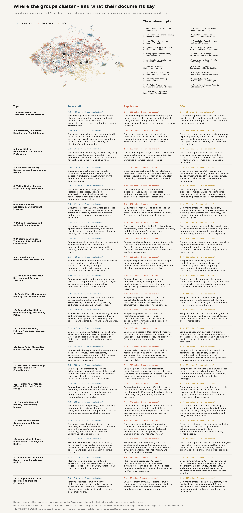

[Full-resolution PNG](../figures/national_claims/full/topics/positions/all_groups.png)

**Democratic and Republican**

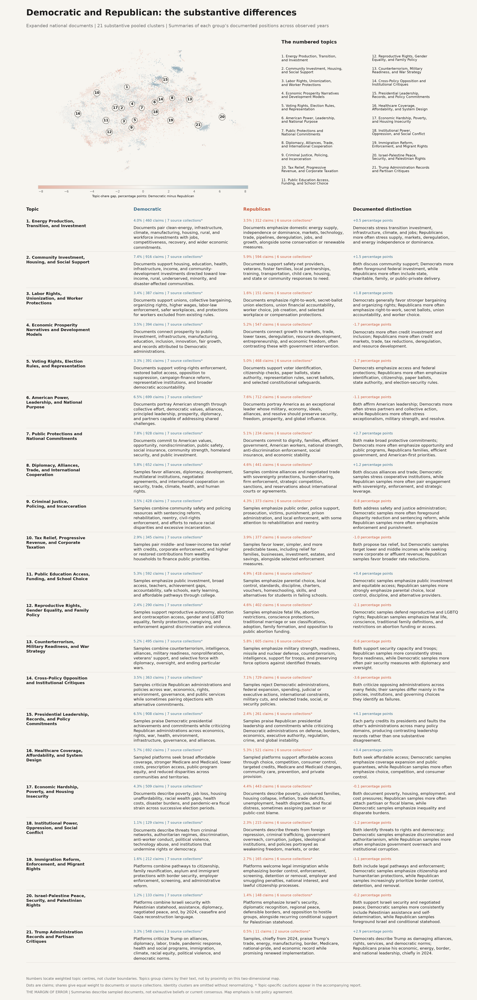

[Full-resolution PNG](../figures/national_claims/full/topics/positions/democratic_vs_republican.png)

**Democratic and DSA**

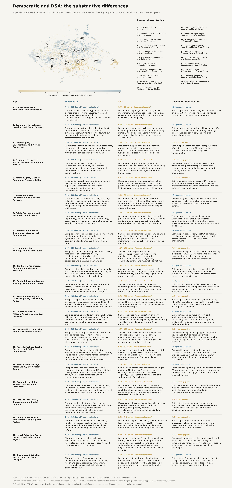

[Full-resolution PNG](../figures/national_claims/full/topics/positions/democratic_vs_dsa.png)

**Republican and DSA**

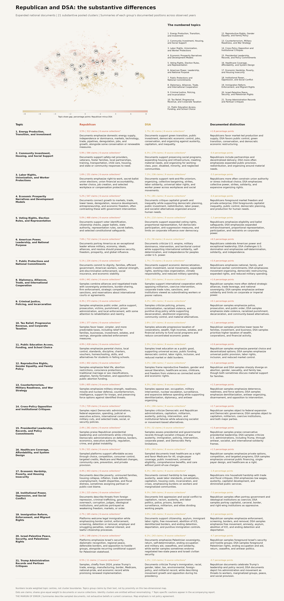

[Full-resolution PNG](../figures/national_claims/full/topics/positions/republican_vs_dsa.png)

[Full position review](../data/analysis/national_claims/full/topics/positions/group_positions.json) / [All sampled claims and source evidence](../data/analysis/national_claims/full/topics/positions/evidence.csv)

#### Position cluster 1: Energy Production, Transition, and Investment

**Democratic:** Documents pair clean-energy, infrastructure, climate, manufacturing, housing, rural, and workforce investments with jobs, competitiveness, recovery, and wider economic commitments.
Scope caution: Some sampled commitments concern housing, trade, rural development, or investment generally rather than energy.
- In 1997, the U.S. negotiated the Kyoto Protocols, an international treaty to establish a strong, realistic, and effective framework to reduce greenhouse emissions in an environmentally strong and economically sound way. ([2000 Democratic Party Platform](https://www.presidency.ucsb.edu/documents/2000-democratic-party-platform); 2000; scoped characters 119728:120468; `democratic-2000-normalized-5f46dfe0b026-006`)
- Commitment to use natural resources to fuel the economy. ([2004 Democratic Party Platform](https://www.presidency.ucsb.edu/documents/2004-democratic-party-platform); 2004; scoped characters 100223:100677; `democratic-2004-normalized-64b3e37a36df-001`)
- Commitment to invest in advanced biofuels like cellulosic ethanol which will provide American-grown fuel and help free the United States from reliance on oil. ([2008 Democratic Party Platform](https://www.presidency.ucsb.edu/documents/2008-democratic-party-platform); 2008; scoped characters 40248:41261; `democratic-2008-normalized-24753467a5b2-009`)
- Support for further cutting reliance on oil with increased energy efficiency in buildings, industry, and homes. ([2012 Democratic Party Platform](https://www.presidency.ucsb.edu/documents/2012-democratic-party-platform); 2012; scoped characters 34090:35578; `democratic-2012-normalized-f07946078a76-006`)
- Commitment to incentivize wind, solar, and other renewable energy over the development of new natural gas power plants. ([2016 Democratic Party Platform](https://www.presidency.ucsb.edu/documents/2016-democratic-party-platform); 2016; scoped characters 92328:92834; `democratic-2016-normalized-68c57aa9b811-011`)
- Commitment to invest significant new resources in clean energy generation and distribution. ([2020 Democratic Party Platform](https://www.presidency.ucsb.edu/documents/2020-democratic-party-platform); 2020; scoped characters 90178:90902; `democratic-2020-normalized-aab0c6ab7f9f-008`)
- Commitment to eliminate tens of billions of dollars in subsidies for oil and gas companies. ([2024 Democratic Party Platform](https://www.presidency.ucsb.edu/documents/2024-democratic-party-platform); 2024; scoped characters 42913:43499; `democratic-2024-normalized-92fa6cad93aa-003`)

**Republican:** Documents emphasize domestic energy supply, independence or dominance, markets, technology, trade, pipelines, deregulation, jobs, and growth, alongside some conservation or renewable measures.
Scope caution: The sample also contains broader economic and national-leadership commitments.
- Commitment to advance clean coal technology. ([2000 Republican Party Platform](https://www.presidency.ucsb.edu/documents/2000-republican-party-platform); 2000; scoped characters 125581:125611; `republican-2000-normalized-082b482bc0aa-005`)
- Commitment to continue to support efforts to expand the use of biodiesel and ethanol. ([2004 Republican Party Platform](https://www.presidency.ucsb.edu/documents/2004-republican-party-platform); 2004; scoped characters 164314:164590; `republican-2004-normalized-e36730b2f81d-007`)
- Commitment to aggressively support technological advances to reduce petroleum dependence. ([2008 Republican Party Platform](https://www.presidency.ucsb.edu/documents/2008-republican-party-platform); 2008; scoped characters 98266:98650; `republican-2008-normalized-dd4b307d1b57-006`)
- Support for promoting development of all forms of energy. ([2012 Republican Party Platform](https://www.presidency.ucsb.edu/documents/2012-republican-party-platform); 2012; scoped characters 70208:70984; `republican-2012-normalized-22c5dd831d0a-002`)
- Support for the development of all forms of energy that are marketable in a free economy without subsidies, including coal, oil, natural gas, nuclear power, and hydropower. ([2016 Republican Party Platform](https://www.presidency.ucsb.edu/documents/2016-republican-party-platform); 2016; scoped characters 83920:85078; `republican-2016-normalized-d390dcdfb473-001`)
- Commitment to end market-distorting restrictions on oil, natural gas, and coal. ([2024 Republican Party Platform](https://www.presidency.ucsb.edu/documents/2024-republican-party-platform); 2024; scoped characters 15857:16203; `republican-2024-normalized-007a594371a0-012`)

**DSA:** Documents support green transition, public investment, democratic economic control, jobs, conservation, and organizing against austerity, capitalism, and inequality.
Scope caution: Some samples concern movement strategy, elections, or economic restructuring beyond energy.
- The development of the Gulf Coast involved billions of public dollars for the petro-chemical industry. ([DSA Statement on Hurricane Katrina](https://dlarchive.dsausa.org/wp-content/uploads/2018/12/DL_2005_V033_02.pdf); 2005; scoped characters 4230:5292; `dsa-2005-katrina-lead-normalized-c5695c721be6-007`)
- The United States economy can be restructured in an ecologically sustainable direction and one that provides good jobs at good wages only if the federal government invests significantly in infrastructure development, alternative energy, and mass-transit technologies. ([2009 convention national priorities resolution](https://dlarchive.dsausa.org/wp-content/uploads/2018/12/DL_2010_V037_03.pdf); 2009; scoped characters 5541:6944; `dsa-2009-priorities-normalized-e439cbeb16b4-003`)
- A transition to renewable energy and innovation in energy productivity can continue to raise living standards. ([A Social and Economic Bill of Rights](https://www.dsausa.org/wp-json/wp/v2/strategy/617); 2012-12-23; scoped characters 31509:31977; `dsa-2010-social-economic-rights-normalized-d54c840b4161-008`)
- Investments in renewable energy and efficient technologies would be prioritized to guarantee ecological sustainability and the future existence of life on Earth. ([Resistance Rising - published summary of DSA strategy](https://www.dsausa.org/files/2016/06/Resistance_Rising.pdf); 2016-06; scoped characters 12597:14064; `dsa-2016-strategy-normalized-c2c0c3b2436c-004`)
- Support for the Green New Deal. ([2021 adopted DSA Political Platform - immutable December 2021 snapshot](https://web.archive.org/web/20211230205416id_/https://www.dsausa.org/dsa-political-platform-from-2021-convention/); 2021-11-09; scoped characters 39166:39180; `dsa-2021-adopted-normalized-5b0837630ae9-015`)
- Support for massive public investment to transition away from fossil fuels toward a green and sustainable economy. ([Workers Deserve More 2024](https://program.dsausa.org/wp-content/uploads/2024/08/DSA_2024Program.pdf); 2024-08; scoped characters 7352:8203; `dsa-2024-program-normalized-f23d4047d972-010`)

**Pairwise distinctions:**
- Democratic / DSA: Both support investment and jobs; DSA more often links transition to public ownership, democratic control, and anti-capitalist restructuring.
- Democratic / Republican: Democrats stress transition investment, infrastructure, climate, and jobs; Republicans more often stress supply, markets, deregulation, and energy independence or dominance.
- Republican / DSA: Republicans favor market-led production and supply; DSA favors public control, green transition, conservation, and democratic economic restructuring.

#### Position cluster 2: Community Investment, Housing, and Social Support

**Democratic:** Documents support housing, education, health, infrastructure, income, and community-development investments directed toward low-income, rural, underserved, minority, and disaster-affected communities.
Scope caution: Programs and beneficiaries vary widely across years, so the sample is not one unified assistance plan.
- Support for helping communities reconnect to the land around them. ([2000 Democratic Party Platform](https://www.presidency.ucsb.edu/documents/2000-democratic-party-platform); 2000; scoped characters 49516:50121; `democratic-2000-normalized-118d6ef991a5-011`)
- Commitment to expand use of voluntary, incentive-based programs that target private landowners. ([2004 Democratic Party Platform](https://www.presidency.ucsb.edu/documents/2004-democratic-party-platform); 2004; scoped characters 100871:101022; `democratic-2004-normalized-64b3e37a36df-008`)
- Support for strengthening federal commitment to cities. ([2008 Democratic Party Platform](https://www.presidency.ucsb.edu/documents/2008-democratic-party-platform); 2008; scoped characters 133738:135336; `democratic-2008-normalized-2189f80725b2-003`)
- Support for expanding the successful neighborhood stabilization efforts proposed in the President’s American Jobs Act. ([2012 Democratic Party Platform](https://www.presidency.ucsb.edu/documents/2012-democratic-party-platform); 2012; scoped characters 18548:19441; `democratic-2012-normalized-70fd3ee45647-008`)
- Support for directing more federal resources to lifting up communities that have been left out and left behind. ([2016 Democratic Party Platform](https://www.presidency.ucsb.edu/documents/2016-democratic-party-platform); 2016; scoped characters 65372:65998; `democratic-2016-normalized-a9bcc4d230c7-011`)
- Commitment to drive increased resources to communities with the highest need, including those with the highest concentrations of low-income students, impoverished urban areas impacted by gentrification, and rural areas. ([2020 Democratic Party Platform](https://www.presidency.ucsb.edu/documents/2020-democratic-party-platform); 2020; scoped characters 204524:205189; `democratic-2020-normalized-5e55d1004289-004`)
- Commitment to increase funding for programs that support the creation and preservation of affordable housing options for essential workers. ([2024 Democratic Party Platform](https://www.presidency.ucsb.edu/documents/2024-democratic-party-platform); 2024; scoped characters 69540:70730; `democratic-2024-normalized-51d7cbe64123-005`)

**Republican:** Documents support safety-net providers, veterans, foster families, local partnerships, training, transportation, child care, housing, and state or community responses to need.
Scope caution: Approaches range from public programs to partnerships, charities, and state-led delivery.
- Commitment to establish stronger public-private partnerships for safety net providers and hospitals in rural and underserved communities. ([2000 Republican Party Platform](https://www.presidency.ucsb.edu/documents/2000-republican-party-platform); 2000; scoped characters 92920:93402; `republican-2000-normalized-76e7e2418f31-008`)
- Support for offering training, transportation, and child care services to help people become self-sufficient. ([2004 Republican Party Platform](https://www.presidency.ucsb.edu/documents/2004-republican-party-platform); 2004; scoped characters 251901:252254; `republican-2004-normalized-8eb776d9223a-009`)
- Support for better meeting state needs. ([2008 Republican Party Platform](https://www.presidency.ucsb.edu/documents/2008-republican-party-platform); 2008; scoped characters 126725:127315; `republican-2008-normalized-fd4bbde75007-008`)
- Support for ensuring equitable participation in federal programs by American Indians, including Alaska Natives, and Native Hawaiians. ([2012 Republican Party Platform](https://www.presidency.ucsb.edu/documents/2012-republican-party-platform); 2012; scoped characters 109114:109763; `republican-2012-normalized-df43c441acff-005`)
- Support for encouraging efforts to reclaim communities from the culture of poverty. ([2016 Republican Party Platform](https://www.presidency.ucsb.edu/documents/2016-republican-party-platform); 2016; scoped characters 137296:138362; `republican-2016-normalized-bfaeff3ad252-005`)
- Commitment to support increased focus on Benefit flexibility. ([2024 Republican Party Platform](https://www.presidency.ucsb.edu/documents/2024-republican-party-platform); 2024; scoped characters 21860:22119; `republican-2024-normalized-639254060a0e-007`)

**DSA:** Documents support preserving social programs, expanding housing and infrastructure, meeting material needs, and organizing for working-class, poor, disabled, minority, and neglected communities.
Scope caution: Some examples are movement priorities or broad redistributive commitments rather than program designs.
- Support will be given to measures in the upcoming legislative fight around renewing welfare reform that will aid the poor and not punish them. ([2001 convention national priorities resolution](https://www.dsausa.org/files/2019/07/DL-2001-Convention-Coverage.pdf); 2002; scoped characters 1794:3222; `dsa-2001-convention-priorities-normalized-dbbe074a05f5-005`)
- Commitment for DSA's NPC and national office to continue providing resources and information for local living-wage campaigns, immigrant-justice activism and labor support. ([2005 convention national priorities resolution](https://dlarchive.dsausa.org/wp-content/uploads/2018/12/DL_2006_V033_03.pdf); 2006; scoped characters 0:1644; `dsa-2005-convention-priorities-normalized-f7cdb3ab29f7-repair-0a3e417fbf5a-010`)
- Support for building the capacity of locals, commissions, networks, and activists to take a proactive role in both visible public education and credible political action. ([2009 convention national priorities resolution](https://dlarchive.dsausa.org/wp-content/uploads/2018/12/DL_2010_V037_03.pdf); 2009; scoped characters 8389:8830; `dsa-2009-priorities-normalized-ed7e15d24ee9-002`)
- Government should promote alternative forms of housing ownership—co-ops, nonprofit and community development corporations—that would also be committed to revitalizing communities. ([A Social and Economic Bill of Rights](https://www.dsausa.org/wp-json/wp/v2/strategy/617); 2012-12-23; scoped characters 12921:13561; `dsa-2010-social-economic-rights-normalized-edb91d554823-010`)
- Commitment to devote more resources to developing new leaders through individual mentoring, skills training, and educational programming. ([Resistance Rising - published summary of DSA strategy](https://www.dsausa.org/files/2016/06/Resistance_Rising.pdf); 2016-06; scoped characters 33893:35651; `dsa-2016-strategy-normalized-8578fcc63dcb-002`)
- Support for securing adequate compensation and living standards, as well as effective infrastructure, healthcare, and institutions in communities and abroad. ([2021 adopted DSA Political Platform - immutable December 2021 snapshot](https://web.archive.org/web/20211230205416id_/https://www.dsausa.org/dsa-political-platform-from-2021-convention/); 2021-11-09; scoped characters 25750:26880; `dsa-2021-adopted-normalized-e66dc1af24d6-005`)
- Support for massive infrastructure and jobs programs. ([Workers Deserve More 2024](https://program.dsausa.org/wp-content/uploads/2024/08/DSA_2024Program.pdf); 2024-08; scoped characters 7352:8203; `dsa-2024-program-normalized-f23d4047d972-012`)

**Pairwise distinctions:**
- Democratic / DSA: Both support housing and social investment; DSA more often frames provision through working-class power, redistribution, and universal material guarantees.
- Democratic / Republican: Both discuss community support; Democrats more often foreground federal investment, while Republicans more often include state, charitable, family, or public-private delivery.
- Republican / DSA: Republicans include partnerships and decentralized delivery; DSA more often emphasizes expanded public provision, redistribution, and organizing around material needs.

#### Position cluster 3: Labor Rights, Unionization, and Worker Protections

**Democratic:** Documents support unions, collective bargaining, organizing rights, higher wages, labor-law enforcement, safer workplaces, and protections for workers excluded from existing rules.
Scope caution: Specific mechanisms and covered workers differ across platform years.
- Support for fair treatment of temporary, part-time and contract workers, including the wages and benefits appropriate to the work they perform. ([2000 Democratic Party Platform](https://www.presidency.ucsb.edu/documents/2000-democratic-party-platform); 2000; scoped characters 63138:63857; `democratic-2000-normalized-db906e584bef-repair-363eca1eef9f-005`)
- Support for reforming labor laws to protect the rights of workers, including public employees, to bargain contracts and organize on a level playing field without interference. ([2004 Democratic Party Platform](https://www.presidency.ucsb.edu/documents/2004-democratic-party-platform); 2004; scoped characters 64881:65517; `democratic-2004-normalized-f23414e33192-006`)
- Commitment to allow unions to organize and lift up workers. ([2008 Democratic Party Platform](https://www.presidency.ucsb.edu/documents/2008-democratic-party-platform); 2008; scoped characters 32612:34070; `democratic-2008-normalized-aece53525f28-008`)
- Commitment to fight for labor laws that facilitate the collective bargaining process. ([2012 Democratic Party Platform](https://www.presidency.ucsb.edu/documents/2012-democratic-party-platform); 2012; scoped characters 47039:48229; `democratic-2012-normalized-18cc338046ac-010`)
- Commitment to make it easier for public and private workers to exercise their right to organize and join unions. ([2016 Democratic Party Platform](https://www.presidency.ucsb.edu/documents/2016-democratic-party-platform); 2016; scoped characters 9736:10261; `democratic-2016-normalized-7ba2e6e4e2f2-002`)
- Commitment to fight to raise wages for working people and improve job quality and security. ([2020 Democratic Party Platform](https://www.presidency.ucsb.edu/documents/2020-democratic-party-platform); 2020; scoped characters 31987:33381; `democratic-2020-normalized-4521936cc397-001`)
- Support for codifying a right to organize for domestic workers, farm workers, and other unprotected laborers. ([2024 Democratic Party Platform](https://www.presidency.ucsb.edu/documents/2024-democratic-party-platform); 2024; scoped characters 18243:19386; `democratic-2024-normalized-8af3eb44deaa-005`)

**Republican:** Documents emphasize right-to-work, secret-ballot union elections, union financial accountability, worker choice, job creation, and selected workplace or compensation protections.
Scope caution: The sample combines limits on union power with some worker-protection measures.
- Support for the right of states to enact Right-to-Work laws. ([2000 Republican Party Platform](https://www.presidency.ucsb.edu/documents/2000-republican-party-platform); 2000; scoped characters 64432:65022; `republican-2000-normalized-7dc35a7f7907-002`)
- Support for the right of states to enact Right-to-Work laws. ([2004 Republican Party Platform](https://www.presidency.ucsb.edu/documents/2004-republican-party-platform); 2004; scoped characters 180203:180630; `republican-2004-normalized-ae295cef572d-011`)
- Advocacy for modernization of the nation's labor laws to make it easier for employers and employees to plan, execute, and profit together. ([2008 Republican Party Platform](https://www.presidency.ucsb.edu/documents/2008-republican-party-platform); 2008; scoped characters 81300:81949; `republican-2008-normalized-5b0f314c5424-002`)
- Support the enactment of a National Right-to-Work law to promote worker freedom and greater economic liberty. ([2012 Republican Party Platform](https://www.presidency.ucsb.edu/documents/2012-republican-party-platform); 2012; scoped characters 35273:36184; `republican-2012-normalized-9b00c73c5686-008`)
- Commitment to encourage trends by bringing labor law into the 21st century. ([2016 Republican Party Platform](https://www.presidency.ucsb.edu/documents/2016-republican-party-platform); 2016; scoped characters 35105:35658; `republican-2016-normalized-eb7a88d709cf-008`)
- Commitment to support working parents. ([2024 Republican Party Platform](https://www.presidency.ucsb.edu/documents/2024-republican-party-platform); 2024; scoped characters 26428:26636; `republican-2024-normalized-19b3439517fb-018`)

**DSA:** Documents support rank-and-file unionism, organizing, collective bargaining, strikes, labor solidarity, universal labor rights, and worker power across workplaces and social movements.
Scope caution: Several examples are organizing strategies or solidarity resolutions rather than legislative proposals.
- Continued support will be given to union organizing efforts. ([2001 convention national priorities resolution](https://www.dsausa.org/files/2019/07/DL-2001-Convention-Coverage.pdf); 2002; scoped characters 1794:3222; `dsa-2001-convention-priorities-normalized-dbbe074a05f5-004`)
- Support for workers on both sides of the Green Line, but not their reactionary political leaderships. ([NPC resolution on Israel's occupation of the West Bank and Gaza](https://dlarchive.dsausa.org/wp-content/uploads/2018/12/DL_2004_V032_02.pdf); 2004; scoped characters 4294:5832; `dsa-2004-israel-palestine-normalized-fb76a6281490-008`)
- Support for continuing to work with labor and its allies to pass meaningful labor law reform that would restore a real right to organize and strike and ensure that the NLRB enforces these laws. ([2009 convention national priorities resolution](https://dlarchive.dsausa.org/wp-content/uploads/2018/12/DL_2010_V037_03.pdf); 2009; scoped characters 3097:4220; `dsa-2009-priorities-normalized-7fbe4754d605-004`)
- The Employee Free Choice Act (EFCA) would restore the original intent of the National Labor Relations Board (NLRB) by permitting workers to choose union representation without fear and intimidation. ([A Social and Economic Bill of Rights](https://www.dsausa.org/wp-json/wp/v2/strategy/617); 2012-12-23; scoped characters 34674:35167; `dsa-2010-social-economic-rights-normalized-b973e3114edd-001`)
- Commitment to stand in solidarity with movements around the world fighting to raise global labor, environmental, and human rights standards in opposition to corporate “race to the bottom” policies. ([Resistance Rising - published summary of DSA strategy](https://www.dsausa.org/files/2016/06/Resistance_Rising.pdf); 2016-06; scoped characters 32452:33891; `dsa-2016-strategy-normalized-300d6a7f449b-001`)
- Support for labor rights for all, regardless of immigration status. ([2021 adopted DSA Political Platform - immutable December 2021 snapshot](https://web.archive.org/web/20211230205416id_/https://www.dsausa.org/dsa-political-platform-from-2021-convention/); 2021-11-09; scoped characters 64302:64494; `dsa-2021-adopted-normalized-6b522fa83bc9-008`)
- Support for protecting all workers’ rights to strike and form a union. ([Workers Deserve More 2024](https://program.dsausa.org/wp-content/uploads/2024/08/DSA_2024Program.pdf); 2024-08; scoped characters 7352:8203; `dsa-2024-program-normalized-f23d4047d972-002`)

**Pairwise distinctions:**
- Democratic / DSA: Both support unions and organizing; DSA more often stresses rank-and-file power, strikes, solidarity, and broader working-class transformation.
- Democratic / Republican: Democrats generally favor stronger bargaining and organizing rights; Republicans more often emphasize right-to-work, secret ballots, union accountability, and worker choice.
- Republican / DSA: Republicans more often constrain union authority or stress individual choice; DSA emphasizes collective power, strikes, solidarity, and expansive organizing rights.

#### Position cluster 4: Economic Prosperity Narratives and Development Models

**Democratic:** Documents connect prosperity to public investment, infrastructure, manufacturing, education, inclusion, innovation, fair growth, and records attributed to Democratic administrations.
Scope caution: The sample mixes causal narratives, administration records, and policy commitments.
- Economic prosperity cannot be taken for granted. ([2000 Democratic Party Platform](https://www.presidency.ucsb.edu/documents/2000-democratic-party-platform); 2000; scoped characters 6216:6828; `democratic-2000-normalized-69d77edc0a26-009`)
- When the middle class grows in size and security, the country gets stronger. ([2004 Democratic Party Platform](https://www.presidency.ucsb.edu/documents/2004-democratic-party-platform); 2004; scoped characters 66754:67069; `democratic-2004-normalized-e819415baaf1-002`)
- Belief that the benefits of open markets should be shared more equitably. ([2008 Democratic Party Platform](https://www.presidency.ucsb.edu/documents/2008-democratic-party-platform); 2008; scoped characters 66617:67063; `democratic-2008-normalized-c05d4fd937df-004`)
- President Obama and Democrats around the country are fighting back from the deepest economic crisis since the Great Depression by laying the foundations for an economy that out-educates, out-builds, and out-innovates the rest of the world. ([2012 Democratic Party Platform](https://www.presidency.ucsb.edu/documents/2012-democratic-party-platform); 2012; scoped characters 169318:169935; `democratic-2012-normalized-952aa542eb75-007`)
- When women and girls are healthy, educated, and able to participate economically, their families and communities prosper, poverty decreases, and economies grow. ([2016 Democratic Party Platform](https://www.presidency.ucsb.edu/documents/2016-democratic-party-platform); 2016; scoped characters 151572:152604; `democratic-2016-normalized-0db34fffef9d-003`)
- Evidence-based investments in jobs, housing, education, and the arts will make the nation freer. ([2020 Democratic Party Platform](https://www.presidency.ucsb.edu/documents/2020-democratic-party-platform); 2020; scoped characters 106051:106506; `democratic-2020-normalized-11c6d091feaf-026`)
- When women and girls are healthy, educated, and able to participate economically, their families and communities prosper, poverty decreases, and economies grow. ([2024 Democratic Party Platform](https://www.presidency.ucsb.edu/documents/2024-democratic-party-platform); 2024; scoped characters 272534:273282; `democratic-2024-normalized-3f92cb29beb8-004`)

**Republican:** Documents connect growth to markets, trade, lower taxes, deregulation, resource development, entrepreneurship, and economic freedom, often contrasting these with government intervention.
Scope caution: Some claims are retrospective or rhetorical rather than specific proposals.
- Cutting tax rates, simplifying the tax code, deregulating industries, and opening world markets to American enterprise resulted in tremendous growth in the 1980s. ([2000 Republican Party Platform](https://www.presidency.ucsb.edu/documents/2000-republican-party-platform); 2000; scoped characters 6170:6843; `republican-2000-normalized-79e5ffd6ad69-015`)
- Economic growth allows people to lift their lives out of poverty. ([2004 Republican Party Platform](https://www.presidency.ucsb.edu/documents/2004-republican-party-platform); 2004; scoped characters 66567:66961; `republican-2004-normalized-d0360dc943ed-012`)
- Belief in the free market as the best tool to sustained prosperity and opportunity for all. ([2008 Republican Party Platform](https://www.presidency.ucsb.edu/documents/2008-republican-party-platform); 2008; scoped characters 82425:83439; `republican-2008-normalized-12c182215fbf-007`)
- Prosperity provides the means by which individuals and families can maintain their independence from government. ([2012 Republican Party Platform](https://www.presidency.ucsb.edu/documents/2012-republican-party-platform); 2012; scoped characters 5696:6331; `republican-2012-normalized-e2658e2345c2-003`)
- A stronger private sector in U.S. territories can reduce dependence on public employment and lead toward self-sufficiency. ([2016 Republican Party Platform](https://www.presidency.ucsb.edu/documents/2016-republican-party-platform); 2016; scoped characters 125548:125938; `republican-2016-normalized-0a9ccb6d88d6-009`)
- Support for defeating inflation and quickly bringing down all prices. ([2024 Republican Party Platform](https://www.presidency.ucsb.edu/documents/2024-republican-party-platform); 2024; scoped characters 8337:8392; `republican-2024-normalized-a213c71f3943-008`)

**DSA:** Documents critique capitalist growth and inequality while supporting democratic planning, public investment, redistribution, labor power, and socialist alternatives organized around human needs.
Scope caution: The sample spans critique, strategy, and long-term visions rather than one development program.
- The economic expansion of the last decade primarily benefited the well-off. ([2001 convention national priorities resolution](https://www.dsausa.org/files/2019/07/DL-2001-Convention-Coverage.pdf); 2002; scoped characters 0:523; `dsa-2001-convention-priorities-normalized-ef8a3eb37787-001`)
- The critique of individualist marketplace ideology and the defense of social solidarity and public provision are only coherently done by socialists. ([2005 convention national priorities resolution](https://dlarchive.dsausa.org/wp-content/uploads/2018/12/DL_2006_V033_03.pdf); 2006; scoped characters 2363:3376; `dsa-2005-convention-priorities-normalized-7c23ddeb2dfa-005`)
- Short of affordable re-financing, distressed homeowners should have the right to stay in their homes and pay the holders of their mortgages an affordable, current-market-value rent. ([2009 convention national priorities resolution](https://dlarchive.dsausa.org/wp-content/uploads/2018/12/DL_2010_V037_03.pdf); 2009; scoped characters 1653:3096; `dsa-2009-priorities-normalized-69ef366c0cec-009`)
- In a society that assures income security, loss of a job will open opportunities to new employment without the pressure to accept the first job offer that emerges. ([A Social and Economic Bill of Rights](https://www.dsausa.org/wp-json/wp/v2/strategy/617); 2012-12-23; scoped characters 25352:25951; `dsa-2010-social-economic-rights-normalized-87e9c919def2-001`)
- In the imagined democratic socialist society, more free time, protection from economic exploitation and deeper norms of respect and solidarity would for the first time let individuals on a mass scale freely choose their development, limited by mutual respect and the absence of exploitation and oppression. ([Resistance Rising - published summary of DSA strategy](https://www.dsausa.org/files/2016/06/Resistance_Rising.pdf); 2016-06; scoped characters 18915:20617; `dsa-2016-strategy-normalized-5c48fe26db58-repair-ee0ea93e3ccb-001`)
- Support for social ownership of all major industry and infrastructure. ([2021 adopted DSA Political Platform - immutable December 2021 snapshot](https://web.archive.org/web/20211230205416id_/https://www.dsausa.org/dsa-political-platform-from-2021-convention/); 2021-11-09; scoped characters 23410:23467; `dsa-2021-adopted-normalized-067c1b4d0c0e-011`)
- Billionaires control access to basic human needs like housing, healthcare, and education and make a profit off of them. ([Workers Deserve More 2024](https://program.dsausa.org/wp-content/uploads/2024/08/DSA_2024Program.pdf); 2024-08; scoped characters 1305:2868; `dsa-2024-program-normalized-c0035893561c-004`)

**Pairwise distinctions:**
- Democratic / DSA: Democrats generally frame inclusive growth within existing institutions; DSA more often critiques capitalism and advances democratic planning, redistribution, and socialist alternatives.
- Democratic / Republican: Democrats more often credit investment and inclusion; Republicans more often credit markets, trade, tax reductions, deregulation, and resource development.
- Republican / DSA: Republicans foreground market freedom and private enterprise; DSA foregrounds capitalist inequality, public control, democratic planning, and production for human needs.

#### Position cluster 5: Voting Rights, Election Rules, and Representation

**Democratic:** Documents support voting-rights enforcement, restored ballot access, opposition to suppression, campaign-finance reform, representative institutions, and broader democratic accountability.
Scope caution: Some samples concern constitutional rights or governance beyond elections.
- Support for the sovereignty of American Indians and Native Alaskans. ([2000 Democratic Party Platform](https://www.presidency.ucsb.edu/documents/2000-democratic-party-platform); 2000; scoped characters 111620:112662; `democratic-2000-normalized-f2530cd8ab59-001`)
- Commitment to call for legislative action that will fully protect and enforce the fundamental Constitutional right of every American to vote. ([2004 Democratic Party Platform](https://www.presidency.ucsb.edu/documents/2004-democratic-party-platform); 2004; scoped characters 104986:105457; `democratic-2004-normalized-1cc1340fa574-012`)
- Commitment to vigorously enforce voting rights laws instead of making them tools of partisan political agendas. ([2008 Democratic Party Platform](https://www.presidency.ucsb.edu/documents/2008-democratic-party-platform); 2008; scoped characters 158596:160012; `democratic-2008-normalized-6cb8a3d542f2-009`)
- Support for campaign finance reform, potentially through a constitutional amendment if necessary. ([2012 Democratic Party Platform](https://www.presidency.ucsb.edu/documents/2012-democratic-party-platform); 2012; scoped characters 63038:63837; `democratic-2012-normalized-db94890967e2-002`)
- Support for restoring the full protections of the Voting Rights Act. ([2016 Democratic Party Platform](https://www.presidency.ucsb.edu/documents/2016-democratic-party-platform); 2016; scoped characters 80174:80810; `democratic-2016-normalized-4292f2af0201-001`)
- Commitment to restore the full power of the Voting Rights Act. ([2020 Democratic Party Platform](https://www.presidency.ucsb.edu/documents/2020-democratic-party-platform); 2020; scoped characters 5092:5834; `democratic-2020-normalized-fcd461184fac-008`)
- Commitment to protect the right to vote for returning citizens. ([2024 Democratic Party Platform](https://www.presidency.ucsb.edu/documents/2024-democratic-party-platform); 2024; scoped characters 124205:125155; `democratic-2024-normalized-e7f0490f5d0f-009`)

**Republican:** Documents support voter identification, citizenship checks, paper ballots, state authority, representation rules, secret ballots, and selected constitutional safeguards.
Scope caution: The sample mixes election administration with broader constitutional amendments and governmental limits.
- Support for a constitutional amendment that will restore to the people, through their elected representatives, their right to safeguard the flag. ([2000 Republican Party Platform](https://www.presidency.ucsb.edu/documents/2000-republican-party-platform); 2000; scoped characters 65040:65538; `republican-2000-normalized-7dc35a7f7907-009`)
- Support for a Constitutional amendment that fully protects marriage. ([2004 Republican Party Platform](https://www.presidency.ucsb.edu/documents/2004-republican-party-platform); 2004; scoped characters 261621:262292; `republican-2004-normalized-5d1db5c9176a-001`)
- Support for the right of states to require an official government-issued photo identification for voting. ([2008 Republican Party Platform](https://www.presidency.ucsb.edu/documents/2008-republican-party-platform); 2008; scoped characters 62697:63176; `republican-2008-normalized-42539f6998d6-010`)
- Support for enacting the Secret Ballot Protection Act. ([2012 Republican Party Platform](https://www.presidency.ucsb.edu/documents/2012-republican-party-platform); 2012; scoped characters 35273:36184; `republican-2012-normalized-9b00c73c5686-002`)
- Pledge to protect the voting rights of every citizen. ([2016 Republican Party Platform](https://www.presidency.ucsb.edu/documents/2016-republican-party-platform); 2016; scoped characters 68925:70221; `republican-2016-normalized-89c33cf0a59f-002`)
- Support for securing elections, including same day voting, voter identification, paper ballots, and proof of citizenship. ([2024 Republican Party Platform](https://www.presidency.ucsb.edu/documents/2024-republican-party-platform); 2024; scoped characters 7906:8016; `republican-2024-normalized-a213c71f3943-005`)

**DSA:** Documents support expanded voting rights, proportional representation, full democratic participation, anti-suppression measures, and limits on corporate influence over democracy.
Scope caution: Some samples address economic democracy, public institutions, or governance rather than ballot rules.
- Progressives and progressive elected officials must demand that all proposals be based on proven need rather than emotional excess. ([DSA statement on the September 11 terrorist attacks](https://dlarchive.dsausa.org/wp-content/uploads/2018/12/DL_2001_V029_02.pdf); 2001; scoped characters 0:1400; `dsa-2001-september-11-normalized-2872d1c0c23f-004`)
- Support for expanding democracy to control corporations. ([An Economic Justice Agenda - adopted November 2007](https://www.dsausa.org/wp-json/wp/v2/strategy/612); 2012-12-23; scoped characters 29985:30029; `dsa-2007-economic-justice-normalized-f59de5af577c-006`)
- Commitment to join movements demanding a moratorium on foreclosures. ([2009 convention national priorities resolution](https://dlarchive.dsausa.org/wp-content/uploads/2018/12/DL_2010_V037_03.pdf); 2009; scoped characters 1653:3096; `dsa-2009-priorities-normalized-69ef366c0cec-007`)
- A democracy’s strength is the thoughtful and full engagement of all of its citizens in the decision-making processes in their communities and at all levels of government. ([A Social and Economic Bill of Rights](https://www.dsausa.org/wp-json/wp/v2/strategy/617); 2012-12-23; scoped characters 26574:27302; `dsa-2010-social-economic-rights-normalized-ed1466a9b361-003`)
- A system of proportional representation would be established for Congress so that Congress actually reflects the political will of the electorate. ([Resistance Rising - published summary of DSA strategy](https://www.dsausa.org/files/2016/06/Resistance_Rising.pdf); 2016-06; scoped characters 14066:15779; `dsa-2016-strategy-normalized-48e0bdf87f39-010`)
- Support for guaranteeing the right to vote. ([2021 adopted DSA Political Platform - immutable December 2021 snapshot](https://web.archive.org/web/20211230205416id_/https://www.dsausa.org/dsa-political-platform-from-2021-convention/); 2021-11-09; scoped characters 8052:8079; `dsa-2021-adopted-normalized-e91b86120260-018`)
- Support for extending full voting rights to people with criminal convictions and noncitizens. ([Workers Deserve More 2024](https://program.dsausa.org/wp-content/uploads/2024/08/DSA_2024Program.pdf); 2024-08; scoped characters 9250:9982; `dsa-2024-program-normalized-0037e0c6a9c8-001`)

**Pairwise distinctions:**
- Democratic / DSA: Both emphasize voting access; DSA more often adds proportional representation, noncitizen enfranchisement, economic democracy, and anti-corporate structural change.
- Democratic / Republican: Democrats emphasize access and federal protections; Republicans more often emphasize identification, citizenship, paper ballots, state authority, and election-security rules.
- Republican / DSA: Republicans emphasize eligibility and ballot safeguards; DSA emphasizes expanded enfranchisement, proportional representation, participation, and restraints on corporate power.

#### Position cluster 6: American Power, Leadership, and National Purpose

**Democratic:** Documents portray American strength through collective effort, democratic values, alliances, principled leadership, prosperity, diplomacy, and partners capable of addressing shared challenges.
Scope caution: Claims vary between national narratives, administration records, and foreign-policy commitments.
- America's current prosperity, progress, and peace is a result of the hard work of the American people. ([2000 Democratic Party Platform](https://www.presidency.ucsb.edu/documents/2000-democratic-party-platform); 2000; scoped characters 14:452; `democratic-2000-normalized-1136706f8f92-002`)
- Support for strong economic development for all those who live under the U.S. flag. ([2004 Democratic Party Platform](https://www.presidency.ucsb.edu/documents/2004-democratic-party-platform); 2004; scoped characters 109653:109787; `democratic-2004-normalized-959a61551087-006`)
- The United States shares its deepest values with democracies. ([2008 Democratic Party Platform](https://www.presidency.ucsb.edu/documents/2008-democratic-party-platform); 2008; scoped characters 109102:109568; `democratic-2008-normalized-9444e34d73ce-004`)
- Through collective effort, Americans can overcome challenges. ([2012 Democratic Party Platform](https://www.presidency.ucsb.edu/documents/2012-democratic-party-platform); 2012; scoped characters 63857:64224; `democratic-2012-normalized-db94890967e2-008`)
- America leads with purpose. ([2016 Democratic Party Platform](https://www.presidency.ucsb.edu/documents/2016-democratic-party-platform); 2016; scoped characters 133798:134369; `democratic-2016-normalized-37111ca02619-017`)
- Belief that American security and prosperity are enhanced when the United States leads in shaping the rules, forging the agreements, and steering the institutions that guide international relations. ([2020 Democratic Party Platform](https://www.presidency.ucsb.edu/documents/2020-democratic-party-platform); 2020; scoped characters 231499:232144; `democratic-2020-normalized-41964e67e6c4-006`)
- The United States is strongest when its partners are strong. ([2024 Democratic Party Platform](https://www.presidency.ucsb.edu/documents/2024-democratic-party-platform); 2024; scoped characters 232787:233374; `democratic-2024-normalized-306753327989-006`)

**Republican:** Documents portray America as an exceptional leader whose military, economy, ideals, alliances, and resolve should preserve security, freedom, prosperity, and global influence.
Scope caution: The sample spans aspirational rhetoric, threat narratives, and policy claims across administrations.
- Confidence that America's best is the best in the world. ([2000 Republican Party Platform](https://www.presidency.ucsb.edu/documents/2000-republican-party-platform); 2000; scoped characters 17856:18036; `republican-2000-normalized-d12f9cf43426-010`)
- Affirmation of America's role in leading the world toward greater freedom, opportunity, and prosperity. ([2004 Republican Party Platform](https://www.presidency.ucsb.edu/documents/2004-republican-party-platform); 2004; scoped characters 70595:71734; `republican-2004-normalized-a269dca8c6eb-001`)
- America represents a set of ideals that speak to the highest aspirations of humanity. ([2008 Republican Party Platform](https://www.presidency.ucsb.edu/documents/2008-republican-party-platform); 2008; scoped characters 140908:141272; `republican-2008-normalized-b2da0054c741-007`)
- In an American century, America will have the strongest economy and the strongest military in the world. ([2012 Republican Party Platform](https://www.presidency.ucsb.edu/documents/2012-republican-party-platform); 2012; scoped characters 151956:152467; `republican-2012-normalized-7815bee1d725-005`)
- The United States supports closer cooperation in both military and economic matters with those on the front lines of civilization's battle against the forces of evil. ([2016 Republican Party Platform](https://www.presidency.ucsb.edu/documents/2016-republican-party-platform); 2016; scoped characters 216797:217293; `republican-2016-normalized-28a344099db9-008`)
- The American people have repeatedly overcome obstacles and forces pitted against them. ([2024 Republican Party Platform](https://www.presidency.ucsb.edu/documents/2024-republican-party-platform); 2024; scoped characters 154:602; `republican-2024-normalized-03c8f1c0a4ef-003`)

**DSA:** Documents criticize U.S. empire, military dominance, intervention, and territorial control while supporting international solidarity, self-determination, and independence for peoples under U.S. power.
Scope caution: Some examples concern particular wars or territories rather than a complete foreign-policy position.
- Americans are deeply concerned about the security of their families. ([2001 convention national priorities resolution](https://www.dsausa.org/files/2019/07/DL-2001-Convention-Coverage.pdf); 2002; scoped characters 0:523; `dsa-2001-convention-priorities-normalized-ef8a3eb37787-005`)
- The United States today spends more on its armed forces than does the rest of the world combined. ([An Economic Justice Agenda - adopted November 2007](https://www.dsausa.org/wp-json/wp/v2/strategy/612); 2012-12-23; scoped characters 3286:3751; `dsa-2007-economic-justice-normalized-53bb7ce424c7-006`)
- Americans must be organized to understand that governments and corporations borrow prudently to finance investments that enhance long-term productivity. ([2011 adopted convention priorities - full ten-page resolution](https://web.archive.org/web/20130108175613id_/http://www.dsausa.org/convention2011/report/Priorities%20Resolution.pdf); 2011; scoped characters 6372:7824; `dsa-2011-priorities-full-normalized-0601aaf70388-002`)
- The United States is unique among advanced democratic nations by making caring for one’s loved ones primarily a private burden. ([A Social and Economic Bill of Rights](https://www.dsausa.org/wp-json/wp/v2/strategy/617); 2012-12-23; scoped characters 22754:23296; `dsa-2010-social-economic-rights-normalized-f4159dc48f2f-006`)
- For roughly 30 years after the end of World War II, the United States and non-Communist Europe experienced expanding social services. ([Resistance Rising - published summary of DSA strategy](https://www.dsausa.org/files/2016/06/Resistance_Rising.pdf); 2016-06; scoped characters 0:990; `dsa-2016-strategy-normalized-18ed67083ccf-005`)
- Support for the independence of all other overseas territories and dependencies controlled, occupied, or otherwise exploited by the USA. ([2021 adopted DSA Political Platform - immutable December 2021 snapshot](https://web.archive.org/web/20211230205416id_/https://www.dsausa.org/dsa-political-platform-from-2021-convention/); 2021-11-09; scoped characters 62873:63259; `dsa-2021-adopted-normalized-5589a830d2a3-004`)
- End all U.S. foreign wars. ([Workers Deserve More 2026 print version](https://program.dsausa.org/wp-content/uploads/2026/09/WDM-Program.pdf); 2026-09; scoped characters 7145:8285; `dsa-2026-program-normalized-40060dd6f6dd-repair-d40710b9eecc-002`)

**Pairwise distinctions:**
- Democratic / DSA: Democrats generally present U.S. leadership as constructive; DSA more often critiques empire, militarism, intervention, and territorial control.
- Democratic / Republican: Both affirm American leadership; Democrats more often stress partners and collective action, while Republicans more often stress exceptionalism, military strength, and resolve.
- Republican / DSA: Republicans celebrate American power and exceptional leadership; DSA challenges U.S. domination and emphasizes self-determination, solidarity, and independence.

#### Position cluster 7: Public Protections and National Commitments

**Democratic:** Documents commit to American values, opportunity, nondiscrimination, public safety, social insurance, community strength, homeland security, and public investment.
Scope caution: The examples span unrelated protections and national aspirations rather than one program.
- Commitment to empower Americans to take charge of their own lives. ([2000 Democratic Party Platform](https://www.presidency.ucsb.edu/documents/2000-democratic-party-platform); 2000; scoped characters 58382:58598; `democratic-2000-normalized-806c15b05792-002`)
- Commitment to honor the values of a strong American community. ([2004 Democratic Party Platform](https://www.presidency.ucsb.edu/documents/2004-democratic-party-platform); 2004; scoped characters 1800:1975; `democratic-2004-normalized-17d0cec3e717-016`)
- Commitment to live up to American values. ([2008 Democratic Party Platform](https://www.presidency.ucsb.edu/documents/2008-democratic-party-platform); 2008; scoped characters 79691:80595; `democratic-2008-normalized-315e0437eb1c-015`)
- Commitment to ensuring Americans do not face employment discrimination. ([2012 Democratic Party Platform](https://www.presidency.ucsb.edu/documents/2012-democratic-party-platform); 2012; scoped characters 87159:87437; `democratic-2012-normalized-ed69b8a85f37-001`)
- Commitment to strengthen homeland security. ([2016 Democratic Party Platform](https://www.presidency.ucsb.edu/documents/2016-democratic-party-platform); 2016; scoped characters 138544:138882; `democratic-2016-normalized-cba8bb3f1bb4-006`)
- Commitment to commit to upholding American values at home and abroad. ([2020 Democratic Party Platform](https://www.presidency.ucsb.edu/documents/2020-democratic-party-platform); 2020; scoped characters 264637:265088; `democratic-2020-normalized-11616ff575d6-014`)
- Commitment to never back down from protecting Social Security, Medicare, and Medicaid. ([2024 Democratic Party Platform](https://www.presidency.ucsb.edu/documents/2024-democratic-party-platform); 2024; scoped characters 82035:82953; `democratic-2024-normalized-635b31a62406-001`)

**Republican:** Documents commit to dignity, families, efficient government, American workers, national strength, anti-discrimination enforcement, social insurance, and economic stability.
Scope caution: The sample mixes domestic protections, governance, economic nationalism, and broad values.
- Commitment to reduce the burden on all Americans, especially those who struggle most. ([2000 Republican Party Platform](https://www.presidency.ucsb.edu/documents/2000-republican-party-platform); 2000; scoped characters 2224:2405; `republican-2000-normalized-b330423b5fe6-002`)
- Commitment to defend families, schools, and religious congregations. ([2004 Republican Party Platform](https://www.presidency.ucsb.edu/documents/2004-republican-party-platform); 2004; scoped characters 249316:249886; `republican-2004-normalized-a736627d9796-006`)
- Commitment to end wasteful U.S. spending on ineffective programs. ([2008 Republican Party Platform](https://www.presidency.ucsb.edu/documents/2008-republican-party-platform); 2008; scoped characters 45704:46209; `republican-2008-normalized-611589cada58-repair-18e7e5f34db0-010`)
- Commitment to treating all Americans with respect and dignity. ([2012 Republican Party Platform](https://www.presidency.ucsb.edu/documents/2012-republican-party-platform); 2012; scoped characters 117035:118167; `republican-2012-normalized-fc7607d78f86-016`)
- Commitment to make government work for the people, rather than the other way around. ([2016 Republican Party Platform](https://www.presidency.ucsb.edu/documents/2016-republican-party-platform); 2016; scoped characters 95143:96280; `republican-2016-normalized-24625e698eaf-002`)
- Commitment to protect Medicare and Social Security and ensure Economic Stability. ([2024 Republican Party Platform](https://www.presidency.ucsb.edu/documents/2024-republican-party-platform); 2024; scoped characters 20758:21300; `republican-2024-normalized-616d2a3c149d-005`)

**DSA:** Documents support economic democratization, public investment, social movements, expanded rights, working-class organization, climate responsibility, and reduced military spending.
Scope caution: Several examples are movement priorities or broad organizational commitments, not specific government programs.
- Commitment to continue to actively participate in social movements to democratize control of the global economy. ([2001 convention national priorities resolution](https://www.dsausa.org/files/2019/07/DL-2001-Convention-Coverage.pdf); 2002; scoped characters 3821:4903; `dsa-2001-convention-priorities-normalized-fabd62226cf6-003`)
- Commitment to fight to restructure the U.S. economy in a democratic direction. ([2009 convention national priorities resolution](https://dlarchive.dsausa.org/wp-content/uploads/2018/12/DL_2010_V037_03.pdf); 2009; scoped characters 1653:3096; `dsa-2009-priorities-normalized-69ef366c0cec-004`)
- Commitment to work with coalitions to promote greater investment in public education and healthcare. ([Reject the Fiscal Cliff](https://www.dsausa.org/wp-json/wp/v2/statement/355); 2012-12-21; scoped characters 5512:5999; `dsa-2012-fiscal-normalized-2b868cee0576-006`)
- Commitment to build deeper ties with organizations representing poor and working-class women and people of color. ([Resistance Rising - published summary of DSA strategy](https://www.dsausa.org/files/2016/06/Resistance_Rising.pdf); 2016-06; scoped characters 20619:22537; `dsa-2016-strategy-normalized-ffd07c765d5d-008`)
- Commitment to share the burden of preparing the world for inevitable climate change effects. ([2021 adopted DSA Political Platform - immutable December 2021 snapshot](https://web.archive.org/web/20211230205416id_/https://www.dsausa.org/dsa-political-platform-from-2021-convention/); 2021-11-09; scoped characters 62026:62104; `dsa-2021-adopted-normalized-25b5c6bc8ae3-010`)
- Support for greatly reducing the U.S. military budget. ([Workers Deserve More 2024](https://program.dsausa.org/wp-content/uploads/2024/08/DSA_2024Program.pdf); 2024-08; scoped characters 8205:9248; `dsa-2024-program-normalized-9d88be1f8868-007`)

**Pairwise distinctions:**
- Democratic / DSA: Both support protections and investment; Democrats frame institutional national commitments, while DSA more often stresses movements, economic democratization, and anti-militarism.
- Democratic / Republican: Both make broad protective commitments; Democrats more often emphasize opportunity and public programs, Republicans families, efficient government, and American-first priorities.
- Republican / DSA: Republicans emphasize national, family, and American-worker commitments; DSA emphasizes movement organizing, democratic restructuring, expanded rights, and reduced military spending.

#### Position cluster 8: Diplomacy, Alliances, Trade, and International Cooperation

**Democratic:** Samples favor alliances, diplomacy, development, multilateral institutions, negotiated agreements, and international cooperation on security, trade, climate, health, and human rights.
Scope caution: Documents vary on trade enforcement, sanctions, military partnerships, and the balance between cooperation and unilateral action.
- Commitment to enhance alliances with countries in Latin America. ([2000 Democratic Party Platform](https://www.presidency.ucsb.edu/documents/2000-democratic-party-platform); 2000; scoped characters 136373:136719; `democratic-2000-normalized-fbf4c8583251-007`)
- Commitment to strong and steady support for democratic processes and institutions in the Western Hemisphere. ([2004 Democratic Party Platform](https://www.presidency.ucsb.edu/documents/2004-democratic-party-platform); 2004; scoped characters 28356:29802; `democratic-2004-normalized-c388831399dd-004`)
- Support for deepening ties with emerging powers. ([2008 Democratic Party Platform](https://www.presidency.ucsb.edu/documents/2008-democratic-party-platform); 2008; scoped characters 107564:107596; `democratic-2008-normalized-f55c9610fa7e-001`)
- Commitment to continue coordinating with other nations. ([2012 Democratic Party Platform](https://www.presidency.ucsb.edu/documents/2012-democratic-party-platform); 2012; scoped characters 130783:132113; `democratic-2012-normalized-c97d54657643-019`)
- Commitment to use diplomacy and development to confront global threats. ([2016 Democratic Party Platform](https://www.presidency.ucsb.edu/documents/2016-democratic-party-platform); 2016; scoped characters 138544:138882; `democratic-2016-normalized-cba8bb3f1bb4-010`)
- Commitment to support a comprehensive strategy to strengthen security and prosperity in partnership with the people of Central America and the Caribbean and with the support of the international community. ([2020 Democratic Party Platform](https://www.presidency.ucsb.edu/documents/2020-democratic-party-platform); 2020; scoped characters 199963:200732; `democratic-2020-normalized-46c49223f22f-004`)
- Commitment to strengthen laws that regulate lobbying by foreign governments. ([2024 Democratic Party Platform](https://www.presidency.ucsb.edu/documents/2024-democratic-party-platform); 2024; scoped characters 140275:141257; `democratic-2024-normalized-b76857d865de-014`)

**Republican:** Samples combine alliances and negotiated trade with sovereignty protections, burden-sharing, firm enforcement, strategic competition, sanctions, and reservations about international courts or agreements.
Scope caution: Positions vary across years between multilateral market opening, selective withdrawal, and stronger national control.
- Commitment to revitalize the World Trade Organization negotiations on agriculture and services. ([2000 Republican Party Platform](https://www.presidency.ucsb.edu/documents/2000-republican-party-platform); 2000; scoped characters 20436:20517; `republican-2000-normalized-7694fd60e0bb-002`)
- Support for enforcement of trade agreements so that other nations live up to their promises. ([2004 Republican Party Platform](https://www.presidency.ucsb.edu/documents/2004-republican-party-platform); 2004; scoped characters 152950:153841; `republican-2004-normalized-fd4a2fbd3b10-016`)
- Advocacy for continued expansion of trade with African nations. ([2008 Republican Party Platform](https://www.presidency.ucsb.edu/documents/2008-republican-party-platform); 2008; scoped characters 30728:31419; `republican-2008-normalized-f81f03d590d8-007`)
- Support for closer cooperation in both military and economic matters with those African countries under attack by forces which seek the destruction of the United States. ([2012 Republican Party Platform](https://www.presidency.ucsb.edu/documents/2012-republican-party-platform); 2012; scoped characters 187720:188052; `republican-2012-normalized-2bd68a93b3b0-012`)
- Support for a worldwide multilateral agreement among nations committed to the principles of open markets. ([2016 Republican Party Platform](https://www.presidency.ucsb.edu/documents/2016-republican-party-platform); 2016; scoped characters 11934:12251; `republican-2016-normalized-4252b541e7a5-016`)
- Commitment to stand up to countries that cheat and prioritize American producers over foreign outsourcers. ([2024 Republican Party Platform](https://www.presidency.ucsb.edu/documents/2024-republican-party-platform); 2024; scoped characters 15456:15813; `republican-2024-normalized-3cf23a1200a0-006`)

**DSA:** Samples support international cooperation while opposing militarism, coercive intervention, corporate trade rules, sanctions, and institutions viewed as subordinating workers or poorer nations.
Scope caution: The sample spans reformist multilateral proposals, antiwar demands, solidarity campaigns, and critiques of U.S. power.
- Commitment to continue its opposition to those trade and investment agreements that structure the global economy in the interests of global corporations. ([2001 convention national priorities resolution](https://www.dsausa.org/files/2019/07/DL-2001-Convention-Coverage.pdf); 2002; scoped characters 3821:4903; `dsa-2001-convention-priorities-normalized-fabd62226cf6-005`)
- The NPC and staff will use the organization’s international ties and other contacts to facilitate a dialogue between progressive elected officials in the United States and in other countries that would focus on policy alternatives to the “Washington consensus”. ([2005 convention national priorities resolution](https://dlarchive.dsausa.org/wp-content/uploads/2018/12/DL_2006_V033_03.pdf); 2006; scoped characters 3378:4737; `dsa-2005-convention-priorities-normalized-1acac9f29c2e-005`)
- DSA recognizes that its primary political responsibility is to change a U.S. foreign policy that continues to give a blank check to Israeli government policy by prolonging its policy of massive unconditional military aid to Israel. ([NPC statement on Israeli-Palestinian conflict](https://dlarchive.dsausa.org/wp-content/uploads/2018/12/DL_2009_V037_01.pdf); 2009-06; scoped characters 6056:7427; `dsa-2009-middle-east-lead-normalized-3a58376c75ca-004`)
- Commitment to partner with other organizations in issue coalitions whenever feasible to build social movements that will constitute the next Left. ([2013 convention political and organizational priorities](https://web.archive.org/web/20140108003017id_/http://www.dsausa.org/convention_2013_report_priorities); 2013-12-01; scoped characters 5983:6587; `dsa-2013-priorities-normalized-9e806fae0cae-002`)
- Commitment to oppose the U.S. government’s own foreign policy, which supports undemocratic international institutions, including pro-corporate “free trade agreements”. ([Resistance Rising - published summary of DSA strategy](https://www.dsausa.org/files/2016/06/Resistance_Rising.pdf); 2016-06; scoped characters 32452:33891; `dsa-2016-strategy-normalized-300d6a7f449b-002`)
- Support for working cooperatively with other governments and through the United Nations to solve global problems. ([2021 adopted DSA Political Platform - immutable December 2021 snapshot](https://web.archive.org/web/20211230205416id_/https://www.dsausa.org/dsa-political-platform-from-2021-convention/); 2021-11-09; scoped characters 58529:58627; `dsa-2021-adopted-normalized-bf23fd771fc3-001`)
- Support for ending economic sanctions that impact the sovereignty of countries whose governments act independently of the United States, such as Iran. ([Workers Deserve More 2024](https://program.dsausa.org/wp-content/uploads/2024/08/DSA_2024Program.pdf); 2024-08; scoped characters 8205:9248; `dsa-2024-program-normalized-9d88be1f8868-012`)

**Pairwise distinctions:**
- Democratic / DSA: Both support cooperation, but DSA samples more consistently criticize military, corporate, and coercive forms of U.S.-led international engagement.
- Democratic / Republican: Both discuss alliances and trade; Democratic samples stress cooperative institutions, while Republican samples more often pair engagement with sovereignty, enforcement, and strategic leverage.
- Republican / DSA: Republican samples more often defend strategic alliances, trade leverage, and national sovereignty; DSA samples emphasize antiwar solidarity and limits on corporate or imperial power.

#### Position cluster 9: Criminal Justice, Policing, and Incarceration

**Democratic:** Samples combine community safety and policing resources with sentencing reform, rehabilitation, reentry, civil-rights enforcement, and efforts to reduce racial disparities and excessive incarceration.
Scope caution: Earlier documents include tougher punishment and capital punishment alongside later reform-oriented claims.
- Support for a zero-tolerance policy toward racial profiling in all law enforcement agencies in America. ([2000 Democratic Party Platform](https://www.presidency.ucsb.edu/documents/2000-democratic-party-platform); 2000; scoped characters 73395:74131; `democratic-2000-normalized-76f514654009-008`)
- Support for cracking down on gang violence and drug crime. ([2004 Democratic Party Platform](https://www.presidency.ucsb.edu/documents/2004-democratic-party-platform); 2004; scoped characters 53040:54311; `democratic-2004-normalized-821dd4b5fe65-004`)
- Commitment to fight inequalities in the criminal justice system. ([2008 Democratic Party Platform](https://www.presidency.ucsb.edu/documents/2008-democratic-party-platform); 2008; scoped characters 144220:144813; `democratic-2008-normalized-01b3baa97bcb-003`)
- Commitment to continue fighting inequalities in the criminal justice system. ([2012 Democratic Party Platform](https://www.presidency.ucsb.edu/documents/2012-democratic-party-platform); 2012; scoped characters 102714:103551; `democratic-2012-normalized-a10b8a8482df-001`)
- Commitment to close private prisons and detention centers. ([2016 Democratic Party Platform](https://www.presidency.ucsb.edu/documents/2016-democratic-party-platform); 2016; scoped characters 48105:48578; `democratic-2016-normalized-2b5775c18e67-005`)
- Commitment to end racial and religious profiling in law enforcement. ([2020 Democratic Party Platform](https://www.presidency.ucsb.edu/documents/2020-democratic-party-platform); 2020; scoped characters 115138:115966; `democratic-2020-normalized-64ec6becb761-005`)
- Commitment to combat hate crimes. ([2024 Democratic Party Platform](https://www.presidency.ucsb.edu/documents/2024-democratic-party-platform); 2024; scoped characters 123180:124203; `democratic-2024-normalized-94ca68ceacfc-010`)

**Republican:** Samples emphasize public order, police support, prosecution, victims, punishment, prison administration, and local enforcement, with some attention to rehabilitation and reentry.
Scope caution: The sampled record varies on federal roles, sentencing, drug policy, prison reform, and capital punishment.
- Commitment to prosecute dangerous offenders identified as felons in instant background checks. ([2000 Republican Party Platform](https://www.presidency.ucsb.edu/documents/2000-republican-party-platform); 2000; scoped characters 63332:64430; `republican-2000-normalized-d9911e371945-004`)
- Support for using jail time as an effective deterrent to drug use. ([2004 Republican Party Platform](https://www.presidency.ucsb.edu/documents/2004-republican-party-platform); 2004; scoped characters 231103:231618; `republican-2004-normalized-9f9a9217f868-001`)
- Support for mandatory prison time for all assaults involving bodily injury to law enforcement officers. ([2008 Republican Party Platform](https://www.presidency.ucsb.edu/documents/2008-republican-party-platform); 2008; scoped characters 136467:136992; `republican-2008-normalized-e1dee5e96afa-004`)
- Support for mandatory prison sentencing for gang crimes. ([2012 Republican Party Platform](https://www.presidency.ucsb.edu/documents/2012-republican-party-platform); 2012; scoped characters 145726:146182; `republican-2012-normalized-81cd9f648eda-004`)
- Support for diversion of first-time, nonviolent offenders to community sentencing. ([2016 Republican Party Platform](https://www.presidency.ucsb.edu/documents/2016-republican-party-platform); 2016; scoped characters 168486:169541; `republican-2016-normalized-51a9befcef21-002`)
- Commitment to lock up violent offenders. ([2024 Republican Party Platform](https://www.presidency.ucsb.edu/documents/2024-republican-party-platform); 2024; scoped characters 7056:7174; `republican-2024-normalized-b90fbe592293-017`)

**DSA:** Samples criticize policing, prisons, criminalization, racialized violence, and punitive drug policy while supporting decarceration, abolitionist organizing, community control, and material alternatives.
Scope caution: Some claims describe specific abuses or campaigns rather than a complete criminal-justice program.
- All perpetrators of the criminal acts of September 11th must be brought before the bar of justice. ([DSA statement on the September 11 terrorist attacks](https://dlarchive.dsausa.org/wp-content/uploads/2018/12/DL_2001_V029_02.pdf); 2001; scoped characters 0:1400; `dsa-2001-september-11-normalized-2872d1c0c23f-003`)
- DSA calls on the Attorney Generals of the relevant states to appoint special prosecutors to investigate those public officials and private institutions that recklessly disregarded the poor and frail. ([DSA Statement on Hurricane Katrina](https://dlarchive.dsausa.org/wp-content/uploads/2018/12/DL_2005_V033_02.pdf); 2005; scoped characters 6564:8093; `dsa-2005-katrina-lead-normalized-4e9387957428-003`)
- The anti-foreclosure movement should use whatever forms of protest that can protect citizens from being evicted from their homes and literally put onto the streets. ([2009 convention national priorities resolution](https://dlarchive.dsausa.org/wp-content/uploads/2018/12/DL_2010_V037_03.pdf); 2009; scoped characters 1653:3096; `dsa-2009-priorities-normalized-69ef366c0cec-006`)
- Cities enact ordinances criminalizing loitering, sleeping and panhandling behavior to keep the homeless out of public view. ([A Social and Economic Bill of Rights](https://www.dsausa.org/wp-json/wp/v2/strategy/617); 2012-12-23; scoped characters 11289:12066; `dsa-2010-social-economic-rights-normalized-982639345321-007`)
- The use of prisons to regulate behavior, which disproportionately affects communities of color and the poor, would be replaced with a system that decriminalizes a wide range of offenses, particularly nonviolent drug-related offenses. ([Resistance Rising - published summary of DSA strategy](https://www.dsausa.org/files/2016/06/Resistance_Rising.pdf); 2016-06; scoped characters 17349:18914; `dsa-2016-strategy-normalized-6fe04de3395d-005`)
- Support for ending mandatory arrest and failure to protect laws that lead to the criminalization of survivors of gendered violence. ([2021 adopted DSA Political Platform - immutable December 2021 snapshot](https://web.archive.org/web/20211230205416id_/https://www.dsausa.org/dsa-political-platform-from-2021-convention/); 2021-11-09; scoped characters 12189:12346; `dsa-2021-adopted-normalized-b086229d094c-002`)
- Support for demilitarizing police departments. ([Workers Deserve More 2024](https://program.dsausa.org/wp-content/uploads/2024/08/DSA_2024Program.pdf); 2024-08; scoped characters 6467:7350; `dsa-2024-program-normalized-b789b4710c28-006`)

**Pairwise distinctions:**
- Democratic / DSA: Democratic samples combine reform with policing institutions; DSA samples more often challenge those institutions directly and advocate decarceration or abolitionist alternatives.
- Democratic / Republican: Both address safety and justice administration; Democratic samples more often foreground disparity reduction and sentencing reform, while Republican samples more often emphasize enforcement and punishment.
- Republican / DSA: Republican samples emphasize police, prosecution, and public order; DSA samples emphasize state violence, racialized punishment, decarceration, and community-based alternatives.

#### Position cluster 10: Tax Relief, Progressive Revenue, and Corporate Taxation

**Democratic:** Samples pair middle- and lower-income tax relief with credits, corporate enforcement, and higher or restored contributions from wealthy households to finance public priorities.
Scope caution: Rates, thresholds, credits, and treatment of investment income vary substantially across platforms.
- Support for tax cuts that would let families invest in their job skills and lifelong learning. ([2000 Democratic Party Platform](https://www.presidency.ucsb.edu/documents/2000-democratic-party-platform); 2000; scoped characters 11736:12815; `democratic-2000-normalized-6c20be0f1be5-008`)
- Support for cutting taxes for companies that create jobs in America. ([2004 Democratic Party Platform](https://www.presidency.ucsb.edu/documents/2004-democratic-party-platform); 2004; scoped characters 58145:58800; `democratic-2004-normalized-6bb9cb0019be-009`)
- Commitment to offer additional tax cuts for middle class families. ([2008 Democratic Party Platform](https://www.presidency.ucsb.edu/documents/2008-democratic-party-platform); 2008; scoped characters 60487:61548; `democratic-2008-normalized-fe2cabd6d37b-005`)
- Commitment to make the U.S. tax code fairer and simpler. ([2012 Democratic Party Platform](https://www.presidency.ucsb.edu/documents/2012-democratic-party-platform); 2012; scoped characters 31475:32488; `democratic-2012-normalized-f75fff4be951-repair-8b87444abb4b-005`)
- Commitment to offer tax relief to hard working, middle-class families for the cost squeeze they have faced for years from rising health care, childcare, education, and other expenses. ([2016 Democratic Party Platform](https://www.presidency.ucsb.edu/documents/2016-democratic-party-platform); 2016; scoped characters 41367:41763; `democratic-2016-normalized-1300e37ca20b-001`)
- Commitment to make sure the wealthy pay their fair share in taxes. ([2020 Democratic Party Platform](https://www.presidency.ucsb.edu/documents/2020-democratic-party-platform); 2020; scoped characters 60168:60904; `democratic-2020-normalized-d9a1dc68d808-007`)
- Commitment to protect and expand tax benefits for working people and families with children. ([2024 Democratic Party Platform](https://www.presidency.ucsb.edu/documents/2024-democratic-party-platform); 2024; scoped characters 37939:38133; `democratic-2024-normalized-a56d1bbc115f-010`)

**Republican:** Samples favor lower, simpler, and more predictable taxes, including relief for families, businesses, investment, estates, and savings, alongside selected enforcement measures.
Scope caution: The sampled proposals differ on credits, deductions, payroll taxes, corporate rates, and deficit implications.
- Support for tax reform that takes 6 million families off the tax rolls, cuts the rate for those who remain on the tax rolls, and doubles the child tax credit to $1,000. ([2000 Republican Party Platform](https://www.presidency.ucsb.edu/documents/2000-republican-party-platform); 2000; scoped characters 44515:44684; `republican-2000-normalized-72d4d20b0778-002`)
- Support for preventing taxes on families from going up next year. ([2004 Republican Party Platform](https://www.presidency.ucsb.edu/documents/2004-republican-party-platform); 2004; scoped characters 140258:140618; `republican-2004-normalized-cf936f38c230-011`)
- Support for replacing high tax rates that discourage thrift with incentives to save. ([2008 Republican Party Platform](https://www.presidency.ucsb.edu/documents/2008-republican-party-platform); 2008; scoped characters 71482:71826; `republican-2008-normalized-903fa1c9b13d-010`)
- Support for eliminating taxes on interest, dividends, and capital gains altogether for lower and middle-income taxpayers. ([2012 Republican Party Platform](https://www.presidency.ucsb.edu/documents/2012-republican-party-platform); 2012; scoped characters 12028:12139; `republican-2012-normalized-cf8e70a905aa-003`)
- Support for lowering tax rates wherever they penalize thrift or discourage investment. ([2016 Republican Party Platform](https://www.presidency.ucsb.edu/documents/2016-republican-party-platform); 2016; scoped characters 8697:9408; `republican-2016-normalized-98c6d92cf7ef-001`)
- Commitment to provide large tax cuts for workers. ([2024 Republican Party Platform](https://www.presidency.ucsb.edu/documents/2024-republican-party-platform); 2024; scoped characters 6608:6655; `republican-2024-normalized-b90fbe592293-006`)

**DSA:** Samples advocate progressive taxation of corporations, wealth, high incomes, estates, and financial activity to fund social programs and reduce concentrated economic power.
Scope caution: Documents vary between immediate revenue measures, structural redistribution, and critiques of particular tax legislation.
- Because there is less financial profit in building public levees, restoring marshland, constructing affordable housing, or providing meaningful job training for the unemployed, it takes a democratic government using funds collected via progressive taxation to create such public goods. ([DSA Statement on Hurricane Katrina](https://dlarchive.dsausa.org/wp-content/uploads/2018/12/DL_2005_V033_02.pdf); 2005; scoped characters 5294:6563; `dsa-2005-katrina-lead-normalized-2dd085ac70ce-005`)
- Support for a fair and progressive income and corporate tax structure. ([2011 adopted resolution supporting Occupy Wall Street](https://web.archive.org/web/20130108175617id_/http://www.dsausa.org/convention2011/report/Resolution%20Supporting%20OWS.pdf); 2011; scoped characters 2452:3839; `dsa-2011-ows-resolution-normalized-654ff8ab0cb5-007`)
- Removing the cap on income subject to the Social Security tax could secure benefits for projected recipients into the foreseeable future. ([A Social and Economic Bill of Rights](https://www.dsausa.org/wp-json/wp/v2/strategy/617); 2012-12-23; scoped characters 4041:5244; `dsa-2010-social-economic-rights-normalized-6d00a492190c-016`)
- Starting in the 1970s, economic elites in the United States and non-Communist Europe began mobilizing politically to lower taxes for the rich and corporations. ([Resistance Rising - published summary of DSA strategy](https://www.dsausa.org/files/2016/06/Resistance_Rising.pdf); 2016-06; scoped characters 992:2697; `dsa-2016-strategy-normalized-5be673d255df-007`)
- Support for taxing financial transactions, capital gains, luxury purchases, and domestic and global corporations. ([2021 adopted DSA Political Platform - immutable December 2021 snapshot](https://web.archive.org/web/20211230205416id_/https://www.dsausa.org/dsa-political-platform-from-2021-convention/); 2021-11-09; scoped characters 32385:32672; `dsa-2021-adopted-normalized-7ace82695f5d-019`)
- Support for raising taxes on for-profit corporations. ([Workers Deserve More 2024](https://program.dsausa.org/wp-content/uploads/2024/08/DSA_2024Program.pdf); 2024-08; scoped characters 7352:8203; `dsa-2024-program-normalized-f23d4047d972-006`)

**Pairwise distinctions:**
- Democratic / DSA: Both support progressive revenue, while DSA samples more strongly frame taxation as redistribution and a challenge to concentrated corporate and wealth power.
- Democratic / Republican: Both propose tax relief, but Democratic samples target lower and middle incomes while seeking more corporate or affluent revenue; Republican samples favor broader rate reductions.
- Republican / DSA: Republican samples prioritize lower taxes for families, investment, and business; DSA samples prioritize higher taxation of wealth, corporations, and financial activity.

#### Position cluster 11: Public Education Access, Funding, and School Choice

**Democratic:** Samples emphasize public investment, broad access, teachers, achievement gaps, accountability, safe schools, early learning, and affordable pathways through college.
Scope caution: Documents vary on testing, charters, discipline, federal standards, and the balance between access and accountability.
- Support for democracy education, civic education, and service requirements in schools. ([2000 Democratic Party Platform](https://www.presidency.ucsb.edu/documents/2000-democratic-party-platform); 2000; scoped characters 25610:25867; `democratic-2000-normalized-f946cf8e17d5-007`)
- Support for an America where every child comes to school ready to learn. ([2004 Democratic Party Platform](https://www.presidency.ucsb.edu/documents/2004-democratic-party-platform); 2004; scoped characters 88727:89300; `democratic-2004-normalized-1c1f3c768152-001`)
- Commitment to close the achievement gap in education. ([2008 Democratic Party Platform](https://www.presidency.ucsb.edu/documents/2008-democratic-party-platform); 2008; scoped characters 148569:149340; `democratic-2008-normalized-4794e91f1cfe-008`)
- Commitment to continue to fight for access to a world-class education for every child. ([2012 Democratic Party Platform](https://www.presidency.ucsb.edu/documents/2012-democratic-party-platform); 2012; scoped characters 100171:101045; `democratic-2012-normalized-c23a3db91fb4-004`)
- Commitment to raising achievement levels for low-income students. ([2016 Democratic Party Platform](https://www.presidency.ucsb.edu/documents/2016-democratic-party-platform); 2016; scoped characters 107544:107958; `democratic-2016-normalized-45d35ed14449-012`)
- Support for increasing investments to guarantee all students can access high-quality public schools, no matter where they live. ([2020 Democratic Party Platform](https://www.presidency.ucsb.edu/documents/2020-democratic-party-platform); 2020; scoped characters 121780:122351; `democratic-2020-normalized-3e1d1d365c73-005`)
- Support for helping schools to lift student achievement, rather than punishing them based on state standardized tests. ([2024 Democratic Party Platform](https://www.presidency.ucsb.edu/documents/2024-democratic-party-platform); 2024; scoped characters 74850:76410; `democratic-2024-normalized-0bc5902e5d0e-005`)

**Republican:** Samples emphasize parental choice, local control, standards, discipline, charters, vouchers, homeschooling, skills, and alternatives for students in failing schools.
Scope caution: The record also includes public-school support, disability access, teacher policy, and federal accountability measures.
- Support for assisting states in closing the achievement gap and empowering needy families to escape persistently failing schools by allowing federal dollars to follow their children to the school of their choice. ([2000 Republican Party Platform](https://www.presidency.ucsb.edu/documents/2000-republican-party-platform); 2000; scoped characters 32663:32857; `republican-2000-normalized-c62b161acb55-002`)
- Support for school choice initiatives that give parents more control over their children's education. ([2004 Republican Party Platform](https://www.presidency.ucsb.edu/documents/2004-republican-party-platform); 2004; scoped characters 258900:259683; `republican-2004-normalized-92c87507e7a2-001`)
- Support for parental options, including home schooling. ([2008 Republican Party Platform](https://www.presidency.ucsb.edu/documents/2008-republican-party-platform); 2008; scoped characters 121530:122395; `republican-2008-normalized-88e1cfdc81cd-012`)
- Support for options for learning, including home schooling and local innovations like single-sex classes, full-day school hours, and year-round schools. ([2012 Republican Party Platform](https://www.presidency.ucsb.edu/documents/2012-republican-party-platform); 2012; scoped characters 137565:138618; `republican-2012-normalized-064968664904-repair-4e50dae99d4f-001`)
- Support for U.S. learning options including homeschooling, career and technical education, private or parochial schools, magnet and charter schools, online learning and early-college high schools. ([2016 Republican Party Platform](https://www.presidency.ucsb.edu/documents/2016-republican-party-platform); 2016; scoped characters 143320:144248; `republican-2016-normalized-e6566783314d-repair-e4af6ec3f523-001`)
- Support for overhauling standards on school discipline. ([2024 Republican Party Platform](https://www.presidency.ucsb.edu/documents/2024-republican-party-platform); 2024; scoped characters 24072:24281; `republican-2024-normalized-631b8e76912c-001`)

**DSA:** Samples treat education as a public good, supporting universal access, public funding, democratic control, labor rights, inclusion, and reduced market or debt burdens.
Scope caution: The sample combines national policy, local campaigns, organizational education, and critiques of privatization.
- Public educational work remains imperative given the weakness of liberalism. ([2005 convention national priorities resolution](https://dlarchive.dsausa.org/wp-content/uploads/2018/12/DL_2006_V033_03.pdf); 2006; scoped characters 2363:3376; `dsa-2005-convention-priorities-normalized-7c23ddeb2dfa-004`)
- Commitment to join forces with those fighting for a radical expansion in public funding of higher education and for a major increase in federal and state grants to university students. ([2009 convention national priorities resolution](https://dlarchive.dsausa.org/wp-content/uploads/2018/12/DL_2010_V037_03.pdf); 2009; scoped characters 4222:5540; `dsa-2009-priorities-normalized-94e16f712017-008`)
- Everyone has a right to free, high quality public education. ([A Social and Economic Bill of Rights](https://www.dsausa.org/wp-json/wp/v2/strategy/617); 2012-12-23; scoped characters 19641:19700; `dsa-2010-social-economic-rights-normalized-4021bdc2b99d-002`)
- Free public higher education would take what should be a universal public good out of the marketplace, put it under democratic control, and guarantee it as a right to all citizens — and fund it by a truly progressive tax system that makes the wealthy and corporations pay their fair share of government revenue. ([Resistance Rising - published summary of DSA strategy](https://www.dsausa.org/files/2016/06/Resistance_Rising.pdf); 2016-06; scoped characters 28517:29612; `dsa-2016-strategy-normalized-89778620ed19-001`)
- Support for democratizing and funding instruction inclusive of all students while minimizing testing at all levels of education. ([2021 adopted DSA Political Platform - immutable December 2021 snapshot](https://web.archive.org/web/20211230205416id_/https://www.dsausa.org/dsa-political-platform-from-2021-convention/); 2021-11-09; scoped characters 29390:29603; `dsa-2021-adopted-normalized-6c02b493f903-009`)
- Support for making all public higher education tuition-free with no out-of-pocket cost for room and board. ([Workers Deserve More 2024](https://program.dsausa.org/wp-content/uploads/2024/08/DSA_2024Program.pdf); 2024-08; scoped characters 6467:7350; `dsa-2024-program-normalized-b789b4710c28-007`)

**Pairwise distinctions:**
- Democratic / DSA: Both favor access and public investment; DSA samples more explicitly oppose privatization and frame education as a universal right under democratic control.
- Democratic / Republican: Democratic samples emphasize public investment and equitable access; Republican samples more strongly emphasize parental choice, local control, discipline, and alternative providers.
- Republican / DSA: Republican samples emphasize parental choice and decentralized options; DSA samples emphasize universal public provision, labor rights, inclusion, and reduced market control.

#### Position cluster 12: Reproductive Rights, Gender Equality, and Family Policy

**Democratic:** Samples support reproductive autonomy, abortion and contraception access, gender and LGBTQ equality, family protections, caregiving, and enforcement against discrimination and violence.
Scope caution: Specific legal, funding, religious-liberty, and family-policy formulations change across years.
- Commitment to support efforts to reduce unintended pregnancies. ([2000 Democratic Party Platform](https://www.presidency.ucsb.edu/documents/2000-democratic-party-platform); 2000; scoped characters 92340:92769; `democratic-2000-normalized-7ccfe90fa2b3-007`)
- Support for a woman's right to choose, consistent with Roe v. Wade, and regardless of her ability to pay. ([2004 Democratic Party Platform](https://www.presidency.ucsb.edu/documents/2004-democratic-party-platform); 2004; scoped characters 106482:106924; `democratic-2004-normalized-1fd50c987b84-010`)
- Strong and unequivocal support for Roe v. Wade and a woman's right to choose a safe and legal abortion, regardless of ability to pay. ([2008 Democratic Party Platform](https://www.presidency.ucsb.edu/documents/2008-democratic-party-platform); 2008; scoped characters 142353:142577; `democratic-2008-normalized-58e656571334-009`)
- Commitment to continue to support efforts to protect women against pregnancy discrimination. ([2012 Democratic Party Platform](https://www.presidency.ucsb.edu/documents/2012-democratic-party-platform); 2012; scoped characters 88897:90061; `democratic-2012-normalized-3760905b0bc6-007`)
- Commitment to stand up for Planned Parenthood. ([2016 Democratic Party Platform](https://www.presidency.ucsb.edu/documents/2016-democratic-party-platform); 2016; scoped characters 112940:113772; `democratic-2016-normalized-9cb88d513c43-008`)
- Commitment to fight to protect and codify the right to reproductive freedom. ([2020 Democratic Party Platform](https://www.presidency.ucsb.edu/documents/2020-democratic-party-platform); 2020; scoped characters 124349:125100; `democratic-2020-normalized-c3e3058c15da-004`)
- Commitment to defend all women's right to reproductive health care. ([2024 Democratic Party Platform](https://www.presidency.ucsb.edu/documents/2024-democratic-party-platform); 2024; scoped characters 164059:165173; `democratic-2024-normalized-30cecb1c1c2f-011`)

**Republican:** Samples emphasize fetal life, abortion restrictions, conscience protections, traditional marriage or sex classifications, adoption, family formation, and opposition to public abortion funding.
Scope caution: The packet also contains protections for women and families that do not resolve its internal policy tensions.
- Support for a human life amendment to the Constitution. ([2000 Republican Party Platform](https://www.presidency.ucsb.edu/documents/2000-republican-party-platform); 2000; scoped characters 59468:60411; `republican-2000-normalized-9eed2dd44520-005`)
- Support for a human life amendment to the Constitution. ([2004 Republican Party Platform](https://www.presidency.ucsb.edu/documents/2004-republican-party-platform); 2004; scoped characters 263844:264536; `republican-2004-normalized-c69b69cca25c-005`)
- Support for a human life amendment to the Constitution. ([2008 Republican Party Platform](https://www.presidency.ucsb.edu/documents/2008-republican-party-platform); 2008; scoped characters 144655:145295; `republican-2008-normalized-ff4b1394e3a9-007`)
- Support for legislation to ban sex-selective abortions—gender discrimination in its most lethal form. ([2012 Republican Party Platform](https://www.presidency.ucsb.edu/documents/2012-republican-party-platform); 2012; scoped characters 58975:60053; `republican-2012-normalized-19a1514122c4-004`)
- Call on Congress to ban sex-selection abortions. ([2016 Republican Party Platform](https://www.presidency.ucsb.edu/documents/2016-republican-party-platform); 2016; scoped characters 61056:61574; `republican-2016-normalized-37762b4ff227-008`)
- Support for banning taxpayer funding for sex change surgeries. ([2024 Republican Party Platform](https://www.presidency.ucsb.edu/documents/2024-republican-party-platform); 2024; scoped characters 31477:31742; `republican-2024-normalized-66a6ecc1590b-003`)

**DSA:** Samples frame reproductive freedom, gender and sexual liberation, healthcare access, childcare, and freedom from violence as connected social and economic rights.
Scope caution: The sampled documents mix programmatic demands, historical analysis, solidarity statements, and critiques of both major parties.
- Support for the rights of LGBTQ parents. ([LGBTQ Rights convention resolution](https://www.dsausa.org/wp-json/wp/v2/statement/407); 2013-04-08; scoped characters 852:992; `dsa-2011-lgbtq-normalized-308387ddff5e-015`)
- The feminist movement fought for parental leave and publicly funded child care. ([A Social and Economic Bill of Rights](https://www.dsausa.org/wp-json/wp/v2/strategy/617); 2012-12-23; scoped characters 1126:1548; `dsa-2010-social-economic-rights-normalized-0743afce1d41-002`)
- Leftists and progressives must defend a woman’s right to abortion and confront a wide range of gender inequities that persist in a male-dominant society, even as neoliberalism increasingly divides working and professional women through the rhetoric of meritocracy and “leaning-in”. ([Resistance Rising - published summary of DSA strategy](https://www.dsausa.org/files/2016/06/Resistance_Rising.pdf); 2016-06; scoped characters 9217:10850; `dsa-2016-strategy-normalized-848349011773-001`)
- Support for repeal of the Hyde Amendment and all legal restrictions on abortion access. ([2021 adopted DSA Political Platform - immutable December 2021 snapshot](https://web.archive.org/web/20211230205416id_/https://www.dsausa.org/dsa-political-platform-from-2021-convention/); 2021-11-09; scoped characters 35175:35249; `dsa-2021-adopted-normalized-0a25e1af4692-005`)
- Support for guaranteed reproductive health care. ([Workers Deserve More 2024](https://program.dsausa.org/wp-content/uploads/2024/08/DSA_2024Program.pdf); 2024-08; scoped characters 6467:7350; `dsa-2024-program-normalized-b789b4710c28-repair-1a7d74b0c436-002`)

**Pairwise distinctions:**
- Democratic / DSA: Both support reproductive and gender equality, while DSA samples more explicitly connect those rights to socialist, labor, healthcare, and anti-capitalist demands.
- Democratic / Republican: Democratic samples defend reproductive and LGBTQ rights; Republican samples emphasize fetal life, conscience, traditional family definitions, and restrictions on abortion funding or access.
- Republican / DSA: Republican and DSA samples sharply diverge on abortion, gender, sexuality, and family law, though both sometimes discuss material support for families.

#### Position cluster 13: Counterterrorism, Military Readiness, and War Strategy

**Democratic:** Samples combine counterterrorism, intelligence, alliances, military readiness, nonproliferation, veterans' support, and selective force with diplomacy, oversight, and ending particular wars.
Scope caution: Approaches vary by conflict and administration, including disagreements over Iraq, Afghanistan, drones, detention, and defense resources.
- Commitment to strengthen defense against the proliferation of conventional and unconventional weapons that threaten America. ([2000 Democratic Party Platform](https://www.presidency.ucsb.edu/documents/2000-democratic-party-platform); 2000; scoped characters 136781:137427; `democratic-2000-normalized-053310f26dff-001`)
- Commitment to train and equip the military to enhance its capabilities to seek out and destroy terrorists. ([2004 Democratic Party Platform](https://www.presidency.ucsb.edu/documents/2004-democratic-party-platform); 2004; scoped characters 8960:9291; `democratic-2004-normalized-040d6ccea8d0-001`)
- Commitment to defeat Al Qaeda in Afghanistan and Pakistan, where those who attacked the U.S. on 9-11 reside and are resurgent. ([2008 Democratic Party Platform](https://www.presidency.ucsb.edu/documents/2008-democratic-party-platform); 2008; scoped characters 76236:76429; `democratic-2008-normalized-a660afb3bf0d-007`)
- Eleven years of continuous military operations and repeated deployments to Iraq and Afghanistan have stretched U.S. forces and strained their families. ([2012 Democratic Party Platform](https://www.presidency.ucsb.edu/documents/2012-democratic-party-platform); 2012; scoped characters 155075:155400; `democratic-2012-normalized-0012a775903a-005`)
- Commitment to remain a resilient nation, always coming together to stand up to terror. ([2016 Democratic Party Platform](https://www.presidency.ucsb.edu/documents/2016-democratic-party-platform); 2016; scoped characters 138895:139958; `democratic-2016-normalized-db366a0cb576-008`)
- Commitment to sustain the global effort to defeat ISIS, al-Qaeda, and their affiliates. ([2020 Democratic Party Platform](https://www.presidency.ucsb.edu/documents/2020-democratic-party-platform); 2020; scoped characters 254663:255111; `democratic-2020-normalized-cc3cbaeb51ea-014`)
- As the Administration plans against dramatic changes in geopolitics, technology, economics, and the environment, the U.S. military has maintained its ability to address terrorist threats, evidenced by successful strikes against leaders of al-Qa'ida and ISIS. ([2024 Democratic Party Platform](https://www.presidency.ucsb.edu/documents/2024-democratic-party-platform); 2024; scoped characters 275503:276590; `democratic-2024-normalized-2eeab9a53433-007`)

**Republican:** Samples emphasize military strength, readiness, missile and nuclear defense, counterterrorism, intelligence, support for troops, and preserving force options against identified threats.
Scope caution: The record varies on nation-building, alliances, treaties, war management, and the scale or purpose of deployments.
- America faces a new and rapidly evolving threat from terrorism and international crime. ([2000 Republican Party Platform](https://www.presidency.ucsb.edu/documents/2000-republican-party-platform); 2000; scoped characters 219253:219463; `republican-2000-normalized-f21f2ecaf855-001`)
- America has declared war against terrorists. ([2004 Republican Party Platform](https://www.presidency.ucsb.edu/documents/2004-republican-party-platform); 2004; scoped characters 14011:14534; `republican-2004-normalized-bb8654a75b0d-008`)
- Americans and Russians share an imperative to end terrorism. ([2008 Republican Party Platform](https://www.presidency.ucsb.edu/documents/2008-republican-party-platform); 2008; scoped characters 38439:39190; `republican-2008-normalized-42aa63feb69e-repair-fdf28605d832-003`)
- Commitment to deter any adversary who would attack the U.S. or use terror as a tool of government. ([2012 Republican Party Platform](https://www.presidency.ucsb.edu/documents/2012-republican-party-platform); 2012; scoped characters 163581:164323; `republican-2012-normalized-4fac0698fcd3-003`)
- The United States must destroy ISIS. ([2016 Republican Party Platform](https://www.presidency.ucsb.edu/documents/2016-republican-party-platform); 2016; scoped characters 198084:199629; `republican-2016-normalized-edb41c383f7b-repair-b3d1abffc553-004`)
- If the United States does not have a Strong Military, it will not be able to defend its interests and will be at the mercy of Hostile Nations. ([2024 Republican Party Platform](https://www.presidency.ucsb.edu/documents/2024-republican-party-platform); 2024; scoped characters 4899:5316; `republican-2024-normalized-908167445e74-001`)

**DSA:** Samples oppose war, occupation, military intervention, nuclear escalation, surveillance, and expansive defense spending while supporting demilitarization, diplomacy, and antiwar organizing.
Scope caution: Some documents address specific conflicts or solidarity campaigns rather than a comprehensive security doctrine.
- Americans have been subject to terrorist attacks. ([2001 convention national priorities resolution](https://www.dsausa.org/files/2019/07/DL-2001-Convention-Coverage.pdf); 2002; scoped characters 0:523; `dsa-2001-convention-priorities-normalized-ef8a3eb37787-006`)
- The United States, the European Union and the United Nations must station a permanent international armed peace-keeping force to separate the parties now. ([NPC resolution on Israel's occupation of the West Bank and Gaza](https://dlarchive.dsausa.org/wp-content/uploads/2018/12/DL_2004_V032_02.pdf); 2004; scoped characters 5833:7153; `dsa-2004-israel-palestine-normalized-3bb1d6b334dc-003`)
- Commitment to join the peace movement in demanding an end to war in Afghanistan as well as Iraq and in calling for massive cuts in wasteful and misguided defense spending and for conversion from imperial war policies and arms manufacturing to those meeting domestic needs and stressing humanitarian foreign aid. ([2009 convention national priorities resolution](https://dlarchive.dsausa.org/wp-content/uploads/2018/12/DL_2010_V037_03.pdf); 2009; scoped characters 5541:6944; `dsa-2009-priorities-normalized-e439cbeb16b4-001`)
- Eliminating weapons programs and reducing more than 200 foreign military bases would yield another $200-300 billion in yearly revenues. ([A Social and Economic Bill of Rights](https://www.dsausa.org/wp-json/wp/v2/strategy/617); 2012-12-23; scoped characters 5884:6663; `dsa-2010-social-economic-rights-normalized-270f13fbb275-007`)
- Leftists and progressives must curtail the United States’ often illegal and generally counterproductive military adventures and “democracy promotion” efforts around the world. ([Resistance Rising - published summary of DSA strategy](https://www.dsausa.org/files/2016/06/Resistance_Rising.pdf); 2016-06; scoped characters 9217:10850; `dsa-2016-strategy-normalized-848349011773-002`)
- Support for closing all US foreign military bases. ([2021 adopted DSA Political Platform - immutable December 2021 snapshot](https://web.archive.org/web/20211230205416id_/https://www.dsausa.org/dsa-political-platform-from-2021-convention/); 2021-11-09; scoped characters 62478:62514; `dsa-2021-adopted-normalized-5589a830d2a3-001`)
- Close U.S. overseas military bases. ([Workers Deserve More 2024](https://program.dsausa.org/wp-content/uploads/2024/08/DSA_2024Program.pdf); 2024-08; scoped characters 8205:9248; `dsa-2024-program-normalized-9d88be1f8868-repair-e0ecacd53027-001`)

**Pairwise distinctions:**
- Democratic / DSA: Democratic samples retain military and intelligence tools; DSA samples more consistently reject intervention, occupation, militarized counterterrorism, and expansive defense spending.
- Democratic / Republican: Both support security capacity and troops; Republican samples more consistently stress force readiness, while Democratic samples more often pair security measures with diplomacy and oversight.
- Republican / DSA: Republican samples emphasize deterrence, readiness, and force options; DSA samples emphasize demilitarization, antiwar organizing, disarmament, and opposition to intervention.

#### Position cluster 14: Cross-Policy Opposition and Institutional Critiques

**Democratic:** Samples criticize Republican administrations and policies across war, economics, rights, environment, governance, and public services while sometimes pairing objections with alternative commitments.
Scope caution: Targets and policy fields change across elections; criticism should not be read as one unified governing program.
- Effort to ratify the Comprehensive Test Ban Treaty was derailed by Senate Republicans. ([2000 Democratic Party Platform](https://www.presidency.ucsb.edu/documents/2000-democratic-party-platform); 2000; scoped characters 137429:137985; `democratic-2000-normalized-053310f26dff-012`)
- The Bush Administration bullies rather than persuades. ([2004 Democratic Party Platform](https://www.presidency.ucsb.edu/documents/2004-democratic-party-platform); 2004; scoped characters 4158:4581; `democratic-2004-normalized-c073ae0833f9-008`)
- Rejection of proposals to continue George Bush's economic policies. ([2008 Democratic Party Platform](https://www.presidency.ucsb.edu/documents/2008-democratic-party-platform); 2008; scoped characters 71580:71706; `democratic-2008-normalized-636e039420f7-001`)
- President Obama's administration recognizes that one size does not fit all. ([2012 Democratic Party Platform](https://www.presidency.ucsb.edu/documents/2012-democratic-party-platform); 2012; scoped characters 96526:97707; `democratic-2012-normalized-61aa77f5ee6e-012`)
- The Republican Party refuses to fund important measures that could contain and address the Zika pandemic. ([2016 Democratic Party Platform](https://www.presidency.ucsb.edu/documents/2016-democratic-party-platform); 2016; scoped characters 158969:159753; `democratic-2016-normalized-bf6673a57fbb-003`)
- Opposition to allowing polluters to undermine American competitiveness. ([2020 Democratic Party Platform](https://www.presidency.ucsb.edu/documents/2020-democratic-party-platform); 2020; scoped characters 159741:160363; `democratic-2020-normalized-4716db9e0752-005`)
- Opposition to all efforts to privatize the U.S. Postal Service. ([2024 Democratic Party Platform](https://www.presidency.ucsb.edu/documents/2024-democratic-party-platform); 2024; scoped characters 20658:21096; `democratic-2024-normalized-e4e0fee5728c-011`)

**Republican:** Samples reject Democratic administrations, federal expansion, spending, judicial or executive actions, international constraints, military cuts, and selected trade, social, or security policies.
Scope caution: The sampled objections span unrelated domains and include both institutional principles and campaign-era partisan judgments.
- The current administration's concept will not protect America. ([2000 Republican Party Platform](https://www.presidency.ucsb.edu/documents/2000-republican-party-platform); 2000; scoped characters 170760:171644; `republican-2000-normalized-3410c4dd9fa7-009`)
- Working with other nations, and under the leadership of President Bush and the Republican Congress, the United States has confronted the failure of decades of massive development assistance. ([2004 Republican Party Platform](https://www.presidency.ucsb.edu/documents/2004-republican-party-platform); 2004; scoped characters 64851:65217; `republican-2004-normalized-4e10fb42f252-005`)
- The United States rejects the UN convention on the rights of the child. ([2008 Republican Party Platform](https://www.presidency.ucsb.edu/documents/2008-republican-party-platform); 2008; scoped characters 24960:25978; `republican-2008-normalized-fe9c7b154769-016`)
- The current Administration has systematically undermined America's missile defense. ([2012 Republican Party Platform](https://www.presidency.ucsb.edu/documents/2012-republican-party-platform); 2012; scoped characters 159192:160215; `republican-2012-normalized-920e52530b73-006`)
- Rejection of U.N. Agenda 21 as erosive of U.S. sovereignty. ([2016 Republican Party Platform](https://www.presidency.ucsb.edu/documents/2016-republican-party-platform); 2016; scoped characters 218921:219722; `republican-2016-normalized-689538531846-007`)
- Republicans characterize Biden-administration foreign policy as weak, making Americans less safe and damaging U.S. international standing. ([2024 Republican Party Platform](https://www.presidency.ucsb.edu/documents/2024-republican-party-platform); 2024; scoped characters 32406:33027; `republican-2024-normalized-66a6ecc1590b-repair-08ee3bdb623c-006`)

**DSA:** Samples criticize Democratic and Republican administrations, capitalism, militarism, austerity, policing, intervention, and institutional failures while advancing socialist or movement-based alternatives.
Scope caution: The evidence mixes U.S. policy critiques, international solidarity, organizational analysis, and statements about particular political actors.
- The forces opposed to the manner in which the Bush Administration has carried out the war on terrorism are weak, confined to campuses and existing left organizations, and isolated from even the mainstream left in the trade unions, communities of color, and the progressive wing of Congress. ([2001 convention national priorities resolution](https://www.dsausa.org/files/2019/07/DL-2001-Convention-Coverage.pdf); 2002; scoped characters 3223:3819; `dsa-2001-convention-priorities-normalized-427a0122b7bd-001`)
- That leadership has been negligent – if not criminally implicated – in the failure to bring peace and justice to the region. ([NPC resolution on Israel's occupation of the West Bank and Gaza](https://dlarchive.dsausa.org/wp-content/uploads/2018/12/DL_2004_V032_02.pdf); 2004; scoped characters 2756:4246; `dsa-2004-israel-palestine-normalized-65a2ba8691a7-009`)
- Democratic Socialists of America deplores the wall that brings neither long-term security to Israelis nor solidarity with its neighbors. ([NPC statement on Israeli-Palestinian conflict](https://dlarchive.dsausa.org/wp-content/uploads/2018/12/DL_2009_V037_01.pdf); 2009-06; scoped characters 0:1321; `dsa-2009-middle-east-lead-normalized-a0dc90522579-006`)
- Out-of-control military spending contributed to United States budget deficits. ([A Social and Economic Bill of Rights](https://www.dsausa.org/wp-json/wp/v2/strategy/617); 2012-12-23; scoped characters 4041:5244; `dsa-2010-social-economic-rights-normalized-6d00a492190c-004`)
- Structural barriers placed by the U.S. political system hinder the Left and progressive movements. ([Resistance Rising - published summary of DSA strategy](https://www.dsausa.org/files/2016/06/Resistance_Rising.pdf); 2016-06; scoped characters 5846:7498; `dsa-2016-strategy-normalized-92f137c832c0-004`)
- Undemocratic institutions like the Senate and the Electoral College combine with the force of money in politics to make it impossible for the will of the majority to be expressed. ([2021 adopted DSA Political Platform - immutable December 2021 snapshot](https://web.archive.org/web/20211230205416id_/https://www.dsausa.org/dsa-political-platform-from-2021-convention/); 2021-11-09; scoped characters 4522:5610; `dsa-2021-adopted-normalized-3f3b41f5e1ea-002`)
- Americans witnessed a failed coup attempt to overturn the 2020 election results. ([Workers Deserve More 2024](https://program.dsausa.org/wp-content/uploads/2024/08/DSA_2024Program.pdf); 2024-08; scoped characters 1305:2868; `dsa-2024-program-normalized-c0035893561c-012`)

**Pairwise distinctions:**
- Democratic / DSA: Democratic samples mostly oppose Republican governance; DSA samples also criticize Democratic administrations and connect policy failures to capitalism, militarism, or movement strategy.
- Democratic / Republican: Both criticize opposing administrations across many fields; their samples differ mainly in the policies, institutions, and governing choices they identify as failures.
- Republican / DSA: Republican samples object to federal expansion and Democratic governance; DSA samples object to capitalism, militarism, coercive institutions, and both major parties.

#### Position cluster 15: Presidential Leadership, Records, and Policy Commitments

**Democratic:** Samples praise Democratic presidential achievements and commitments while criticizing Republican administrations across economics, rights, war, health, environment, infrastructure, governance, and alliances.
Scope caution: Claims span prospective promises and retrospective assessments across multiple administrations and policy fields.
- With Al Gore as President, the U.S. will make schools safe havens for students to learn and teachers to teach. ([2000 Democratic Party Platform](https://www.presidency.ucsb.edu/documents/2000-democratic-party-platform); 2000; scoped characters 68469:69590; `democratic-2000-normalized-fadbed899274-006`)
- In President George Bush's America, opportunity is often dependent on special privileges. ([2004 Democratic Party Platform](https://www.presidency.ucsb.edu/documents/2004-democratic-party-platform); 2004; scoped characters 56607:57152; `democratic-2004-normalized-1830228f721e-001`)
- Under Barack Obama, the U.S. will rebuild ties to allies in Europe and Asia. ([2008 Democratic Party Platform](https://www.presidency.ucsb.edu/documents/2008-democratic-party-platform); 2008; scoped characters 98422:99191; `democratic-2008-normalized-2f22bd733321-010`)
- President Obama pledged to double the number of work-study jobs available to students. ([2012 Democratic Party Platform](https://www.presidency.ucsb.edu/documents/2012-democratic-party-platform); 2012; scoped characters 25287:26795; `democratic-2012-normalized-ec12f322f1a7-007`)
- Twenty million people gained health insurance coverage under President Obama's leadership. ([2016 Democratic Party Platform](https://www.presidency.ucsb.edu/documents/2016-democratic-party-platform); 2016; scoped characters 181:714; `democratic-2016-normalized-bd681f711028-003`)
- The character of the President is on the ballot in this election. ([2020 Democratic Party Platform](https://www.presidency.ucsb.edu/documents/2020-democratic-party-platform); 2020; scoped characters 1612:1886; `democratic-2020-normalized-e9a6e36dc389-010`)
- Under President Biden, the United States is rebuilding roads, bridges, ports, airports, water systems, electric grids, and broadband. ([2024 Democratic Party Platform](https://www.presidency.ucsb.edu/documents/2024-democratic-party-platform); 2024; scoped characters 11102:11739; `democratic-2024-normalized-9be95fb035db-008`)

**Republican:** Samples praise Republican presidential leadership and commitments while criticizing Democratic administrations on defense, borders, economics, executive authority, regulation, crime, and global instability.
Scope caution: The record combines campaign promises, institutional claims, and retrospective assessments from several presidencies.
- The next Republican president will direct joint action with the United States in military conflict when necessary. ([2000 Republican Party Platform](https://www.presidency.ucsb.edu/documents/2000-republican-party-platform); 2000; scoped characters 198182:198815; `republican-2000-normalized-f7d97bfd0c6d-010`)
- President Bush fulfilled a promise to begin transforming how the nation organizes and equips itself to fight 21st Century adversaries. ([2004 Republican Party Platform](https://www.presidency.ucsb.edu/documents/2004-republican-party-platform); 2004; scoped characters 60159:60640; `republican-2004-normalized-a2113b2e5302-001`)
- The next president must preserve all options in dealing with present conflicts and future crises. ([2008 Republican Party Platform](https://www.presidency.ucsb.edu/documents/2008-republican-party-platform); 2008; scoped characters 5278:5675; `republican-2008-normalized-5fc82a4e1aed-004`)
- President Obama has reduced the defense budget by over $487 billion over the next decade. ([2012 Republican Party Platform](https://www.presidency.ucsb.edu/documents/2012-republican-party-platform); 2012; scoped characters 153120:153863; `republican-2012-normalized-e3f9e5a181c1-002`)
- President George W. Bush's health initiatives—AIDS relief under PEPFAR and the Global Fund to Fight AIDS, Tuberculosis, and Malaria—continue to save millions of lives. ([2016 Republican Party Platform](https://www.presidency.ucsb.edu/documents/2016-republican-party-platform); 2016; scoped characters 216060:216795; `republican-2016-normalized-28a344099db9-003`)
- After nearly four years of the Biden administration, America is rocked by Open Borders. ([2024 Republican Party Platform](https://www.presidency.ucsb.edu/documents/2024-republican-party-platform); 2024; scoped characters 2210:2408; `republican-2024-normalized-51f7b85d22c5-013`)

**DSA:** Samples assess presidential and governmental records through socialist critiques of war, austerity, immigration, policing, intervention, corporate power, and Democratic Party limitations.
Scope caution: Several samples concern foreign leaders or movements, illustrating the cluster's broad actor-centered attribution.
- Some neoliberal pundits applauded former President Clinton’s tough-on-crime policies. ([An Economic Justice Agenda - adopted November 2007](https://www.dsausa.org/wp-json/wp/v2/strategy/612); 2012-12-23; scoped characters 15418:16433; `dsa-2007-economic-justice-normalized-128b407c9166-010`)
- The George W. Bush administration bailed out the banks that caused the financial crisis with trillions of dollars of taxpayers' money. ([2011 adopted resolution supporting Occupy Wall Street](https://web.archive.org/web/20130108175617id_/http://www.dsausa.org/convention2011/report/Resolution%20Supporting%20OWS.pdf); 2011; scoped characters 1344:2451; `dsa-2011-ows-resolution-normalized-e3136ce5f7d1-010`)
- President Obama avoided commitments to substantive change in economic policy or worker rights. ([After the Election: Keeping Fighting](https://www.dsausa.org/wp-json/wp/v2/statement/366); 2012-12-19; scoped characters 2575:3137; `dsa-statement-366-normalized-7c33b68483e4-001`)
- Bernie Sanders had a phenomenal success with his “political revolution” during the 2016 United States’ presidential election. ([Resistance Rising - published summary of DSA strategy](https://www.dsausa.org/files/2016/06/Resistance_Rising.pdf); 2016-06; scoped characters 2698:4199; `dsa-2016-strategy-normalized-00a77283dbcd-008`)
- President Nayib Bukele delivered the order via Twitter. ([DSA stands in solidarity with the Salvadoran people](https://www.dsausa.org/wp-json/wp/v2/statement/4617); 2020-03-11; scoped characters 543:969; `dsa-statement-4617-normalized-9576675179ab-009`)
- Under Joe Biden, the United States has prioritized funding a massive military budget and expanding oil drilling. ([Workers Deserve More 2024](https://program.dsausa.org/wp-content/uploads/2024/08/DSA_2024Program.pdf); 2024-08; scoped characters 2869:3829; `dsa-2024-program-normalized-43f2e9413efb-003`)

**Pairwise distinctions:**
- Democratic / DSA: Democratic samples defend Democratic presidential records; DSA samples more often criticize those administrations from antiwar, labor, immigrant-rights, or anti-capitalist perspectives.
- Democratic / Republican: Each party credits its presidents and faults the other's administrations across many policy domains, producing contrasting leadership records rather than one substantive disagreement.
- Republican / DSA: Republican samples praise conservative presidential leadership; DSA samples criticize U.S. administrations, including Trump, through antiwar, socialist, and international-solidarity frames.

#### Position cluster 16: Healthcare Coverage, Affordability, and System Design

**Democratic:** Sampled platforms seek broad affordable coverage, stronger Medicare and Medicaid, lower costs, prescription access, public-program equity, and reduced disparities across communities and territories.
Scope caution: Proposals vary by year across universal coverage, insurance expansion, public programs, providers, and cost controls.
- Support for guaranteed coverage of emergency room care. ([2000 Democratic Party Platform](https://www.presidency.ucsb.edu/documents/2000-democratic-party-platform); 2000; scoped characters 85576:86228; `democratic-2000-normalized-5805bdf2eea5-007`)
- Belief that health care should be available and affordable in America. ([2004 Democratic Party Platform](https://www.presidency.ucsb.edu/documents/2004-democratic-party-platform); 2004; scoped characters 87683:87950; `democratic-2004-normalized-6a60b850a081-001`)
- Commitment to provide access to affordable health insurance. ([2008 Democratic Party Platform](https://www.presidency.ucsb.edu/documents/2008-democratic-party-platform); 2008; scoped characters 69161:70120; `democratic-2008-normalized-4d9ec60a89b1-004`)
- Accessible, affordable, high quality health care is part of the American promise. ([2012 Democratic Party Platform](https://www.presidency.ucsb.edu/documents/2012-democratic-party-platform); 2012; scoped characters 13424:13815; `democratic-2012-normalized-61e8754355e5-010`)
- Commitment to fight for a comprehensive system of primary health care, including dental, mental health care, and low-cost prescription drugs. ([2016 Democratic Party Platform](https://www.presidency.ucsb.edu/documents/2016-democratic-party-platform); 2016; scoped characters 117013:117666; `democratic-2016-normalized-ecd47e7958b3-013`)
- Commitment to build a health care system that provides universal health care coverage. ([2020 Democratic Party Platform](https://www.presidency.ucsb.edu/documents/2020-democratic-party-platform); 2020; scoped characters 75631:76409; `democratic-2020-normalized-3542c1bfdbb3-010`)
- Commitment to strengthen coverage across all health plans. ([2024 Democratic Party Platform](https://www.presidency.ucsb.edu/documents/2024-democratic-party-platform); 2024; scoped characters 216908:217600; `democratic-2024-normalized-aa0b71876216-002`)

**Republican:** Sampled platforms support affordable access through choice, competition, consumer control, targeted credits, Medicare and Medicaid changes, community care, prevention, and private provision.
Scope caution: The samples include both program protection and restructuring, with varied approaches to coverage and regulation.
- All Americans should have access to high-quality and affordable health care. ([2000 Republican Party Platform](https://www.presidency.ucsb.edu/documents/2000-republican-party-platform); 2000; scoped characters 89042:89820; `republican-2000-normalized-83e6d37c1b34-002`)
- Support for continued efforts to make health care more affordable, more accessible, and more consumer-driven. ([2004 Republican Party Platform](https://www.presidency.ucsb.edu/documents/2004-republican-party-platform); 2004; scoped characters 196987:198161; `republican-2004-normalized-aa4dd54dab3b-008`)
- Commitment to not put government between patients and their health care providers. ([2008 Republican Party Platform](https://www.presidency.ucsb.edu/documents/2008-republican-party-platform); 2008; scoped characters 106820:106898; `republican-2008-normalized-4e30b857ac84-001`)
- Support for increasing healthcare choice and options. ([2012 Republican Party Platform](https://www.presidency.ucsb.edu/documents/2012-republican-party-platform); 2012; scoped characters 125557:126429; `republican-2012-normalized-1205d70085c8-002`)
- More than 100 million Americans depend on Medicare or Medicaid for their healthcare. ([2016 Republican Party Platform](https://www.presidency.ucsb.edu/documents/2016-republican-party-platform); 2016; scoped characters 98175:98901; `republican-2016-normalized-591801711d53-008`)
- Commitment to protect Medicare. ([2024 Republican Party Platform](https://www.presidency.ucsb.edu/documents/2024-republican-party-platform); 2024; scoped characters 18215:18538; `republican-2024-normalized-9f17cba7fce7-013`)

**DSA:** Sampled documents treat healthcare as a right and favor Medicare for All, single-payer coverage, public investment, universal eligibility, comprehensive benefits, and care without point-of-use charges.
Scope caution: Some examples address adjacent reproductive care, addiction, institutions, immigration status, or specific reform campaigns.
- A single-payer system is equivalent to “Medicare for all,” and not just for the poor or the currently uninsured. ([An Economic Justice Agenda - adopted November 2007](https://www.dsausa.org/wp-json/wp/v2/strategy/612); 2012-12-23; scoped characters 20350:21181; `dsa-2007-economic-justice-normalized-969c50089fd8-010`)
- Reassertion of commitment to passing single-payer health care legislation at either the federal or state level. ([2009 convention national priorities resolution](https://dlarchive.dsausa.org/wp-content/uploads/2018/12/DL_2010_V037_03.pdf); 2009; scoped characters 3097:4220; `dsa-2009-priorities-normalized-7fbe4754d605-006`)
- Prior to the passage of health reform in 2010, 47 million United States citizens had no health insurance. ([A Social and Economic Bill of Rights](https://www.dsausa.org/wp-json/wp/v2/strategy/617); 2012-12-23; scoped characters 15470:16089; `dsa-2010-social-economic-rights-normalized-08c6cbb50586-003`)
- Universal daycare, eldercare and paid family leave would be provided. ([Resistance Rising - published summary of DSA strategy](https://www.dsausa.org/files/2016/06/Resistance_Rising.pdf); 2016-06; scoped characters 17349:18914; `dsa-2016-strategy-normalized-6fe04de3395d-001`)
- Support for guaranteeing home health care for all who need it to decrease institutionalization. ([2021 adopted DSA Political Platform - immutable December 2021 snapshot](https://web.archive.org/web/20211230205416id_/https://www.dsausa.org/dsa-political-platform-from-2021-convention/); 2021-11-09; scoped characters 52065:52144; `dsa-2021-adopted-normalized-be9ce88ed31f-006`)
- Support for Medicare for All providing universal health care without premiums, copays or deductibles. ([Workers Deserve More 2024](https://program.dsausa.org/wp-content/uploads/2024/08/DSA_2024Program.pdf); 2024-08; scoped characters 6467:7350; `dsa-2024-program-normalized-b789b4710c28-repair-1a7d74b0c436-001`)

**Pairwise distinctions:**
- Democratic / DSA: Democratic samples expand mixed-system coverage; DSA samples more consistently demand universal single-payer or publicly guaranteed care without financial barriers.
- Democratic / Republican: Both seek affordable access; Democratic samples emphasize coverage expansion and public guarantees, while Republican samples more often emphasize choice, competition, and consumer control.
- Republican / DSA: Republican samples emphasize private options, competition, and targeted programs; DSA samples emphasize universal public financing, single-payer design, and healthcare as a right.

#### Position cluster 17: Economic Hardship, Poverty, and Housing Insecurity

**Democratic:** Documents describe poverty, job loss, housing unaffordability, racial wealth gaps, health costs, disaster burdens, and pandemic-era fiscal strain across successive election periods.
Scope caution: These are mainly problem descriptions; sampled remedies and causal explanations vary by document and year.
- More than 1 billion of the Earth's inhabitants live on less than $1 a day, inviting social dislocation, violence, and war. ([2000 Democratic Party Platform](https://www.presidency.ucsb.edu/documents/2000-democratic-party-platform); 2000; scoped characters 118628:119221; `democratic-2000-normalized-db6e404196a5-009`)
- Millions of Americans are struggling under the mounting burden of life's everyday costs. ([2004 Democratic Party Platform](https://www.presidency.ucsb.edu/documents/2004-democratic-party-platform); 2004; scoped characters 799:967; `democratic-2004-normalized-eb1979bf3bc4-011`)
- The economy is struggling. ([2008 Democratic Party Platform](https://www.presidency.ucsb.edu/documents/2008-democratic-party-platform); 2008; scoped characters 816:958; `democratic-2008-normalized-3a4c640c1fa0-015`)
- Fifteen percent of U.S. citizens live in poverty. ([2012 Democratic Party Platform](https://www.presidency.ucsb.edu/documents/2012-democratic-party-platform); 2012; scoped characters 98921:99419; `democratic-2012-normalized-0cea95a4c23e-001`)
- African Americans and Latinos lost more than half of their net worth as a result of the housing crisis and the Great Recession. ([2016 Democratic Party Platform](https://www.presidency.ucsb.edu/documents/2016-democratic-party-platform); 2016; scoped characters 46632:47261; `democratic-2016-normalized-fcee54a1c348-003`)
- State and local governments are suffering severe budget shortfalls due to declines in tax revenues while being asked to shoulder the burden of COVID-related services and rising unemployment. ([2020 Democratic Party Platform](https://www.presidency.ucsb.edu/documents/2020-democratic-party-platform); 2020; scoped characters 20252:21206; `democratic-2020-normalized-f836047404ea-002`)
- The nation's teachers, nurses, firefighters, and other essential workers are struggling with housing costs that outpace their incomes, leaving them unable to live near their workplaces. ([2024 Democratic Party Platform](https://www.presidency.ucsb.edu/documents/2024-democratic-party-platform); 2024; scoped characters 69540:70730; `democratic-2024-normalized-51d7cbe64123-004`)

**Republican:** Documents describe poverty, uninsured families, housing collapse, inflation, trade deficits, unemployment, health disparities, and fiscal distress, sometimes assigning partisan or public-cost blame.
Scope caution: Samples combine household hardship, macroeconomic indicators, and international poverty without one consistent causal theory.
- America's trade deficit with the rest of the world has surged to record highs. ([2000 Republican Party Platform](https://www.presidency.ucsb.edu/documents/2000-republican-party-platform); 2000; scoped characters 19215:19879; `republican-2000-normalized-64311357ec62-004`)
- Rising health insurance costs cause families to go without insurance. ([2004 Republican Party Platform](https://www.presidency.ucsb.edu/documents/2004-republican-party-platform); 2004; scoped characters 184049:185269; `republican-2004-normalized-5fb0b69ca72f-004`)
- A world where half of the human race lives on a few dollars a day is neither just nor stable. ([2008 Republican Party Platform](https://www.presidency.ucsb.edu/documents/2008-republican-party-platform); 2008; scoped characters 26368:26765; `republican-2008-normalized-91cf5f541c61-004`)
- U.S. territories face serious economic challenges as they struggle to retain existing industries and develop new ones. ([2012 Republican Party Platform](https://www.presidency.ucsb.edu/documents/2012-republican-party-platform); 2012; scoped characters 115025:115640; `republican-2012-normalized-adebb630a1c9-004`)
- The number of Americans living in poverty has increased by 7 million under President Obama and the Democratic Party. ([2016 Republican Party Platform](https://www.presidency.ucsb.edu/documents/2016-republican-party-platform); 2016; scoped characters 6140:6803; `republican-2016-normalized-c9a8ddf744a5-003`)
- Healthcare and prescription drug costs are out of control. ([2024 Republican Party Platform](https://www.presidency.ucsb.edu/documents/2024-republican-party-platform); 2024; scoped characters 18215:18538; `republican-2024-normalized-9f17cba7fce7-009`)

**DSA:** Documents connect hardship to low wages, austerity, weak labor standards, privatization, capitalism, housing costs, incarceration, and crises, emphasizing burdens on workers and marginalized communities.
Scope caution: Some examples concern foreign humanitarian crises or broad systemic diagnoses rather than U.S. household insecurity alone.
- The economic recession will increase already morally unacceptable levels of inequality by worsening the conditions of low-wage workers and threatening the living standards of the middle class. ([2001 convention national priorities resolution](https://www.dsausa.org/files/2019/07/DL-2001-Convention-Coverage.pdf); 2002; scoped characters 0:523; `dsa-2001-convention-priorities-normalized-ef8a3eb37787-002`)
- The Israeli government’s policy of administering collective punishment contributes to mass unemployment, economic destitution and homelessness. ([NPC resolution on Israel's occupation of the West Bank and Gaza](https://dlarchive.dsausa.org/wp-content/uploads/2018/12/DL_2004_V032_02.pdf); 2004; scoped characters 1311:2755; `dsa-2004-israel-palestine-normalized-60393d986d7c-009`)
- Only by such measures as massive federal financial aid to state, county, and municipal governments can essential public services be maintained and massive deflationary layoffs be avoided. ([2009 convention national priorities resolution](https://dlarchive.dsausa.org/wp-content/uploads/2018/12/DL_2010_V037_03.pdf); 2009; scoped characters 3097:4220; `dsa-2009-priorities-normalized-7fbe4754d605-002`)
- The failure of the Fair Labor Standards Act (FLSA) to establish limits on the working day or week has left Americans working more hours than in other advanced industrialized countries. ([A Social and Economic Bill of Rights](https://www.dsausa.org/wp-json/wp/v2/strategy/617); 2012-12-23; scoped characters 28827:29345; `dsa-2010-social-economic-rights-normalized-3b733e07abe8-007`)
- Starting in the 1970s, economic elites in the United States and non-Communist Europe began mobilizing politically to slash spending on essential social services such as education and social security. ([Resistance Rising - published summary of DSA strategy](https://www.dsausa.org/files/2016/06/Resistance_Rising.pdf); 2016-06; scoped characters 992:2697; `dsa-2016-strategy-normalized-5be673d255df-009`)
- Public austerity and incarceration endanger communities and make it difficult for many people to pay for rent, food, childcare, or housing. ([2021 adopted DSA Political Platform - immutable December 2021 snapshot](https://web.archive.org/web/20211230205416id_/https://www.dsausa.org/dsa-political-platform-from-2021-convention/); 2021-11-09; scoped characters 24811:25556; `dsa-2021-adopted-normalized-1870bd662c8e-005`)
- Millions struggle with low wages, dangerous working conditions, and limited control over their own lives. ([Workers Deserve More 2024](https://program.dsausa.org/wp-content/uploads/2024/08/DSA_2024Program.pdf); 2024-08; scoped characters 1305:2868; `dsa-2024-program-normalized-c0035893561c-002`)

**Pairwise distinctions:**
- Democratic / DSA: Both describe hardship and unequal burdens; DSA more consistently attributes them to capitalism, austerity, weakened labor standards, privatization, and incarceration.
- Democratic / Republican: Both document poverty, housing, employment, and cost pressures; Republican samples more often attach partisan or fiscal blame, while Democratic samples emphasize inequality and disparate burdens.
- Republican / DSA: Republicans mix household hardship with trade and fiscal critiques; DSA emphasizes low wages, austerity, capitalist development, and diminished public services.

#### Position cluster 18: Institutional Power, Oppression, and Social Conflict

**Democratic:** Documents describe threats from criminal networks, authoritarian regimes, discrimination, anti-worker conduct, political violence, technology abuse, and institutions that undermine rights or democracy.
Scope caution: Examples span domestic and foreign actors, historical injustices, security threats, labor, technology, and civil rights.
- Drug producing nations like Colombia have seen their societies torn apart by the intersection of criminal activity, political discord, and terrorism. ([2000 Democratic Party Platform](https://www.presidency.ucsb.edu/documents/2000-democratic-party-platform); 2000; scoped characters 121596:122397; `democratic-2000-normalized-987b8bb7d15c-001`)
- The middle class is under assault. ([2004 Democratic Party Platform](https://www.presidency.ucsb.edu/documents/2004-democratic-party-platform); 2004; scoped characters 68759:69527; `democratic-2004-normalized-7b91c49d3831-009`)
- The American Dream is at risk. ([2008 Democratic Party Platform](https://www.presidency.ucsb.edu/documents/2008-democratic-party-platform); 2008; scoped characters 2065:2766; `democratic-2008-normalized-697a49619629-008`)
- The political system is under assault by those who believe that special interests should be able to buy whatever they want in society, including the government. ([2012 Democratic Party Platform](https://www.presidency.ucsb.edu/documents/2012-democratic-party-platform); 2012; scoped characters 62579:63036; `democratic-2012-normalized-8faac26492b5-004`)
- Republican governors, legislatures, and their corporate allies have launched attacks on workers' fundamental rights to organize and bargain collectively. ([2016 Democratic Party Platform](https://www.presidency.ucsb.edu/documents/2016-democratic-party-platform); 2016; scoped characters 7331:8389; `democratic-2016-normalized-641f6e77a059-003`)
- Around the world, democracy and human rights are under greater assault than they have been in a generation. ([2020 Democratic Party Platform](https://www.presidency.ucsb.edu/documents/2020-democratic-party-platform); 2020; scoped characters 255761:256388; `democratic-2020-normalized-3179d55c58b5-008`)
- Tech platforms and companies deepen extremism and polarization. ([2024 Democratic Party Platform](https://www.presidency.ucsb.edu/documents/2024-democratic-party-platform); 2024; scoped characters 218724:219431; `democratic-2024-normalized-a37279748650-009`)

**Republican:** Documents describe threats from foreign repression, criminal trafficking, government overreach, corruption, judges, ideological institutions, and policies portrayed as weakening freedom, markets, or order.
Scope caution: The sample combines international human rights, domestic institutions, regulation, taxation, education, and partisan rhetoric.
- Democracy and free markets are under siege from narcotics traffickers, guerrillas, economic uncertainty, and demographic upheaval. ([2000 Republican Party Platform](https://www.presidency.ucsb.edu/documents/2000-republican-party-platform); 2000; scoped characters 186979:187493; `republican-2000-normalized-cb3bac386bf8-003`)
- Democratic institutions and democratic values are threatened in some parts of Africa by terrorism, chaos, and civil war. ([2004 Republican Party Platform](https://www.presidency.ucsb.edu/documents/2004-republican-party-platform); 2004; scoped characters 87919:88272; `republican-2004-normalized-2b47ca54696f-002`)
- Opposition to treating government as a substitute for family or community. ([2008 Republican Party Platform](https://www.presidency.ucsb.edu/documents/2008-republican-party-platform); 2008; scoped characters 45240:45702; `republican-2008-normalized-611589cada58-repair-18e7e5f34db0-005`)
- For much of the last century, an opposing view has dominated public policy, resulting in the expansion, centralization, and bureaucracy of an entitlement society. ([2012 Republican Party Platform](https://www.presidency.ucsb.edu/documents/2012-republican-party-platform); 2012; scoped characters 82358:83152; `republican-2012-normalized-b86110cd3cf4-004`)
- Tyranny and injustice thrive when America is weakened. ([2016 Republican Party Platform](https://www.presidency.ucsb.edu/documents/2016-republican-party-platform); 2016; scoped characters 174316:174500; `republican-2016-normalized-1929f10ead2d-005`)
- Commitment to slash regulations that stifle jobs, freedom, innovation, and make everything more expensive. ([2024 Republican Party Platform](https://www.presidency.ucsb.edu/documents/2024-republican-party-platform); 2024; scoped characters 14880:15051; `republican-2024-normalized-3cf23a1200a0-001`)

**DSA:** Documents link oppression and social conflict to capitalism, racism, austerity, anti-labor politics, police, prisons, borders, surveillance, militarism, and elites dividing working people.
Scope caution: Examples range across international conflict, migration, labor struggles, political violence, and broad systemic critique.
- Military action that leaves in place an international economy that promotes poverty and inequality throughout the world cannot prevent the growth of extremist groups. ([2001 convention national priorities resolution](https://www.dsausa.org/files/2019/07/DL-2001-Convention-Coverage.pdf); 2002; scoped characters 525:1792; `dsa-2001-convention-priorities-normalized-f35a6ece882e-006`)
- The recent massive public workers strike, led by the Histadrut Labour Federation, is a direct outcome of the government’s iron-wall intransigence, the accumulated financial burden of maintaining Israel as a garrison state, and efforts by the Likud-led government to privatize Israel’s public sector. ([NPC resolution on Israel's occupation of the West Bank and Gaza](https://dlarchive.dsausa.org/wp-content/uploads/2018/12/DL_2004_V032_02.pdf); 2004; scoped characters 4294:5832; `dsa-2004-israel-palestine-normalized-fb76a6281490-006`)
- The worst elements of both Israeli and Palestinian society are now the political leaderships of their respective nations. ([NPC statement on Israeli-Palestinian conflict](https://dlarchive.dsausa.org/wp-content/uploads/2018/12/DL_2009_V037_01.pdf); 2009-06; scoped characters 2823:4262; `dsa-2009-middle-east-lead-normalized-8976b05dabb1-007`)
- A capitalist system exploits workers instead of benefiting them. ([A Social and Economic Bill of Rights](https://www.dsausa.org/wp-json/wp/v2/strategy/617); 2012-12-23; scoped characters 28827:29345; `dsa-2010-social-economic-rights-normalized-3b733e07abe8-010`)
- Starting in the 1970s, economic elites in the United States and non-Communist Europe began mobilizing politically to deregulate industries across the economy. ([Resistance Rising - published summary of DSA strategy](https://www.dsausa.org/files/2016/06/Resistance_Rising.pdf); 2016-06; scoped characters 992:2697; `dsa-2016-strategy-normalized-5be673d255df-010`)
- Militarized borders, xenophobic/racist immigration laws, and an abusive prison industrial complex suppress wages and divide the working class. ([2021 adopted DSA Political Platform - immutable December 2021 snapshot](https://web.archive.org/web/20211230205416id_/https://www.dsausa.org/dsa-political-platform-from-2021-convention/); 2021-11-09; scoped characters 63528:64300; `dsa-2021-adopted-normalized-6b522fa83bc9-003`)
- Black and brown workers in racially segregated communities bear the brunt of capitalism’s cruelties. ([Workers Deserve More 2024](https://program.dsausa.org/wp-content/uploads/2024/08/DSA_2024Program.pdf); 2024-08; scoped characters 1305:2868; `dsa-2024-program-normalized-c0035893561c-006`)

**Pairwise distinctions:**
- Democratic / DSA: Both criticize discrimination, violence, and attacks on workers; DSA more consistently roots them in capitalism, class power, borders, policing, and prisons.
- Democratic / Republican: Both identify threats to rights and democracy; Democratic samples emphasize discrimination and authoritarianism, while Republican samples more often emphasize government overreach and institutional corruption.
- Republican / DSA: Republican samples often portray government and ideological institutions as coercive; DSA samples portray capitalist, carceral, border, and right-wing institutions as oppressive.

#### Position cluster 19: Immigration Reform, Enforcement, and Migrant Rights

**Democratic:** Platforms combine pathways to citizenship, family reunification, asylum and immigrant protections with border security, employer enforcement, screening, and administrative reform.
Scope caution: The balance between legalization, humanitarian protections, and enforcement changes substantially across election years.
- Support for restoration of basic due process protections and essential benefits for legal immigrants. ([2000 Democratic Party Platform](https://www.presidency.ucsb.edu/documents/2000-democratic-party-platform); 2000; scoped characters 107752:109164; `democratic-2000-normalized-d8f80a687b3b-013`)
- Undocumented immigrants within U.S. borders who clear a background check, work hard and pay taxes should have a path to earn full participation in America. ([2004 Democratic Party Platform](https://www.presidency.ucsb.edu/documents/2004-democratic-party-platform); 2004; scoped characters 107114:108108; `democratic-2004-normalized-de1de10356f0-006`)
- Commitment to pursue tough, practical, and humane immigration reform in the first year of the next administration. ([2008 Democratic Party Platform](https://www.presidency.ucsb.edu/documents/2008-democratic-party-platform); 2008; scoped characters 124836:125264; `democratic-2008-normalized-a72950dcb936-007`)
- President Obama and the Democratic Party support comprehensive immigration reform that intelligently prioritizes the country's security and economic needs. ([2012 Democratic Party Platform](https://www.presidency.ucsb.edu/documents/2012-democratic-party-platform); 2012; scoped characters 68469:68866; `democratic-2012-normalized-252b68a3a48d-005`)
- Commitment to enact comprehensive immigration reform. ([2016 Democratic Party Platform](https://www.presidency.ucsb.edu/documents/2016-democratic-party-platform); 2016; scoped characters 56962:57929; `democratic-2016-normalized-a06765db4456-008`)
- Commitment to create a humane, 21st century immigration system that benefits all Americans. ([2020 Democratic Party Platform](https://www.presidency.ucsb.edu/documents/2020-democratic-party-platform); 2020; scoped characters 5836:6328; `democratic-2020-normalized-0b9b0d310f69-006`)
- Support for Congress to pass legislation to provide a pathway to citizenship for Dreamers, farmworkers, careworkers, and other long-term undocumented individuals. ([2024 Democratic Party Platform](https://www.presidency.ucsb.edu/documents/2024-democratic-party-platform); 2024; scoped characters 210783:211103; `democratic-2024-normalized-05342cc6000a-006`)

**Republican:** Platforms welcome legal immigration while emphasizing border control, enforcement, screening, detention or removal, employer and smuggling penalties, national interest, and lawful citizenship processes.
Scope caution: Earlier reform and service proposals coexist with increasingly expansive detention, deportation, and border-enforcement commitments.
- Support for the recommendations of the U.S. Commission on Immigration Reform. ([2000 Republican Party Platform](https://www.presidency.ucsb.edu/documents/2000-republican-party-platform); 2000; scoped characters 67237:67624; `republican-2000-normalized-b9bde448fe94-006`)
- Support for enforcing the law while welcoming immigrants who enter America through legal avenues. ([2004 Republican Party Platform](https://www.presidency.ucsb.edu/documents/2004-republican-party-platform); 2004; scoped characters 248713:249289; `republican-2004-normalized-a736627d9796-003`)
- Aliens convicted of crimes that render them removable from the United States must be removed as soon as possible after the completion of their sentences through the immediate transfer of their custody to Immigration and Customs Enforcement. ([2008 Republican Party Platform](https://www.presidency.ucsb.edu/documents/2008-republican-party-platform); 2008; scoped characters 133896:134608; `republican-2008-normalized-e4c44a6dbd75-014`)
- Support for assisting the journey of legally present newcomers to full citizenship. ([2012 Republican Party Platform](https://www.presidency.ucsb.edu/documents/2012-republican-party-platform); 2012; scoped characters 104800:105396; `republican-2012-normalized-40fe6a061706-003`)
- Support for enforcing U.S. immigration laws. ([2016 Republican Party Platform](https://www.presidency.ucsb.edu/documents/2016-republican-party-platform); 2016; scoped characters 179080:179795; `republican-2016-normalized-fbf2085e7ad8-009`)
- Commitment to increase penalties for illegal entry and overstaying Visas. ([2024 Republican Party Platform](https://www.presidency.ucsb.edu/documents/2024-republican-party-platform); 2024; scoped characters 12450:13076; `republican-2024-normalized-da1836ccdad0-009`)

**DSA:** Documents support citizenship, asylum, immigrant labor rights, free movement, abolition of ICE, demilitarized borders, and ending detention, deportation, and punitive immigration controls.
Scope caution: Some samples discuss particular bills, foreign asylum disputes, trafficking, healthcare, or organizing campaigns rather than comprehensive policy.
- Opposition to restrictions on civil liberties and immigration in the name of fighting terrorism. ([2001 convention resolution on war and terrorism](https://www.dsausa.org/files/2019/07/DL-2001-Convention-Coverage.pdf); 2002; scoped characters 0:1258; `dsa-2001-war-terrorism-normalized-7bbb1e1c3390-010`)
- Support for passing comprehensive immigration reform legislation that grants immediate permanent resident status to undocumented workers currently in the United States and establishes an expeditious and non-punitive road to citizenship for these workers and their families. ([An Economic Justice Agenda - adopted November 2007](https://www.dsausa.org/wp-json/wp/v2/strategy/612); 2012-12-23; scoped characters 27998:29403; `dsa-2007-economic-justice-normalized-3a71f1b7e983-006`)
- DSA advocates for changes in the immigration system to recognize same-sex relationships including marriages, domestic partnerships and long-standing relationships on the same basis as heterosexual relationships in approving visas, residency and citizenship. ([LGBTQ Rights convention resolution](https://www.dsausa.org/wp-json/wp/v2/statement/407); 2013-04-08; scoped characters 994:1254; `dsa-2011-lgbtq-normalized-308387ddff5e-017`)
- The Senate bill would allow millions of immigrants and their dependents to work and travel without fear of deportation. ([Real Immigration Reform](https://www.dsausa.org/wp-json/wp/v2/statement/368); 2013-07-23; scoped characters 1954:2576; `dsa-2013-immigration-normalized-c8a79e4083c7-009`)
- Leftists and progressives must fight to win citizenship for the millions of immigrants who contribute massively to national prosperity but who are forced to live in constant fear of deportation and who do not enjoy the political and economic benefits of citizenship. ([Resistance Rising - published summary of DSA strategy](https://www.dsausa.org/files/2016/06/Resistance_Rising.pdf); 2016-06; scoped characters 9217:10850; `dsa-2016-strategy-normalized-848349011773-003`)
- Commitment to end immigration detention. ([2021 adopted DSA Political Platform - immutable December 2021 snapshot](https://web.archive.org/web/20211230205416id_/https://www.dsausa.org/dsa-political-platform-from-2021-convention/); 2021-11-09; scoped characters 13904:14050; `dsa-2021-adopted-normalized-989abebd4619-007`)
- Support for ending all immigrant detention. ([Workers Deserve More 2024](https://program.dsausa.org/wp-content/uploads/2024/08/DSA_2024Program.pdf); 2024-08; scoped characters 8205:9248; `dsa-2024-program-normalized-9d88be1f8868-015`)

**Pairwise distinctions:**
- Democratic / DSA: Both support legalization and immigrant protections; DSA samples more consistently reject detention, deportation, ICE, militarized borders, and restrictive controls.
- Democratic / Republican: Both include legal pathways and enforcement; Democratic samples emphasize citizenship and humanitarian protections, while Republican samples increasingly prioritize border control, detention, and removal.
- Republican / DSA: Republican samples emphasize enforcement, screening, borders, and removal; DSA samples emphasize free movement, amnesty, asylum, abolition of ICE, and ending detention and deportation.

#### Position cluster 20: Israel-Palestine Peace, Security, and Palestinian Rights

**Democratic:** Platforms combine Israeli security with Palestinian statehood, assistance, diplomacy, negotiated peace, and, by 2024, ceasefire and Gaza reconstruction language.
Scope caution: Emphasis shifts by conflict and administration; security support coexists with humanitarian aid and Palestinian self-determination.
- The United States helped broker the Israel-Jordan Peace Treaty. ([2000 Democratic Party Platform](https://www.presidency.ucsb.edu/documents/2000-democratic-party-platform); 2000; scoped characters 127494:128979; `democratic-2000-normalized-778d4faa42e6-006`)
- Commitment to the creation of a comprehensive, just and lasting peace between Israel and its neighbors. ([2004 Democratic Party Platform](https://www.presidency.ucsb.edu/documents/2004-democratic-party-platform); 2004; scoped characters 30512:31084; `democratic-2004-normalized-0ad85f479ed5-007`)
- The United States should stand with Israel against those who seek its destruction. ([2008 Democratic Party Platform](https://www.presidency.ucsb.edu/documents/2008-democratic-party-platform); 2008; scoped characters 106123:107562; `democratic-2008-normalized-0ef47ff2a906-003`)
- President Obama and the Democratic Party seek Israeli-Palestinian peace precisely because of their commitment to Israel's security. ([2012 Democratic Party Platform](https://www.presidency.ucsb.edu/documents/2012-democratic-party-platform); 2012; scoped characters 139104:140045; `democratic-2012-normalized-a169090a236c-repair-8c2d7575d8ad-001`)
- Commitment to ensure that Israel always has the ability to defend itself. ([2016 Democratic Party Platform](https://www.presidency.ucsb.edu/documents/2016-democratic-party-platform); 2016; scoped characters 143052:143954; `democratic-2016-normalized-8c63c7382aed-014`)
- Commitment to restore critical assistance to the Palestinian people in the West Bank and Gaza, consistent with U.S. law. ([2020 Democratic Party Platform](https://www.presidency.ucsb.edu/documents/2020-democratic-party-platform); 2020; scoped characters 283912:284685; `democratic-2020-normalized-3c29dbc1688d-012`)
- The United States strongly supports Israel in the fight against Hamas. ([2024 Democratic Party Platform](https://www.presidency.ucsb.edu/documents/2024-democratic-party-platform); 2024; scoped characters 248131:249135; `democratic-2024-normalized-ad8875381e40-009`)

**Republican:** Platforms emphasize Israel’s security, diplomatic recognition, regional peace, defensible borders, and opposition to hostile groups, alongside recurring conditional support for Palestinian statehood.
Scope caution: The lone 2024 sample is broad; most detailed Israel-Palestine positions come from 2000–2016 platforms.
- Support for Israel and honoring Israel as the only true democracy in the Middle East. ([2000 Republican Party Platform](https://www.presidency.ucsb.edu/documents/2000-republican-party-platform); 2000; scoped characters 208671:209200; `republican-2000-normalized-604806dbd478-001`)
- Support for President Bush's vision of two states, Israel and Palestine, living side by side in peace and security. ([2004 Republican Party Platform](https://www.presidency.ucsb.edu/documents/2004-republican-party-platform); 2004; scoped characters 116552:117233; `republican-2004-normalized-f14ff84db296-006`)
- America supports the vision of two democratic states living in peace and security: Israel, with Jerusalem as its capital, and Palestine. ([2008 Republican Party Platform](https://www.presidency.ucsb.edu/documents/2008-republican-party-platform); 2008; scoped characters 40361:41296; `republican-2008-normalized-ec14bb449444-006`)
- Support for Israel. ([2012 Republican Party Platform](https://www.presidency.ucsb.edu/documents/2012-republican-party-platform); 2012; scoped characters 195980:196013; `republican-2012-normalized-2bab5f5039fa-001`)
- Israel shares American essential values. ([2016 Republican Party Platform](https://www.presidency.ucsb.edu/documents/2016-republican-party-platform); 2016; scoped characters 200404:201202; `republican-2016-normalized-91c625caf0a4-007`)
- Commitment to restore peace in the Middle East. ([2024 Republican Party Platform](https://www.presidency.ucsb.edu/documents/2024-republican-party-platform); 2024; scoped characters 6819:6989; `republican-2024-normalized-b90fbe592293-011`)

**DSA:** Documents emphasize Palestinian sovereignty, return, self-determination, ending occupation and military aid, ceasefires, and solidarity, while earlier samples sometimes endorse negotiated two-state peace and Israeli civilian security.
Scope caution: Samples also include Iraq, Syria, Yemen, antisemitism, and other regional or antiwar claims outside Israel-Palestine.
- Opposition to racist scapegoating of Arab-Americans and American Muslims and all other racist scapegoating. ([2001 convention resolution on war and terrorism](https://www.dsausa.org/files/2019/07/DL-2001-Convention-Coverage.pdf); 2002; scoped characters 0:1258; `dsa-2001-war-terrorism-normalized-7bbb1e1c3390-011`)
- The U.S. and the European Union should pressure the Palestinian Authority to do all in its power to cease attacks on Israeli civilians. ([NPC resolution on Israel's occupation of the West Bank and Gaza](https://dlarchive.dsausa.org/wp-content/uploads/2018/12/DL_2004_V032_02.pdf); 2004; scoped characters 5833:7153; `dsa-2004-israel-palestine-normalized-3bb1d6b334dc-002`)
- The Israeli state has a right to defend its people, but after more than 60 years of self-defense and 40 years of an unjust occupation of the West Bank and Gaza, it should be self-evident that peace and security for Israel cannot be achieved by injustice towards another people. ([NPC statement on Israeli-Palestinian conflict](https://dlarchive.dsausa.org/wp-content/uploads/2018/12/DL_2009_V037_01.pdf); 2009-06; scoped characters 2823:4262; `dsa-2009-middle-east-lead-normalized-8976b05dabb1-001`)
- Such a coalition must put an end to the frontal assault on Muslims, immigrants, people of color, and women. ([Fighting Back Against the Rising Tide of Nativist and Racist Reaction](https://www.dsausa.org/wp-json/wp/v2/statement/352); 2015-12-01; scoped characters 4081:4530; `dsa-statement-352-normalized-a85cbcca8dea-008`)
- There is solidarity and support for those targeted by anti-Semitism. ([DSA Steering Committee Resolution on the Violence of the Last Week](https://www.dsausa.org/wp-json/wp/v2/statement/1087); 2018-10-31; scoped characters 383:790; `dsa-statement-1087-normalized-e94a60933f5b-008`)
- Stand in solidarity with the Palestinian struggle against apartheid, colonialism, and military occupation, and for equality, human rights, and self-determination, including the Boycott, Divestment and Sanctions (BDS) movement. ([2021 adopted DSA Political Platform - immutable December 2021 snapshot](https://web.archive.org/web/20211230205416id_/https://www.dsausa.org/dsa-political-platform-from-2021-convention/); 2021-11-09; scoped characters 57356:57582; `dsa-2021-adopted-normalized-a26aa576943f-002`)
- Support for national sovereignty for the Palestinian people. ([Workers Deserve More 2024](https://program.dsausa.org/wp-content/uploads/2024/08/DSA_2024Program.pdf); 2024-08; scoped characters 8205:9248; `dsa-2024-program-normalized-9d88be1f8868-006`)

**Pairwise distinctions:**
- Democratic / DSA: Democratic samples combine Israeli security with Palestinian statehood and assistance; DSA samples more fundamentally challenge occupation, military aid, and restrictions on Palestinian sovereignty.
- Democratic / Republican: Both support Israeli security and negotiated peace; Democratic samples more consistently include Palestinian assistance and self-determination, while Republican samples foreground Israel and conditional statehood.
- Republican / DSA: Republican samples foreground Israel’s security and hostile groups; DSA samples foreground Palestinian rights, ending occupation and aid, return, ceasefire, and antiwar politics.

#### Position cluster 21: Trump Administration Records and Partisan Critiques

**Democratic:** Platforms criticize Trump on alliances, diplomacy, labor, trade, pandemic response, health and social programs, immigration, climate, racial equity, political violence, and democratic norms.
Scope caution: Claims span campaign warnings and retrospective accusations from 2016–2024, not independently adjudicated findings.
- Donald Trump would overturn more than 50 years of American foreign policy by abandoning NATO partners. ([2016 Democratic Party Platform](https://www.presidency.ucsb.edu/documents/2016-democratic-party-platform); 2016; scoped characters 144805:145853; `democratic-2016-normalized-b4f43c23e8c1-006`)
- President Trump has tarnished U.S. credibility. ([2020 Democratic Party Platform](https://www.presidency.ucsb.edu/documents/2020-democratic-party-platform); 2020; scoped characters 224266:224581; `democratic-2020-normalized-f4a47a1af77b-010`)
- Donald Trump weakened global democratic norms. ([2024 Democratic Party Platform](https://www.presidency.ucsb.edu/documents/2024-democratic-party-platform); 2024; scoped characters 233376:233831; `democratic-2024-normalized-306753327989-009`)

**Republican:** Samples, chiefly from 2024, praise Trump’s trade, energy, manufacturing, border, Medicare, national-pride, and economic record while promising renewed implementation.
Scope caution: Only one 2016 claim appears, and it criticizes an unnamed president rather than documenting Trump’s record.
- A president mocked America's immigration laws by making himself superior to the will of the nation. ([2016 Republican Party Platform](https://www.presidency.ucsb.edu/documents/2016-republican-party-platform); 2016; scoped characters 106870:108139; `republican-2016-normalized-6168430fdff6-003`)
- President Trump turned American trade policy around, protecting U.S. producers and renegotiating failed agreements. ([2024 Republican Party Platform](https://www.presidency.ucsb.edu/documents/2024-republican-party-platform); 2024; scoped characters 15456:15813; `republican-2024-normalized-3cf23a1200a0-008`)

**DSA:** Documents criticize Trump’s immigration, racial, gender, labor, tax, environmental, foreign-policy, and militarist record, while describing movement growth and opposition during his presidency.
Scope caution: Samples mix policy criticism, attributed rhetoric, protest appeals, and predictions about a second Trump term.
- Donald Trump blames Mexican immigrants, Muslim terrorists, Black protesters, China’s economic and military power and American leaders for barriers to America’s “greatness”. ([Fighting Back Against the Rising Tide of Nativist and Racist Reaction](https://www.dsausa.org/wp-json/wp/v2/statement/352); 2015-12-01; scoped characters 1944:3138; `dsa-statement-352-normalized-ac77172a6b86-005`)
- A groundswell of racist and anti-immigrant political organization exists, represented most dramatically by Donald Trump’s presidential campaign. ([Resistance Rising - published summary of DSA strategy](https://www.dsausa.org/files/2016/06/Resistance_Rising.pdf); 2016-06; scoped characters 5846:7498; `dsa-2016-strategy-normalized-92f137c832c0-006`)
- In the four years of the Trump administration, DSA membership exploded. ([2021 adopted DSA Political Platform - immutable December 2021 snapshot](https://web.archive.org/web/20211230205416id_/https://www.dsausa.org/dsa-political-platform-from-2021-convention/); 2021-11-09; scoped characters 2529:2934; `dsa-2021-adopted-normalized-49ef8772becb-013`)
- Accelerating declines in living standards are exploited by the Christian nationalist right and figures like Donald Trump. ([Workers Deserve More 2024](https://program.dsausa.org/wp-content/uploads/2024/08/DSA_2024Program.pdf); 2024-08; scoped characters 1305:2868; `dsa-2024-program-normalized-c0035893561c-010`)

**Pairwise distinctions:**
- Democratic / DSA: Both criticize Trump across foreign and domestic policy; DSA more often frames those harms through capitalism, working-class struggle, militarism, and movement organizing.
- Democratic / Republican: Democrats describe Trump as damaging alliances, rights, services, and democratic norms; Republicans praise his economic, energy, border, and national leadership, chiefly in 2024.
- Republican / DSA: Republican documents celebrate Trump’s leadership and policy record; DSA documents depict his administration and movement as threats to workers, marginalized groups, peace, and social provision.
### Detailed density comparisons

Each large map is paired with numbered representative claims and the saved region's claim/bundle support. Keywords are retrieval aids, not reviewed topic labels. Markers locate the selected examples, not region boundaries. Natural-log density contrasts are evaluated in the higher-dimensional KDE space, not the two-dimensional display. A positive value means denser first-group language; it is not a topic-share ratio, policy agreement or a regional average.

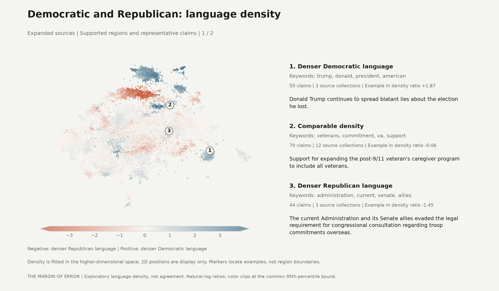

| Marker | Keywords | Claims / documents / bundles | Raw group counts | Example ln ratio | Source-linked claim |
|---|---|---:|---|---:|---|
| 1 | trump, donald, president, american | 50 / 3 / 3 | {"democratic": 50} | +1.87 | Donald Trump continues to spread blatant lies about the election he lost. ([2024 Democratic Party Platform](https://www.presidency.ucsb.edu/documents/2024-democratic-party-platform); 2024; scoped characters 137224:137907) |
| 2 | veterans, commitment, va, support | 70 / 12 / 12 | {"democratic": 33, "republican": 37} | -0.06 | Support for expanding the post-9/11 veteran's caregiver program to include all veterans. ([2016 Democratic Party Platform](https://www.presidency.ucsb.edu/documents/2016-democratic-party-platform); 2016; scoped characters 136043:136981) |
| 3 | administration, current, senate, allies | 44 / 3 / 3 | {"republican": 44} | -1.45 | The current Administration and its Senate allies evaded the legal requirement for congressional consultation regarding troop commitments overseas. ([2012 Republican Party Platform](https://www.presidency.ucsb.edu/documents/2012-republican-party-platform); 2012; scoped characters 38836:40176) |

[Complete region evidence](../data/analysis/national_claims/full/topics/../expanded/density_region_evidence.csv)

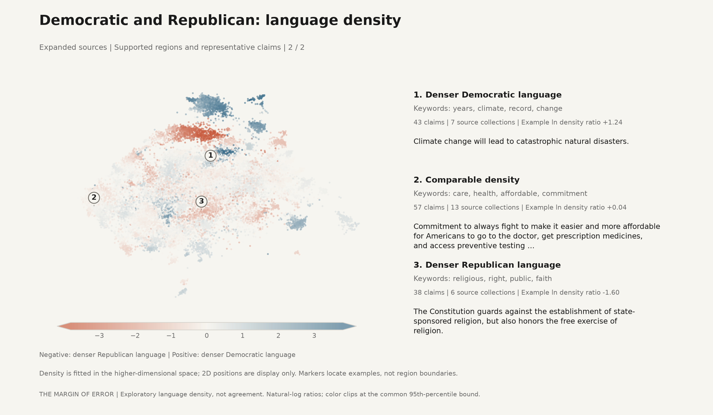

| Marker | Keywords | Claims / documents / bundles | Raw group counts | Example ln ratio | Source-linked claim |
|---|---|---:|---|---:|---|
| 1 | years, climate, record, change | 43 / 7 / 7 | {"democratic": 43} | +1.24 | Climate change will lead to catastrophic natural disasters. ([2012 Democratic Party Platform](https://www.presidency.ucsb.edu/documents/2012-democratic-party-platform); 2012; scoped characters 129322:130781) |
| 2 | care, health, affordable, commitment | 57 / 13 / 13 | {"democratic": 38, "republican": 19} | +0.04 | Commitment to always fight to make it easier and more affordable for Americans to go to the doctor, get prescription medicines, and access preventive testing and treatments. ([2020 Democratic Party Platform](https://www.presidency.ucsb.edu/documents/2020-democratic-party-platform); 2020; scoped characters 76411:76598) |
| 3 | religious, right, public, faith | 38 / 6 / 6 | {"republican": 38} | -1.60 | The Constitution guards against the establishment of state-sponsored religion, but also honors the free exercise of religion. ([2000 Republican Party Platform](https://www.presidency.ucsb.edu/documents/2000-republican-party-platform); 2000; scoped characters 57021:58434) |

[Complete region evidence](../data/analysis/national_claims/full/topics/../expanded/density_region_evidence.csv)

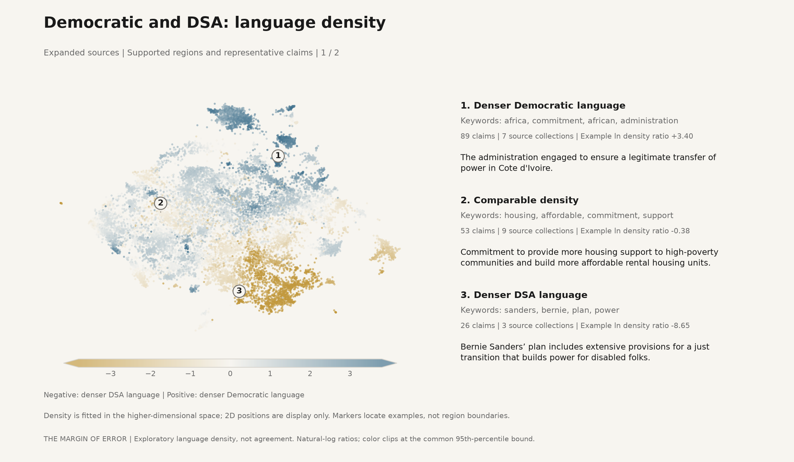

| Marker | Keywords | Claims / documents / bundles | Raw group counts | Example ln ratio | Source-linked claim |
|---|---|---:|---|---:|---|
| 1 | africa, commitment, african, administration | 89 / 7 / 7 | {"democratic": 89} | +3.40 | The administration engaged to ensure a legitimate transfer of power in Cote d'Ivoire. ([2012 Democratic Party Platform](https://www.presidency.ucsb.edu/documents/2012-democratic-party-platform); 2012; scoped characters 161730:161954) |
| 2 | housing, affordable, commitment, support | 53 / 9 / 9 | {"dsa": 8, "democratic": 45} | -0.38 | Commitment to provide more housing support to high-poverty communities and build more affordable rental housing units. ([2016 Democratic Party Platform](https://www.presidency.ucsb.edu/documents/2016-democratic-party-platform); 2016; scoped characters 67776:68445) |
| 3 | sanders, bernie, plan, power | 26 / 5 / 3 | {"dsa": 26} | -8.65 | Bernie Sanders’ plan includes extensive provisions for a just transition that builds power for disabled folks. ([National DSA Ecosocialists support Bernie Sanders’ Green New Deal](https://www.dsausa.org/wp-json/wp/v2/statement/4013); 2019-08-27; scoped characters 887:1479) |

[Complete region evidence](../data/analysis/national_claims/full/topics/../expanded/density_region_evidence.csv)

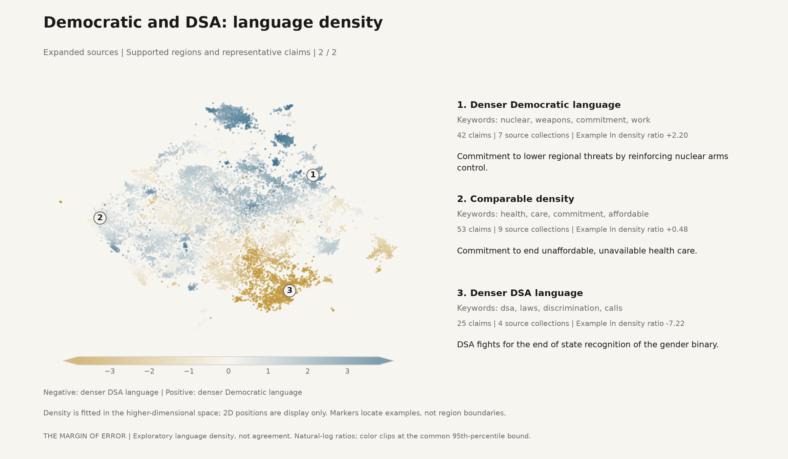

| Marker | Keywords | Claims / documents / bundles | Raw group counts | Example ln ratio | Source-linked claim |
|---|---|---:|---|---:|---|
| 1 | nuclear, weapons, commitment, work | 42 / 7 / 7 | {"democratic": 42} | +2.20 | Commitment to lower regional threats by reinforcing nuclear arms control. ([2020 Democratic Party Platform](https://www.presidency.ucsb.edu/documents/2020-democratic-party-platform); 2020; scoped characters 279543:279966) |
| 2 | health, care, commitment, affordable | 53 / 9 / 9 | {"democratic": 47, "dsa": 6} | +0.48 | Commitment to end unaffordable, unavailable health care. ([2008 Democratic Party Platform](https://www.presidency.ucsb.edu/documents/2008-democratic-party-platform); 2008; scoped characters 4336:5162) |
| 3 | dsa, laws, discrimination, calls | 25 / 4 / 4 | {"dsa": 25} | -7.22 | DSA fights for the end of state recognition of the gender binary. ([2021 adopted DSA Political Platform - immutable December 2021 snapshot](https://web.archive.org/web/20211230205416id_/https://www.dsausa.org/dsa-political-platform-from-2021-convention/); 2021-11-09; scoped characters 33183:33774) |

[Complete region evidence](../data/analysis/national_claims/full/topics/../expanded/density_region_evidence.csv)

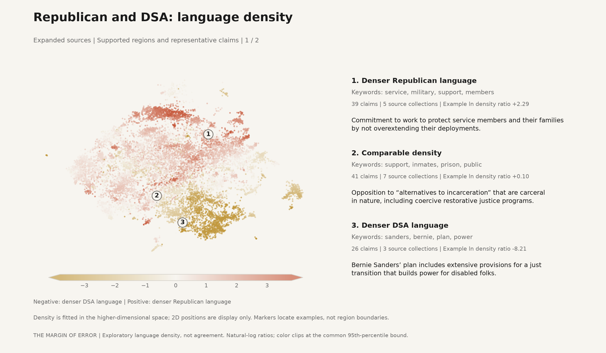

| Marker | Keywords | Claims / documents / bundles | Raw group counts | Example ln ratio | Source-linked claim |
|---|---|---:|---|---:|---|
| 1 | service, military, support, members | 39 / 5 / 5 | {"republican": 39} | +2.29 | Commitment to work to protect service members and their families by not overextending their deployments. ([2012 Republican Party Platform](https://www.presidency.ucsb.edu/documents/2012-republican-party-platform); 2012; scoped characters 172163:172722) |
| 2 | support, inmates, prison, public | 41 / 8 / 7 | {"republican": 29, "dsa": 12} | +0.10 | Opposition to “alternatives to incarceration” that are carceral in nature, including coercive restorative justice programs. ([2021 adopted DSA Political Platform - immutable December 2021 snapshot](https://web.archive.org/web/20211230205416id_/https://www.dsausa.org/dsa-political-platform-from-2021-convention/); 2021-11-09; scoped characters 12768:12936) |
| 3 | sanders, bernie, plan, power | 26 / 5 / 3 | {"dsa": 26} | -8.21 | Bernie Sanders’ plan includes extensive provisions for a just transition that builds power for disabled folks. ([National DSA Ecosocialists support Bernie Sanders’ Green New Deal](https://www.dsausa.org/wp-json/wp/v2/statement/4013); 2019-08-27; scoped characters 887:1479) |

[Complete region evidence](../data/analysis/national_claims/full/topics/../expanded/density_region_evidence.csv)

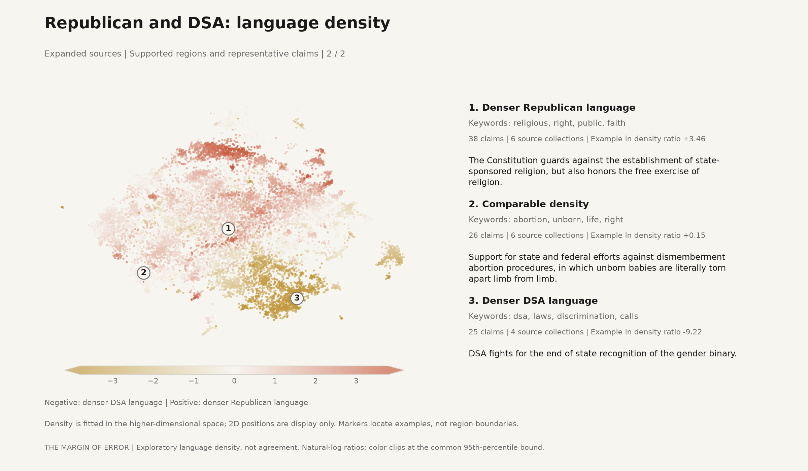

| Marker | Keywords | Claims / documents / bundles | Raw group counts | Example ln ratio | Source-linked claim |
|---|---|---:|---|---:|---|
| 1 | religious, right, public, faith | 38 / 6 / 6 | {"republican": 38} | +3.46 | The Constitution guards against the establishment of state-sponsored religion, but also honors the free exercise of religion. ([2000 Republican Party Platform](https://www.presidency.ucsb.edu/documents/2000-republican-party-platform); 2000; scoped characters 57021:58434) |
| 2 | abortion, unborn, life, right | 26 / 6 / 6 | {"republican": 25, "dsa": 1} | +0.15 | Support for state and federal efforts against dismemberment abortion procedures, in which unborn babies are literally torn apart limb from limb. ([2016 Republican Party Platform](https://www.presidency.ucsb.edu/documents/2016-republican-party-platform); 2016; scoped characters 60031:61054) |
| 3 | dsa, laws, discrimination, calls | 25 / 4 / 4 | {"dsa": 25} | -9.22 | DSA fights for the end of state recognition of the gender binary. ([2021 adopted DSA Political Platform - immutable December 2021 snapshot](https://web.archive.org/web/20211230205416id_/https://www.dsausa.org/dsa-political-platform-from-2021-convention/); 2021-11-09; scoped characters 33183:33774) |

[Complete region evidence](../data/analysis/national_claims/full/topics/../expanded/density_region_evidence.csv)

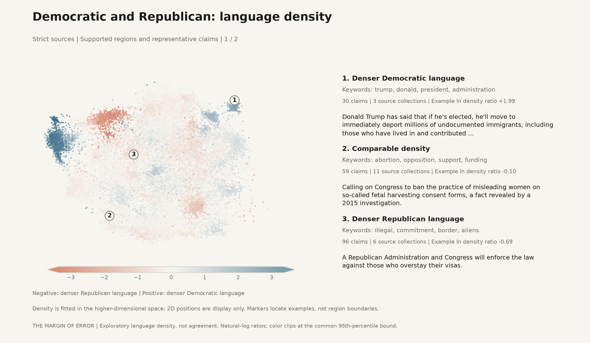

| Marker | Keywords | Claims / documents / bundles | Raw group counts | Example ln ratio | Source-linked claim |
|---|---|---:|---|---:|---|
| 1 | trump, donald, president, administration | 30 / 3 / 3 | {"democratic": 30} | +1.99 | Donald Trump has said that if he's elected, he'll move to immediately deport millions of undocumented immigrants, including those who have lived in and contributed to this country for years. ([2024 Democratic Party Platform](https://www.presidency.ucsb.edu/documents/2024-democratic-party-platform); 2024; scoped characters 194558:195420) |
| 2 | abortion, opposition, support, funding | 59 / 11 / 11 | {"republican": 36, "democratic": 23} | -0.10 | Calling on Congress to ban the practice of misleading women on so-called fetal harvesting consent forms, a fact revealed by a 2015 investigation. ([2016 Republican Party Platform](https://www.presidency.ucsb.edu/documents/2016-republican-party-platform); 2016; scoped characters 57781:58451) |
| 3 | illegal, commitment, border, aliens | 96 / 6 / 6 | {"republican": 96} | -0.69 | A Republican Administration and Congress will enforce the law against those who overstay their visas. ([2012 Republican Party Platform](https://www.presidency.ucsb.edu/documents/2012-republican-party-platform); 2012; scoped characters 103627:104183) |

[Complete region evidence](../data/analysis/national_claims/full/topics/../strict/density_region_evidence.csv)

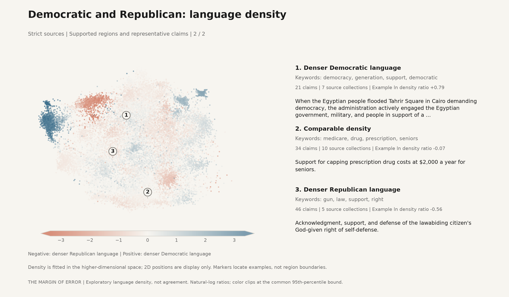

| Marker | Keywords | Claims / documents / bundles | Raw group counts | Example ln ratio | Source-linked claim |
|---|---|---:|---|---:|---|
| 1 | democracy, generation, support, democratic | 21 / 7 / 7 | {"democratic": 21} | +0.79 | When the Egyptian people flooded Tahrir Square in Cairo demanding democracy, the administration actively engaged the Egyptian government, military, and people in support of a transition away from decades of dictatorship and towards democracy. ([2012 Democratic Party Platform](https://www.presidency.ucsb.edu/documents/2012-democratic-party-platform); 2012; scoped characters 159096:160566) |
| 2 | medicare, drug, prescription, seniors | 34 / 10 / 10 | {"republican": 14, "democratic": 20} | -0.07 | Support for capping prescription drug costs at $2,000 a year for seniors. ([2024 Democratic Party Platform](https://www.presidency.ucsb.edu/documents/2024-democratic-party-platform); 2024; scoped characters 164059:165173) |
| 3 | gun, law, support, right | 46 / 5 / 5 | {"republican": 46} | -0.56 | Acknowledgment, support, and defense of the lawabiding citizen's God-given right of self-defense. ([2012 Republican Party Platform](https://www.presidency.ucsb.edu/documents/2012-republican-party-platform); 2012; scoped characters 53822:55372) |

[Complete region evidence](../data/analysis/national_claims/full/topics/../strict/density_region_evidence.csv)

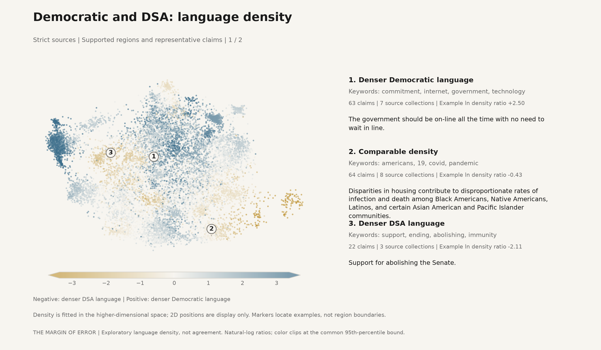

| Marker | Keywords | Claims / documents / bundles | Raw group counts | Example ln ratio | Source-linked claim |
|---|---|---:|---|---:|---|
| 1 | commitment, internet, government, technology | 63 / 7 / 7 | {"democratic": 63} | +2.50 | The government should be on-line all the time with no need to wait in line. ([2000 Democratic Party Platform](https://www.presidency.ucsb.edu/documents/2000-democratic-party-platform); 2000; scoped characters 56787:57060) |
| 2 | americans, 19, covid, pandemic | 64 / 8 / 8 | {"dsa": 6, "democratic": 58} | -0.43 | Disparities in housing contribute to disproportionate rates of infection and death among Black Americans, Native Americans, Latinos, and certain Asian American and Pacific Islander communities. ([2020 Democratic Party Platform](https://www.presidency.ucsb.edu/documents/2020-democratic-party-platform); 2020; scoped characters 9983:10388) |
| 3 | support, ending, abolishing, immunity | 22 / 3 / 3 | {"dsa": 22} | -2.11 | Support for abolishing the Senate. ([2021 adopted DSA Political Platform - immutable December 2021 snapshot](https://web.archive.org/web/20211230205416id_/https://www.dsausa.org/dsa-political-platform-from-2021-convention/); 2021-11-09; scoped characters 6804:6848) |

[Complete region evidence](../data/analysis/national_claims/full/topics/../strict/density_region_evidence.csv)

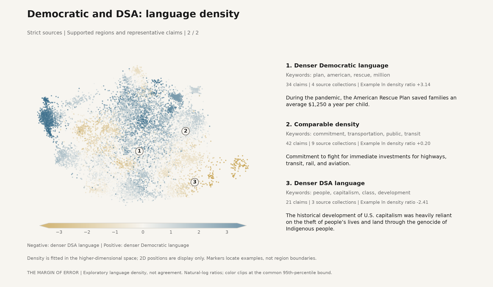

| Marker | Keywords | Claims / documents / bundles | Raw group counts | Example ln ratio | Source-linked claim |
|---|---|---:|---|---:|---|
| 1 | plan, american, rescue, million | 34 / 4 / 4 | {"democratic": 34} | +3.14 | During the pandemic, the American Rescue Plan saved families an average $1,250 a year per child. ([2024 Democratic Party Platform](https://www.presidency.ucsb.edu/documents/2024-democratic-party-platform); 2024; scoped characters 56313:56671) |
| 2 | commitment, transportation, public, transit | 42 / 9 / 9 | {"democratic": 40, "dsa": 2} | +0.20 | Commitment to fight for immediate investments for highways, transit, rail, and aviation. ([2012 Democratic Party Platform](https://www.presidency.ucsb.edu/documents/2012-democratic-party-platform); 2012; scoped characters 40432:40996) |
| 3 | people, capitalism, class, development | 21 / 3 / 3 | {"dsa": 21} | -2.41 | The historical development of U.S. capitalism was heavily reliant on the theft of people’s lives and land through the genocide of Indigenous people. ([2021 adopted DSA Political Platform - immutable December 2021 snapshot](https://web.archive.org/web/20211230205416id_/https://www.dsausa.org/dsa-political-platform-from-2021-convention/); 2021-11-09; scoped characters 905:1529) |

[Complete region evidence](../data/analysis/national_claims/full/topics/../strict/density_region_evidence.csv)

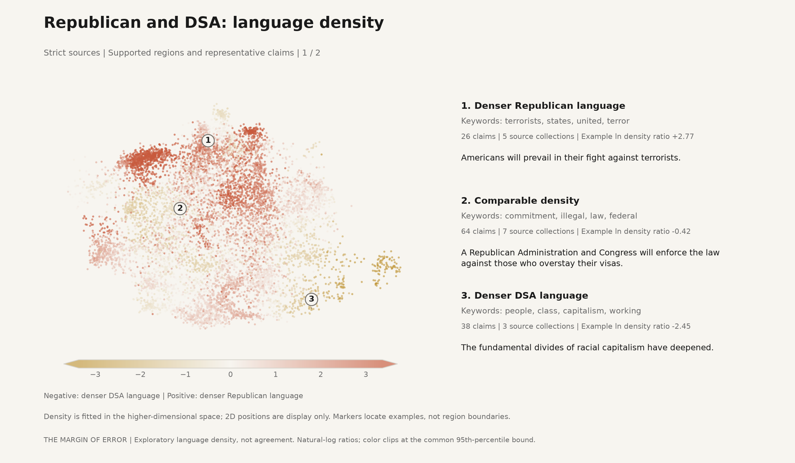

| Marker | Keywords | Claims / documents / bundles | Raw group counts | Example ln ratio | Source-linked claim |
|---|---|---:|---|---:|---|
| 1 | terrorists, states, united, terror | 26 / 5 / 5 | {"republican": 26} | +2.77 | Americans will prevail in their fight against terrorists. ([2004 Republican Party Platform](https://www.presidency.ucsb.edu/documents/2004-republican-party-platform); 2004; scoped characters 9498:10431) |
| 2 | commitment, illegal, law, federal | 64 / 7 / 7 | {"republican": 62, "dsa": 2} | -0.42 | A Republican Administration and Congress will enforce the law against those who overstay their visas. ([2012 Republican Party Platform](https://www.presidency.ucsb.edu/documents/2012-republican-party-platform); 2012; scoped characters 103627:104183) |
| 3 | people, class, capitalism, working | 38 / 3 / 3 | {"dsa": 38} | -2.45 | The fundamental divides of racial capitalism have deepened. ([2021 adopted DSA Political Platform - immutable December 2021 snapshot](https://web.archive.org/web/20211230205416id_/https://www.dsausa.org/dsa-political-platform-from-2021-convention/); 2021-11-09; scoped characters 24811:25556) |

[Complete region evidence](../data/analysis/national_claims/full/topics/../strict/density_region_evidence.csv)

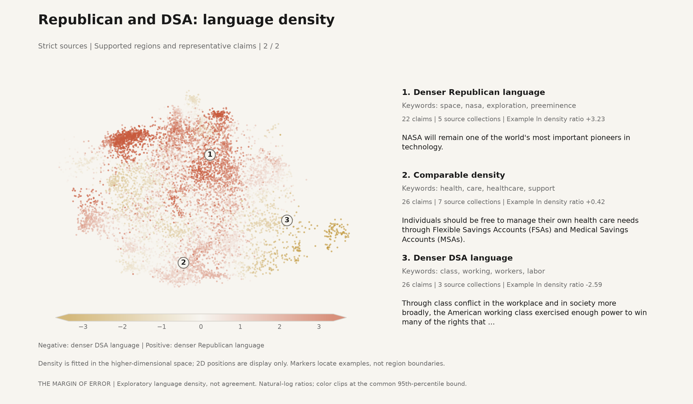

| Marker | Keywords | Claims / documents / bundles | Raw group counts | Example ln ratio | Source-linked claim |
|---|---|---:|---|---:|---|
| 1 | space, nasa, exploration, preeminence | 22 / 5 / 5 | {"republican": 22} | +3.23 | NASA will remain one of the world's most important pioneers in technology. ([2008 Republican Party Platform](https://www.presidency.ucsb.edu/documents/2008-republican-party-platform); 2008; scoped characters 77484:77921) |
| 2 | health, care, healthcare, support | 26 / 7 / 7 | {"dsa": 10, "republican": 16} | +0.42 | Individuals should be free to manage their own health care needs through Flexible Savings Accounts (FSAs) and Medical Savings Accounts (MSAs). ([2000 Republican Party Platform](https://www.presidency.ucsb.edu/documents/2000-republican-party-platform); 2000; scoped characters 91403:92274) |
| 3 | class, working, workers, labor | 26 / 3 / 3 | {"dsa": 26} | -2.59 | Through class conflict in the workplace and in society more broadly, the American working class exercised enough power to win many of the rights that exist today. ([2021 adopted DSA Political Platform - immutable December 2021 snapshot](https://web.archive.org/web/20211230205416id_/https://www.dsausa.org/dsa-political-platform-from-2021-convention/); 2021-11-09; scoped characters 21071:21659) |

[Complete region evidence](../data/analysis/national_claims/full/topics/../strict/density_region_evidence.csv)

### Expanded distribution

Largest absolute shares across all observed periods (not necessarily the most distinctive topics):

- **Democratic:** Public Protections and National Commitments (7.8%); Community Investment, Housing, and Social Support (7.4%); American Power, Leadership, and National Purpose (6.5%).
- **Republican:** American Power, Leadership, and National Purpose (7.6%); Cross-Policy Opposition and Institutional Critiques (7.1%); Community Investment, Housing, and Social Support (5.9%).
- **DSA:** Institutional Power, Oppression, and Social Conflict (9.3%); Labor Rights, Unionization, and Worker Protections (7.1%); Community Investment, Housing, and Social Support (6.3%).

Identity and narrative clusters describe rhetoric, not substantive policy priorities. Pooled shares mix periods and document genres; read the period analyses below before interpreting them as enduring differences.

The overall pages place each group's evidence-reviewed summary beside its bars. These describe sampled documents across years, not a current consensus; the group-position section retains topic caveats and source-linked claims.

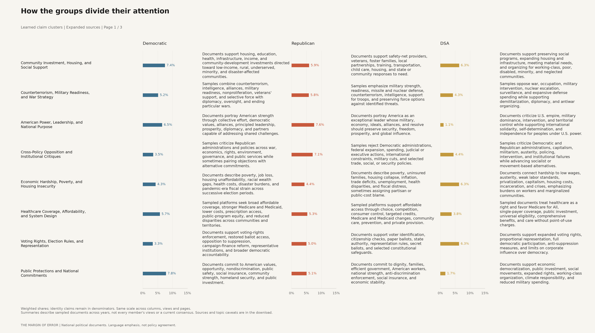

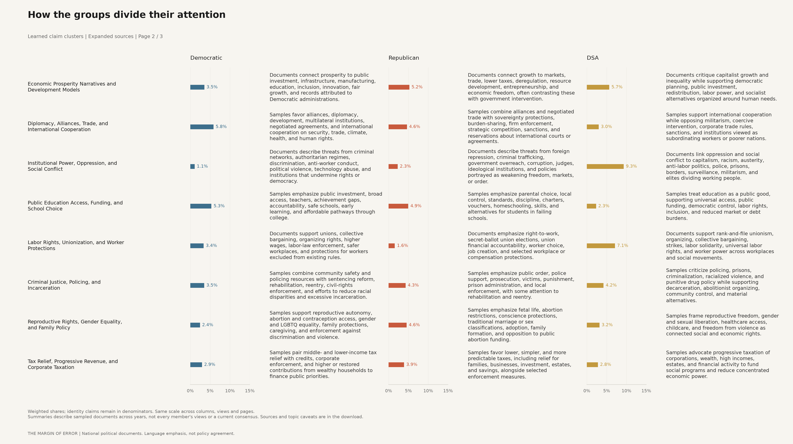

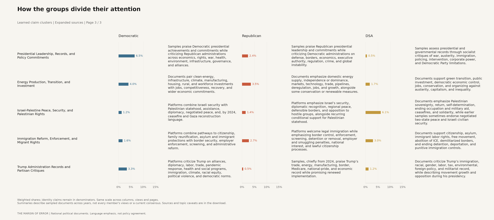

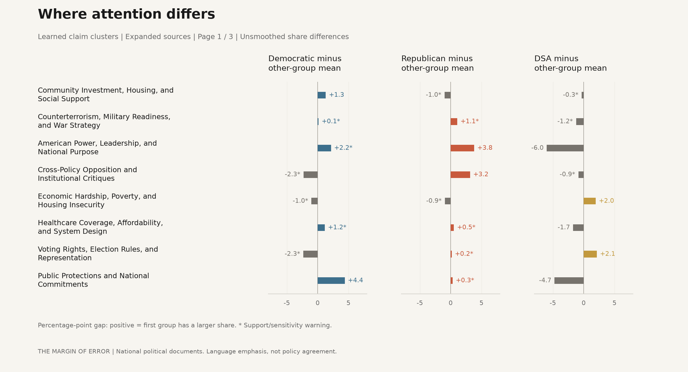

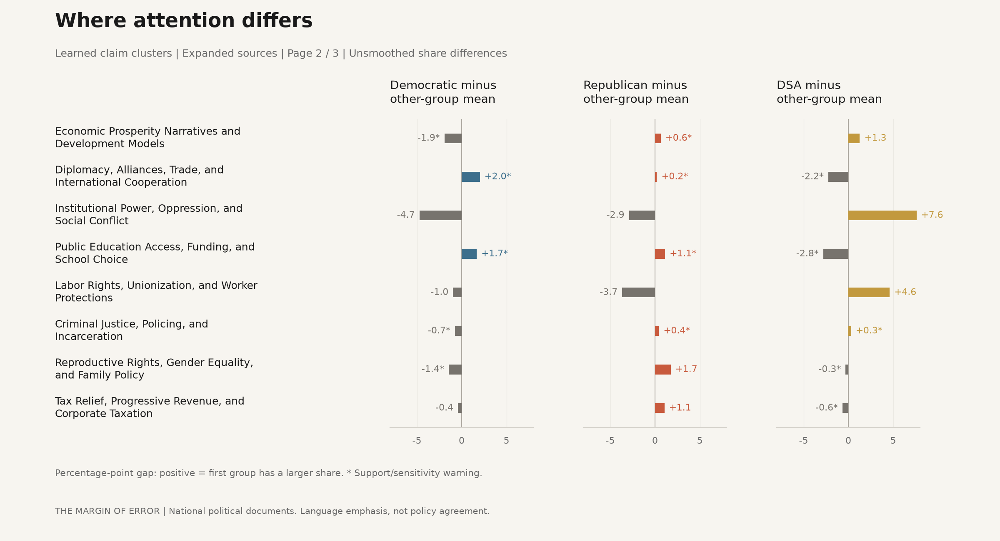

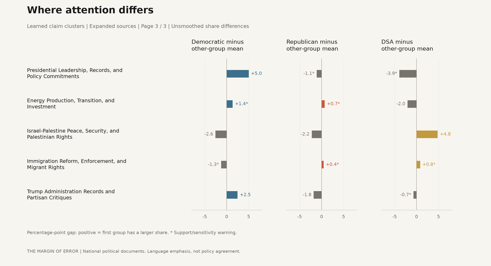

Largest relative-emphasis ratios (all support levels remain eligible):

| Group | Topic | Share | Other-group mean | Difference (pp) | log2 ratio | Warnings |
|---|---|---:|---:|---:|---:|---|
| Democratic | Presidential Leadership, Records, and Policy Commitments | 6.5% | 1.5% | +5.01 | +2.13 | none |
| Democratic | Trump Administration Records and Partisan Critiques | 3.3% | 0.8% | +2.48 | +1.97 | none |
| Democratic | Public Protections and National Commitments | 7.8% | 3.4% | +4.40 | +1.20 | none |
| Republican | American Power, Leadership, and National Purpose | 7.6% | 3.8% | +3.81 | +1.00 | none |
| Republican | Cross-Policy Opposition and Institutional Critiques | 7.1% | 4.0% | +3.15 | +0.84 | none |
| Republican | Reproductive Rights, Gender Equality, and Family Policy | 4.6% | 2.8% | +1.75 | +0.70 | none |
| DSA | Institutional Power, Oppression, and Social Conflict | 9.3% | 1.7% | +7.61 | +2.46 | none |
| DSA | Israel-Palestine Peace, Security, and Palestinian Rights | 6.1% | 1.3% | +4.80 | +2.19 | none |
| DSA | Labor Rights, Unionization, and Worker Protections | 7.1% | 2.5% | +4.61 | +1.51 | none |

Pairwise contrast panels:

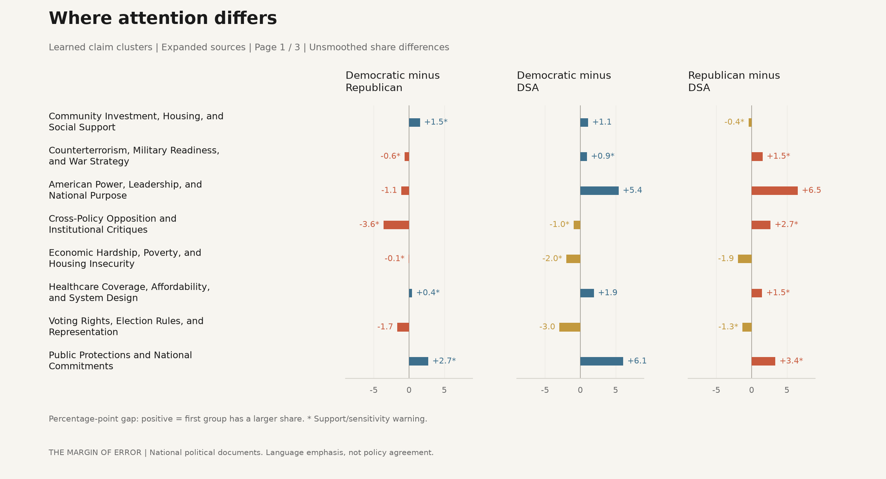

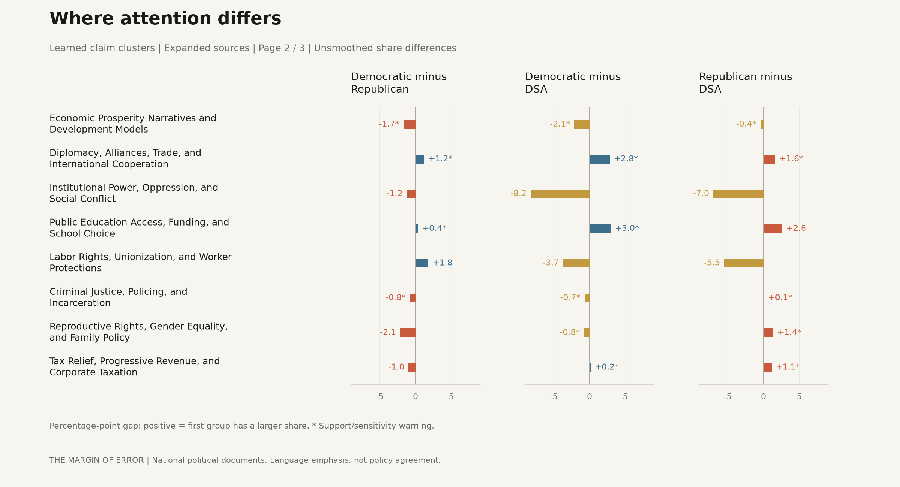

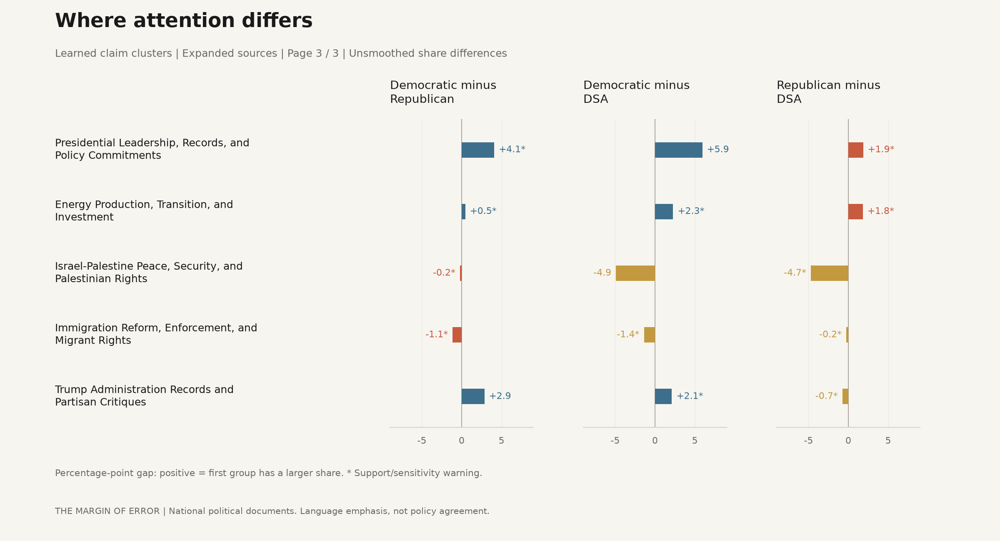

### Strict distribution

Largest absolute shares across all observed periods (not necessarily the most distinctive topics):

- **Democratic:** Public Protections and National Commitments (7.8%); Community Investment, Housing, and Social Support (7.4%); American Power, Leadership, and National Purpose (6.5%).
- **Republican:** American Power, Leadership, and National Purpose (7.6%); Cross-Policy Opposition and Institutional Critiques (7.1%); Community Investment, Housing, and Social Support (5.9%).
- **DSA:** Voting Rights, Election Rules, and Representation (11.7%); Labor Rights, Unionization, and Worker Protections (8.6%); Institutional Power, Oppression, and Social Conflict (8.4%).

Identity and narrative clusters describe rhetoric, not substantive policy priorities. Pooled shares mix periods and document genres; read the period analyses below before interpreting them as enduring differences.

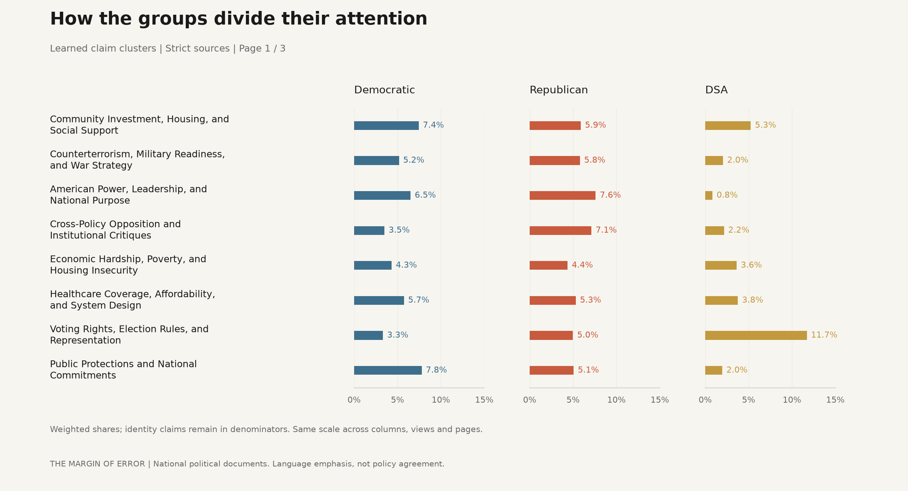

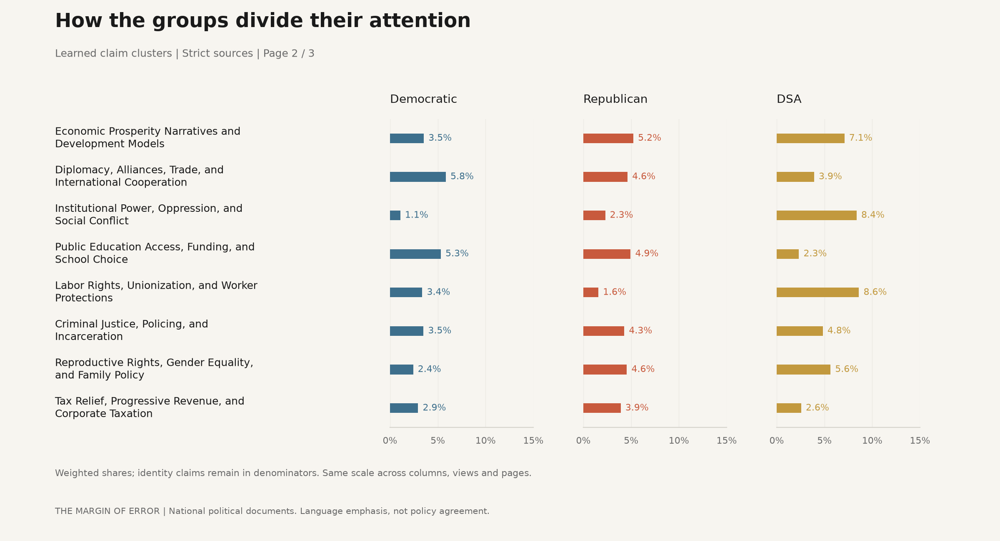

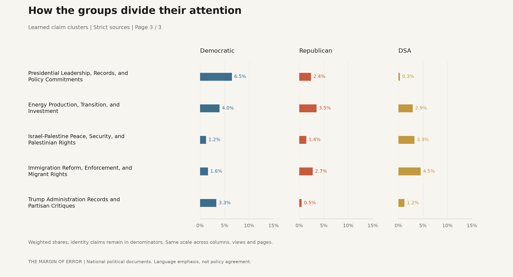

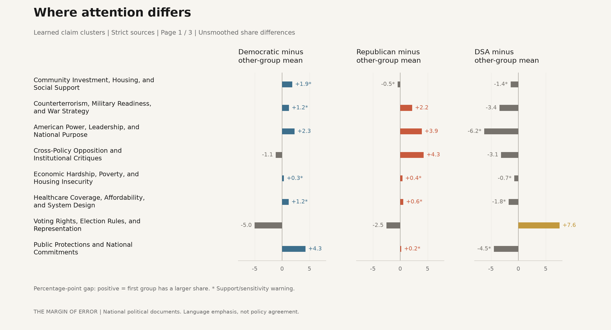

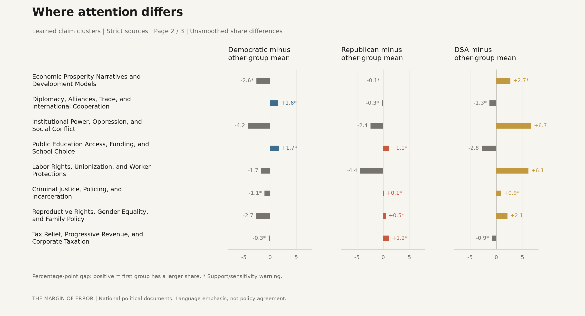

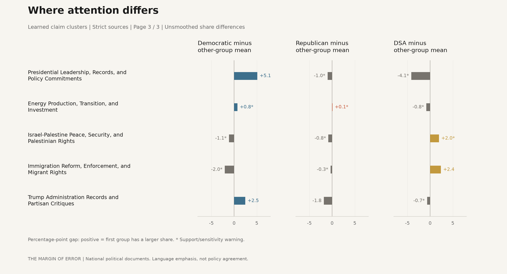

Largest relative-emphasis ratios (all support levels remain eligible):

| Group | Topic | Share | Other-group mean | Difference (pp) | log2 ratio | Warnings |
|---|---|---:|---:|---:|---:|---|
| Democratic | Presidential Leadership, Records, and Policy Commitments | 6.5% | 1.3% | +5.13 | +2.26 | none |
| Democratic | Trump Administration Records and Partisan Critiques | 3.3% | 0.9% | +2.47 | +1.95 | none |
| Democratic | Public Protections and National Commitments | 7.8% | 3.5% | +4.27 | +1.15 | none |
| Republican | Cross-Policy Opposition and Institutional Critiques | 7.1% | 2.8% | +4.30 | +1.33 | none |
| Republican | American Power, Leadership, and National Purpose | 7.6% | 3.7% | +3.94 | +1.05 | none |
| Republican | Counterterrorism, Military Readiness, and War Strategy | 5.8% | 3.6% | +2.19 | +0.68 | none |
| DSA | Institutional Power, Oppression, and Social Conflict | 8.4% | 1.7% | +6.68 | +2.30 | none |
| DSA | Labor Rights, Unionization, and Worker Protections | 8.6% | 2.5% | +6.13 | +1.79 | none |
| DSA | Voting Rights, Election Rules, and Representation | 11.7% | 4.2% | +7.55 | +1.49 | none |

Pairwise contrast panels:

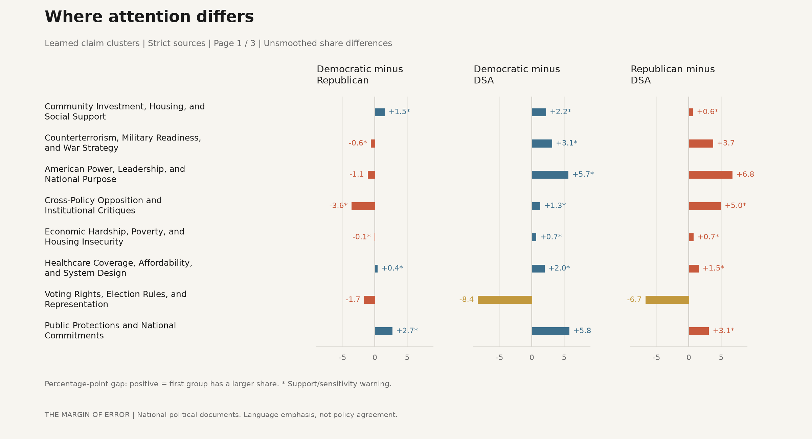

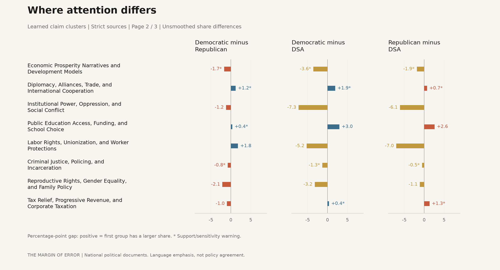

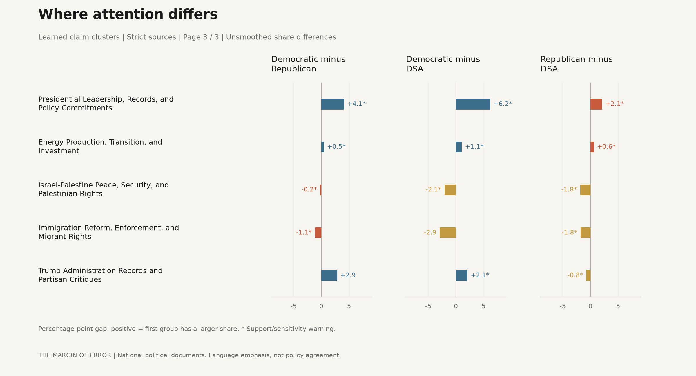

### Topics over time

**Fixed-topic trends:** the same topic assignments are tracked in four-year adoption/publication periods. Within each period, each document/fallback bundle has equal group weight. Adoption dates take precedence when recorded; original date precision is retained. Missing periods remain gaps: neither reused platforms nor absent publications are carried forward as new independent observations. The final period is partial.

Relative time-series contrasts require all configured comparison groups for group-versus-rest baselines; pairwise contrasts require both organizations. These charts describe the changing composition of observed documents, not annual party positions or causal changes. One-document periods are visibly counted and flagged in the downloadable tables.

[Period coverage and support](../data/analysis/national_claims/full/topics/temporal_coverage.csv) · [All period shares](../data/analysis/national_claims/full/topics/temporal_shares.csv) · [Time-specific relative emphasis](../data/analysis/national_claims/full/topics/temporal_contrasts.csv) · [Adjacent observed-period changes](../data/analysis/national_claims/full/topics/temporal_changes.csv) · [Exact date choices](../data/analysis/national_claims/full/topics/temporal_document_dates.csv) · [Date exclusions](../data/analysis/national_claims/full/topics/temporal_exclusions.csv)

#### Expanded time views

Largest adjacent observed-period changes on the **fixed pooled taxonomy**. These can reflect changing rhetoric or document composition, not policy movement:

- **Democratic:** Presidential Leadership, Records, and Policy Commitments: +23.2 percentage points (2020-2023 → 2024-2026; 1 → 1 bundles); Presidential Leadership, Records, and Policy Commitments: -12.8 percentage points (2012-2015 → 2016-2019; 1 → 1 bundles).

- **Republican:** Presidential Leadership, Records, and Policy Commitments: -8.8 percentage points (2004-2007 → 2008-2011; 1 → 1 bundles); Cross-Policy Opposition and Institutional Critiques: -7.7 percentage points (2000-2003 → 2004-2007; 1 → 1 bundles).

- **DSA:** Counterterrorism, Military Readiness, and War Strategy: -16.5 percentage points (2000-2003 → 2004-2007; 1 → 1 bundles); Israel-Palestine Peace, Security, and Palestinian Rights: -13.9 percentage points (2008-2011 → 2012-2015; 1 → 1 bundles).

#### Figures for the piece

These six selected policy subjects pair the overall comparison with its timeline. Headlines are calculated from observed, unsmoothed shares; ratios require at least two contributing bundles on both sides. All groups remain visible, and both panels share a zero-based percentage scale. Short chart names are display labels, not new clusters or stance labels.

| Issue | Combined overall and timeline |
|---|---|
| Labor and worker protections | [PNG](../figures/national_claims/full/topics/expanded/piece/topic-003.png) |
| Tax relief and revenue | [PNG](../figures/national_claims/full/topics/expanded/piece/topic-011.png) |
| Education and school choice | [PNG](../figures/national_claims/full/topics/expanded/piece/topic-012.png) |
| Reproductive rights, gender equality and families | [PNG](../figures/national_claims/full/topics/expanded/piece/topic-013.png) |
| Healthcare | [PNG](../figures/national_claims/full/topics/expanded/piece/topic-018.png) |
| Israel-Palestine | [PNG](../figures/national_claims/full/topics/expanded/piece/topic-022.png) |
#### Individual issue comparisons

Each standalone chart compares all organizations on one topic. Overall bars and observed-period lines are separate figures, suitable for individual embedding. Axes are shared across organizations and both views of the same topic; different issues can have different vertical scales. Missing evidence remains a gap. Actor and narrative topics retain their qualifications rather than being presented as coherent policy issues.

| Topic | Overall comparison | Over time |
|---|---|---|
| Energy Production, Transition, and Investment | [PNG](../figures/national_claims/full/topics/expanded/issues/topic-001_overall.png) | [PNG](../figures/national_claims/full/topics/expanded/issues/topic-001_time.png) |
| Community Investment, Housing, and Social Support | [PNG](../figures/national_claims/full/topics/expanded/issues/topic-002_overall.png) | [PNG](../figures/national_claims/full/topics/expanded/issues/topic-002_time.png) |
| Labor Rights, Unionization, and Worker Protections | [PNG](../figures/national_claims/full/topics/expanded/issues/topic-003_overall.png) | [PNG](../figures/national_claims/full/topics/expanded/issues/topic-003_time.png) |
| Economic Prosperity Narratives and Development Models | [PNG](../figures/national_claims/full/topics/expanded/issues/topic-004_overall.png) | [PNG](../figures/national_claims/full/topics/expanded/issues/topic-004_time.png) |
| Voting Rights, Election Rules, and Representation | [PNG](../figures/national_claims/full/topics/expanded/issues/topic-005_overall.png) | [PNG](../figures/national_claims/full/topics/expanded/issues/topic-005_time.png) |
| American Power, Leadership, and National Purpose | [PNG](../figures/national_claims/full/topics/expanded/issues/topic-006_overall.png) | [PNG](../figures/national_claims/full/topics/expanded/issues/topic-006_time.png) |
| Public Protections and National Commitments | [PNG](../figures/national_claims/full/topics/expanded/issues/topic-007_overall.png) | [PNG](../figures/national_claims/full/topics/expanded/issues/topic-007_time.png) |
| Diplomacy, Alliances, Trade, and International Cooperation | [PNG](../figures/national_claims/full/topics/expanded/issues/topic-009_overall.png) | [PNG](../figures/national_claims/full/topics/expanded/issues/topic-009_time.png) |
| Criminal Justice, Policing, and Incarceration | [PNG](../figures/national_claims/full/topics/expanded/issues/topic-010_overall.png) | [PNG](../figures/national_claims/full/topics/expanded/issues/topic-010_time.png) |
| Tax Relief, Progressive Revenue, and Corporate Taxation | [PNG](../figures/national_claims/full/topics/expanded/issues/topic-011_overall.png) | [PNG](../figures/national_claims/full/topics/expanded/issues/topic-011_time.png) |
| Public Education Access, Funding, and School Choice | [PNG](../figures/national_claims/full/topics/expanded/issues/topic-012_overall.png) | [PNG](../figures/national_claims/full/topics/expanded/issues/topic-012_time.png) |
| Reproductive Rights, Gender Equality, and Family Policy | [PNG](../figures/national_claims/full/topics/expanded/issues/topic-013_overall.png) | [PNG](../figures/national_claims/full/topics/expanded/issues/topic-013_time.png) |
| Counterterrorism, Military Readiness, and War Strategy | [PNG](../figures/national_claims/full/topics/expanded/issues/topic-014_overall.png) | [PNG](../figures/national_claims/full/topics/expanded/issues/topic-014_time.png) |
| Cross-Policy Opposition and Institutional Critiques | [PNG](../figures/national_claims/full/topics/expanded/issues/topic-015_overall.png) | [PNG](../figures/national_claims/full/topics/expanded/issues/topic-015_time.png) |
| Presidential Leadership, Records, and Policy Commitments | [PNG](../figures/national_claims/full/topics/expanded/issues/topic-016_overall.png) | [PNG](../figures/national_claims/full/topics/expanded/issues/topic-016_time.png) |
| Healthcare Coverage, Affordability, and System Design | [PNG](../figures/national_claims/full/topics/expanded/issues/topic-018_overall.png) | [PNG](../figures/national_claims/full/topics/expanded/issues/topic-018_time.png) |
| Economic Hardship, Poverty, and Housing Insecurity | [PNG](../figures/national_claims/full/topics/expanded/issues/topic-019_overall.png) | [PNG](../figures/national_claims/full/topics/expanded/issues/topic-019_time.png) |
| Institutional Power, Oppression, and Social Conflict | [PNG](../figures/national_claims/full/topics/expanded/issues/topic-020_overall.png) | [PNG](../figures/national_claims/full/topics/expanded/issues/topic-020_time.png) |
| Immigration Reform, Enforcement, and Migrant Rights | [PNG](../figures/national_claims/full/topics/expanded/issues/topic-021_overall.png) | [PNG](../figures/national_claims/full/topics/expanded/issues/topic-021_time.png) |
| Israel-Palestine Peace, Security, and Palestinian Rights | [PNG](../figures/national_claims/full/topics/expanded/issues/topic-022_overall.png) | [PNG](../figures/national_claims/full/topics/expanded/issues/topic-022_time.png) |
| Trump Administration Records and Partisan Critiques | [PNG](../figures/national_claims/full/topics/expanded/issues/topic-024_overall.png) | [PNG](../figures/national_claims/full/topics/expanded/issues/topic-024_time.png) |

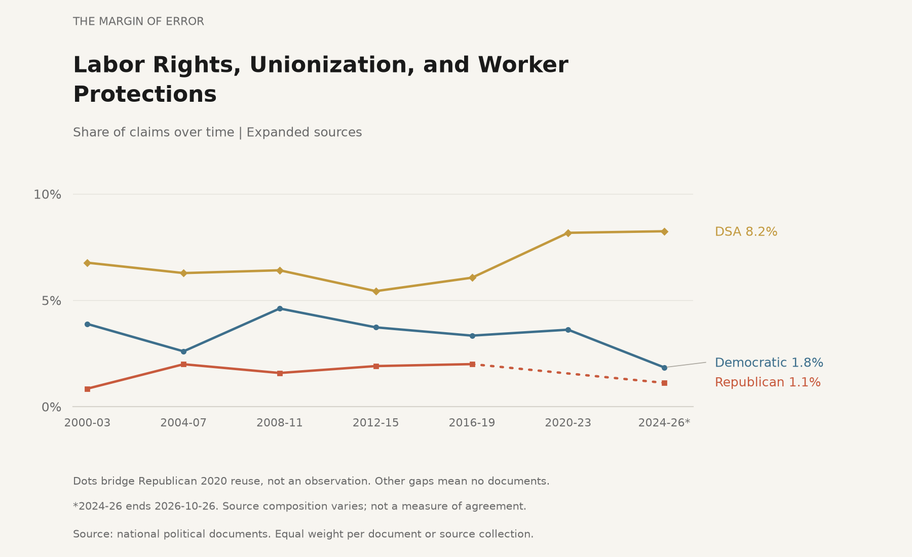

#### Strict time views

Largest adjacent observed-period changes on the **fixed pooled taxonomy**. These can reflect changing rhetoric or document composition, not policy movement:

- **Democratic:** Presidential Leadership, Records, and Policy Commitments: +23.2 percentage points (2020-2023 → 2024-2026; 1 → 1 bundles); Presidential Leadership, Records, and Policy Commitments: -12.8 percentage points (2012-2015 → 2016-2019; 1 → 1 bundles).

- **Republican:** Presidential Leadership, Records, and Policy Commitments: -8.8 percentage points (2004-2007 → 2008-2011; 1 → 1 bundles); Cross-Policy Opposition and Institutional Critiques: -7.7 percentage points (2000-2003 → 2004-2007; 1 → 1 bundles).

- **DSA:** Community Investment, Housing, and Social Support: -7.1 percentage points (2020-2023 → 2024-2026; 1 → 2 bundles); Criminal Justice, Policing, and Incarceration: -6.0 percentage points (2020-2023 → 2024-2026; 1 → 2 bundles).

#### Figures for the piece

These six selected policy subjects pair the overall comparison with its timeline. Headlines are calculated from observed, unsmoothed shares; ratios require at least two contributing bundles on both sides. All groups remain visible, and both panels share a zero-based percentage scale. Short chart names are display labels, not new clusters or stance labels.

| Issue | Combined overall and timeline |
|---|---|
| Labor and worker protections | [PNG](../figures/national_claims/full/topics/strict/piece/topic-003.png) |
| Tax relief and revenue | [PNG](../figures/national_claims/full/topics/strict/piece/topic-011.png) |
| Education and school choice | [PNG](../figures/national_claims/full/topics/strict/piece/topic-012.png) |
| Reproductive rights, gender equality and families | [PNG](../figures/national_claims/full/topics/strict/piece/topic-013.png) |
| Healthcare | [PNG](../figures/national_claims/full/topics/strict/piece/topic-018.png) |
| Israel-Palestine | [PNG](../figures/national_claims/full/topics/strict/piece/topic-022.png) |
#### Individual issue comparisons

Each standalone chart compares all organizations on one topic. Overall bars and observed-period lines are separate figures, suitable for individual embedding. Axes are shared across organizations and both views of the same topic; different issues can have different vertical scales. Missing evidence remains a gap. Actor and narrative topics retain their qualifications rather than being presented as coherent policy issues.

| Topic | Overall comparison | Over time |
|---|---|---|
| Energy Production, Transition, and Investment | [PNG](../figures/national_claims/full/topics/strict/issues/topic-001_overall.png) | [PNG](../figures/national_claims/full/topics/strict/issues/topic-001_time.png) |
| Community Investment, Housing, and Social Support | [PNG](../figures/national_claims/full/topics/strict/issues/topic-002_overall.png) | [PNG](../figures/national_claims/full/topics/strict/issues/topic-002_time.png) |
| Labor Rights, Unionization, and Worker Protections | [PNG](../figures/national_claims/full/topics/strict/issues/topic-003_overall.png) | [PNG](../figures/national_claims/full/topics/strict/issues/topic-003_time.png) |
| Economic Prosperity Narratives and Development Models | [PNG](../figures/national_claims/full/topics/strict/issues/topic-004_overall.png) | [PNG](../figures/national_claims/full/topics/strict/issues/topic-004_time.png) |
| Voting Rights, Election Rules, and Representation | [PNG](../figures/national_claims/full/topics/strict/issues/topic-005_overall.png) | [PNG](../figures/national_claims/full/topics/strict/issues/topic-005_time.png) |
| American Power, Leadership, and National Purpose | [PNG](../figures/national_claims/full/topics/strict/issues/topic-006_overall.png) | [PNG](../figures/national_claims/full/topics/strict/issues/topic-006_time.png) |
| Public Protections and National Commitments | [PNG](../figures/national_claims/full/topics/strict/issues/topic-007_overall.png) | [PNG](../figures/national_claims/full/topics/strict/issues/topic-007_time.png) |
| Diplomacy, Alliances, Trade, and International Cooperation | [PNG](../figures/national_claims/full/topics/strict/issues/topic-009_overall.png) | [PNG](../figures/national_claims/full/topics/strict/issues/topic-009_time.png) |
| Criminal Justice, Policing, and Incarceration | [PNG](../figures/national_claims/full/topics/strict/issues/topic-010_overall.png) | [PNG](../figures/national_claims/full/topics/strict/issues/topic-010_time.png) |
| Tax Relief, Progressive Revenue, and Corporate Taxation | [PNG](../figures/national_claims/full/topics/strict/issues/topic-011_overall.png) | [PNG](../figures/national_claims/full/topics/strict/issues/topic-011_time.png) |
| Public Education Access, Funding, and School Choice | [PNG](../figures/national_claims/full/topics/strict/issues/topic-012_overall.png) | [PNG](../figures/national_claims/full/topics/strict/issues/topic-012_time.png) |
| Reproductive Rights, Gender Equality, and Family Policy | [PNG](../figures/national_claims/full/topics/strict/issues/topic-013_overall.png) | [PNG](../figures/national_claims/full/topics/strict/issues/topic-013_time.png) |
| Counterterrorism, Military Readiness, and War Strategy | [PNG](../figures/national_claims/full/topics/strict/issues/topic-014_overall.png) | [PNG](../figures/national_claims/full/topics/strict/issues/topic-014_time.png) |
| Cross-Policy Opposition and Institutional Critiques | [PNG](../figures/national_claims/full/topics/strict/issues/topic-015_overall.png) | [PNG](../figures/national_claims/full/topics/strict/issues/topic-015_time.png) |
| Presidential Leadership, Records, and Policy Commitments | [PNG](../figures/national_claims/full/topics/strict/issues/topic-016_overall.png) | [PNG](../figures/national_claims/full/topics/strict/issues/topic-016_time.png) |
| Healthcare Coverage, Affordability, and System Design | [PNG](../figures/national_claims/full/topics/strict/issues/topic-018_overall.png) | [PNG](../figures/national_claims/full/topics/strict/issues/topic-018_time.png) |
| Economic Hardship, Poverty, and Housing Insecurity | [PNG](../figures/national_claims/full/topics/strict/issues/topic-019_overall.png) | [PNG](../figures/national_claims/full/topics/strict/issues/topic-019_time.png) |
| Institutional Power, Oppression, and Social Conflict | [PNG](../figures/national_claims/full/topics/strict/issues/topic-020_overall.png) | [PNG](../figures/national_claims/full/topics/strict/issues/topic-020_time.png) |
| Immigration Reform, Enforcement, and Migrant Rights | [PNG](../figures/national_claims/full/topics/strict/issues/topic-021_overall.png) | [PNG](../figures/national_claims/full/topics/strict/issues/topic-021_time.png) |
| Israel-Palestine Peace, Security, and Palestinian Rights | [PNG](../figures/national_claims/full/topics/strict/issues/topic-022_overall.png) | [PNG](../figures/national_claims/full/topics/strict/issues/topic-022_time.png) |
| Trump Administration Records and Partisan Critiques | [PNG](../figures/national_claims/full/topics/strict/issues/topic-024_overall.png) | [PNG](../figures/national_claims/full/topics/strict/issues/topic-024_time.png) |

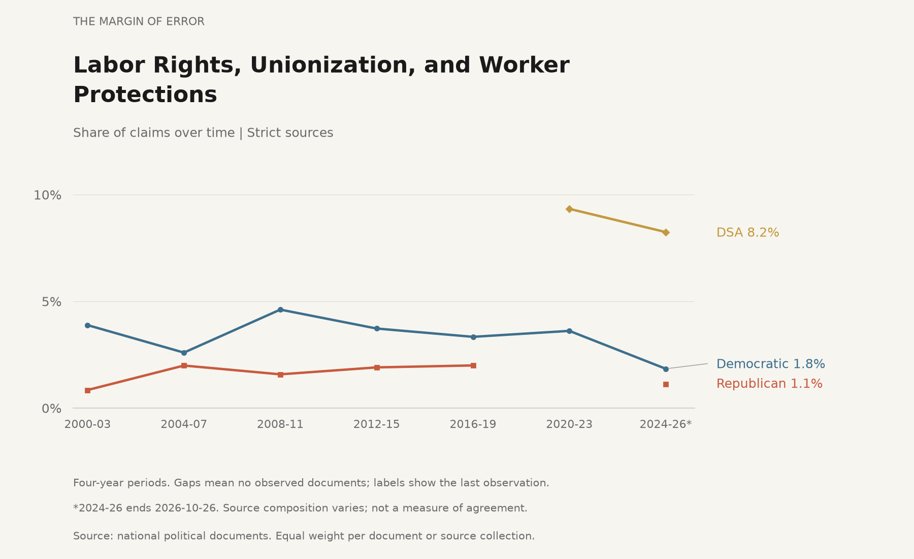

### Independently discovered topics within each period

Unlike the fixed-topic trends above, each period gets its own PCA, clustering, keywords and evidence packets, using only documents observed in that period. The number and meaning of clusters can differ. The strict view reuses that period's expanded assignments; it does not fit sparse adopted-only evidence separately.

Names summarize bounded local-Gemma evidence packets, not a pre-existing policy taxonomy. Source-bound assistant revisions are identified below and in the review record; original model replies remain unchanged.

**Evidence review:** 74/74 period-topic labels reviewed against bounded representative claims; 74 source-bound assistant revisions. This is not independent human gold or whole-cluster validation.

Adjacent-period centroid cosine similarities suggest possible thematic continuity. Only mutual nearest matches above 0.80 are called candidates. Neither a low similarity nor an unmatched topic proves that an issue first appeared or disappeared. Source coverage, rhetorical framing and cluster boundaries can all change.

[Period fits and diagnostics](../data/analysis/national_claims/full/topics/evolution/period_fits.json) · [Within-period shares](../data/analysis/national_claims/full/topics/evolution/shares.csv) · [Within-period contrasts and warnings](../data/analysis/national_claims/full/topics/evolution/contrasts.csv) · [Adjacent-period similarities](../data/analysis/national_claims/full/topics/evolution/adjacent_matches.csv) · [Representative source evidence](../data/analysis/national_claims/full/topics/evolution/representatives.csv) · [Label review and provenance](../data/analysis/national_claims/full/topics/evolution/label_review.json) · [Period coverage](../data/analysis/national_claims/full/topics/evolution/coverage.csv)

#### 2000-2003: observed themes

3,364 claims from 10 documents; 12 independently discovered topics. Fit status: complete. Cosine silhouette: 0.066.

Method: `weighted_kmeans`; unweighted assignment coverage: 100.0%. Low separation and mixed narrative clusters limit policy interpretation.

**Expanded reading:** topic shares below are within this period, not measurements of a permanent political position.

- Democratic: Social Insurance, School Choice, and Public-Service Improvements (19.8%); Economic Growth, Competitiveness, and Corporate Power (15.8%). Based on 1 bundle(s); unclustered share 0.0%. Source composition limits interpretation.
- Republican: Social Insurance, School Choice, and Public-Service Improvements (19.2%); Republican party narratives and competing policy descriptions (15.1%). Based on 1 bundle(s); unclustered share 0.0%. Source composition limits interpretation.
- DSA: Civil Society, Community Coalitions, and Public-Land Partnerships (23.3%); U.S. Policy Regarding Iraq and Saddam Hussein (18.8%). Based on 1 bundle(s); unclustered share 0.0%. Source composition limits interpretation.

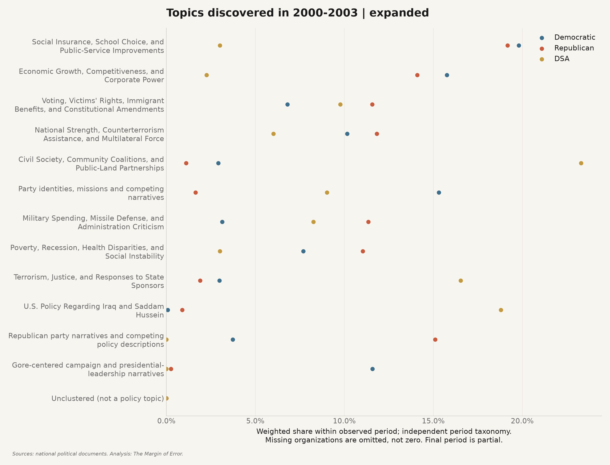

**Strict reading:** topic shares below are within this period, not measurements of a permanent political position.

- Democratic: Social Insurance, School Choice, and Public-Service Improvements (19.8%); Economic Growth, Competitiveness, and Corporate Power (15.8%). Based on 1 bundle(s); unclustered share 0.0%. Source composition limits interpretation.
- Republican: Social Insurance, School Choice, and Public-Service Improvements (19.2%); Republican party narratives and competing policy descriptions (15.1%). Based on 1 bundle(s); unclustered share 0.0%. Source composition limits interpretation.
- DSA: no observed documents in this view.

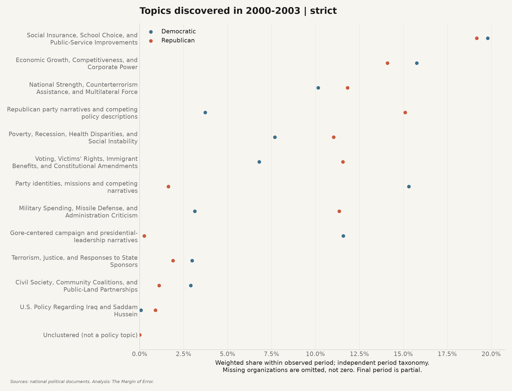

| Period topic | Closest preceding theme | Cosine | Interpretation |
|---|---|---:|---|

Period-specific label summaries and inspectable source examples:

**Economic Growth, Competitiveness, and Corporate Power** (`period-2000-topic-001`): Democratic examples describe economic growth and worker competitiveness. Republican examples credit tax reductions, deregulation, and open markets with growth. DSA examples describe unequal gains from expansion and corporations' legal power.

Caveat: Representative statements span distinct policies and assertions; they are not an independently verified or exhaustive account.

**Provenance:** source-bound assistant revision; original Gemma response retained unchanged.

> With trade and investments in giving American workers the skills they need, the U.S. can out-compete workers anywhere in the world.

Democratic — [2000 Democratic Party Platform](https://www.presidency.ucsb.edu/documents/2000-democratic-party-platform); `democratic-2000-normalized-2d154b3bd0b8-014`.

> The economic expansion of the last decade primarily benefited the well-off.

DSA — [2001 convention national priorities resolution](https://www.dsausa.org/files/2019/07/DL-2001-Convention-Coverage.pdf); `dsa-2001-convention-priorities-normalized-ef8a3eb37787-001`.

**Social Insurance, School Choice, and Public-Service Improvements** (`period-2000-topic-002`): Democratic examples favor unemployment benefits and preserving Social Security and Medicare. Republican examples support charitable giving and school choice. DSA examples favor improved electoral machinery and technical domestic-security improvements.

Caveat: Representative statements span distinct policies and assertions; they are not an independently verified or exhaustive account.

**Provenance:** source-bound assistant revision; original Gemma response retained unchanged.

> Commitment to improve benefits in the nation's unemployment system.

Democratic — [2000 Democratic Party Platform](https://www.presidency.ucsb.edu/documents/2000-democratic-party-platform); `democratic-2000-normalized-6f5c11a781d7-014`.

> Support for equitable financing and provision of crucial public goods, including standardized, high-quality machinery and a voter-verifiable permanent audit trail.

DSA — [2003 resolution on electoral reform](https://web.archive.org/web/20040110235906id_/http://www.dsausa.org/convention2003/report/r-electoral.html); `dsa-2003-electoral-normalized-6d2b6566d517-009`.

**Voting, Victims' Rights, Immigrant Benefits, and Constitutional Amendments** (`period-2000-topic-003`): Democratic examples support victims' constitutional protections and legal immigrants' due process and benefits. DSA examples defend voting and restoration of felons' suffrage. Republican examples support state right-to-work authority and a human-life constitutional amendment.

Caveat: Representative statements span distinct policies and assertions; they are not an independently verified or exhaustive account.

**Provenance:** source-bound assistant revision; original Gemma response retained unchanged.

> Support for a Victims' Rights Amendment to the United States Constitution consistent with fundamental Constitutional protections.

Democratic — [2000 Democratic Party Platform](https://www.presidency.ucsb.edu/documents/2000-democratic-party-platform); `democratic-2000-normalized-7453e9d4001f-001`.

> Support for efforts to defend the right to vote.

DSA — [2003 resolution on electoral reform](https://web.archive.org/web/20040110235906id_/http://www.dsausa.org/convention2003/report/r-electoral.html); `dsa-2003-electoral-normalized-6d2b6566d517-012`.

**Military Spending, Missile Defense, and Administration Criticism** (`period-2000-topic-004`): Democratic examples oppose unilateral arsenal cuts and an unproven missile-defense system. Republican examples criticize the administration's treatment of allies and alleged encouragement of anti-Americanism. DSA examples oppose wasteful military spending and the Bush administration's proposed Iraq force.

Caveat: Representative statements span distinct policies and assertions; they are not an independently verified or exhaustive account.

**Provenance:** source-bound assistant revision; original Gemma response retained unchanged.

> Opposition to Republican plans to make unilateral cuts in the U.S. arsenal.

Democratic — [2000 Democratic Party Platform](https://www.presidency.ucsb.edu/documents/2000-democratic-party-platform); `democratic-2000-normalized-44455af554d9-006`.

> Opposition to wasteful and ineffective increases in military spending.

DSA — [DSA statement on the September 11 terrorist attacks](https://dlarchive.dsausa.org/wp-content/uploads/2018/12/DL_2001_V029_02.pdf); `dsa-2001-september-11-normalized-b4053b6e0d8a-001`.

**Civil Society, Community Coalitions, and Public-Land Partnerships** (`period-2000-topic-005`): Democratic examples support civil society and participation at work and in communities. DSA examples concern coalitions with communities of color and a campaign for Wal-Mart workers. Republican examples emphasize AIDS action and local partnerships in public-land management.

Caveat: Representative statements span distinct policies and assertions; they are not an independently verified or exhaustive account.

**Provenance:** source-bound assistant revision; original Gemma response retained unchanged.

> Commitment to continue to support the development of judiciary, legal systems, media and civil society organizations.

Democratic — [2000 Democratic Party Platform](https://www.presidency.ucsb.edu/documents/2000-democratic-party-platform); `democratic-2000-normalized-93fadee8da59-008`.

> Commitment to consistently look for opportunities to work with activists in communities of color.

DSA — [2001 convention national priorities resolution](https://www.dsausa.org/files/2019/07/DL-2001-Convention-Coverage.pdf); `dsa-2001-convention-priorities-normalized-cf1eef463e22-008`.

**Party identities, missions and competing narratives** (`period-2000-topic-006`): Democratic claims link party beliefs to Social Security and communities, while a Republican example criticizes a Democratic tax increase and another frames party outreach. DSA examples describe its democratic-socialist mission and coalition strategy.

Caveat: Party self-descriptions and criticisms across unrelated policies, not a shared stance on Social Security or taxation.

**Provenance:** source-bound assistant revision; original Gemma response retained unchanged.

> Democrats believe in using prosperity to save Social Security.

Democratic — [2000 Democratic Party Platform](https://www.presidency.ucsb.edu/documents/2000-democratic-party-platform); `democratic-2000-normalized-0c700669dee2-004`.

> DSA aims to establish democratic socialism by helping to build progressive coalitions to win victories that move the United States towards greater democracy.

DSA — [2003 adopted working mission statement](https://web.archive.org/web/20040227005032id_/http://www.dsausa.org/convention2003/report/r-mission.html); `dsa-2003-mission-normalized-20f699d8e4de-006`.

**Gore-centered campaign and presidential-leadership narratives** (`period-2000-topic-007`): Democratic examples describe Gore's after-school agenda and cooperation with Armenia. Republican examples describe the scope of Gore's security agenda and the importance of presidential leadership on environmental issues.

Caveat: Actor-centered campaign language across unrelated policies, not a single policy position.

**Provenance:** source-bound assistant revision; original Gemma response retained unchanged.

> Al Gore believes in expanding after-school programs.

Democratic — [2000 Democratic Party Platform](https://www.presidency.ucsb.edu/documents/2000-democratic-party-platform); `democratic-2000-normalized-6bd9c0fed2ac-006`.

> Vice President Gore's "new security agenda" adds disease, climate, and all the world's ethnic or religious conflicts to an undiminished set of existing American responsibilities.

Republican — [2000 Republican Party Platform](https://www.presidency.ucsb.edu/documents/2000-republican-party-platform); `republican-2000-normalized-82a5e5527427-001`.

**Poverty, Recession, Health Disparities, and Social Instability** (`period-2000-topic-008`): Democratic examples connect extreme global poverty with instability and the need to address it. DSA examples predict recession-related inequality and declining living standards. Republican examples describe Western Hemisphere social problems and health disparities among underserved groups.

Caveat: Representative statements span distinct policies and assertions; they are not an independently verified or exhaustive account.

**Provenance:** source-bound assistant revision; original Gemma response retained unchanged.

> More than 1 billion of the Earth's inhabitants live on less than $1 a day, inviting social dislocation, violence, and war.

Democratic — [2000 Democratic Party Platform](https://www.presidency.ucsb.edu/documents/2000-democratic-party-platform); `democratic-2000-normalized-db6e404196a5-009`.

> The economic recession will increase already morally unacceptable levels of inequality by worsening the conditions of low-wage workers and threatening the living standards of the middle class.

DSA — [2001 convention national priorities resolution](https://www.dsausa.org/files/2019/07/DL-2001-Convention-Coverage.pdf); `dsa-2001-convention-priorities-normalized-ef8a3eb37787-002`.

**National Strength, Counterterrorism Assistance, and Multilateral Force** (`period-2000-topic-009`): Democratic examples support economic and military strength and defenses against weapons proliferation. Republican examples favor healthy neighbors and assistance against terrorism. DSA examples support limited, directed multilateral armed force and measures against the international arms trade.

Caveat: Representative statements span distinct policies and assertions; they are not an independently verified or exhaustive account.

**Provenance:** source-bound assistant revision; original Gemma response retained unchanged.

> Support for maintaining America's economic and military strength.

Democratic — [2000 Democratic Party Platform](https://www.presidency.ucsb.edu/documents/2000-democratic-party-platform); `democratic-2000-normalized-8312f38dd9b9-005`.

> Support for the limited and directed use of multilateral armed force.

DSA — [2001 convention resolution on war and terrorism](https://www.dsausa.org/files/2019/07/DL-2001-Convention-Coverage.pdf); `dsa-2001-war-terrorism-normalized-7bbb1e1c3390-008`.

**Republican party narratives and competing policy descriptions** (`period-2000-topic-010`): Democratic examples criticize Republican Medicare proposals involving HMOs and premiums. Republican examples describe support for new ideas, private sectors, open markets and open societies.

Caveat: Partisan criticism and self-description across several subjects; claims about Republican proposals are attributed assertions, not verified outcomes.

**Provenance:** source-bound assistant revision; original Gemma response retained unchanged.

> The Republican Party has supported plans that would force elderly patients into HMOs.

Democratic — [2000 Democratic Party Platform](https://www.presidency.ucsb.edu/documents/2000-democratic-party-platform); `democratic-2000-normalized-6f072c85794d-011`.

> Republicans promote the development of new ideas and private sectors.

Republican — [2000 Republican Party Platform](https://www.presidency.ucsb.edu/documents/2000-republican-party-platform); `republican-2000-normalized-6ebdc3abd700-006`.

**Terrorism, Justice, and Responses to State Sponsors** (`period-2000-topic-011`): Democratic examples promise pursuit of terrorists and describe terrorism in Colombia. Republican examples favor pressure on state sponsors and a resolute but measured response. DSA examples describe Americans' exposure to attacks and support bringing September 11 perpetrators to justice.

Caveat: Representative statements span distinct policies and assertions; they are not an independently verified or exhaustive account.

**Provenance:** source-bound assistant revision; original Gemma response retained unchanged.

> The U.S. will scour the world to hunt down terrorists and bring them to justice.

Democratic — [2000 Democratic Party Platform](https://www.presidency.ucsb.edu/documents/2000-democratic-party-platform); `democratic-2000-normalized-35991a3208e1-015`.

> Americans have been subject to terrorist attacks.

DSA — [2001 convention national priorities resolution](https://www.dsausa.org/files/2019/07/DL-2001-Convention-Coverage.pdf); `dsa-2001-convention-priorities-normalized-ef8a3eb37787-006`.

**U.S. Policy Regarding Iraq and Saddam Hussein** (`period-2000-topic-012`): Claims address the U.S. stance toward removing Saddam Hussein from power in Iraq. The claims also describe the state of Iraq, including infrastructure destruction and the unraveling of efforts to control weapons of mass destruction. Differing perspectives are present regarding past successes in containing Iraq's power.

Caveat: Claims present positions on Iraq, but do not detail comprehensive policy proposals beyond regime change and proliferation concerns.

**Provenance:** source-bound assistant revision; original Gemma response retained unchanged.

> The U.S. will work to see Saddam Hussein out of power.

Democratic — [2000 Democratic Party Platform](https://www.presidency.ucsb.edu/documents/2000-democratic-party-platform); `democratic-2000-normalized-ad3592354251-008`.

> Iraq is being ravaged.

DSA — [2003 resolution on the occupation of Iraq](https://web.archive.org/web/20040110235717id_/http://www.dsausa.org/convention2003/report/r-iraq.html); `dsa-2003-iraq-normalized-aeabf36dcf1a-013`.

#### 2004-2007: observed themes

3,627 claims from 6 documents; 12 independently discovered topics. Fit status: complete. Cosine silhouette: 0.075.

Method: `weighted_kmeans`; unweighted assignment coverage: 100.0%. Low separation and mixed narrative clusters limit policy interpretation.

**Expanded reading:** topic shares below are within this period, not measurements of a permanent political position.

- Democratic: Counterterrorism, Armed Peacekeeping, and Military Spending (17.8%); Economic Development, International Partnerships, and Shared Resources (17.6%). Based on 1 bundle(s); unclustered share 0.0%. Source composition limits interpretation.
- Republican: Republican Records, Social Spending, and Environmental Criticism (15.1%); Counterterrorism, Armed Peacekeeping, and Military Spending (14.1%). Based on 1 bundle(s); unclustered share 0.0%. Source composition limits interpretation.
- DSA: Employment Loss, Living Costs, and Social Stability (32.3%); Democratic Prosperity, Market Policy, and Progressive Economic Coalitions (25.6%). Based on 1 bundle(s); unclustered share 0.0%. Source composition limits interpretation.

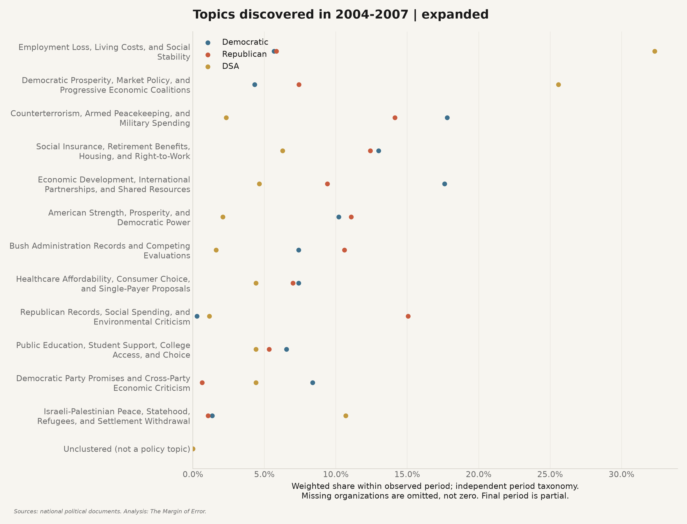

**Strict reading:** topic shares below are within this period, not measurements of a permanent political position.

- Democratic: Counterterrorism, Armed Peacekeeping, and Military Spending (17.8%); Economic Development, International Partnerships, and Shared Resources (17.6%). Based on 1 bundle(s); unclustered share 0.0%. Source composition limits interpretation.
- Republican: Republican Records, Social Spending, and Environmental Criticism (15.1%); Counterterrorism, Armed Peacekeeping, and Military Spending (14.1%). Based on 1 bundle(s); unclustered share 0.0%. Source composition limits interpretation.
- DSA: no observed documents in this view.

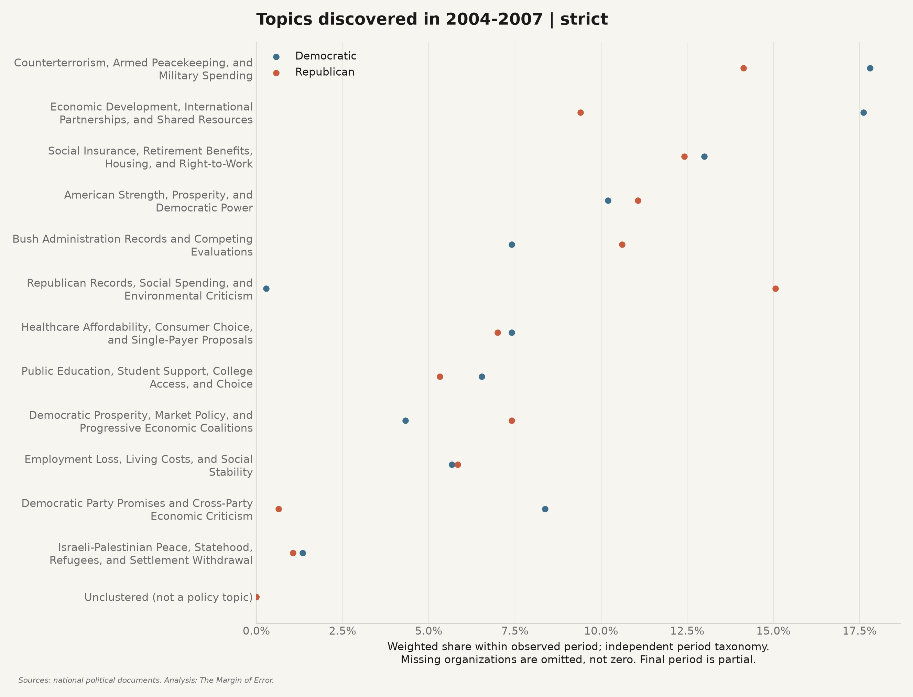

| Period topic | Closest preceding theme | Cosine | Interpretation |
|---|---|---:|---|
| Economic Development, International Partnerships, and Shared Resources | Social Insurance, School Choice, and Public-Service Improvements (2000-2003) | 0.952 | uncertain_match_not_proof_of_new_topic |
| American Strength, Prosperity, and Democratic Power | Economic Growth, Competitiveness, and Corporate Power (2000-2003) | 0.955 | candidate_thematic_continuity |
| Counterterrorism, Armed Peacekeeping, and Military Spending | National Strength, Counterterrorism Assistance, and Multilateral Force (2000-2003) | 0.953 | candidate_thematic_continuity |
| Social Insurance, Retirement Benefits, Housing, and Right-to-Work | Voting, Victims' Rights, Immigrant Benefits, and Constitutional Amendments (2000-2003) | 0.975 | candidate_thematic_continuity |
| Employment Loss, Living Costs, and Social Stability | Poverty, Recession, Health Disparities, and Social Instability (2000-2003) | 0.975 | candidate_thematic_continuity |
| Bush Administration Records and Competing Evaluations | Military Spending, Missile Defense, and Administration Criticism (2000-2003) | 0.889 | uncertain_match_not_proof_of_new_topic |
| Healthcare Affordability, Consumer Choice, and Single-Payer Proposals | Social Insurance, School Choice, and Public-Service Improvements (2000-2003) | 0.914 | uncertain_match_not_proof_of_new_topic |
| Democratic Party Promises and Cross-Party Economic Criticism | Party identities, missions and competing narratives (2000-2003) | 0.968 | candidate_thematic_continuity |
| Public Education, Student Support, College Access, and Choice | Social Insurance, School Choice, and Public-Service Improvements (2000-2003) | 0.943 | uncertain_match_not_proof_of_new_topic |
| Israeli-Palestinian Peace, Statehood, Refugees, and Settlement Withdrawal | National Strength, Counterterrorism Assistance, and Multilateral Force (2000-2003) | 0.852 | uncertain_match_not_proof_of_new_topic |
| Democratic Prosperity, Market Policy, and Progressive Economic Coalitions | Economic Growth, Competitiveness, and Corporate Power (2000-2003) | 0.937 | uncertain_match_not_proof_of_new_topic |
| Republican Records, Social Spending, and Environmental Criticism | Republican party narratives and competing policy descriptions (2000-2003) | 0.981 | candidate_thematic_continuity |

Period-specific label summaries and inspectable source examples:

**Economic Development, International Partnerships, and Shared Resources** (`period-2004-topic-001`): Democratic examples support competitiveness and the Atlantic partnership. Republican examples favor productive potential internationally and biofuel use. DSA examples propose a sustainable-development Marshall Plan and protection of natural, social, and political commons.

Caveat: Representative statements span distinct policies and assertions; they are not an independently verified or exhaustive account.

**Provenance:** source-bound assistant revision; original Gemma response retained unchanged.

> Support for renewing American competitiveness.

Democratic — [2004 Democratic Party Platform](https://www.presidency.ucsb.edu/documents/2004-democratic-party-platform); `democratic-2004-normalized-986d0d10e57b-006`.

> Support for a global Marshall Plan for sustainable development to reverse the race to the bottom in wages, taxation, health, and environmental regulation.

DSA — [An Economic Justice Agenda - adopted November 2007](https://www.dsausa.org/wp-json/wp/v2/strategy/612); `dsa-2007-economic-justice-normalized-b0584d210bd2-007`.

**American Strength, Prosperity, and Democratic Power** (`period-2004-topic-002`): Democratic examples connect economic development and family investment with national strength. Republican examples affirm American leadership and multinational action against terrorism. DSA examples describe U.S. military spending and argue that democratizing power can extend the American Dream to previously excluded people.

Caveat: Representative statements span distinct policies and assertions; they are not an independently verified or exhaustive account.

**Provenance:** source-bound assistant revision; original Gemma response retained unchanged.

> Support for strong economic development for all those who live under the U.S. flag.

Democratic — [2004 Democratic Party Platform](https://www.presidency.ucsb.edu/documents/2004-democratic-party-platform); `democratic-2004-normalized-959a61551087-006`.

> The United States today spends more on its armed forces than does the rest of the world combined.

DSA — [An Economic Justice Agenda - adopted November 2007](https://www.dsausa.org/wp-json/wp/v2/strategy/612); `dsa-2007-economic-justice-normalized-53bb7ce424c7-006`.

**Counterterrorism, Armed Peacekeeping, and Military Spending** (`period-2004-topic-003`): Democratic examples promise military action against terrorism. Republican examples describe an ongoing war on terror and support stronger human intelligence collection. DSA examples call for an international armed peacekeeping force in the Israeli-Palestinian conflict and criticize the scale of U.S. military spending.

Caveat: Representative statements span distinct policies and assertions; they are not an independently verified or exhaustive account.

**Provenance:** source-bound assistant revision; original Gemma response retained unchanged.

> Commitment to train and equip the military to enhance its capabilities to seek out and destroy terrorists.

Democratic — [2004 Democratic Party Platform](https://www.presidency.ucsb.edu/documents/2004-democratic-party-platform); `democratic-2004-normalized-040d6ccea8d0-001`.

> The United States, the European Union and the United Nations must station a permanent international armed peace-keeping force to separate the parties now.

DSA — [NPC resolution on Israel's occupation of the West Bank and Gaza](https://dlarchive.dsausa.org/wp-content/uploads/2018/12/DL_2004_V032_02.pdf); `dsa-2004-israel-palestine-normalized-3bb1d6b334dc-003`.

**Social Insurance, Retirement Benefits, Housing, and Right-to-Work** (`period-2004-topic-004`): Democratic examples support preserving Social Security and removing discriminatory retirement-benefit rules. DSA examples favor expanded Social Security and reversing unemployment and disability eligibility cuts. Republican examples support state right-to-work laws and an affordable-housing tax credit.

Caveat: Representative statements span distinct policies and assertions; they are not an independently verified or exhaustive account.

**Provenance:** source-bound assistant revision; original Gemma response retained unchanged.

> Support for preserving Social Security.

Democratic — [2004 Democratic Party Platform](https://www.presidency.ucsb.edu/documents/2004-democratic-party-platform); `democratic-2004-normalized-9dd4e85fc8cc-001`.

> Support for reversing severe cutbacks in eligibility for unemployment and disability insurance.

DSA — [An Economic Justice Agenda - adopted November 2007](https://www.dsausa.org/wp-json/wp/v2/strategy/612); `dsa-2007-economic-justice-normalized-c63351d156d5-004`.

**Employment Loss, Living Costs, and Social Stability** (`period-2004-topic-005`): Democratic examples describe job losses and rising everyday costs. Republican examples connect family breakdown with instability and oppose carbon controls they characterize as harmful to jobs and growth. DSA examples criticize corporate dominance and the absence of social solidarity and common-welfare commitment exposed by Katrina.

Caveat: Representative statements span distinct policies and assertions; they are not an independently verified or exhaustive account.

**Provenance:** source-bound assistant revision; original Gemma response retained unchanged.

> Millions of Americans have lost their jobs.

Democratic — [2004 Democratic Party Platform](https://www.presidency.ucsb.edu/documents/2004-democratic-party-platform); `democratic-2004-normalized-eb1979bf3bc4-010`.

> Hurricane Katrina’s devastation of New Orleans and much of the Gulf Coast demonstrates the absence of social solidarity in the United States and the lack of government commitment to the common welfare.

DSA — [DSA Statement on Hurricane Katrina](https://dlarchive.dsausa.org/wp-content/uploads/2018/12/DL_2005_V033_02.pdf); `dsa-2005-katrina-lead-normalized-2cf7871721ea-001`.

**Bush Administration Records and Competing Evaluations** (`period-2004-topic-006`): Democratic examples accuse Bush of favoring special interests and trying to eliminate Pell Grants for students. DSA examples criticize veterans' treatment and the response exposed by Katrina. Republican examples praise Bush's international leadership and decision to confront Saddam Hussein.

Caveat: Representative statements span distinct policies and assertions; they are not an independently verified or exhaustive account.

**Provenance:** source-bound assistant revision; original Gemma response retained unchanged.

> President Bush has regularly governed for the benefit of special interests, not the public interest.

Democratic — [2004 Democratic Party Platform](https://www.presidency.ucsb.edu/documents/2004-democratic-party-platform); `democratic-2004-normalized-3473e48c58d7-008`.

> The Bush administration had scandals, including the maltreatment of veterans at Walter Reed Hospital.

DSA — [An Economic Justice Agenda - adopted November 2007](https://www.dsausa.org/wp-json/wp/v2/strategy/612); `dsa-2007-economic-justice-normalized-1178d564665f-008`.

**Healthcare Affordability, Consumer Choice, and Single-Payer Proposals** (`period-2004-topic-007`): Democratic examples support affordable, available healthcare and system reform to help businesses with costs. Republican examples favor affordability, access, and consumer-driven care. DSA examples describe Medicare for all and potential savings from a single-payer system.

Caveat: Representative statements span distinct policies and assertions; they are not an independently verified or exhaustive account.

**Provenance:** source-bound assistant revision; original Gemma response retained unchanged.

> Belief that health care should be available and affordable in America.

Democratic — [2004 Democratic Party Platform](https://www.presidency.ucsb.edu/documents/2004-democratic-party-platform); `democratic-2004-normalized-6a60b850a081-001`.

> The huge savings in administrative costs and elimination of wasteful insurance advertising in a single-payer system could be used to improve the quality of health care.

DSA — [An Economic Justice Agenda - adopted November 2007](https://www.dsausa.org/wp-json/wp/v2/strategy/612); `dsa-2007-economic-justice-normalized-969c50089fd8-013`.

**Democratic Party Promises and Cross-Party Economic Criticism** (`period-2004-topic-008`): Democratic examples promise a stronger, safer, healthier America. DSA examples criticize neoliberal Democrats' deregulation, privatization, and social-spending priorities. Republican examples criticize Democrats' taxation views and alleged resistance to shifting power from Washington to families and businesses.

Caveat: Representative statements span distinct policies and assertions; they are not an independently verified or exhaustive account.

**Provenance:** source-bound assistant revision; original Gemma response retained unchanged.

> The Democratic Party has a plan to build a strong, respected America.

Democratic — [2004 Democratic Party Platform](https://www.presidency.ucsb.edu/documents/2004-democratic-party-platform); `democratic-2004-normalized-17d0cec3e717-004`.

> Neoliberal Democrats advocate deregulation and privatization.

DSA — [An Economic Justice Agenda - adopted November 2007](https://www.dsausa.org/wp-json/wp/v2/strategy/612); `dsa-2007-economic-justice-normalized-2f0b6e9da929-009`.

**Public Education, Student Support, College Access, and Choice** (`period-2004-topic-009`): Democratic examples favor school readiness and personal attention for students. DSA examples propose democratic public education and affordable college. Republican examples support school choice and greater parental control.

Caveat: Representative statements span distinct policies and assertions; they are not an independently verified or exhaustive account.

**Provenance:** source-bound assistant revision; original Gemma response retained unchanged.

> Support for an America where every child comes to school ready to learn.

Democratic — [2004 Democratic Party Platform](https://www.presidency.ucsb.edu/documents/2004-democratic-party-platform); `democratic-2004-normalized-1c1f3c768152-001`.

> Support for creating a truly democratic public education system.

DSA — [An Economic Justice Agenda - adopted November 2007](https://www.dsausa.org/wp-json/wp/v2/strategy/612); `dsa-2007-economic-justice-normalized-500c699fb1db-014`.

**Israeli-Palestinian Peace, Statehood, Refugees, and Settlement Withdrawal** (`period-2004-topic-010`): Democratic examples support lasting peace and a Palestinian state alongside Israel. Republican examples describe Israeli outpost removal and settlement withdrawal favorably. DSA examples discuss Israel's responsibility for refugees and the displacement underlying its majority-Jewish character.

Caveat: Representative statements span distinct policies and assertions; they are not an independently verified or exhaustive account.

**Provenance:** source-bound assistant revision; original Gemma response retained unchanged.

> Commitment to the creation of a comprehensive, just and lasting peace between Israel and its neighbors.

Democratic — [2004 Democratic Party Platform](https://www.presidency.ucsb.edu/documents/2004-democratic-party-platform); `democratic-2004-normalized-0ad85f479ed5-007`.

> Israel has a responsibility in the creation of the 1948 Palestinian refugees.

DSA — [NPC resolution on Israel's occupation of the West Bank and Gaza](https://dlarchive.dsausa.org/wp-content/uploads/2018/12/DL_2004_V032_02.pdf); `dsa-2004-israel-palestine-normalized-ed0e04548cee-001`.

**Democratic Prosperity, Market Policy, and Progressive Economic Coalitions** (`period-2004-topic-011`): Democratic examples link collective security and prosperity with democracy, environmental stewardship, and middle-class jobs. Republican examples favor commerce, investment, free and fair trade, lower taxes, and limited regulation. DSA examples propose progressive taxation, public goods, labor rights, and a coalition addressing structural inequality and corporate power.

Caveat: Representative statements span distinct policies and assertions; they are not an independently verified or exhaustive account.

**Provenance:** source-bound assistant revision; original Gemma response retained unchanged.

> Collective security and prosperity are furthered by mutual efforts to promote democracy, generate wealth, reduce income disparities, and provide sound environmental stewardship.

Democratic — [2004 Democratic Party Platform](https://www.presidency.ucsb.edu/documents/2004-democratic-party-platform); `democratic-2004-normalized-c388831399dd-003`.

> By uniting behind a program that restores faith in democratic government, re-institutes progressive taxation, defends and extends public goods and social insurance, restores and expands labor rights, and builds just global institutions, democratic forces can curb the power of corporate elites and reverse corporate globalization’s exacerbation of inequality.

DSA — [An Economic Justice Agenda - adopted November 2007](https://www.dsausa.org/wp-json/wp/v2/strategy/612); `dsa-2007-economic-justice-normalized-9bc5b8b5d38b-001`.

**Republican Records, Social Spending, and Environmental Criticism** (`period-2004-topic-012`): Republican examples credit their party and Bush-era leadership with overcoming challenges and security achievements. Democratic examples oppose Republican threats to protections for seniors and disabled people and criticize public-land giveaways. DSA examples characterize Republican social-spending priorities and discuss Reagan's support for union rights in Communist countries.

Caveat: Representative statements span distinct policies and assertions; they are not an independently verified or exhaustive account.

**Provenance:** source-bound assistant revision; original Gemma response retained unchanged.

> Opposition to allowing Republicans to destroy a commitment that has done so much good for so many seniors and people with disabilities over the past 39 years.

Democratic — [2004 Democratic Party Platform](https://www.presidency.ucsb.edu/documents/2004-democratic-party-platform); `democratic-2004-normalized-598dfac59a77-008`.

> The Republican Party favors cuts in social spending.

DSA — [An Economic Justice Agenda - adopted November 2007](https://www.dsausa.org/wp-json/wp/v2/strategy/612); `dsa-2007-economic-justice-normalized-2f0b6e9da929-007`.

#### 2008-2011: observed themes

2,973 claims from 8 documents; 2 independently discovered topics. Fit status: complete. Cosine silhouette: 0.114.

Method: `hdbscan`; unweighted assignment coverage: 52.2%. Low separation and mixed narrative clusters limit policy interpretation. Two broad clusters plus substantial unclustered mass are not a complete account of the issues discussed.

**Expanded reading:** topic shares below are within this period, not measurements of a permanent political position.

- Democratic: Government Economic Role and Public Spending (60.9%); Israeli-Palestinian security, rights and two-state diplomacy (0.7%). Based on 1 bundle(s); unclustered share 38.4%. Source composition limits interpretation.
- Republican: Government Economic Role and Public Spending (41.1%); Israeli-Palestinian security, rights and two-state diplomacy (1.0%). Based on 1 bundle(s); unclustered share 57.9%. Source composition limits interpretation.
- DSA: Government Economic Role and Public Spending (35.0%); Israeli-Palestinian security, rights and two-state diplomacy (12.4%). Based on 1 bundle(s); unclustered share 52.6%. Source composition limits interpretation.

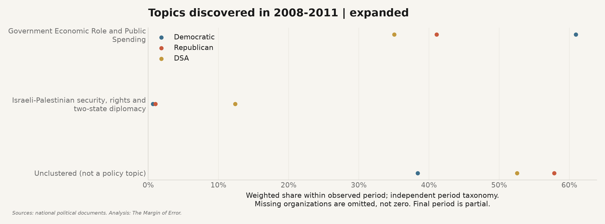

**Strict reading:** topic shares below are within this period, not measurements of a permanent political position.

- Democratic: Government Economic Role and Public Spending (60.9%); Israeli-Palestinian security, rights and two-state diplomacy (0.7%). Based on 1 bundle(s); unclustered share 38.4%. Source composition limits interpretation.
- Republican: Government Economic Role and Public Spending (41.1%); Israeli-Palestinian security, rights and two-state diplomacy (1.0%). Based on 1 bundle(s); unclustered share 57.9%. Source composition limits interpretation.
- DSA: no observed documents in this view.

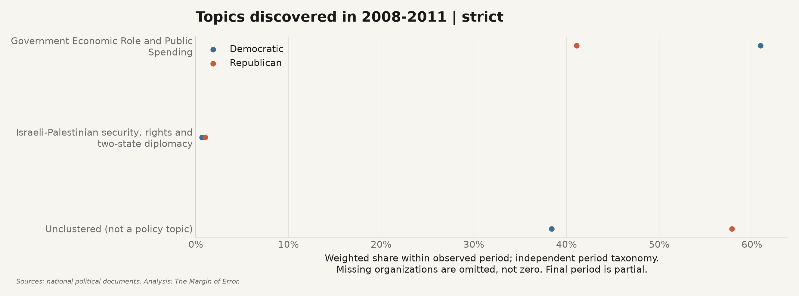

| Period topic | Closest preceding theme | Cosine | Interpretation |
|---|---|---:|---|
| Government Economic Role and Public Spending | Economic Development, International Partnerships, and Shared Resources (2004-2007) | 0.977 | candidate_thematic_continuity |
| Israeli-Palestinian security, rights and two-state diplomacy | Israeli-Palestinian Peace, Statehood, Refugees, and Settlement Withdrawal (2004-2007) | 0.980 | candidate_thematic_continuity |

Period-specific label summaries and inspectable source examples:

**Government Economic Role and Public Spending** (`period-2008-topic-001`): These claims address the role of the U.S. federal government in the economy, with commitments to both restructuring the economy and limiting government intrusion. There are also stated goals to provide assistance to states and localities, alongside commitments to end wasteful spending on ineffective programs. These positions reflect differing views on the appropriate level and type of government involvement.

Caveat: mixed-subtopic/stance

**Provenance:** source-bound assistant revision; original Gemma response retained unchanged.

> Commitment to work to provide real opportunities for all Americans suffering from disadvantage.

Democratic — [2008 Democratic Party Platform](https://www.presidency.ucsb.edu/documents/2008-democratic-party-platform); `democratic-2008-normalized-4794e91f1cfe-006`.

> Commitment to fight to restructure the U.S. economy in a democratic direction.

DSA — [2009 convention national priorities resolution](https://dlarchive.dsausa.org/wp-content/uploads/2018/12/DL_2010_V037_03.pdf); `dsa-2009-priorities-normalized-69ef366c0cec-004`.

**Israeli-Palestinian security, rights and two-state diplomacy** (`period-2008-topic-002`): Democratic and Republican examples discuss Israel's security and diplomatic partners, including a Republican two-state vision. DSA examples criticize occupation and injustice while calling for a sustained negotiated two-state settlement following the Gaza ceasefire.

Caveat: Positions differ in emphasis and conditions; no supplied example establishes unconditional support.

**Provenance:** source-bound assistant revision; original Gemma response retained unchanged.

> The United States should stand with Israel against those who seek its destruction.

Democratic — [2008 Democratic Party Platform](https://www.presidency.ucsb.edu/documents/2008-democratic-party-platform); `democratic-2008-normalized-0ef47ff2a906-003`.

> The Israeli state has a right to defend its people, but after more than 60 years of self-defense and 40 years of an unjust occupation of the West Bank and Gaza, it should be self-evident that peace and security for Israel cannot be achieved by injustice towards another people.

DSA — [NPC statement on Israeli-Palestinian conflict](https://dlarchive.dsausa.org/wp-content/uploads/2018/12/DL_2009_V037_01.pdf); `dsa-2009-middle-east-lead-normalized-8976b05dabb1-001`.

#### 2012-2015: observed themes

4,128 claims from 30 documents; 12 independently discovered topics. Fit status: complete. Cosine silhouette: 0.059.

Method: `weighted_kmeans`; unweighted assignment coverage: 100.0%. Low separation and mixed narrative clusters limit policy interpretation.

**Expanded reading:** topic shares below are within this period, not measurements of a permanent political position.

- Democratic: Obama Administration Records, Proposals, and Partisan Critiques (18.3%); Public Investment, Workforce Retraining, and Indigenous Community Support (16.1%). Based on 1 bundle(s); unclustered share 0.0%. Source composition limits interpretation.
- Republican: Public Investment, Workforce Retraining, and Indigenous Community Support (13.7%); Universal Rights, Voting, Self-Defense, and Religious Freedom (13.0%). Based on 1 bundle(s); unclustered share 0.0%. Source composition limits interpretation.
- DSA: Economic Crisis, Household Bills, and Sequestration Cuts (14.4%); Good Jobs, Workers' Rights, Income Security, and Enterprise (12.4%). Based on 1 bundle(s); unclustered share 0.0%. Source composition limits interpretation.

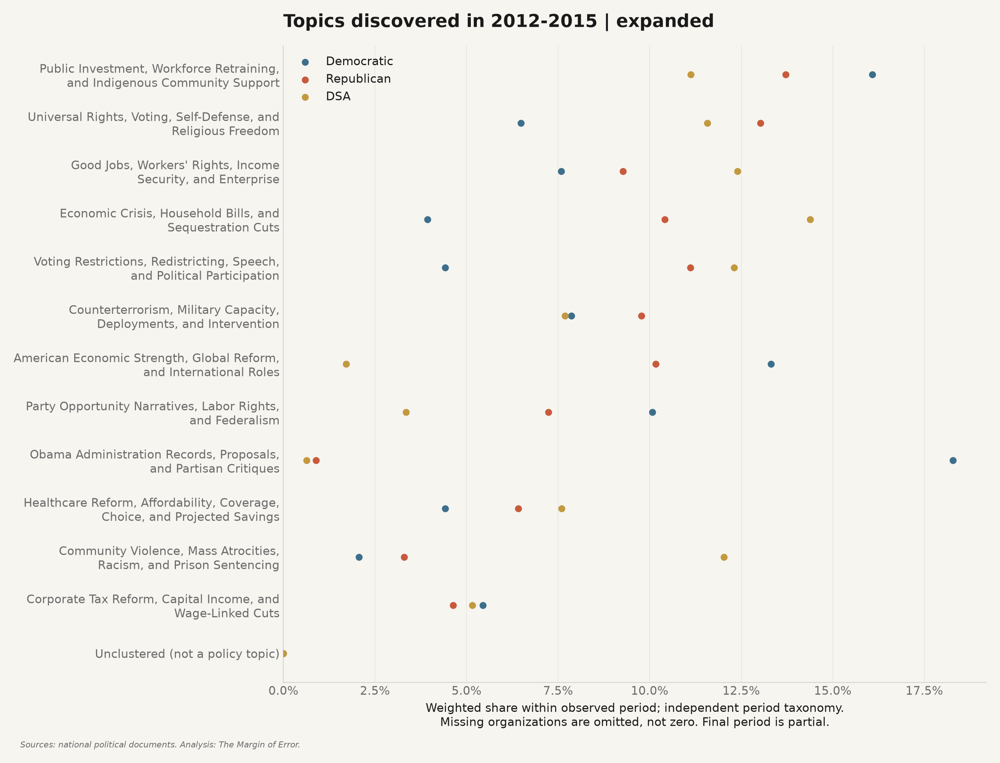

**Strict reading:** topic shares below are within this period, not measurements of a permanent political position.

- Democratic: Obama Administration Records, Proposals, and Partisan Critiques (18.3%); Public Investment, Workforce Retraining, and Indigenous Community Support (16.1%). Based on 1 bundle(s); unclustered share 0.0%. Source composition limits interpretation.
- Republican: Public Investment, Workforce Retraining, and Indigenous Community Support (13.7%); Universal Rights, Voting, Self-Defense, and Religious Freedom (13.0%). Based on 1 bundle(s); unclustered share 0.0%. Source composition limits interpretation.
- DSA: no observed documents in this view.

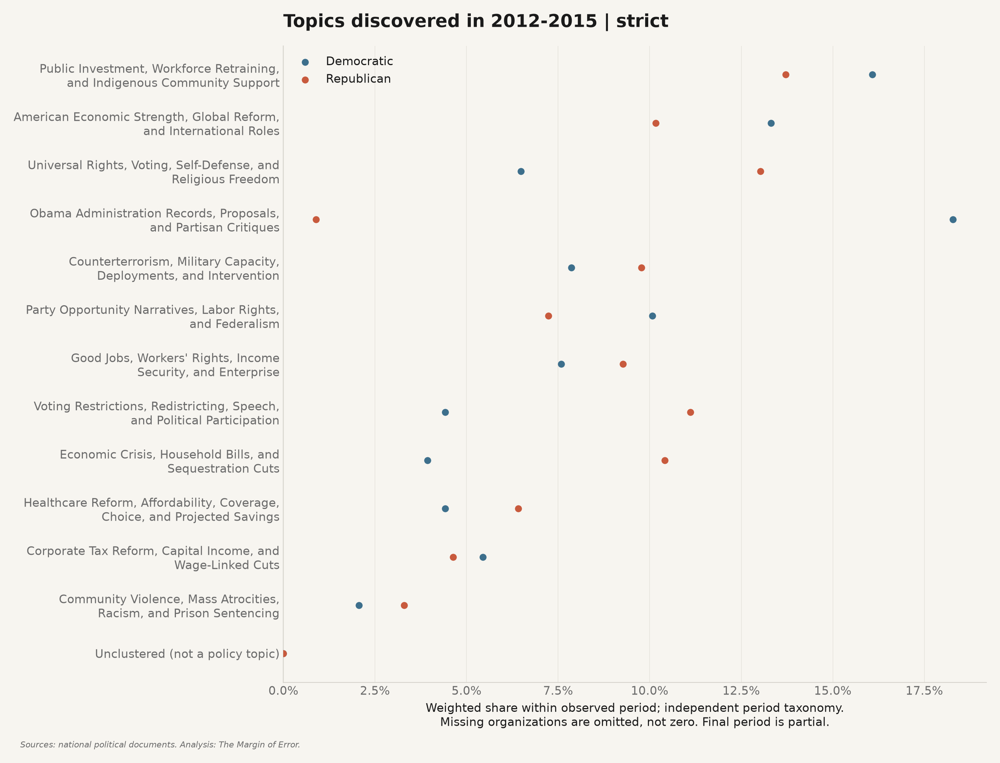

| Period topic | Closest preceding theme | Cosine | Interpretation |
|---|---|---:|---|
| Party Opportunity Narratives, Labor Rights, and Federalism | Government Economic Role and Public Spending (2008-2011) | 0.935 | uncertain_match_not_proof_of_new_topic |
| Counterterrorism, Military Capacity, Deployments, and Intervention | Government Economic Role and Public Spending (2008-2011) | 0.893 | uncertain_match_not_proof_of_new_topic |
| Obama Administration Records, Proposals, and Partisan Critiques | Government Economic Role and Public Spending (2008-2011) | 0.894 | uncertain_match_not_proof_of_new_topic |
| American Economic Strength, Global Reform, and International Roles | Government Economic Role and Public Spending (2008-2011) | 0.926 | uncertain_match_not_proof_of_new_topic |
| Healthcare Reform, Affordability, Coverage, Choice, and Projected Savings | Government Economic Role and Public Spending (2008-2011) | 0.905 | uncertain_match_not_proof_of_new_topic |
| Public Investment, Workforce Retraining, and Indigenous Community Support | Government Economic Role and Public Spending (2008-2011) | 0.979 | candidate_thematic_continuity |
| Good Jobs, Workers' Rights, Income Security, and Enterprise | Government Economic Role and Public Spending (2008-2011) | 0.930 | uncertain_match_not_proof_of_new_topic |
| Universal Rights, Voting, Self-Defense, and Religious Freedom | Government Economic Role and Public Spending (2008-2011) | 0.954 | uncertain_match_not_proof_of_new_topic |
| Voting Restrictions, Redistricting, Speech, and Political Participation | Government Economic Role and Public Spending (2008-2011) | 0.891 | uncertain_match_not_proof_of_new_topic |
| Economic Crisis, Household Bills, and Sequestration Cuts | Government Economic Role and Public Spending (2008-2011) | 0.862 | uncertain_match_not_proof_of_new_topic |
| Community Violence, Mass Atrocities, Racism, and Prison Sentencing | Government Economic Role and Public Spending (2008-2011) | 0.889 | uncertain_match_not_proof_of_new_topic |
| Corporate Tax Reform, Capital Income, and Wage-Linked Cuts | Government Economic Role and Public Spending (2008-2011) | 0.919 | uncertain_match_not_proof_of_new_topic |

Period-specific label summaries and inspectable source examples:

**Party Opportunity Narratives, Labor Rights, and Federalism** (`period-2012-topic-001`): Democratic examples support equal opportunity and collective bargaining. Republican examples favor restored federal-state balance and opportunities to own, invest, build, and prosper. DSA examples describe the Right's control of governments and criticize Republican nativism.

Caveat: Representative statements span distinct policies and assertions; they are not an independently verified or exhaustive account.

**Provenance:** source-bound assistant revision; original Gemma response retained unchanged.

> Democrats encourage initiatives to remove barriers to equal opportunity in employment, education, and business opportunities.

Democratic — [2012 Democratic Party Platform](https://www.presidency.ucsb.edu/documents/2012-democratic-party-platform); `democratic-2012-normalized-c23a3db91fb4-008`.

> The Right controls many state and local governments.

DSA — [2013 convention political and organizational priorities](https://web.archive.org/web/20140108003017id_/http://www.dsausa.org/convention_2013_report_priorities); `dsa-2013-priorities-normalized-d4dec7ab5bbe-016`.

**Counterterrorism, Military Capacity, Deployments, and Intervention** (`period-2012-topic-002`): Democratic examples describe deployment strains and interest in ending al-Qaeda safe havens. Republican examples emphasize deterrence and criticize reduced capacity to fight simultaneous conflicts. DSA examples oppose U.S. intervention in Syria and favor multilateral pressure on authoritarian forces.

Caveat: Representative statements span distinct policies and assertions; they are not an independently verified or exhaustive account.

**Provenance:** source-bound assistant revision; original Gemma response retained unchanged.

> Eleven years of continuous military operations and repeated deployments to Iraq and Afghanistan have stretched U.S. forces and strained their families.

Democratic — [2012 Democratic Party Platform](https://www.presidency.ucsb.edu/documents/2012-democratic-party-platform); `democratic-2012-normalized-0012a775903a-005`.

> Opposition to United States military intervention in the civil war in Syria.

DSA — [Statement on U.S. Action Against Syria](https://www.dsausa.org/wp-json/wp/v2/statement/364); `dsa-statement-364-normalized-50865307df58-001`.

**Obama Administration Records, Proposals, and Partisan Critiques** (`period-2012-topic-003`): Democratic examples credit Obama with mortgage assistance and a work-study pledge. DSA examples describe diplomatic ties with Cuba and criticize his economic and worker-rights commitments. Republican examples assert defense-budget reductions and criticize Obamacare as expanded government control.

Caveat: An actor-centered cluster across unrelated policies; document assertions are not independently verified accomplishments or outcomes.

**Provenance:** source-bound assistant revision; original Gemma response retained unchanged.

> President Obama pledged to double the number of work-study jobs available to students.

Democratic — [2012 Democratic Party Platform](https://www.presidency.ucsb.edu/documents/2012-democratic-party-platform); `democratic-2012-normalized-ec12f322f1a7-007`.

> The Obama administration is working to restore diplomatic relations with Cuba, for an improvement in the human condition, even if limited, is a victory for social justice.

DSA — [DSA Statement on US Normalizing Relations with Cuba](https://www.dsausa.org/wp-json/wp/v2/statement/373); `dsa-statement-373-normalized-1ec2288816c3-003`.

**American Economic Strength, Global Reform, and International Roles** (`period-2012-topic-004`): Democratic examples support economic development and describe U.S. support for Middle Eastern and North African reform. Republican examples connect competitiveness with economic and military strength. DSA examples express internationalist aspirations and call for rewarding coexistence and moderation.

Caveat: Broad national and international narratives, not evidence that all three groups share an economic-strength agenda or that unspecified triumphs establish concrete outcomes.

**Provenance:** source-bound assistant revision; original Gemma response retained unchanged.

> Support for strong economic development for those who live under the U.S. flag.

Democratic — [2012 Democratic Party Platform](https://www.presidency.ucsb.edu/documents/2012-democratic-party-platform); `democratic-2012-normalized-b5a0b9382373-005`.

> Work will continue to bring similar triumphs to the United States and beyond.

DSA — [The Greek People Reject Austerity: Now the Rest of the World Must Join Them](https://www.dsausa.org/wp-json/wp/v2/statement/402); `dsa-statement-402-normalized-f9e9b5e33cc3-006`.

**Healthcare Reform, Affordability, Coverage, Choice, and Projected Savings** (`period-2012-topic-005`): Democratic examples credit health reform with family security and affirm affordable, high-quality care. DSA examples describe uninsured people and an attributed estimate of potential single-payer savings. Republican examples support healthcare choice and affordable care for older people.

Caveat: Coverage and savings figures are attributed document claims, not independently verified estimates; the packet does not establish a common reform approach.

**Provenance:** source-bound assistant revision; original Gemma response retained unchanged.

> Historic health care reform was enacted to provide economic security for families.

Democratic — [2012 Democratic Party Platform](https://www.presidency.ucsb.edu/documents/2012-democratic-party-platform); `democratic-2012-normalized-da1d6566f5d3-010`.

> Prior to the passage of health reform in 2010, 47 million United States citizens had no health insurance.

DSA — [A Social and Economic Bill of Rights](https://www.dsausa.org/wp-json/wp/v2/strategy/617); `dsa-2010-social-economic-rights-normalized-08c6cbb50586-003`.

**Public Investment, Workforce Retraining, and Indigenous Community Support** (`period-2012-topic-006`): Democratic examples favor development and Indigenous languages. DSA examples support programs for vulnerable people and investment in education and healthcare. Republican examples favor workforce retraining and improving social and economic conditions in Indian country.

Caveat: Representative statements span distinct policies and assertions; they are not an independently verified or exhaustive account.

**Provenance:** source-bound assistant revision; original Gemma response retained unchanged.

> Commitment to support progress by supporting the dignity that comes with development.

Democratic — [2012 Democratic Party Platform](https://www.presidency.ucsb.edu/documents/2012-democratic-party-platform); `democratic-2012-normalized-c3ba20b3ad55-008`.

> Commitment to work with coalitions to preserve programs that benefit the working poor and most vulnerable.

DSA — [Reject the Fiscal Cliff](https://www.dsausa.org/wp-json/wp/v2/statement/355); `dsa-2012-fiscal-normalized-2b868cee0576-005`.

**Good Jobs, Workers' Rights, Income Security, and Enterprise** (`period-2012-topic-007`): Democratic examples affirm workers' rights and good jobs. DSA examples describe income-security and living-wage guarantees as enabling economic well-being and better employment choices. Republican examples credit territorial private-sector development and free enterprise with wages, self-sufficiency, and opportunity.

Caveat: Representative statements span distinct policies and assertions; they are not an independently verified or exhaustive account.

**Provenance:** source-bound assistant revision; original Gemma response retained unchanged.

> Support for respecting workers' rights in economic growth.

Democratic — [2012 Democratic Party Platform](https://www.presidency.ucsb.edu/documents/2012-democratic-party-platform); `democratic-2012-normalized-10db8affc1b3-002`.

> In a society that assures income security, loss of a job will open opportunities to new employment without the pressure to accept the first job offer that emerges.

DSA — [A Social and Economic Bill of Rights](https://www.dsausa.org/wp-json/wp/v2/strategy/617); `dsa-2010-social-economic-rights-normalized-87e9c919def2-001`.

**Universal Rights, Voting, Self-Defense, and Religious Freedom** (`period-2012-topic-008`): Democratic examples support universal rights and civil-rights statutes. DSA examples favor voting and representation rights and protections for immigrants, reproductive rights, and LGBTQ rights. Republican examples affirm self-defense, conscience, and religious freedom.

Caveat: Representative statements span distinct policies and assertions; they are not an independently verified or exhaustive account.

**Provenance:** source-bound assistant revision; original Gemma response retained unchanged.

> Commitment to continue to support the exercise of universal rights.

Democratic — [2012 Democratic Party Platform](https://www.presidency.ucsb.edu/documents/2012-democratic-party-platform); `democratic-2012-normalized-c3ba20b3ad55-005`.

> Support for enacting a constitutional right to vote and to be fairly represented.

DSA — [Defend and Expand Democracy: Statement on the Voting Rights Act Supreme Court Decision](https://www.dsausa.org/wp-json/wp/v2/statement/384); `dsa-statement-384-normalized-4db8b1a5732c-006`.

**Voting Restrictions, Redistricting, Speech, and Political Participation** (`period-2012-topic-009`): Democratic examples oppose disenfranchisement and unnecessary voting restrictions. DSA examples describe Justice Department actions against restrictive voter-ID laws and a Texas redistricting plan. Republican examples oppose speech censorship and restrictions on political participation.

Caveat: Representative statements span distinct policies and assertions; they are not an independently verified or exhaustive account.

**Provenance:** source-bound assistant revision; original Gemma response retained unchanged.

> Refusal to allow the use of political pretexts to disenfranchise American citizens.

Democratic — [2012 Democratic Party Platform](https://www.presidency.ucsb.edu/documents/2012-democratic-party-platform); `democratic-2012-normalized-fef136903755-006`.

> The Justice Department struck down a state legislative redistricting plan in Texas that severely limited representation for Latino voters.

DSA — [Defend and Expand Democracy: Statement on the Voting Rights Act Supreme Court Decision](https://www.dsausa.org/wp-json/wp/v2/statement/384); `dsa-statement-384-normalized-8bfe021af1fe-004`.

**Economic Crisis, Household Bills, and Sequestration Cuts** (`period-2012-topic-010`): Democratic examples describe economic crisis and families unable to pay bills. Republican examples describe a severe downturn and territorial economic challenges. DSA examples attribute manufacturing-job losses partly to tax changes and predict harm to low-income Americans from sequestration.

Caveat: Representative statements span distinct policies and assertions; they are not an independently verified or exhaustive account.

**Provenance:** source-bound assistant revision; original Gemma response retained unchanged.

> The country was in the midst of the greatest economic crisis since the Great Depression four years ago.

Democratic — [2012 Democratic Party Platform](https://www.presidency.ucsb.edu/documents/2012-democratic-party-platform); `democratic-2012-normalized-f97dee824c45-002`.

> Sequestration cuts will harm millions of low-income Americans.

DSA — [Cancel the Sequester; Create Jobs!](https://www.dsausa.org/wp-json/wp/v2/statement/363); `dsa-statement-363-normalized-71b1af7648bf-002`.

**Community Violence, Mass Atrocities, Racism, and Prison Sentencing** (`period-2012-topic-011`): Democratic examples favor protection from violence and accountability for mass atrocities. Republican examples support mandatory prison sentences for gang crimes and murder. DSA examples criticize racist killings and mass imprisonment of nonviolent young people of color.

Caveat: Representative statements span distinct policies and assertions; they are not an independently verified or exhaustive account.

**Provenance:** source-bound assistant revision; original Gemma response retained unchanged.

> Commitment to protecting all communities from violence.

Democratic — [2012 Democratic Party Platform](https://www.presidency.ucsb.edu/documents/2012-democratic-party-platform); `democratic-2012-normalized-929e9c6ed507-005`.

> The unrelenting killing of unarmed young persons of color by both police forces and white vigilantes – from Trayvon Martin to Oscar Grant to Eric Garner – demonstrates how racism literally takes the lives of people of color.

DSA — [Justice for Michael Brown: Community Control of Police & Equality for All](https://www.dsausa.org/wp-json/wp/v2/statement/400); `dsa-statement-400-normalized-df91d48c5877-006`.

**Corporate Tax Reform, Capital Income, and Wage-Linked Cuts** (`period-2012-topic-012`): Democratic examples support corporate-rate reductions with closed loopholes and wage-linked small-business tax cuts. Republican examples favor tax reform and eliminating lower- and middle-income capital-income taxes. DSA examples favor equal capital and earned-income rates and ending top-end Bush tax cuts.

Caveat: Representative statements span distinct policies and assertions; they are not an independently verified or exhaustive account.

**Provenance:** source-bound assistant revision; original Gemma response retained unchanged.

> Support for lowering the corporate tax rate while closing unnecessary loopholes.

Democratic — [2012 Democratic Party Platform](https://www.presidency.ucsb.edu/documents/2012-democratic-party-platform); `democratic-2012-normalized-7b1c29fbf833-001`.

> Support for taxing capital gains and stock dividends at the same rate as earned income.

DSA — [Reject the Fiscal Cliff](https://www.dsausa.org/wp-json/wp/v2/statement/355); `dsa-2012-fiscal-normalized-675dfbae09ee-010`.

#### 2016-2019: observed themes

5,165 claims from 54 documents; 12 independently discovered topics. Fit status: complete. Cosine silhouette: 0.049.

Method: `weighted_kmeans`; unweighted assignment coverage: 100.0%. Low separation and mixed narrative clusters limit policy interpretation.

**Expanded reading:** topic shares below are within this period, not measurements of a permanent political position.

- Democratic: Childhood Investment, Homelessness, Community Organizing, and Agricultural Trade (27.6%); Democratic Party Positions on Political Campaigns and Issues (14.6%). Based on 1 bundle(s); unclustered share 0.0%. Source composition limits interpretation.
- Republican: Voting, Congressional Representation, Immigration Enforcement, and Labor Rights (17.6%); Reproductive funding, immigration, discipline and gun-rights disputes (15.0%). Based on 1 bundle(s); unclustered share 0.0%. Source composition limits interpretation.
- DSA: Socialist organizing and mixed economic or humanitarian commitments (23.2%); Political Repression, Foreign Intervention, and Humanitarian Crises (18.4%). Based on 1 bundle(s); unclustered share 0.0%. Source composition limits interpretation.

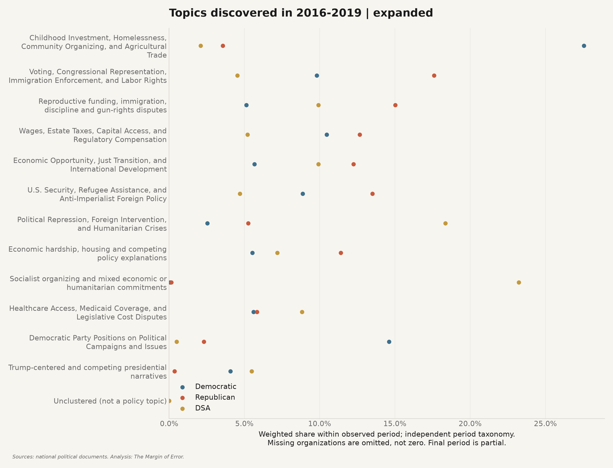

**Strict reading:** topic shares below are within this period, not measurements of a permanent political position.

- Democratic: Childhood Investment, Homelessness, Community Organizing, and Agricultural Trade (27.6%); Democratic Party Positions on Political Campaigns and Issues (14.6%). Based on 1 bundle(s); unclustered share 0.0%. Source composition limits interpretation.
- Republican: Voting, Congressional Representation, Immigration Enforcement, and Labor Rights (17.6%); Reproductive funding, immigration, discipline and gun-rights disputes (15.0%). Based on 1 bundle(s); unclustered share 0.0%. Source composition limits interpretation.
- DSA: no observed documents in this view.

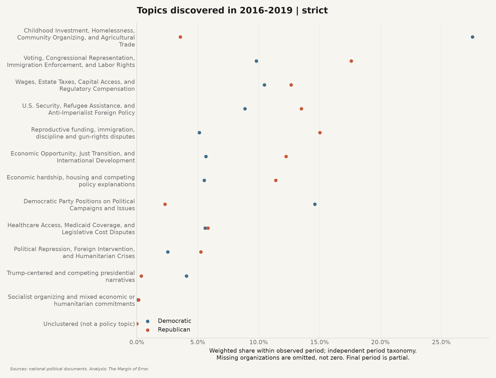

| Period topic | Closest preceding theme | Cosine | Interpretation |
|---|---|---:|---|
| Democratic Party Positions on Political Campaigns and Issues | Party Opportunity Narratives, Labor Rights, and Federalism (2012-2015) | 0.952 | candidate_thematic_continuity |
| Wages, Estate Taxes, Capital Access, and Regulatory Compensation | Corporate Tax Reform, Capital Income, and Wage-Linked Cuts (2012-2015) | 0.960 | candidate_thematic_continuity |
| Childhood Investment, Homelessness, Community Organizing, and Agricultural Trade | Public Investment, Workforce Retraining, and Indigenous Community Support (2012-2015) | 0.979 | candidate_thematic_continuity |
| Healthcare Access, Medicaid Coverage, and Legislative Cost Disputes | Healthcare Reform, Affordability, Coverage, Choice, and Projected Savings (2012-2015) | 0.987 | candidate_thematic_continuity |
| Economic hardship, housing and competing policy explanations | Economic Crisis, Household Bills, and Sequestration Cuts (2012-2015) | 0.988 | candidate_thematic_continuity |
| Voting, Congressional Representation, Immigration Enforcement, and Labor Rights | Universal Rights, Voting, Self-Defense, and Religious Freedom (2012-2015) | 0.987 | candidate_thematic_continuity |
| Economic Opportunity, Just Transition, and International Development | Good Jobs, Workers' Rights, Income Security, and Enterprise (2012-2015) | 0.978 | candidate_thematic_continuity |
| U.S. Security, Refugee Assistance, and Anti-Imperialist Foreign Policy | American Economic Strength, Global Reform, and International Roles (2012-2015) | 0.970 | candidate_thematic_continuity |
| Trump-centered and competing presidential narratives | Voting Restrictions, Redistricting, Speech, and Political Participation (2012-2015) | 0.834 | uncertain_match_not_proof_of_new_topic |
| Reproductive funding, immigration, discipline and gun-rights disputes | Voting Restrictions, Redistricting, Speech, and Political Participation (2012-2015) | 0.990 | candidate_thematic_continuity |
| Political Repression, Foreign Intervention, and Humanitarian Crises | Community Violence, Mass Atrocities, Racism, and Prison Sentencing (2012-2015) | 0.939 | candidate_thematic_continuity |
| Socialist organizing and mixed economic or humanitarian commitments | Public Investment, Workforce Retraining, and Indigenous Community Support (2012-2015) | 0.907 | uncertain_match_not_proof_of_new_topic |

Period-specific label summaries and inspectable source examples:

**Democratic Party Positions on Political Campaigns and Issues** (`period-2016-topic-001`): Claims focus on the Democratic Party's stated positions on job creation and foreign policy, as well as accusations regarding healthcare and abortion. The Democratic Socialists of America (DSA) state a strategy of supporting Democratic candidates, particularly progressive and socialist ones.

Caveat: Mixed subtopics: campaign strategy, healthcare, foreign policy, and social issues are all represented.

**Provenance:** source-bound assistant revision; original Gemma response retained unchanged.

> Democrats are focused on creating good jobs in communities across America.

Democratic — [2016 Democratic Party Platform](https://www.presidency.ucsb.edu/documents/2016-democratic-party-platform); `democratic-2016-normalized-9b1d0772b2c6-002`.

> Currently, the Democratic Party is inching towards alignment around the impeachment of President Donald Trump.

DSA — [DSA National Political Committee (NPC) Statement on Impeachment](https://www.dsausa.org/wp-json/wp/v2/statement/4192); `dsa-statement-4192-normalized-0081d76339ad-002`.

**Wages, Estate Taxes, Capital Access, and Regulatory Compensation** (`period-2016-topic-002`): Democratic examples support good-paying jobs and fair estate taxation. DSA examples favor a $15 minimum wage and describe a bill's removal of low-income subsidies. Republican examples support capital access and compensation for regulatory takings.

Caveat: Representative statements span distinct policies and assertions; they are not an independently verified or exhaustive account.

**Provenance:** source-bound assistant revision; original Gemma response retained unchanged.

> Support for creating good-paying jobs that can support a middle-class life.

Democratic — [2016 Democratic Party Platform](https://www.presidency.ucsb.edu/documents/2016-democratic-party-platform); `democratic-2016-normalized-4bac4fec2ba2-011`.

> Support for increasing the minimum wage to $15 in states and municipalities where it is lower than $15.

DSA — [2017 convention national priorities resolution](https://www.dsausa.org/wp-json/wp/v2/blog/3035); `dsa-2017-priorities-normalized-1bd328679060-001`.

**Childhood Investment, Homelessness, Community Organizing, and Agricultural Trade** (`period-2016-topic-003`): Democratic examples support early-childhood programs and coordinated action against homelessness. DSA examples emphasize socialist education and ties with poor and working-class communities. Republican examples prioritize children's well-being and agricultural market access.

Caveat: Representative statements span distinct policies and assertions; they are not an independently verified or exhaustive account.

**Provenance:** source-bound assistant revision; original Gemma response retained unchanged.

> Commitment to invest in early childhood programs like Early Head Start.

Democratic — [2016 Democratic Party Platform](https://www.presidency.ucsb.edu/documents/2016-democratic-party-platform); `democratic-2016-normalized-23a1d152a23a-002`.

> Commitment to prioritize social movement work and public socialist education.

DSA — [2017 convention national priorities resolution](https://www.dsausa.org/wp-json/wp/v2/blog/3035); `dsa-2017-priorities-normalized-1bd328679060-004`.

**Healthcare Access, Medicaid Coverage, and Legislative Cost Disputes** (`period-2016-topic-004`): Democratic examples support comprehensive primary care and ending retiree-health prefunding. DSA examples predict AHCA cuts to Medicaid and coverage. Republican examples describe Medicare and Medicaid beneficiaries and support expanded healthcare options and cost containment.

Caveat: Representative statements span distinct policies and assertions; they are not an independently verified or exhaustive account.

**Provenance:** source-bound assistant revision; original Gemma response retained unchanged.

> Commitment to eliminating the unsustainable mandate to "pre-fund" retiree health costs.

Democratic — [2016 Democratic Party Platform](https://www.presidency.ucsb.edu/documents/2016-democratic-party-platform); `democratic-2016-normalized-d3e4c2bc77d2-006`.

> The American Health Care Act (AHCA) will gut Medicaid, a single-payer system that covers 74 million low-income, disabled and elderly Americans.

DSA — [Trump Care Must not Pass the Senate: Building a Movement for “Medicare for All”](https://www.dsausa.org/wp-json/wp/v2/statement/392); `dsa-statement-392-normalized-913c404ed427-004`.

**Economic hardship, housing and competing policy explanations** (`period-2016-topic-005`): Democratic examples address housing costs and racial wealth and income gaps. DSA examples criticize capitalist austerity and social-spending cuts. Republican examples attribute increased poverty to Obama and describe territorial economic challenges.

Caveat: Document diagnoses and partisan causal claims across several economic subjects, not independently verified explanations.

**Provenance:** source-bound assistant revision; original Gemma response retained unchanged.

> Commitment to combat the affordable housing crisis and skyrocketing rents in many parts of the country, which is leading too many families and workers to be pushed out of communities where they work.

Democratic — [2016 Democratic Party Platform](https://www.presidency.ucsb.edu/documents/2016-democratic-party-platform); `democratic-2016-normalized-d67c83c72be1-004`.

> Neoliberal capitalist austerity policies enacted by governments the world over, including Wall Street Democrats in the U.S., force poor and working people to compete with each other to survive.

DSA — [DSA stands in solidarity with Christchurch](https://www.dsausa.org/wp-json/wp/v2/statement/1896); `dsa-statement-1896-normalized-ead9022fbed2-001`.

**Voting, Congressional Representation, Immigration Enforcement, and Labor Rights** (`period-2016-topic-006`): Democratic examples defend Voting Rights Act protections and D.C. congressional rights. DSA examples affirm equal rights and redress for people wrongly harmed or detained. Republican examples support immigration enforcement and state right-to-work authority.

Caveat: Representative statements span distinct policies and assertions; they are not an independently verified or exhaustive account.

**Provenance:** source-bound assistant revision; original Gemma response retained unchanged.

> Support for restoring the full protections of the Voting Rights Act.

Democratic — [2016 Democratic Party Platform](https://www.presidency.ucsb.edu/documents/2016-democratic-party-platform); `democratic-2016-normalized-4292f2af0201-001`.

> Support for full and equal rights for all.

DSA — [DSA Condemns Texas Senate Bill 4](https://www.dsausa.org/wp-json/wp/v2/statement/369); `dsa-statement-369-normalized-543d4d8f93e8-009`.

**Economic Opportunity, Just Transition, and International Development** (`period-2016-topic-007`): Democratic examples connect women's economic participation and entrepreneurship with prosperity. DSA examples describe Sanders' just-transition provisions for workers and residents of U.S. colonies. Republican examples connect rights advocacy, trade, investment, and democratic free-market principles with security and growth.

Caveat: Representative statements span distinct policies and assertions; they are not an independently verified or exhaustive account.

**Provenance:** source-bound assistant revision; original Gemma response retained unchanged.

> When women and girls are healthy, educated, and able to participate economically, their families and communities prosper, poverty decreases, and economies grow.

Democratic — [2016 Democratic Party Platform](https://www.presidency.ucsb.edu/documents/2016-democratic-party-platform); `democratic-2016-normalized-0db34fffef9d-003`.

> Bernie Sanders’ plan includes extensive provisions for a just transition that builds power for workers.

DSA — [National DSA Ecosocialists support Bernie Sanders’ Green New Deal](https://www.dsausa.org/wp-json/wp/v2/statement/4013); `dsa-statement-4013-normalized-0e688c5b7733-008`.

**U.S. Security, Refugee Assistance, and Anti-Imperialist Foreign Policy** (`period-2016-topic-008`): Democratic examples affirm refuge and protection of Americans abroad. Republican examples emphasize borders and military-economic cooperation. DSA examples support anti-imperialist U.S. policy and humanitarian assistance for Syrian refugees.

Caveat: Representative statements span distinct policies and assertions; they are not an independently verified or exhaustive account.

**Provenance:** source-bound assistant revision; original Gemma response retained unchanged.

> Support for maintaining the United States' role as a beacon of hope for people seeking safety, freedom, and security.

Democratic — [2016 Democratic Party Platform](https://www.presidency.ucsb.edu/documents/2016-democratic-party-platform); `democratic-2016-normalized-fd7836178d2b-003`.

> Support for a government in the United States that implements an anti-imperialist foreign policy.

DSA — [Statement on Central American Caravan/DSA se solidariza con la actual caravana centroamericana en un éxodo a los Estados Unidos](https://www.dsausa.org/wp-json/wp/v2/statement/1083); `dsa-statement-1083-normalized-2a79393ed2b5-004`.

**Trump-centered and competing presidential narratives** (`period-2016-topic-009`): Democratic examples criticize Trump's approach to NATO and allies. DSA examples accuse Trump of divisive rhetoric and hostility toward marginalized groups. Republican examples promise a different military approach to climate change and criticize an unnamed president over immigration law.

Caveat: Actor-centered rhetoric includes unnamed presidential references; not every example concerns Trump and accusations are not independently verified.

**Provenance:** source-bound assistant revision; original Gemma response retained unchanged.

> Donald Trump would overturn more than 50 years of American foreign policy by abandoning NATO partners.

Democratic — [2016 Democratic Party Platform](https://www.presidency.ucsb.edu/documents/2016-democratic-party-platform); `democratic-2016-normalized-b4f43c23e8c1-006`.

> Donald Trump’s statement is a narrative used to divide people.

DSA — [DSA Statement on Georgia Abortion Law](https://www.dsausa.org/wp-json/wp/v2/statement/2185); `dsa-statement-2185-normalized-caaebbe8a88d-003`.

**Reproductive funding, immigration, discipline and gun-rights disputes** (`period-2016-topic-010`): DSA examples describe the Hyde Amendment and Title X abortion-funding restrictions. Democratic examples reject religious immigration tests and discriminatory school discipline. Republican examples oppose gun-owner registration and deprivation of gun rights without due process.

Caveat: Mixed rights and regulation subjects; only the DSA examples in this packet concern reproductive healthcare funding.

**Provenance:** source-bound assistant revision; original Gemma response retained unchanged.

> Rejection of attempts to impose a religious test to bar immigrants or refugees from entering the United States.

Democratic — [2016 Democratic Party Platform](https://www.presidency.ucsb.edu/documents/2016-democratic-party-platform); `democratic-2016-normalized-bba3819c4be8-001`.

> The 1976 Hyde Amendment bans Medicaid funds being used for abortions.

DSA — [Uniting to Build a Socialist Feminist Movement](https://www.dsausa.org/wp-json/wp/v2/statement/388); `dsa-statement-388-normalized-472e2eb2aeff-012`.

**Political Repression, Foreign Intervention, and Humanitarian Crises** (`period-2016-topic-011`): Democratic and Republican examples describe repression and attacks by the Iranian and Syrian governments. Republican examples also describe religious slaughter. DSA examples discuss U.S. intervention in Central America and economic and political crises in Venezuela.

Caveat: Representative statements span distinct policies and assertions; they are not an independently verified or exhaustive account.

**Provenance:** source-bound assistant revision; original Gemma response retained unchanged.

> Characterization of Iran as violating the human rights of its population.

Democratic — [2016 Democratic Party Platform](https://www.presidency.ucsb.edu/documents/2016-democratic-party-platform); `democratic-2016-normalized-8c63c7382aed-007`.

> U.S. intervention and imperialism have contributed to political turmoil in Honduras and Nicaragua.

DSA — [Statement on Central American Caravan/DSA se solidariza con la actual caravana centroamericana en un éxodo a los Estados Unidos](https://www.dsausa.org/wp-json/wp/v2/statement/1083); `dsa-statement-1083-normalized-89cb4e70281a-002`.

**Socialist organizing and mixed economic or humanitarian commitments** (`period-2016-topic-012`): DSA examples describe solidarity against capitalism and nonviolent action for social justice. A Democratic example proposes humanitarian aid for Syrian and Iraqi civilians. Republican examples oppose crony capitalism and tax increases and favor markets for wealth and Social Security.

Caveat: Mixed organizational and policy statements; humanitarian assistance describes one supplied example, not the whole cluster.

**Provenance:** source-bound assistant revision; original Gemma response retained unchanged.

> Given the immense scale of human suffering in Syria, Democrats will lead the international community in providing greater humanitarian assistance to civilian victims of war in Syria and Iraq, especially displaced refugees.

Democratic — [2016 Democratic Party Platform](https://www.presidency.ucsb.edu/documents/2016-democratic-party-platform); `democratic-2016-normalized-9c61e4f3f556-005`.

> DSA fights capitalism with solidarity.

DSA — [DSA Statement on Georgia Abortion Law](https://www.dsausa.org/wp-json/wp/v2/statement/2185); `dsa-statement-2185-normalized-4656dc715a5f-017`.

#### 2020-2023: observed themes

3,660 claims from 23 documents; 12 independently discovered topics. Fit status: complete. Cosine silhouette: 0.090.

Method: `weighted_kmeans`; unweighted assignment coverage: 100.0%. Low separation and mixed narrative clusters limit policy interpretation.

**Expanded reading:** topic shares below are within this period, not measurements of a permanent political position.

- Democratic: Community and Regional Economic Development Initiatives (17.1%); Racial Profiling, Police Surveillance, Detention, and Migrant Mobility (17.1%). Based on 1 bundle(s); unclustered share 0.0%. Source composition limits interpretation.
- Republican: no observed documents in this view.
- DSA: Structural Racism, Policing, Borders, and Housing Exclusion (18.4%); Private Prisons, Deportation, Police Discipline, and Abortion Restrictions (16.6%). Based on 2 bundle(s); unclustered share 0.0%. Source composition limits interpretation.

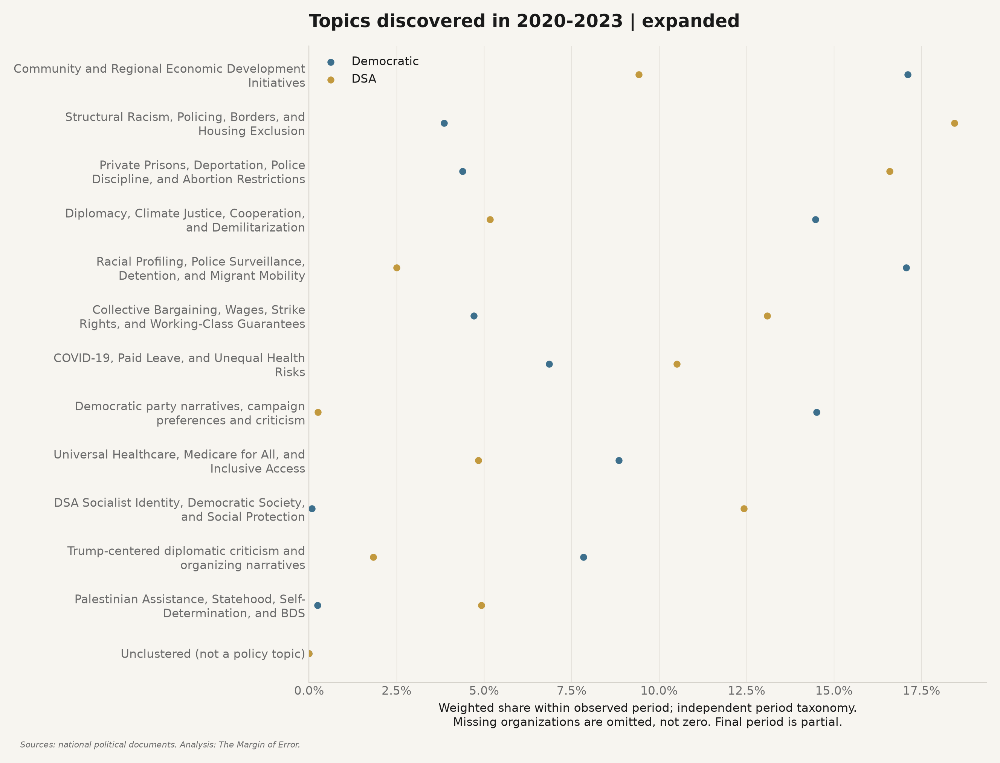

**Strict reading:** topic shares below are within this period, not measurements of a permanent political position.

- Democratic: Community and Regional Economic Development Initiatives (17.1%); Racial Profiling, Police Surveillance, Detention, and Migrant Mobility (17.1%). Based on 1 bundle(s); unclustered share 0.0%. Source composition limits interpretation.
- Republican: no observed documents in this view.
- DSA: Private Prisons, Deportation, Police Discipline, and Abortion Restrictions (24.8%); Collective Bargaining, Wages, Strike Rights, and Working-Class Guarantees (16.2%). Based on 1 bundle(s); unclustered share 0.0%. Source composition limits interpretation.

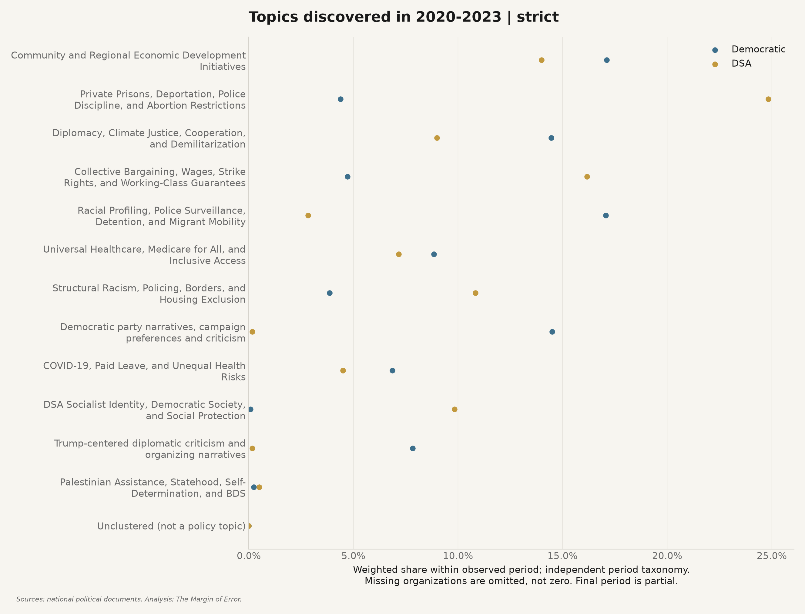

| Period topic | Closest preceding theme | Cosine | Interpretation |
|---|---|---:|---|
| Community and Regional Economic Development Initiatives | Wages, Estate Taxes, Capital Access, and Regulatory Compensation (2016-2019) | 0.967 | candidate_thematic_continuity |
| Universal Healthcare, Medicare for All, and Inclusive Access | Healthcare Access, Medicaid Coverage, and Legislative Cost Disputes (2016-2019) | 0.966 | candidate_thematic_continuity |
| Private Prisons, Deportation, Police Discipline, and Abortion Restrictions | Voting, Congressional Representation, Immigration Enforcement, and Labor Rights (2016-2019) | 0.969 | candidate_thematic_continuity |
| Racial Profiling, Police Surveillance, Detention, and Migrant Mobility | Childhood Investment, Homelessness, Community Organizing, and Agricultural Trade (2016-2019) | 0.968 | candidate_thematic_continuity |
| Collective Bargaining, Wages, Strike Rights, and Working-Class Guarantees | Wages, Estate Taxes, Capital Access, and Regulatory Compensation (2016-2019) | 0.936 | uncertain_match_not_proof_of_new_topic |
| Democratic party narratives, campaign preferences and criticism | Democratic Party Positions on Political Campaigns and Issues (2016-2019) | 0.994 | candidate_thematic_continuity |
| COVID-19, Paid Leave, and Unequal Health Risks | Economic hardship, housing and competing policy explanations (2016-2019) | 0.943 | uncertain_match_not_proof_of_new_topic |
| Structural Racism, Policing, Borders, and Housing Exclusion | Political Repression, Foreign Intervention, and Humanitarian Crises (2016-2019) | 0.957 | candidate_thematic_continuity |
| Trump-centered diplomatic criticism and organizing narratives | Trump-centered and competing presidential narratives (2016-2019) | 0.975 | candidate_thematic_continuity |
| Diplomacy, Climate Justice, Cooperation, and Demilitarization | U.S. Security, Refugee Assistance, and Anti-Imperialist Foreign Policy (2016-2019) | 0.967 | candidate_thematic_continuity |
| Palestinian Assistance, Statehood, Self-Determination, and BDS | Political Repression, Foreign Intervention, and Humanitarian Crises (2016-2019) | 0.840 | uncertain_match_not_proof_of_new_topic |
| DSA Socialist Identity, Democratic Society, and Social Protection | Socialist organizing and mixed economic or humanitarian commitments (2016-2019) | 0.977 | candidate_thematic_continuity |

Period-specific label summaries and inspectable source examples:

**Community and Regional Economic Development Initiatives** (`period-2020-topic-001`): These claims focus on directing resources to communities experiencing economic hardship, including low-income, urban, and rural areas. Support is expressed for strengthening infrastructure and institutions within these communities, alongside programs for desegregation and integration. Claims also address immediate needs like emergency shelter and advocate for economic stimulus.

Caveat: Mixed positions can share a subject.

**Provenance:** source-bound assistant revision; original Gemma response retained unchanged.

> Commitment to drive increased resources to communities with the highest need, including those with the highest concentrations of low-income students, impoverished urban areas impacted by gentrification, and rural areas.

Democratic — [2020 Democratic Party Platform](https://www.presidency.ucsb.edu/documents/2020-democratic-party-platform); `democratic-2020-normalized-5e55d1004289-004`.

> Support for securing adequate compensation and living standards, as well as effective infrastructure, healthcare, and institutions in communities and abroad.

DSA — [2021 adopted DSA Political Platform - immutable December 2021 snapshot](https://web.archive.org/web/20211230205416id_/https://www.dsausa.org/dsa-political-platform-from-2021-convention/); `dsa-2021-adopted-normalized-e66dc1af24d6-005`.

**Universal Healthcare, Medicare for All, and Inclusive Access** (`period-2020-topic-002`): Democratic examples support universal coverage and improved territorial access and affordability. DSA examples advocate Medicare for All and healthcare regardless of employment, immigration, or insurance status, including care for non-citizens and people with disabilities.

Caveat: The sampled packet has Democratic and DSA claims only; Republican platform reuse is not a newly issued 2020 observation.

**Provenance:** source-bound assistant revision; original Gemma response retained unchanged.

> Commitment to build a health care system that provides universal health care coverage.

Democratic — [2020 Democratic Party Platform](https://www.presidency.ucsb.edu/documents/2020-democratic-party-platform); `democratic-2020-normalized-3542c1bfdbb3-010`.

> Support for a national healthcare system like Medicare For All.

DSA — [For those Grieving and Raging Today](https://www.dsausa.org/wp-json/wp/v2/statement/5581); `dsa-statement-5581-normalized-20cd15748fbe-003`.

**Private Prisons, Deportation, Police Discipline, and Abortion Restrictions** (`period-2020-topic-003`): Democratic examples favor ending private prisons and repealing the Helms Amendment. DSA examples oppose deportations and detention, favor repealing police disciplinary protections, and support reinvestment in Black and Brown communities instead of policing.

Caveat: Representative statements span distinct policies and assertions; they are not an independently verified or exhaustive account.

**Provenance:** source-bound assistant revision; original Gemma response retained unchanged.

> Support for ending the use of private prisons and private detention centers.

Democratic — [2020 Democratic Party Platform](https://www.presidency.ucsb.edu/documents/2020-democratic-party-platform); `democratic-2020-normalized-f41908e5d30b-002`.

> Support for ending all deportations and enforcement actions, immigration detention, private prison contracts, and deputization of local police forces.

DSA — [2021 adopted DSA Political Platform - immutable December 2021 snapshot](https://web.archive.org/web/20211230205416id_/https://www.dsausa.org/dsa-political-platform-from-2021-convention/); `dsa-2021-adopted-normalized-7a7bd5c278de-003`.

**Racial Profiling, Police Surveillance, Detention, and Migrant Mobility** (`period-2020-topic-004`): Democratic examples commit to ending racial and religious profiling. DSA examples oppose police surveillance, repressive policing, and immigration detention while describing the DACA decision as a step toward freer movement.

Caveat: Representative statements span distinct policies and assertions; they are not an independently verified or exhaustive account.

**Provenance:** source-bound assistant revision; original Gemma response retained unchanged.

> Commitment to ban racial and religious profiling in law enforcement.

Democratic — [2020 Democratic Party Platform](https://www.presidency.ucsb.edu/documents/2020-democratic-party-platform); `democratic-2020-normalized-11c6d091feaf-010`.

> Commitment to end police surveillance.

DSA — [2021 adopted DSA Political Platform - immutable December 2021 snapshot](https://web.archive.org/web/20211230205416id_/https://www.dsausa.org/dsa-political-platform-from-2021-convention/); `dsa-2021-adopted-normalized-989abebd4619-004`.

**Collective Bargaining, Wages, Strike Rights, and Working-Class Guarantees** (`period-2020-topic-005`): Democratic examples support organizing, collective bargaining, better wages, and job security. DSA examples favor labor rights regardless of immigration status and universal strike rights and call on politicians to guarantee healthcare, good jobs, safe work, and organizing rights.

Caveat: Representative statements span distinct policies and assertions; they are not an independently verified or exhaustive account.

**Provenance:** source-bound assistant revision; original Gemma response retained unchanged.

> Commitment to restore and protect workers' rights to organize and bargain collectively.

Democratic — [2020 Democratic Party Platform](https://www.presidency.ucsb.edu/documents/2020-democratic-party-platform); `democratic-2020-normalized-fc967cb6cbce-003`.

> Support for labor rights for all, regardless of immigration status.

DSA — [2021 adopted DSA Political Platform - immutable December 2021 snapshot](https://web.archive.org/web/20211230205416id_/https://www.dsausa.org/dsa-political-platform-from-2021-convention/); `dsa-2021-adopted-normalized-6b522fa83bc9-008`.

**Democratic party narratives, campaign preferences and criticism** (`period-2020-topic-006`): Democratic examples describe commitments to children and education. DSA examples favor Sanders' immigration platform, criticize mainstream Democrats' donors and criticize Democratic leaders' response to Barrett's confirmation.

Caveat: Actor-centered campaign and party narratives, not a children-and-education-only policy cluster; judgments about candidates and motives remain attributed claims.

**Provenance:** source-bound assistant revision; original Gemma response retained unchanged.

> Democrats are committed to creating a society where children are safe and can thrive physically, emotionally, educationally, and spiritually.

Democratic — [2020 Democratic Party Platform](https://www.presidency.ucsb.edu/documents/2020-democratic-party-platform); `democratic-2020-normalized-cf9ab893acce-012`.

> Bernie Sanders has the strongest platform for immigrant rights of any of the Democratic candidates.

DSA — [For a moratorium on deportations, with no exceptions/Para una moratoria de las deportaciones, sin excepciones](https://www.dsausa.org/wp-json/wp/v2/statement/4621); `dsa-statement-4621-normalized-932b136c3755-003`.

**COVID-19, Paid Leave, and Unequal Health Risks** (`period-2020-topic-007`): Democratic examples connect missing paid leave with pandemic risks and unequal infection and death rates. DSA examples describe deaths, racial and economic disparities, and anticipated harms to vulnerable people unable to afford testing or treatment.

Caveat: Representative statements span distinct policies and assertions; they are not an independently verified or exhaustive account.

**Provenance:** source-bound assistant revision; original Gemma response retained unchanged.

> The lack of guaranteed paid sick leave and paid family leave is catastrophic for public health in the midst of the COVID-19 pandemic.

Democratic — [2020 Democratic Party Platform](https://www.presidency.ucsb.edu/documents/2020-democratic-party-platform); `democratic-2020-normalized-440c88ef847f-017`.

> With the COVID-19 outbreak and a looming economic recession, hospital workers, poor and unhoused people, the elderly, incarcerated people, the immunocompromised, immigrants, and other marginalized groups will likely bear the most impact.

DSA — [Now is the Time for Solidarity: DSA National Statement on COVID-2019/Es la hora de solidaridad: Comunicación nacional de DSA acerca de COVID-19](https://www.dsausa.org/wp-json/wp/v2/statement/4626); `dsa-statement-4626-normalized-6ac57c252fad-004`.

**Structural Racism, Policing, Borders, and Housing Exclusion** (`period-2020-topic-008`): Democratic examples describe racial injustice and barriers to homeownership. DSA examples characterize borders, criminalization, police, and prisons as sources of racial and working-class oppression and discuss Sanders' recognition of those patterns.

Caveat: Representative statements span distinct policies and assertions; they are not an independently verified or exhaustive account.

**Provenance:** source-bound assistant revision; original Gemma response retained unchanged.

> Decades of red-lining, rising income inequality, and predatory lending practices targeting low-income families and people of color have made homeownership all but impossible for millions of working families.

Democratic — [2020 Democratic Party Platform](https://www.presidency.ucsb.edu/documents/2020-democratic-party-platform); `democratic-2020-normalized-7f5f6135a575-002`.

> Militarized borders, xenophobic/racist immigration laws, and an abusive prison industrial complex suppress wages and divide the working class.

DSA — [2021 adopted DSA Political Platform - immutable December 2021 snapshot](https://web.archive.org/web/20211230205416id_/https://www.dsausa.org/dsa-political-platform-from-2021-convention/); `dsa-2021-adopted-normalized-6b522fa83bc9-003`.

**Trump-centered diplomatic criticism and organizing narratives** (`period-2020-topic-009`): Democratic examples criticize Trump's effects on American credibility and diplomacy. DSA examples criticize withdrawal from the Iran agreement and military escalation, and describe membership growth during the Trump administration.

Caveat: Actor-centered criticism and organizational history, not solely foreign policy or independently verified effects of presidential actions.

**Provenance:** source-bound assistant revision; original Gemma response retained unchanged.

> President Trump has tarnished U.S. credibility.

Democratic — [2020 Democratic Party Platform](https://www.presidency.ucsb.edu/documents/2020-democratic-party-platform); `democratic-2020-normalized-f4a47a1af77b-010`.

> Donald Trump unilaterally pulled out of the Iran Nuclear Agreement, in spite of Iran’s compliance with it.

DSA — [Urgent Call For Action Against A U.S. War On Iran](https://www.dsausa.org/wp-json/wp/v2/statement/4386); `dsa-statement-4386-normalized-89aab4241a6d-003`.

**Diplomacy, Climate Justice, Cooperation, and Demilitarization** (`period-2020-topic-010`): Democratic examples favor renewed diplomacy and climate-aware security policy. DSA examples support demilitarization, decolonization, global cooperation, and climate justice while opposing U.S. funding for imperialism and violence.

Caveat: Representative statements span distinct policies and assertions; they are not an independently verified or exhaustive account.

**Provenance:** source-bound assistant revision; original Gemma response retained unchanged.

> Commitment to revitalize the power and purpose of American diplomacy to compete in a more contested world.

Democratic — [2020 Democratic Party Platform](https://www.presidency.ucsb.edu/documents/2020-democratic-party-platform); `democratic-2020-normalized-c477536fec4b-001`.

> Support for demilitarization, decolonization, and striving for a future of international solidarity and cooperation toward global climate justice.

DSA — [2021 adopted DSA Political Platform - immutable December 2021 snapshot](https://web.archive.org/web/20211230205416id_/https://www.dsausa.org/dsa-political-platform-from-2021-convention/); `dsa-2021-adopted-normalized-7a4fcef26ad9-008`.

**Palestinian Assistance, Statehood, Self-Determination, and BDS** (`period-2020-topic-011`): Democratic examples support Palestinian assistance and a negotiated two-state solution. DSA examples affirm Palestinian self-determination and solidarity with BDS; other sampled claims report Palestinians in the United States demanding rights to resist oppression.

Caveat: Representative statements span distinct policies and assertions; they are not an independently verified or exhaustive account.

**Provenance:** source-bound assistant revision; original Gemma response retained unchanged.

> Commitment to restore critical assistance to the Palestinian people in the West Bank and Gaza, consistent with U.S. law.

Democratic — [2020 Democratic Party Platform](https://www.presidency.ucsb.edu/documents/2020-democratic-party-platform); `democratic-2020-normalized-3c29dbc1688d-012`.

> Palestinians in the United States demand the right to resist their oppression.

DSA — [DSA endorses vision and policy demand statement of Freedom is the Future](https://www.dsausa.org/wp-json/wp/v2/statement/4489); `dsa-statement-4489-normalized-783bbde2a3e3-repair-f17a6ab3053c-001`.

**DSA Socialist Identity, Democratic Society, and Social Protection** (`period-2020-topic-012`): DSA examples describe working-class democratic socialism, socialist feminism, racial equality, and a society free of oppression. Democratic examples defend Social Security and describe the arts as essential to democracy.

Caveat: Representative statements span distinct policies and assertions; they are not an independently verified or exhaustive account.

**Provenance:** source-bound assistant revision; original Gemma response retained unchanged.

> Opposition to every effort to cut, privatize, or weaken Social Security.

Democratic — [2020 Democratic Party Platform](https://www.presidency.ucsb.edu/documents/2020-democratic-party-platform); `democratic-2020-normalized-adb3cd71f6fa-010`.

> DSA's movement for democratic socialism stands for all working class people.

DSA — [For a moratorium on deportations, with no exceptions/Para una moratoria de las deportaciones, sin excepciones](https://www.dsausa.org/wp-json/wp/v2/statement/4621); `dsa-statement-4621-normalized-70579fa7af56-002`.

#### 2024-2026: observed themes

3,152 claims from 4 documents; 12 independently discovered topics. Fit status: complete. Cosine silhouette: 0.111.

Method: `weighted_kmeans`; unweighted assignment coverage: 100.0%. Low separation and mixed narrative clusters limit policy interpretation.

**Expanded reading:** topic shares below are within this period, not measurements of a permanent political position.

- Democratic: Family Benefits, Housing Supply, Public Spaces, and Leisure (25.5%); Biden Administration Records, Indigenous Affairs, and Border Criticism (22.8%). Based on 1 bundle(s); unclustered share 0.0%. Source composition limits interpretation.
- Republican: Social Insurance, Affordability, Community Investment, and Public Energy (28.5%); Republican Tax, Healthcare, Border, and Rights Claims and Critiques (16.5%). Based on 1 bundle(s); unclustered share 0.0%. Source composition limits interpretation.
- DSA: Labor Rights, Minimum Wages, School Choice, and Suffrage (25.8%); DSA Socialist Organizing, Competition, and Democratic Futures (23.7%). Based on 2 bundle(s); unclustered share 0.0%. Source composition limits interpretation.

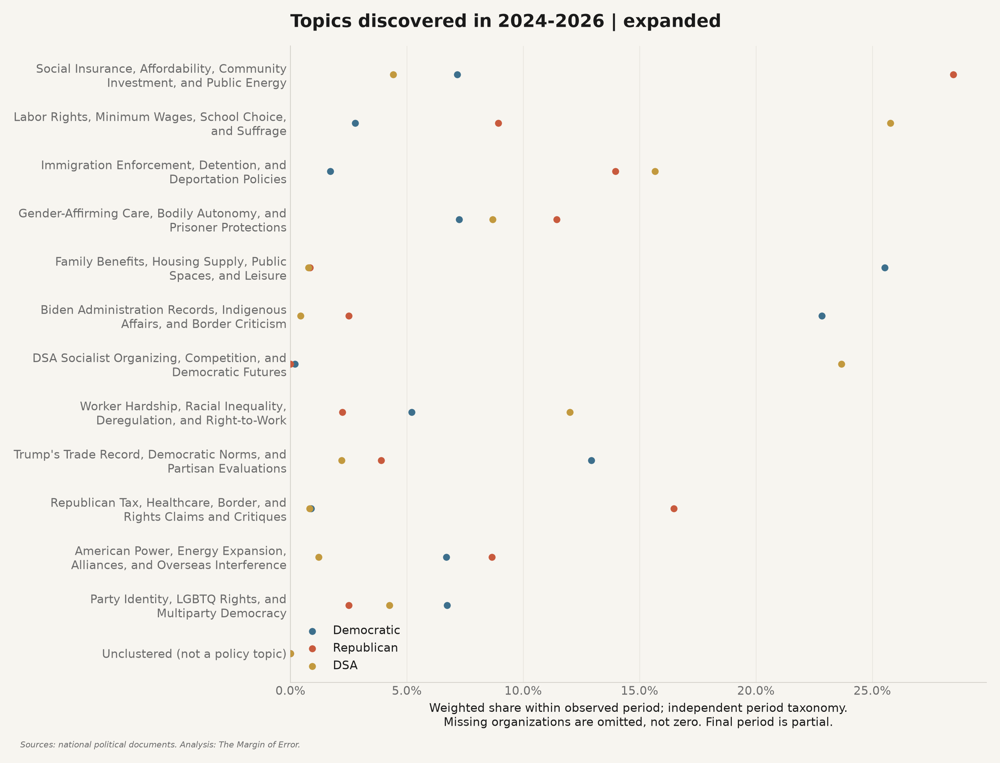

**Strict reading:** topic shares below are within this period, not measurements of a permanent political position.

- Democratic: Family Benefits, Housing Supply, Public Spaces, and Leisure (25.5%); Biden Administration Records, Indigenous Affairs, and Border Criticism (22.8%). Based on 1 bundle(s); unclustered share 0.0%. Source composition limits interpretation.
- Republican: Social Insurance, Affordability, Community Investment, and Public Energy (28.5%); Republican Tax, Healthcare, Border, and Rights Claims and Critiques (16.5%). Based on 1 bundle(s); unclustered share 0.0%. Source composition limits interpretation.
- DSA: Labor Rights, Minimum Wages, School Choice, and Suffrage (25.8%); DSA Socialist Organizing, Competition, and Democratic Futures (23.7%). Based on 2 bundle(s); unclustered share 0.0%. Source composition limits interpretation.

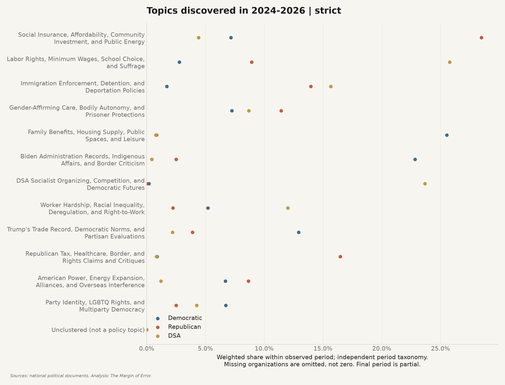

| Period topic | Closest preceding theme | Cosine | Interpretation |
|---|---|---:|---|
| Party Identity, LGBTQ Rights, and Multiparty Democracy | Democratic party narratives, campaign preferences and criticism (2020-2023) | 0.967 | candidate_thematic_continuity |
| Biden Administration Records, Indigenous Affairs, and Border Criticism | Diplomacy, Climate Justice, Cooperation, and Demilitarization (2020-2023) | 0.842 | uncertain_match_not_proof_of_new_topic |
| Trump's Trade Record, Democratic Norms, and Partisan Evaluations | Trump-centered diplomatic criticism and organizing narratives (2020-2023) | 0.976 | candidate_thematic_continuity |
| Worker Hardship, Racial Inequality, Deregulation, and Right-to-Work | Structural Racism, Policing, Borders, and Housing Exclusion (2020-2023) | 0.959 | candidate_thematic_continuity |
| Immigration Enforcement, Detention, and Deportation Policies | Racial Profiling, Police Surveillance, Detention, and Migrant Mobility (2020-2023) | 0.943 | uncertain_match_not_proof_of_new_topic |
| Family Benefits, Housing Supply, Public Spaces, and Leisure | Community and Regional Economic Development Initiatives (2020-2023) | 0.947 | candidate_thematic_continuity |
| American Power, Energy Expansion, Alliances, and Overseas Interference | Diplomacy, Climate Justice, Cooperation, and Demilitarization (2020-2023) | 0.930 | uncertain_match_not_proof_of_new_topic |
| Labor Rights, Minimum Wages, School Choice, and Suffrage | Private Prisons, Deportation, Police Discipline, and Abortion Restrictions (2020-2023) | 0.955 | uncertain_match_not_proof_of_new_topic |
| Gender-Affirming Care, Bodily Autonomy, and Prisoner Protections | Private Prisons, Deportation, Police Discipline, and Abortion Restrictions (2020-2023) | 0.965 | candidate_thematic_continuity |
| Social Insurance, Affordability, Community Investment, and Public Energy | Racial Profiling, Police Surveillance, Detention, and Migrant Mobility (2020-2023) | 0.952 | uncertain_match_not_proof_of_new_topic |
| DSA Socialist Organizing, Competition, and Democratic Futures | DSA Socialist Identity, Democratic Society, and Social Protection (2020-2023) | 0.930 | candidate_thematic_continuity |
| Republican Tax, Healthcare, Border, and Rights Claims and Critiques | Democratic party narratives, campaign preferences and criticism (2020-2023) | 0.853 | uncertain_match_not_proof_of_new_topic |

Period-specific label summaries and inspectable source examples:

**Party Identity, LGBTQ Rights, and Multiparty Democracy** (`period-2024-topic-001`): Democratic examples affirm mutual support and LGBTQI+ rights. Republican examples criticize Democratic regulation and labor policies. DSA examples favor multiparty democracy and argue that reliance on Democrats to defeat Republicans is not working.

Caveat: Representative statements span distinct policies and assertions; they are not an independently verified or exhaustive account.

**Provenance:** source-bound assistant revision; original Gemma response retained unchanged.

> Democrats believe in an America where people look out for one another and leave no one behind.

Democratic — [2024 Democratic Party Platform](https://www.presidency.ucsb.edu/documents/2024-democratic-party-platform); `democratic-2024-normalized-31862ca12465-001`.

> Replace the U.S. two-party system with a multiparty democracy.

DSA — [Workers Deserve More 2026 print version](https://program.dsausa.org/wp-content/uploads/2026/09/WDM-Program.pdf); `dsa-2026-program-normalized-d326f1020c4f-repair-94c56feee2ed-004`.

**Biden Administration Records, Indigenous Affairs, and Border Criticism** (`period-2024-topic-002`): Democratic examples credit Biden with antidiscrimination orders and restoring the Native American affairs council. DSA examples criticize military funding and expanded oil drilling under Biden. Republican examples accuse Biden of encouraging migration and promise deportations.

Caveat: Representative statements span distinct policies and assertions; they are not an independently verified or exhaustive account.

**Provenance:** source-bound assistant revision; original Gemma response retained unchanged.

> President Biden signed two Executive Orders to combat bias, discrimination and hate-based violence.

Democratic — [2024 Democratic Party Platform](https://www.presidency.ucsb.edu/documents/2024-democratic-party-platform); `democratic-2024-normalized-567f3057384a-010`.

> Under Joe Biden, the United States has prioritized funding a massive military budget and expanding oil drilling.

DSA — [Workers Deserve More 2024](https://program.dsausa.org/wp-content/uploads/2024/08/DSA_2024Program.pdf); `dsa-2024-program-normalized-43f2e9413efb-003`.

**Trump's Trade Record, Democratic Norms, and Partisan Evaluations** (`period-2024-topic-003`): Democratic examples accuse Trump of weakening democratic norms and failing to bring manufacturing jobs home. Republican examples credit his trade policy and national-pride rhetoric. DSA examples criticize right-wing exploitation of hardship and alleged Democratic adoption of Trump-related policies.

Caveat: Representative statements span distinct policies and assertions; they are not an independently verified or exhaustive account.

**Provenance:** source-bound assistant revision; original Gemma response retained unchanged.

> Donald Trump weakened global democratic norms.

Democratic — [2024 Democratic Party Platform](https://www.presidency.ucsb.edu/documents/2024-democratic-party-platform); `democratic-2024-normalized-306753327989-009`.

> Accelerating declines in living standards are exploited by the Christian nationalist right and figures like Donald Trump.

DSA — [Workers Deserve More 2024](https://program.dsausa.org/wp-content/uploads/2024/08/DSA_2024Program.pdf); `dsa-2024-program-normalized-c0035893561c-010`.

**Worker Hardship, Racial Inequality, Deregulation, and Right-to-Work** (`period-2024-topic-004`): Democratic examples describe essential workers' housing costs and oppose right-to-work laws. Republican examples favor deregulation. DSA examples describe low wages, dangerous work, capitalism's unequal burdens on Black and brown workers, and billionaire-driven division among workers.

Caveat: Representative statements span distinct policies and assertions; they are not an independently verified or exhaustive account.

**Provenance:** source-bound assistant revision; original Gemma response retained unchanged.

> The nation's teachers, nurses, firefighters, and other essential workers are struggling with housing costs that outpace their incomes, leaving them unable to live near their workplaces.

Democratic — [2024 Democratic Party Platform](https://www.presidency.ucsb.edu/documents/2024-democratic-party-platform); `democratic-2024-normalized-51d7cbe64123-004`.

> Millions struggle with low wages, dangerous working conditions, and limited control over their own lives.

DSA — [Workers Deserve More 2024](https://program.dsausa.org/wp-content/uploads/2024/08/DSA_2024Program.pdf); `dsa-2024-program-normalized-c0035893561c-002`.

**Immigration Enforcement, Detention, and Deportation Policies** (`period-2024-topic-005`): Claims address policies related to immigration enforcement, specifically detention and deportation. Positions range from increased enforcement and deportation of those who have violated U.S. laws ('republican-2024-normalized-048e2be2d61f-003') to abolishing and ending detention/deportations by U.S. Immigration and Customs Enforcement ('dsa-2026-program-normalized-40060dd6f6dd-repair-d40710b9eecc-006'). There is also a commitment to combat drug trafficking ('democratic-2024-normalized-94ca68ceacfc-002').

Caveat: Includes a claim about drug trafficking, which is related but distinct from the core immigration focus.

**Provenance:** source-bound assistant revision; original Gemma response retained unchanged.

> Commitment to combat drug trafficking.

Democratic — [2024 Democratic Party Platform](https://www.presidency.ucsb.edu/documents/2024-democratic-party-platform); `democratic-2024-normalized-94ca68ceacfc-002`.

> Abolish U.S. Immigration and Customs Enforcement.

DSA — [Workers Deserve More 2026 print version](https://program.dsausa.org/wp-content/uploads/2026/09/WDM-Program.pdf); `dsa-2026-program-normalized-40060dd6f6dd-repair-d40710b9eecc-006`.

**Family Benefits, Housing Supply, Public Spaces, and Leisure** (`period-2024-topic-006`): Democratic examples credit the American Rescue Plan with SNAP and family relief. Republican examples describe Social Security's support and propose federal land for homebuilding. DSA examples support public recreation, learning, and social spaces; a separate vignette imagines future time off.

Caveat: The imagined leisure vignette is not an established present-day service guarantee; benefit assertions remain attributed to their documents.

**Provenance:** source-bound assistant revision; original Gemma response retained unchanged.

> The American Rescue Plan increased Supplemental Nutrition Assistance Program (SNAP) benefits.

Democratic — [2024 Democratic Party Platform](https://www.presidency.ucsb.edu/documents/2024-democratic-party-platform); `democratic-2024-normalized-31862ca12465-011`.

> Support for expanding public resources to support recreation, learning, and social spaces accessible to all.

DSA — [Workers Deserve More 2026 print version](https://program.dsausa.org/wp-content/uploads/2026/09/WDM-Program.pdf); `dsa-2026-program-normalized-3ba469ba4e69-001`.

**American Power, Energy Expansion, Alliances, and Overseas Interference** (`period-2024-topic-007`): Democratic examples connect U.S. strength with partners and technological leadership. Republican examples favor stronger national capabilities and predict benefits from energy expansion. DSA examples characterize corporate-government dealings as self-enrichment and favor freedom from U.S. interference abroad.

Caveat: Representative statements span distinct policies and assertions; they are not an independently verified or exhaustive account.

**Provenance:** source-bound assistant revision; original Gemma response retained unchanged.

> The United States is strongest when its partners are strong.

Democratic — [2024 Democratic Party Platform](https://www.presidency.ucsb.edu/documents/2024-democratic-party-platform); `democratic-2024-normalized-306753327989-006`.

> Big business is characterized as making deals with the U.S. government to enrich itself.

DSA — [Workers Deserve More 2026 print version](https://program.dsausa.org/wp-content/uploads/2026/09/WDM-Program.pdf); `dsa-2026-program-normalized-7484933df369-repair-872a1ceaa7ec-007`.

**Labor Rights, Minimum Wages, School Choice, and Suffrage** (`period-2024-topic-008`): Democratic examples favor public-sector bargaining and a $15 minimum wage. DSA examples support voting rights for permanent residents, immigrant labor rights, and free pre-K-to-college education. A Republican example supports universal school choice.

Caveat: Representative statements span distinct policies and assertions; they are not an independently verified or exhaustive account.

**Provenance:** source-bound assistant revision; original Gemma response retained unchanged.

> Support for passing the Public Service Freedom to Negotiate Act, guaranteeing public sector bargaining rights.

Democratic — [2024 Democratic Party Platform](https://www.presidency.ucsb.edu/documents/2024-democratic-party-platform); `democratic-2024-normalized-8af3eb44deaa-004`.

> Support for extending full voting rights to all permanent U.S. residents.

DSA — [Workers Deserve More 2026 print version](https://program.dsausa.org/wp-content/uploads/2026/09/WDM-Program.pdf); `dsa-2026-program-normalized-d326f1020c4f-001`.

**Gender-Affirming Care, Bodily Autonomy, and Prisoner Protections** (`period-2024-topic-009`): Democratic examples oppose gender-affirming-care bans and favor restricting abusive prisoner treatment. DSA examples support gender-affirming healthcare and bodily autonomy. Republican examples favor state votes on the Issue of Life and oppose taxpayer funding for sex-change surgeries.

Caveat: Representative statements span distinct policies and assertions; they are not an independently verified or exhaustive account.

**Provenance:** source-bound assistant revision; original Gemma response retained unchanged.

> Support for vigorously opposing state and federal bans on gender-affirming health care.

Democratic — [2024 Democratic Party Platform](https://www.presidency.ucsb.edu/documents/2024-democratic-party-platform); `democratic-2024-normalized-9fb427e7c407-003`.

> Support for guaranteed gender-affirming health care.

DSA — [Workers Deserve More 2024](https://program.dsausa.org/wp-content/uploads/2024/08/DSA_2024Program.pdf); `dsa-2024-program-normalized-b789b4710c28-repair-1a7d74b0c436-003`.

**Social Insurance, Affordability, Community Investment, and Public Energy** (`period-2024-topic-010`): Democratic examples defend Social Security, Medicare, and Medicaid and promise investment. Republican examples promise Medicare and Social Security protection and lower inflation. DSA examples favor investment in neglected minority communities and sustainable, publicly owned energy and transit.

Caveat: Representative statements span distinct policies and assertions; they are not an independently verified or exhaustive account.

**Provenance:** source-bound assistant revision; original Gemma response retained unchanged.

> Commitment to never back down from protecting Social Security, Medicare, and Medicaid.

Democratic — [2024 Democratic Party Platform](https://www.presidency.ucsb.edu/documents/2024-democratic-party-platform); `democratic-2024-normalized-635b31a62406-001`.

> Support for massively investing in good jobs, quality housing and infrastructure in neglected minority communities.

DSA — [Workers Deserve More 2026 print version](https://program.dsausa.org/wp-content/uploads/2026/09/WDM-Program.pdf); `dsa-2026-program-normalized-3ba469ba4e69-019`.

**DSA Socialist Organizing, Competition, and Democratic Futures** (`period-2024-topic-011`): DSA examples describe working-class organizing, a democratic socialist republic, and hopes for a society prioritizing people over profit. Democratic examples discuss competition in capitalism and describe democracy as essential at a global inflection point.

Caveat: No Republican claims were sampled; no Republican position is inferred. DSA's hoped-for socialist society is an organizational aspiration, not an established outcome.

**Provenance:** source-bound assistant revision; original Gemma response retained unchanged.

> The President says that capitalism without competition isn't capitalism, it's exploitation.

Democratic — [2024 Democratic Party Platform](https://www.presidency.ucsb.edu/documents/2024-democratic-party-platform); `democratic-2024-normalized-da9ab87f7a1b-010`.

> With working-class government, strong unions and social movements organizing everywhere, DSA hopes to build a socialist society where people take priority over profit.

DSA — [Workers Deserve More 2024](https://program.dsausa.org/wp-content/uploads/2024/08/DSA_2024Program.pdf); `dsa-2024-program-normalized-d601340193eb-repair-ede159c9a402-001`.

**Republican Tax, Healthcare, Border, and Rights Claims and Critiques** (`period-2024-topic-012`): Republican examples promise secure borders and protection of life, liberty, and the pursuit of happiness. Democratic examples describe proposed Republican corporate tax cuts and health-insurance-credit expiration. DSA examples criticize the choice of major parties and Republican involvement in authoritarian, anti-worker conduct.

Caveat: Representative statements span distinct policies and assertions; they are not an independently verified or exhaustive account.

**Provenance:** source-bound assistant revision; original Gemma response retained unchanged.

> Republicans propose $1 trillion in new corporate tax cuts.

Democratic — [2024 Democratic Party Platform](https://www.presidency.ucsb.edu/documents/2024-democratic-party-platform); `democratic-2024-normalized-71e685291d2d-002`.

> In most races, Americans will have the choice between far-right Republicans and corporate Democrats.

DSA — [Workers Deserve More 2024](https://program.dsausa.org/wp-content/uploads/2024/08/DSA_2024Program.pdf); `dsa-2024-program-normalized-c668d0328bc5-002`.

### Publication figure versions

Publication figures are PNG-only and use the warm #F7F5F0 Substack house style. Matching #F5F5F5 versions for The Margin of Error are included under `figures/themarginoferror/` in the complete archive. Only background colors change between versions; plotted values, labels and dimensions are identical.

### Topic summaries and evidence

#### topic-001: Energy Production, Transition, and Investment

Historical claims combine commitments to energy production or independence with clean-energy transition, infrastructure, technology, jobs, and wider public or private investment. Democratic examples often link investment to climate and employment, Republican examples emphasize domestic supply and market-led growth, and DSA examples connect transition to democratic economic control.

**Caveat:** The cluster also contains broader housing, rural, trade, and economic commitments; it does not establish a single energy program or a current consensus within any group.

**Label provenance:** source-bound assistant revision of the preserved Gemma response; see the label-review record.

**Distinctive phrases:** energy, clean, natural, gas, oil, clean energy, environmental, natural gas, climate, fuels

| View | Group | Share | Claims | Documents | Bundles |
|---|---|---:|---:|---:|---:|
| expanded | Democratic | 4.0% | 460 | 7 | 7 |
| expanded | Republican | 3.5% | 312 | 6 | 6 |
| expanded | DSA | 1.7% | 81 | 16 | 8 |
| strict | Democratic | 4.0% | 460 | 7 | 7 |
| strict | Republican | 3.5% | 312 | 6 | 6 |
| strict | DSA | 2.9% | 33 | 3 | 3 |

| Group | Full representative claim | Source and locator |
|---|---|---|
| Democratic | Commitment to invest significant new resources in clean energy generation and distribution. (`democratic-2020-normalized-aab0c6ab7f9f-008`) | [2020 Democratic Party Platform](https://www.presidency.ucsb.edu/documents/2020-democratic-party-platform) scoped characters 90178:90902 |
| DSA | Support for phasing out the use of fossil fuels. (`dsa-2026-program-normalized-cc87289e0395-029`) | [Workers Deserve More 2026 print version](https://program.dsausa.org/wp-content/uploads/2026/09/WDM-Program.pdf) scoped characters 5915:7099 |
| Republican | Commitment to end market-distorting restrictions on oil, natural gas, and coal. (`republican-2024-normalized-007a594371a0-012`) | [2024 Republican Party Platform](https://www.presidency.ucsb.edu/documents/2024-republican-party-platform) scoped characters 15857:16203 |
| Democratic | Commitment to incentivize wind, solar, and other renewable energy over the development of new natural gas power plants. (`democratic-2016-normalized-68c57aa9b811-011`) | [2016 Democratic Party Platform](https://www.presidency.ucsb.edu/documents/2016-democratic-party-platform) scoped characters 92328:92834 |
| DSA | Support for substantial investment in clean energy. (`dsa-2011-ows-resolution-normalized-654ff8ab0cb5-006`) | [2011 adopted resolution supporting Occupy Wall Street](https://web.archive.org/web/20130108175617id_/http://www.dsausa.org/convention2011/report/Resolution%20Supporting%20OWS.pdf) scoped characters 2452:3839 |
| Democratic | Commitment to eliminate tens of billions of dollars in subsidies for oil and gas companies. (`democratic-2024-normalized-92fa6cad93aa-003`) | [2024 Democratic Party Platform](https://www.presidency.ucsb.edu/documents/2024-democratic-party-platform) scoped characters 42913:43499 |
| Democratic | Support for further cutting reliance on oil with increased energy efficiency in buildings, industry, and homes. (`democratic-2012-normalized-f07946078a76-006`) | [2012 Democratic Party Platform](https://www.presidency.ucsb.edu/documents/2012-democratic-party-platform) scoped characters 34090:35578 |
| Republican | Support for promoting development of all forms of energy. (`republican-2012-normalized-22c5dd831d0a-002`) | [2012 Republican Party Platform](https://www.presidency.ucsb.edu/documents/2012-republican-party-platform) scoped characters 70208:70984 |
| Democratic | Commitment to use natural resources to fuel the economy. (`democratic-2004-normalized-64b3e37a36df-001`) | [2004 Democratic Party Platform](https://www.presidency.ucsb.edu/documents/2004-democratic-party-platform) scoped characters 100223:100677 |
| Democratic | Commitment to move towards a sustainable energy-independent future if America's great natural resources are harnessed. (`democratic-2012-normalized-f07946078a76-001`) | [2012 Democratic Party Platform](https://www.presidency.ucsb.edu/documents/2012-democratic-party-platform) scoped characters 34090:35578 |
| Republican | Commitment to aggressively support technological advances to reduce petroleum dependence. (`republican-2008-normalized-dd4b307d1b57-006`) | [2008 Republican Party Platform](https://www.presidency.ucsb.edu/documents/2008-republican-party-platform) scoped characters 98266:98650 |
| Democratic | Commitment to invest in advanced biofuels like cellulosic ethanol which will provide American-grown fuel and help free the United States from reliance on oil. (`democratic-2008-normalized-24753467a5b2-009`) | [2008 Democratic Party Platform](https://www.presidency.ucsb.edu/documents/2008-democratic-party-platform) scoped characters 40248:41261 |

#### topic-002: Community Investment, Housing, and Social Support

Historical claims concern directing resources toward low-income, rural, underserved, minority, veteran, and disaster-affected communities through housing, health care, education, child care, transportation, infrastructure, safety-net programs, and local partnerships. The packet centers assistance and community investment rather than descriptions of hardship alone.

**Caveat:** The cluster mixes targeted benefits, broad anti-poverty commitments, local capacity, and public-private delivery models; sampled documents differ on beneficiaries, scale, and administration.

**Label provenance:** source-bound assistant revision of the preserved Gemma response; see the label-review record.

**Distinctive phrases:** housing, programs, public, funding, communities, local, resources, federal, locals, help

| View | Group | Share | Claims | Documents | Bundles |
|---|---|---:|---:|---:|---:|
| expanded | Democratic | 7.4% | 916 | 7 | 7 |
| expanded | Republican | 5.9% | 594 | 6 | 6 |
| expanded | DSA | 6.3% | 279 | 54 | 9 |
| strict | Democratic | 7.4% | 916 | 7 | 7 |
| strict | Republican | 5.9% | 594 | 6 | 6 |
| strict | DSA | 5.3% | 67 | 3 | 3 |

| Group | Full representative claim | Source and locator |
|---|---|---|
| Democratic | Support for directing more federal resources to lifting up communities that have been left out and left behind. (`democratic-2016-normalized-a9bcc4d230c7-011`) | [2016 Democratic Party Platform](https://www.presidency.ucsb.edu/documents/2016-democratic-party-platform) scoped characters 65372:65998 |
| DSA | Support for securing adequate compensation and living standards, as well as effective infrastructure, healthcare, and institutions in communities and abroad. (`dsa-2021-adopted-normalized-e66dc1af24d6-005`) | [2021 adopted DSA Political Platform - immutable December 2021 snapshot](https://web.archive.org/web/20211230205416id_/https://www.dsausa.org/dsa-political-platform-from-2021-convention/) scoped characters 25750:26880 |
| Republican | Support for better meeting state needs. (`republican-2008-normalized-fd4bbde75007-008`) | [2008 Republican Party Platform](https://www.presidency.ucsb.edu/documents/2008-republican-party-platform) scoped characters 126725:127315 |
| Republican | Support for offering training, transportation, and child care services to help people become self-sufficient. (`republican-2004-normalized-8eb776d9223a-009`) | [2004 Republican Party Platform](https://www.presidency.ucsb.edu/documents/2004-republican-party-platform) scoped characters 251901:252254 |
| Democratic | Commitment to increase funding for programs that support the creation and preservation of affordable housing options for essential workers. (`democratic-2024-normalized-51d7cbe64123-005`) | [2024 Democratic Party Platform](https://www.presidency.ucsb.edu/documents/2024-democratic-party-platform) scoped characters 69540:70730 |
| Democratic | Support for raising household incomes in poor communities. (`democratic-2016-normalized-d699b43d99c3-003`) | [2016 Democratic Party Platform](https://www.presidency.ucsb.edu/documents/2016-democratic-party-platform) scoped characters 110675:111651 |
| Republican | Commitment to establish stronger public-private partnerships for safety net providers and hospitals in rural and underserved communities. (`republican-2000-normalized-76e7e2418f31-008`) | [2000 Republican Party Platform](https://www.presidency.ucsb.edu/documents/2000-republican-party-platform) scoped characters 92920:93402 |
| Democratic | Commitment to drive increased resources to communities with the highest need, including those with the highest concentrations of low-income students, impoverished urban areas impacted by gentrification, and rural areas. (`democratic-2020-normalized-5e55d1004289-004`) | [2020 Democratic Party Platform](https://www.presidency.ucsb.edu/documents/2020-democratic-party-platform) scoped characters 204524:205189 |
| Republican | Support for efforts to help low-income individuals get a fair shot based on their potential and merit. (`republican-2008-normalized-44c3a0e30932-012`) | [2008 Republican Party Platform](https://www.presidency.ucsb.edu/documents/2008-republican-party-platform) scoped characters 143558:144054 |
| Democratic | Support for strengthening federal commitment to cities. (`democratic-2008-normalized-2189f80725b2-003`) | [2008 Democratic Party Platform](https://www.presidency.ucsb.edu/documents/2008-democratic-party-platform) scoped characters 133738:135336 |
| DSA | Support for massively investing in good jobs, quality housing and infrastructure in neglected minority communities. (`dsa-2026-program-normalized-3ba469ba4e69-019`) | [Workers Deserve More 2026 print version](https://program.dsausa.org/wp-content/uploads/2026/09/WDM-Program.pdf) scoped characters 4779:5913 |
| Democratic | Support for providing substantially higher levels of support for programs and institutions that boost economic development in America's most impoverished communities. (`democratic-2020-normalized-e1aa30a70b10-011`) | [2020 Democratic Party Platform](https://www.presidency.ucsb.edu/documents/2020-democratic-party-platform) scoped characters 66229:66611 |

#### topic-003: Labor Rights, Unionization, and Worker Protections

Historical claims address organizing, collective bargaining, unions, strikes, wages, workplace standards, labor-law enforcement, and worker power. Democratic and DSA documents generally support stronger organizing rights and protections, while Republican documents include right-to-work, secret-ballot, and union-accountability positions.

**Caveat:** The packet spans distinct labor institutions and periods, and includes some economic or occupational policies that do not amount to a comprehensive labor platform.

**Label provenance:** source-bound assistant revision of the preserved Gemma response; see the label-review record.

**Distinctive phrases:** workers, labor, union, wage, unions, work, minimum wage, minimum, worker, strike

| View | Group | Share | Claims | Documents | Bundles |
|---|---|---:|---:|---:|---:|
| expanded | Democratic | 3.4% | 387 | 7 | 7 |
| expanded | Republican | 1.6% | 151 | 6 | 6 |
| expanded | DSA | 7.1% | 336 | 53 | 9 |
| strict | Democratic | 3.4% | 387 | 7 | 7 |
| strict | Republican | 1.6% | 151 | 6 | 6 |
| strict | DSA | 8.6% | 76 | 3 | 3 |

| Group | Full representative claim | Source and locator |
|---|---|---|
| Democratic | Commitment to fight for labor laws that facilitate the collective bargaining process. (`democratic-2012-normalized-18cc338046ac-010`) | [2012 Democratic Party Platform](https://www.presidency.ucsb.edu/documents/2012-democratic-party-platform) scoped characters 47039:48229 |
| DSA | Support for labor rights for all, regardless of immigration status. (`dsa-2021-adopted-normalized-6b522fa83bc9-008`) | [2021 adopted DSA Political Platform - immutable December 2021 snapshot](https://web.archive.org/web/20211230205416id_/https://www.dsausa.org/dsa-political-platform-from-2021-convention/) scoped characters 64302:64494 |
| Republican | Support the enactment of a National Right-to-Work law to promote worker freedom and greater economic liberty. (`republican-2012-normalized-9b00c73c5686-008`) | [2012 Republican Party Platform](https://www.presidency.ucsb.edu/documents/2012-republican-party-platform) scoped characters 35273:36184 |
| Democratic | Commitment to fight to raise wages for working people and improve job quality and security. (`democratic-2020-normalized-4521936cc397-001`) | [2020 Democratic Party Platform](https://www.presidency.ucsb.edu/documents/2020-democratic-party-platform) scoped characters 31987:33381 |
| Democratic | Commitment to continue to fight for a strong labor movement. (`democratic-2012-normalized-c23a3db91fb4-003`) | [2012 Democratic Party Platform](https://www.presidency.ucsb.edu/documents/2012-democratic-party-platform) scoped characters 100171:101045 |
| Democratic | Commitment to restore and protect workers' rights to organize and bargain collectively. (`democratic-2020-normalized-fc967cb6cbce-003`) | [2020 Democratic Party Platform](https://www.presidency.ucsb.edu/documents/2020-democratic-party-platform) scoped characters 151965:153106 |
| DSA | Support for strengthening labor’s power in the marketplace by guaranteeing a true right to organize and to bargain collectively. (`dsa-2007-economic-justice-normalized-43ac027d547d-001`) | [An Economic Justice Agenda - adopted November 2007](https://www.dsausa.org/wp-json/wp/v2/strategy/612) scoped characters 11788:12343 |
| DSA | Support for protecting all workers’ rights to strike and form a union. (`dsa-2024-program-normalized-f23d4047d972-002`) | [Workers Deserve More 2024](https://program.dsausa.org/wp-content/uploads/2024/08/DSA_2024Program.pdf) scoped characters 7352:8203 |
| Democratic | Commitment to allow unions to organize and lift up workers. (`democratic-2008-normalized-aece53525f28-008`) | [2008 Democratic Party Platform](https://www.presidency.ucsb.edu/documents/2008-democratic-party-platform) scoped characters 32612:34070 |
| DSA | Support for the right to strike for all workers. (`dsa-2021-adopted-normalized-8861a9fa1bd2-009`) | [2021 adopted DSA Political Platform - immutable December 2021 snapshot](https://web.archive.org/web/20211230205416id_/https://www.dsausa.org/dsa-political-platform-from-2021-convention/) scoped characters 24555:24590 |
| Democratic | Support for codifying a right to organize for domestic workers, farm workers, and other unprotected laborers. (`democratic-2024-normalized-8af3eb44deaa-005`) | [2024 Democratic Party Platform](https://www.presidency.ucsb.edu/documents/2024-democratic-party-platform) scoped characters 18243:19386 |
| Democratic | Commitment to make it easier for public and private workers to exercise their right to organize and join unions. (`democratic-2016-normalized-7ba2e6e4e2f2-002`) | [2016 Democratic Party Platform](https://www.presidency.ucsb.edu/documents/2016-democratic-party-platform) scoped characters 9736:10261 |

#### topic-004: Economic Prosperity Narratives and Development Models

Historical claims explain prosperity, growth, jobs, and poverty reduction through competing models: public investment, education, inclusion, markets, trade, tax and regulatory policy, resource development, or socialist alternatives. Many examples are narratives about economic outcomes rather than discrete program commitments.

**Caveat:** The heterogeneous cluster mixes retrospective records, causal claims, aspirations, and policy models; it should not be read as one coherent theory within or across groups.

**Label provenance:** source-bound assistant revision of the preserved Gemma response; see the label-review record.

**Distinctive phrases:** future capitalism, capitalism, future, economic, capitalism people, economy, prosperity, profit, richer, imagined

| View | Group | Share | Claims | Documents | Bundles |
|---|---|---:|---:|---:|---:|
| expanded | Democratic | 3.5% | 394 | 7 | 7 |
| expanded | Republican | 5.2% | 547 | 6 | 6 |
| expanded | DSA | 5.7% | 281 | 52 | 9 |
| strict | Democratic | 3.5% | 394 | 7 | 7 |
| strict | Republican | 5.2% | 547 | 6 | 6 |
| strict | DSA | 7.1% | 49 | 3 | 3 |

| Group | Full representative claim | Source and locator |
|---|---|---|
| Democratic | When women and girls are healthy, educated, and able to participate economically, their families and communities prosper, poverty decreases, and economies grow. (`democratic-2016-normalized-0db34fffef9d-003`) | [2016 Democratic Party Platform](https://www.presidency.ucsb.edu/documents/2016-democratic-party-platform) scoped characters 151572:152604 |
| DSA | If people lived in a classless society and governed themselves, they could freely build a world without war or poverty. (`dsa-2026-program-normalized-27f09020d87d-001`) | [Workers Deserve More 2026 print version](https://program.dsausa.org/wp-content/uploads/2026/09/WDM-Program.pdf) scoped characters 3195:4582 |
| Republican | Belief in the free market as the best tool to sustained prosperity and opportunity for all. (`republican-2008-normalized-12c182215fbf-007`) | [2008 Republican Party Platform](https://www.presidency.ucsb.edu/documents/2008-republican-party-platform) scoped characters 82425:83439 |
| Republican | Economic freedom expands the prosperity pie. (`republican-2008-normalized-d1ed35d0f511-005`) | [2008 Republican Party Platform](https://www.presidency.ucsb.edu/documents/2008-republican-party-platform) scoped characters 68577:69006 |
| Democratic | When women and girls are healthy, educated, and able to participate economically, their families and communities prosper, poverty decreases, and economies grow. (`democratic-2024-normalized-3f92cb29beb8-004`) | [2024 Democratic Party Platform](https://www.presidency.ucsb.edu/documents/2024-democratic-party-platform) scoped characters 272534:273282 |
| Democratic | Investments in infrastructure and manufacturing are helping millions of people thrive. (`democratic-2024-normalized-484cf745805e-012`) | [2024 Democratic Party Platform](https://www.presidency.ucsb.edu/documents/2024-democratic-party-platform) scoped characters 26108:26821 |
| Democratic | Belief that the benefits of open markets should be shared more equitably. (`democratic-2008-normalized-c05d4fd937df-004`) | [2008 Democratic Party Platform](https://www.presidency.ucsb.edu/documents/2008-democratic-party-platform) scoped characters 66617:67063 |
| Democratic | President Obama and Democrats around the country are fighting back from the deepest economic crisis since the Great Depression by laying the foundations for an economy that out-educates, out-builds, and out-innovates the rest of the world. (`democratic-2012-normalized-952aa542eb75-007`) | [2012 Democratic Party Platform](https://www.presidency.ucsb.edu/documents/2012-democratic-party-platform) scoped characters 169318:169935 |
| Republican | Economic growth allows people to lift their lives out of poverty. (`republican-2004-normalized-d0360dc943ed-012`) | [2004 Republican Party Platform](https://www.presidency.ucsb.edu/documents/2004-republican-party-platform) scoped characters 66567:66961 |
| DSA | Democratic forces in advanced industrial democracies traditionally used their power politically to fund high-quality universal public goods such as free public education, accessible health care, and child care. (`dsa-2007-economic-justice-normalized-53bb7ce424c7-010`) | [An Economic Justice Agenda - adopted November 2007](https://www.dsausa.org/wp-json/wp/v2/strategy/612) scoped characters 3753:4359 |
| Republican | Prosperity provides the means by which individuals and families can maintain their independence from government. (`republican-2012-normalized-e2658e2345c2-003`) | [2012 Republican Party Platform](https://www.presidency.ucsb.edu/documents/2012-republican-party-platform) scoped characters 5696:6331 |
| DSA | In a future without capitalism, people may work as much as they are able and no more than needed. (`dsa-2026-program-normalized-977a2c8a9837-002`) | [Workers Deserve More 2026 print version](https://program.dsausa.org/wp-content/uploads/2026/09/WDM-Program.pdf) scoped characters 0:1295 |

#### topic-005: Voting Rights, Election Rules, and Representation

Historical claims concern access to voting, enforcement of voting-rights protections, voter identification and citizenship rules, representation, campaign finance, election administration, and democratic participation. Democratic and DSA documents often emphasize expanding or restoring access, while Republican documents more often specify ballot-security and state-administered rules.

**Caveat:** The cluster also contains broader constitutional rights, governmental constraints, and democratic-governance claims; it does not present one uniform election system or establish current group consensus.

**Label provenance:** source-bound assistant revision of the preserved Gemma response; see the label-review record.

**Distinctive phrases:** voting, vote, voting rights, elections, electoral, ending, electoral college, rights, right, statehood

| View | Group | Share | Claims | Documents | Bundles |
|---|---|---:|---:|---:|---:|
| expanded | Democratic | 3.3% | 391 | 7 | 7 |
| expanded | Republican | 5.0% | 468 | 6 | 6 |
| expanded | DSA | 6.3% | 210 | 51 | 9 |
| strict | Democratic | 3.3% | 391 | 7 | 7 |
| strict | Republican | 5.0% | 468 | 6 | 6 |
| strict | DSA | 11.7% | 91 | 3 | 3 |

| Group | Full representative claim | Source and locator |
|---|---|---|
| Democratic | Support for restoring the full protections of the Voting Rights Act. (`democratic-2016-normalized-4292f2af0201-001`) | [2016 Democratic Party Platform](https://www.presidency.ucsb.edu/documents/2016-democratic-party-platform) scoped characters 80174:80810 |
| DSA | Support for expanding and protecting voting rights and ending voter suppression. (`dsa-2026-program-normalized-d326f1020c4f-005`) | [Workers Deserve More 2026 print version](https://program.dsausa.org/wp-content/uploads/2026/09/WDM-Program.pdf) scoped characters 8326:9332 |
| Republican | Support for the right of states to require an official government-issued photo identification for voting. (`republican-2008-normalized-42539f6998d6-010`) | [2008 Republican Party Platform](https://www.presidency.ucsb.edu/documents/2008-republican-party-platform) scoped characters 62697:63176 |
| DSA | Support for enacting a constitutional right to vote and to be fairly represented. (`dsa-statement-384-normalized-4db8b1a5732c-006`) | [Defend and Expand Democracy: Statement on the Voting Rights Act Supreme Court Decision](https://www.dsausa.org/wp-json/wp/v2/statement/384) scoped characters 490:947 |
| DSA | Support for guaranteeing the right to vote. (`dsa-2021-adopted-normalized-e91b86120260-018`) | [2021 adopted DSA Political Platform - immutable December 2021 snapshot](https://web.archive.org/web/20211230205416id_/https://www.dsausa.org/dsa-political-platform-from-2021-convention/) scoped characters 8052:8079 |
| Democratic | Support for efforts to defeat ill-motivated voter suppression tactics. (`democratic-2016-normalized-f5fefdce7197-004`) | [2016 Democratic Party Platform](https://www.presidency.ucsb.edu/documents/2016-democratic-party-platform) scoped characters 81496:81998 |
| DSA | Support for extending full voting rights to all permanent U.S. residents. (`dsa-2026-program-normalized-d326f1020c4f-001`) | [Workers Deserve More 2026 print version](https://program.dsausa.org/wp-content/uploads/2026/09/WDM-Program.pdf) scoped characters 8326:9332 |
| DSA | Support for efforts to defend the right to vote. (`dsa-2003-electoral-normalized-6d2b6566d517-012`) | [2003 resolution on electoral reform](https://web.archive.org/web/20040110235906id_/http://www.dsausa.org/convention2003/report/r-electoral.html) scoped characters 1173:1362 |
| DSA | Support for passage of the John Lewis Voting Rights Act, reenacting and strengthening the Voting Rights Act. (`dsa-2021-adopted-normalized-5746209c69bc-002`) | [2021 adopted DSA Political Platform - immutable December 2021 snapshot](https://web.archive.org/web/20211230205416id_/https://www.dsausa.org/dsa-political-platform-from-2021-convention/) scoped characters 8531:8626 |
| DSA | Support for restoration of full voting rights to convicted felons. (`dsa-2003-electoral-normalized-6d2b6566d517-011`) | [2003 resolution on electoral reform](https://web.archive.org/web/20040110235906id_/http://www.dsausa.org/convention2003/report/r-electoral.html) scoped characters 1117:1171 |
| Democratic | Commitment to restore the full power of the Voting Rights Act. (`democratic-2020-normalized-fcd461184fac-008`) | [2020 Democratic Party Platform](https://www.presidency.ucsb.edu/documents/2020-democratic-party-platform) scoped characters 5092:5834 |
| Republican | Pledge to protect the voting rights of every citizen. (`republican-2016-normalized-89c33cf0a59f-002`) | [2016 Republican Party Platform](https://www.presidency.ucsb.edu/documents/2016-republican-party-platform) scoped characters 68925:70221 |

#### topic-006: American Power, Leadership, and National Purpose

Historical claims describe American strength, leadership, ideals, alliances, national purpose, security, prosperity, and global influence. Democratic and Republican documents commonly affirm leadership in different terms, while DSA documents more often criticize U.S. domination, militarism, and control of overseas peoples.

**Caveat:** The cluster mixes patriotic narratives, alliance claims, economic competitiveness, military power, and anti-imperialist critique; it is broader than diplomacy or any single administration.

**Label provenance:** source-bound assistant revision of the preserved Gemma response; see the label-review record.

**Distinctive phrases:** america, united states, united, states, american, world, americans, american people, people, country

| View | Group | Share | Claims | Documents | Bundles |
|---|---|---:|---:|---:|---:|
| expanded | Democratic | 6.5% | 699 | 7 | 7 |
| expanded | Republican | 7.6% | 712 | 6 | 6 |
| expanded | DSA | 1.1% | 58 | 26 | 8 |
| strict | Democratic | 6.5% | 699 | 7 | 7 |
| strict | Republican | 7.6% | 712 | 6 | 6 |
| strict | DSA | 0.8% | 4 | 2 | 2 |

| Group | Full representative claim | Source and locator |
|---|---|---|
| Democratic | America leads with purpose. (`democratic-2016-normalized-37111ca02619-017`) | [2016 Democratic Party Platform](https://www.presidency.ucsb.edu/documents/2016-democratic-party-platform) scoped characters 133798:134369 |
| DSA | Support for the independence of all other overseas territories and dependencies controlled, occupied, or otherwise exploited by the USA. (`dsa-2021-adopted-normalized-5589a830d2a3-004`) | [2021 adopted DSA Political Platform - immutable December 2021 snapshot](https://web.archive.org/web/20211230205416id_/https://www.dsausa.org/dsa-political-platform-from-2021-convention/) scoped characters 62873:63259 |
| Republican | In an American century, America will have the strongest economy and the strongest military in the world. (`republican-2012-normalized-7815bee1d725-005`) | [2012 Republican Party Platform](https://www.presidency.ucsb.edu/documents/2012-republican-party-platform) scoped characters 151956:152467 |
| Democratic | Through collective effort, Americans can overcome challenges. (`democratic-2012-normalized-db94890967e2-008`) | [2012 Democratic Party Platform](https://www.presidency.ucsb.edu/documents/2012-democratic-party-platform) scoped characters 63857:64224 |
| Democratic | The United States is strongest when its partners are strong. (`democratic-2024-normalized-306753327989-006`) | [2024 Democratic Party Platform](https://www.presidency.ucsb.edu/documents/2024-democratic-party-platform) scoped characters 232787:233374 |
| Democratic | The United States shares its deepest values with democracies. (`democratic-2008-normalized-9444e34d73ce-004`) | [2008 Democratic Party Platform](https://www.presidency.ucsb.edu/documents/2008-democratic-party-platform) scoped characters 109102:109568 |
| Republican | America represents a set of ideals that speak to the highest aspirations of humanity. (`republican-2008-normalized-b2da0054c741-007`) | [2008 Republican Party Platform](https://www.presidency.ucsb.edu/documents/2008-republican-party-platform) scoped characters 140908:141272 |
| Republican | Affirmation of America's role in leading the world toward greater freedom, opportunity, and prosperity. (`republican-2004-normalized-a269dca8c6eb-001`) | [2004 Republican Party Platform](https://www.presidency.ucsb.edu/documents/2004-republican-party-platform) scoped characters 70595:71734 |
| Republican | America is preserving the peace by working with more than 80 allied nations and international institutions to isolate and confront terrorists and outlaw regimes. (`republican-2004-normalized-76b5fb08ee36-004`) | [2004 Republican Party Platform](https://www.presidency.ucsb.edu/documents/2004-republican-party-platform) scoped characters 14536:15292 |
| Democratic | America is stronger abroad and safer at home because of this principled leadership. (`democratic-2016-normalized-667eb0d7cebb-014`) | [2016 Democratic Party Platform](https://www.presidency.ucsb.edu/documents/2016-democratic-party-platform) scoped characters 131984:132768 |
| Republican | Support for ensuring America remains competitive in the global marketplace. (`republican-2012-normalized-22c5dd831d0a-004`) | [2012 Republican Party Platform](https://www.presidency.ucsb.edu/documents/2012-republican-party-platform) scoped characters 70208:70984 |
| Democratic | Support for strong economic development for those who live under the U.S. flag. (`democratic-2012-normalized-b5a0b9382373-005`) | [2012 Democratic Party Platform](https://www.presidency.ucsb.edu/documents/2012-democratic-party-platform) scoped characters 84413:85200 |

#### topic-007: Public Protections and National Commitments

Historical claims express broad commitments to social insurance, equal opportunity, public safety, dignity, community values, economic security, democratic rights, and national responsibilities. Democratic and Republican documents often frame these as institutional or national promises, while DSA documents more often connect them to movement organizing, economic democratization, and opposition to militarism.

**Caveat:** This is a heterogeneous cluster of values, protections, and organizational goals rather than a single policy field; specific commitments and their intended beneficiaries vary substantially by document and period.

**Label provenance:** source-bound assistant revision of the preserved Gemma response; see the label-review record.

**Distinctive phrases:** restore, american, promote, ensure, fight, protect, government, honor, strengthen, veterans

| View | Group | Share | Claims | Documents | Bundles |
|---|---|---:|---:|---:|---:|
| expanded | Democratic | 7.8% | 928 | 7 | 7 |
| expanded | Republican | 5.1% | 234 | 6 | 6 |
| expanded | DSA | 1.7% | 73 | 30 | 8 |
| strict | Democratic | 7.8% | 928 | 7 | 7 |
| strict | Republican | 5.1% | 234 | 6 | 6 |
| strict | DSA | 2.0% | 20 | 3 | 3 |

| Group | Full representative claim | Source and locator |
|---|---|---|
| Democratic | Commitment to commit to upholding American values at home and abroad. (`democratic-2020-normalized-11616ff575d6-014`) | [2020 Democratic Party Platform](https://www.presidency.ucsb.edu/documents/2020-democratic-party-platform) scoped characters 264637:265088 |
| DSA | Commitment to fight to restructure the U.S. economy in a democratic direction. (`dsa-2009-priorities-normalized-69ef366c0cec-004`) | [2009 convention national priorities resolution](https://dlarchive.dsausa.org/wp-content/uploads/2018/12/DL_2010_V037_03.pdf) scoped characters 1653:3096 |
| Republican | Commitment to protect Medicare and Social Security and ensure Economic Stability. (`republican-2024-normalized-616d2a3c149d-005`) | [2024 Republican Party Platform](https://www.presidency.ucsb.edu/documents/2024-republican-party-platform) scoped characters 20758:21300 |
| Democratic | Commitment to live up to American values. (`democratic-2008-normalized-315e0437eb1c-015`) | [2008 Democratic Party Platform](https://www.presidency.ucsb.edu/documents/2008-democratic-party-platform) scoped characters 79691:80595 |
| Democratic | Commitment to fight to end poverty-wage, child, and slave labor. (`democratic-2020-normalized-345185b30ef3-009`) | [2020 Democratic Party Platform](https://www.presidency.ucsb.edu/documents/2020-democratic-party-platform) scoped characters 259806:260425 |
| Democratic | Commitment to never back down from protecting Social Security, Medicare, and Medicaid. (`democratic-2024-normalized-635b31a62406-001`) | [2024 Democratic Party Platform](https://www.presidency.ucsb.edu/documents/2024-democratic-party-platform) scoped characters 82035:82953 |
| Democratic | Commitment to empower Americans to take charge of their own lives. (`democratic-2000-normalized-806c15b05792-002`) | [2000 Democratic Party Platform](https://www.presidency.ucsb.edu/documents/2000-democratic-party-platform) scoped characters 58382:58598 |
| Democratic | Commitment to work to provide real opportunities for all Americans suffering from disadvantage. (`democratic-2008-normalized-4794e91f1cfe-006`) | [2008 Democratic Party Platform](https://www.presidency.ucsb.edu/documents/2008-democratic-party-platform) scoped characters 148569:149340 |
| Republican | Commitment to treating all Americans with respect and dignity. (`republican-2012-normalized-fc7607d78f86-016`) | [2012 Republican Party Platform](https://www.presidency.ucsb.edu/documents/2012-republican-party-platform) scoped characters 117035:118167 |
| Democratic | Commitment to invest in public safety and justice. (`democratic-2024-normalized-ecf3480da059-021`) | [2024 Democratic Party Platform](https://www.presidency.ucsb.edu/documents/2024-democratic-party-platform) scoped characters 181468:182609 |
| Democratic | Commitment to honor the values of a strong American community. (`democratic-2004-normalized-17d0cec3e717-016`) | [2004 Democratic Party Platform](https://www.presidency.ucsb.edu/documents/2004-democratic-party-platform) scoped characters 1800:1975 |
| Republican | Commitment to put American workers first. (`republican-2024-normalized-048e2be2d61f-011`) | [2024 Republican Party Platform](https://www.presidency.ucsb.edu/documents/2024-republican-party-platform) scoped characters 14099:14347 |

#### topic-009: Diplomacy, Alliances, Trade, and International Cooperation

The central claims concern alliances, diplomacy, international institutions, trade rules, sanctions, development, and cooperation on shared global problems. They range from multilateral engagement and negotiated settlements to sovereignty reservations, strategic partnerships, and critiques of intervention or corporate-led globalization.

**Caveat:** The topic mixes cooperative, market-opening, sovereignty-protective, and anti-imperialist positions; agreement on international engagement does not imply agreement on its institutions, terms, or use.

**Label provenance:** source-bound assistant revision of the preserved Gemma response; see the label-review record.

**Distinctive phrases:** international, trade, countries, nations, china, multilateral, global, agreements, foreign, nato

| View | Group | Share | Claims | Documents | Bundles |
|---|---|---:|---:|---:|---:|
| expanded | Democratic | 5.8% | 652 | 7 | 7 |
| expanded | Republican | 4.6% | 441 | 6 | 6 |
| expanded | DSA | 3.0% | 103 | 33 | 9 |
| strict | Democratic | 5.8% | 652 | 7 | 7 |
| strict | Republican | 4.6% | 441 | 6 | 6 |
| strict | DSA | 3.9% | 38 | 3 | 3 |

| Group | Full representative claim | Source and locator |
|---|---|---|
| Democratic | Commitment to use diplomacy and development to confront global threats. (`democratic-2016-normalized-cba8bb3f1bb4-010`) | [2016 Democratic Party Platform](https://www.presidency.ucsb.edu/documents/2016-democratic-party-platform) scoped characters 138544:138882 |
| DSA | Support for working cooperatively with other governments and through the United Nations to solve global problems. (`dsa-2021-adopted-normalized-bf23fd771fc3-001`) | [2021 adopted DSA Political Platform - immutable December 2021 snapshot](https://web.archive.org/web/20211230205416id_/https://www.dsausa.org/dsa-political-platform-from-2021-convention/) scoped characters 58529:58627 |
| Republican | Support for a worldwide multilateral agreement among nations committed to the principles of open markets. (`republican-2016-normalized-4252b541e7a5-016`) | [2016 Republican Party Platform](https://www.presidency.ucsb.edu/documents/2016-republican-party-platform) scoped characters 11934:12251 |
| Democratic | Support for deepening ties with emerging powers. (`democratic-2008-normalized-f55c9610fa7e-001`) | [2008 Democratic Party Platform](https://www.presidency.ucsb.edu/documents/2008-democratic-party-platform) scoped characters 107564:107596 |
| Democratic | Commitment to enhance alliances with countries in Latin America. (`democratic-2000-normalized-fbf4c8583251-007`) | [2000 Democratic Party Platform](https://www.presidency.ucsb.edu/documents/2000-democratic-party-platform) scoped characters 136373:136719 |
| Democratic | Commitment to continue to support the spread of democracy across Africa, Asia, and the Middle East. (`democratic-2000-normalized-93fadee8da59-007`) | [2000 Democratic Party Platform](https://www.presidency.ucsb.edu/documents/2000-democratic-party-platform) scoped characters 147542:148412 |
| Democratic | Support for effective collaboration on pressing global issues among all major powers, including China, India, Russia, Brazil, Nigeria, and South Africa. (`democratic-2008-normalized-f55c9610fa7e-002`) | [2008 Democratic Party Platform](https://www.presidency.ucsb.edu/documents/2008-democratic-party-platform) scoped characters 107598:108351 |
| Democratic | Commitment to bolster democratic institutions in the Americas. (`democratic-2016-normalized-755f6fab8c61-005`) | [2016 Democratic Party Platform](https://www.presidency.ucsb.edu/documents/2016-democratic-party-platform) scoped characters 166287:167091 |
| Democratic | Commitment to continue coordinating with other nations. (`democratic-2012-normalized-c97d54657643-019`) | [2012 Democratic Party Platform](https://www.presidency.ucsb.edu/documents/2012-democratic-party-platform) scoped characters 130783:132113 |
| DSA | Support for demilitarization, decolonization, and striving for a future of international solidarity and cooperation toward global climate justice. (`dsa-2021-adopted-normalized-7a4fcef26ad9-008`) | [2021 adopted DSA Political Platform - immutable December 2021 snapshot](https://web.archive.org/web/20211230205416id_/https://www.dsausa.org/dsa-political-platform-from-2021-convention/) scoped characters 45725:45849 |
| Democratic | Commitment to strengthen national and multilateral capabilities to advance peace, security, and opportunity. (`democratic-2012-normalized-4811ef89e242-012`) | [2012 Democratic Party Platform](https://www.presidency.ucsb.edu/documents/2012-democratic-party-platform) scoped characters 142382:142915 |
| Democratic | Commitment to support a comprehensive strategy to strengthen security and prosperity in partnership with the people of Central America and the Caribbean and with the support of the international community. (`democratic-2020-normalized-46c49223f22f-004`) | [2020 Democratic Party Platform](https://www.presidency.ucsb.edu/documents/2020-democratic-party-platform) scoped characters 199963:200732 |

#### topic-010: Criminal Justice, Policing, and Incarceration

The central claims address policing, prosecution, sentencing, prisons, reentry, crime prevention, and the treatment of defendants and incarcerated people. They include both public-safety enforcement and reforms aimed at reducing racial disparities, excessive punishment, private incarceration, or barriers after release.

**Caveat:** The packet contains punitive, rehabilitative, abolitionist, civil-rights, and victim-centered strands; documents differ sharply over police authority, capital punishment, and incarceration.

**Label provenance:** source-bound assistant revision of the preserved Gemma response; see the label-review record.

**Distinctive phrases:** police, crime, enforcement, law enforcement, law, justice, victims, criminal, prison, criminals

| View | Group | Share | Claims | Documents | Bundles |
|---|---|---:|---:|---:|---:|
| expanded | Democratic | 3.5% | 428 | 7 | 7 |
| expanded | Republican | 4.3% | 373 | 6 | 6 |
| expanded | DSA | 4.2% | 265 | 56 | 9 |
| strict | Democratic | 3.5% | 428 | 7 | 7 |
| strict | Republican | 4.3% | 373 | 6 | 6 |
| strict | DSA | 4.8% | 60 | 3 | 3 |

| Group | Full representative claim | Source and locator |
|---|---|---|
| Democratic | Support for cracking down on gang violence and drug crime. (`democratic-2004-normalized-821dd4b5fe65-004`) | [2004 Democratic Party Platform](https://www.presidency.ucsb.edu/documents/2004-democratic-party-platform) scoped characters 53040:54311 |
| DSA | Support for addressing those who have been wrongly killed, hurt, and detained. (`dsa-statement-4267-normalized-a87200f2da12-007`) | [Statement of Solidarity with the Chilean People](https://www.dsausa.org/wp-json/wp/v2/statement/4267) scoped characters 1551:1740 |
| Republican | Commitment to lock up violent offenders. (`republican-2024-normalized-b90fbe592293-017`) | [2024 Republican Party Platform](https://www.presidency.ucsb.edu/documents/2024-republican-party-platform) scoped characters 7056:7174 |
| Democratic | Support for tough punishment of violent crime. (`democratic-2004-normalized-821dd4b5fe65-002`) | [2004 Democratic Party Platform](https://www.presidency.ucsb.edu/documents/2004-democratic-party-platform) scoped characters 53040:54311 |
| Democratic | Commitment to fight inequalities in the criminal justice system. (`democratic-2008-normalized-01b3baa97bcb-003`) | [2008 Democratic Party Platform](https://www.presidency.ucsb.edu/documents/2008-democratic-party-platform) scoped characters 144220:144813 |
| Democratic | Commitment to continue fighting inequalities in the criminal justice system. (`democratic-2012-normalized-a10b8a8482df-001`) | [2012 Democratic Party Platform](https://www.presidency.ucsb.edu/documents/2012-democratic-party-platform) scoped characters 102714:103551 |
| Republican | Support for mandatory prison sentencing for gang crimes. (`republican-2012-normalized-81cd9f648eda-004`) | [2012 Republican Party Platform](https://www.presidency.ucsb.edu/documents/2012-republican-party-platform) scoped characters 145726:146182 |
| Democratic | Commitment to end racial and religious profiling in law enforcement. (`democratic-2020-normalized-64ec6becb761-005`) | [2020 Democratic Party Platform](https://www.presidency.ucsb.edu/documents/2020-democratic-party-platform) scoped characters 115138:115966 |
| Democratic | Commitment to combat hate crimes. (`democratic-2024-normalized-94ca68ceacfc-010`) | [2024 Democratic Party Platform](https://www.presidency.ucsb.edu/documents/2024-democratic-party-platform) scoped characters 123180:124203 |
| Democratic | Commitment to reform the criminal justice system from top to bottom. (`democratic-2020-normalized-0b9b0d310f69-002`) | [2020 Democratic Party Platform](https://www.presidency.ucsb.edu/documents/2020-democratic-party-platform) scoped characters 5836:6328 |
| Democratic | Support for a zero-tolerance policy toward racial profiling in all law enforcement agencies in America. (`democratic-2000-normalized-76f514654009-008`) | [2000 Democratic Party Platform](https://www.presidency.ucsb.edu/documents/2000-democratic-party-platform) scoped characters 73395:74131 |
| Democratic | Commitment to close private prisons and detention centers. (`democratic-2016-normalized-2b5775c18e67-005`) | [2016 Democratic Party Platform](https://www.presidency.ucsb.edu/documents/2016-democratic-party-platform) scoped characters 48105:48578 |

#### topic-011: Tax Relief, Progressive Revenue, and Corporate Taxation

The central claims concern income, payroll, estate, capital-gains, corporate, and wealth taxation, including credits, rate reductions, enforcement, and revenue for public programs. They contrast broad or targeted tax relief with proposals to increase contributions from corporations and affluent households.

**Caveat:** Tax bases, beneficiaries, and stated purposes vary widely; the cluster also includes critiques of loopholes, deductions, tax avoidance, and distributional effects.

**Label provenance:** source-bound assistant revision of the preserved Gemma response; see the label-review record.

**Distinctive phrases:** tax, taxes, raising taxes, tax credit, tax cuts, credit, cuts, tax code, raising, income

| View | Group | Share | Claims | Documents | Bundles |
|---|---|---:|---:|---:|---:|
| expanded | Democratic | 2.9% | 345 | 7 | 7 |
| expanded | Republican | 3.9% | 377 | 6 | 6 |
| expanded | DSA | 2.8% | 157 | 27 | 8 |
| strict | Democratic | 2.9% | 345 | 7 | 7 |
| strict | Republican | 3.9% | 377 | 6 | 6 |
| strict | DSA | 2.6% | 21 | 3 | 3 |

| Group | Full representative claim | Source and locator |
|---|---|---|
| Democratic | Commitment to offer tax relief to hard working, middle-class families for the cost squeeze they have faced for years from rising health care, childcare, education, and other expenses. (`democratic-2016-normalized-1300e37ca20b-001`) | [2016 Democratic Party Platform](https://www.presidency.ucsb.edu/documents/2016-democratic-party-platform) scoped characters 41367:41763 |
| DSA | Support for taxing financial transactions, capital gains, luxury purchases, and domestic and global corporations. (`dsa-2021-adopted-normalized-7ace82695f5d-019`) | [2021 adopted DSA Political Platform - immutable December 2021 snapshot](https://web.archive.org/web/20211230205416id_/https://www.dsausa.org/dsa-political-platform-from-2021-convention/) scoped characters 32385:32672 |
| Republican | Support for eliminating taxes on interest, dividends, and capital gains altogether for lower and middle-income taxpayers. (`republican-2012-normalized-cf8e70a905aa-003`) | [2012 Republican Party Platform](https://www.presidency.ucsb.edu/documents/2012-republican-party-platform) scoped characters 12028:12139 |
| Republican | Strong support for tax reform. (`republican-2012-normalized-f95e92c5e588-006`) | [2012 Republican Party Platform](https://www.presidency.ucsb.edu/documents/2012-republican-party-platform) scoped characters 96929:97665 |
| Republican | Support for replacing high tax rates that discourage thrift with incentives to save. (`republican-2008-normalized-903fa1c9b13d-010`) | [2008 Republican Party Platform](https://www.presidency.ucsb.edu/documents/2008-republican-party-platform) scoped characters 71482:71826 |
| Republican | Support for lowering tax rates wherever they penalize thrift or discourage investment. (`republican-2016-normalized-98c6d92cf7ef-001`) | [2016 Republican Party Platform](https://www.presidency.ucsb.edu/documents/2016-republican-party-platform) scoped characters 8697:9408 |
| DSA | Support for imposing just and progressive taxes on the rich. (`dsa-2021-adopted-normalized-918420373a3a-004`) | [2021 adopted DSA Political Platform - immutable December 2021 snapshot](https://web.archive.org/web/20211230205416id_/https://www.dsausa.org/dsa-political-platform-from-2021-convention/) scoped characters 47800:47889 |
| Democratic | Commitment to make sure the wealthy pay their fair share in taxes. (`democratic-2020-normalized-d9a1dc68d808-007`) | [2020 Democratic Party Platform](https://www.presidency.ucsb.edu/documents/2020-democratic-party-platform) scoped characters 60168:60904 |
| Democratic | Commitment to protect and expand tax benefits for working people and families with children. (`democratic-2024-normalized-a56d1bbc115f-010`) | [2024 Democratic Party Platform](https://www.presidency.ucsb.edu/documents/2024-democratic-party-platform) scoped characters 37939:38133 |
| Democratic | Commitment to cut costs and make the tax code fairer for the middle class. (`democratic-2024-normalized-a56d1bbc115f-003`) | [2024 Democratic Party Platform](https://www.presidency.ucsb.edu/documents/2024-democratic-party-platform) scoped characters 37136:37901 |
| Democratic | Support for making child care and dependent tax credits significantly more generous. (`democratic-2020-normalized-5e55d1004289-008`) | [2020 Democratic Party Platform](https://www.presidency.ucsb.edu/documents/2020-democratic-party-platform) scoped characters 205191:205948 |
| DSA | Support for raising taxes on for-profit corporations. (`dsa-2024-program-normalized-f23d4047d972-006`) | [Workers Deserve More 2024](https://program.dsausa.org/wp-content/uploads/2024/08/DSA_2024Program.pdf) scoped characters 7352:8203 |

#### topic-012: Public Education Access, Funding, and School Choice

The central claims concern access to public education, school funding, academic standards, accountability, teachers, early learning, college affordability, and parental or student choice. They contrast investment and equity goals with charter, voucher, homeschooling, local-control, and performance-based approaches.

**Caveat:** The topic spans early childhood through higher education and includes conflicting views on testing, federal authority, nonpublic options, discipline, and democratic governance.

**Label provenance:** source-bound assistant revision of the preserved Gemma response; see the label-review record.

**Distinctive phrases:** education, schools, school, students, teachers, student, children, college, public, learning

| View | Group | Share | Claims | Documents | Bundles |
|---|---|---:|---:|---:|---:|
| expanded | Democratic | 5.3% | 592 | 7 | 7 |
| expanded | Republican | 4.9% | 418 | 6 | 6 |
| expanded | DSA | 2.3% | 114 | 30 | 8 |
| strict | Democratic | 5.3% | 592 | 7 | 7 |
| strict | Republican | 4.9% | 418 | 6 | 6 |
| strict | DSA | 2.3% | 18 | 3 | 3 |

| Group | Full representative claim | Source and locator |
|---|---|---|
| Democratic | Support for democracy education, civic education, and service requirements in schools. (`democratic-2000-normalized-f946cf8e17d5-007`) | [2000 Democratic Party Platform](https://www.presidency.ucsb.edu/documents/2000-democratic-party-platform) scoped characters 25610:25867 |
| DSA | Support for providing free, quality public education from pre-K to college. (`dsa-2026-program-normalized-3ba469ba4e69-005`) | [Workers Deserve More 2026 print version](https://program.dsausa.org/wp-content/uploads/2026/09/WDM-Program.pdf) scoped characters 4779:5913 |
| Republican | Support for parental options, including home schooling. (`republican-2008-normalized-88e1cfdc81cd-012`) | [2008 Republican Party Platform](https://www.presidency.ucsb.edu/documents/2008-republican-party-platform) scoped characters 121530:122395 |
| Democratic | Commitment to raising achievement levels for low-income students. (`democratic-2016-normalized-45d35ed14449-012`) | [2016 Democratic Party Platform](https://www.presidency.ucsb.edu/documents/2016-democratic-party-platform) scoped characters 107544:107958 |
| Democratic | Support for expansion of charter schools, magnet schools, site-based schools, year-round schools, and other nontraditional public school options. (`democratic-2000-normalized-68dc8fee2e45-002`) | [2000 Democratic Party Platform](https://www.presidency.ucsb.edu/documents/2000-democratic-party-platform) scoped characters 32708:33021 |
| Democratic | Commitment to close the achievement gap in education. (`democratic-2008-normalized-4794e91f1cfe-008`) | [2008 Democratic Party Platform](https://www.presidency.ucsb.edu/documents/2008-democratic-party-platform) scoped characters 148569:149340 |
| DSA | Support for creating a truly democratic public education system. (`dsa-2007-economic-justice-normalized-500c699fb1db-014`) | [An Economic Justice Agenda - adopted November 2007](https://www.dsausa.org/wp-json/wp/v2/strategy/612) scoped characters 22261:22310 |
| Republican | Support for overhauling standards on school discipline. (`republican-2024-normalized-631b8e76912c-001`) | [2024 Republican Party Platform](https://www.presidency.ucsb.edu/documents/2024-republican-party-platform) scoped characters 24072:24281 |
| Democratic | Support for helping schools to lift student achievement, rather than punishing them based on state standardized tests. (`democratic-2024-normalized-0bc5902e5d0e-005`) | [2024 Democratic Party Platform](https://www.presidency.ucsb.edu/documents/2024-democratic-party-platform) scoped characters 74850:76410 |
| Democratic | Support for increasing investments to guarantee all students can access high-quality public schools, no matter where they live. (`democratic-2020-normalized-3e1d1d365c73-005`) | [2020 Democratic Party Platform](https://www.presidency.ucsb.edu/documents/2020-democratic-party-platform) scoped characters 121780:122351 |
| Democratic | Commitment to holding schools, districts, communities, and states accountable for raising achievement levels for all students. (`democratic-2016-normalized-45d35ed14449-011`) | [2016 Democratic Party Platform](https://www.presidency.ucsb.edu/documents/2016-democratic-party-platform) scoped characters 107544:107958 |
| DSA | Support for democratizing and funding instruction inclusive of all students while minimizing testing at all levels of education. (`dsa-2021-adopted-normalized-6c02b493f903-009`) | [2021 adopted DSA Political Platform - immutable December 2021 snapshot](https://web.archive.org/web/20211230205416id_/https://www.dsausa.org/dsa-political-platform-from-2021-convention/) scoped characters 29390:29603 |

#### topic-013: Reproductive Rights, Gender Equality, and Family Policy

The central claims concern abortion and reproductive health, contraception, gender and sexual equality, family recognition, caregiving, and protections against discrimination or violence. The packet includes direct conflicts over reproductive autonomy, fetal life, public funding, judicial doctrine, and the legal definition of family and sex.

**Caveat:** Reproductive policy is central, but the cluster also contains broader equality and family-policy claims; positions differ within and across documents over rights, funding, and institutions.

**Label provenance:** source-bound assistant revision of the preserved Gemma response; see the label-review record.

**Distinctive phrases:** abortion, gender, women, right, marriage, rights, discrimination, amendment, religious, sex

| View | Group | Share | Claims | Documents | Bundles |
|---|---|---:|---:|---:|---:|
| expanded | Democratic | 2.4% | 290 | 7 | 7 |
| expanded | Republican | 4.6% | 402 | 6 | 6 |
| expanded | DSA | 3.2% | 188 | 35 | 7 |
| strict | Democratic | 2.4% | 290 | 7 | 7 |
| strict | Republican | 4.6% | 402 | 6 | 6 |
| strict | DSA | 5.6% | 45 | 3 | 3 |

| Group | Full representative claim | Source and locator |
|---|---|---|
| Democratic | Commitment to fight to protect and codify the right to reproductive freedom. (`democratic-2020-normalized-c3e3058c15da-004`) | [2020 Democratic Party Platform](https://www.presidency.ucsb.edu/documents/2020-democratic-party-platform) scoped characters 124349:125100 |
| DSA | Support for repeal of the Hyde Amendment and all legal restrictions on abortion access. (`dsa-2021-adopted-normalized-0a25e1af4692-005`) | [2021 adopted DSA Political Platform - immutable December 2021 snapshot](https://web.archive.org/web/20211230205416id_/https://www.dsausa.org/dsa-political-platform-from-2021-convention/) scoped characters 35175:35249 |
| Republican | Support for legislation to ban sex-selective abortions—gender discrimination in its most lethal form. (`republican-2012-normalized-19a1514122c4-004`) | [2012 Republican Party Platform](https://www.presidency.ucsb.edu/documents/2012-republican-party-platform) scoped characters 58975:60053 |
| Democratic | Commitment to protect and codify the right to reproductive freedom. (`democratic-2020-normalized-c38cf06ab1e5-008`) | [2020 Democratic Party Platform](https://www.presidency.ucsb.edu/documents/2020-democratic-party-platform) scoped characters 91517:92260 |
| Democratic | Commitment to defend all women's right to reproductive health care. (`democratic-2024-normalized-30cecb1c1c2f-011`) | [2024 Democratic Party Platform](https://www.presidency.ucsb.edu/documents/2024-democratic-party-platform) scoped characters 164059:165173 |
| DSA | Support for reproductive justice for all. (`dsa-2021-adopted-normalized-0a25e1af4692-001`) | [2021 adopted DSA Political Platform - immutable December 2021 snapshot](https://web.archive.org/web/20211230205416id_/https://www.dsausa.org/dsa-political-platform-from-2021-convention/) scoped characters 35005:35033 |
| Democratic | Support for vigorously opposing state and federal bans on gender-affirming health care. (`democratic-2024-normalized-9fb427e7c407-003`) | [2024 Democratic Party Platform](https://www.presidency.ucsb.edu/documents/2024-democratic-party-platform) scoped characters 171503:171935 |
| Democratic | Commitment to continue to support efforts to protect women against pregnancy discrimination. (`democratic-2012-normalized-3760905b0bc6-007`) | [2012 Democratic Party Platform](https://www.presidency.ucsb.edu/documents/2012-democratic-party-platform) scoped characters 88897:90061 |
| Democratic | Strong and unequivocal support for Roe v. Wade and a woman's right to choose a safe and legal abortion, regardless of ability to pay. (`democratic-2008-normalized-58e656571334-009`) | [2008 Democratic Party Platform](https://www.presidency.ucsb.edu/documents/2008-democratic-party-platform) scoped characters 142353:142577 |
| DSA | Support for guaranteed reproductive health care. (`dsa-2024-program-normalized-b789b4710c28-repair-1a7d74b0c436-002`) | [Workers Deserve More 2024](https://program.dsausa.org/wp-content/uploads/2024/08/DSA_2024Program.pdf) scoped characters 6467:7350 |
| Democratic | Support for a woman's right to choose, consistent with Roe v. Wade, and regardless of her ability to pay. (`democratic-2004-normalized-1fd50c987b84-010`) | [2004 Democratic Party Platform](https://www.presidency.ucsb.edu/documents/2004-democratic-party-platform) scoped characters 106482:106924 |
| Democratic | Commitment to end health insurance discrimination against contraception. (`democratic-2008-normalized-2d53ea9068c0-005`) | [2008 Democratic Party Platform](https://www.presidency.ucsb.edu/documents/2008-democratic-party-platform) scoped characters 25211:25580 |

#### topic-014: Counterterrorism, Military Readiness, and War Strategy

The central claims address terrorism, weapons threats, defense readiness, intelligence, military force, war authorization, veterans, and the conduct or termination of conflicts. They range from deterrence and force expansion to diplomatic restraint, antiwar mobilization, disarmament, and criticism of intervention.

**Caveat:** Threat assessments and preferred tools conflict sharply; the topic mixes operational policy, retrospective war judgments, civil-liberties concerns, and support for service members.

**Label provenance:** source-bound assistant revision of the preserved Gemma response; see the label-review record.

**Distinctive phrases:** iraq, military, weapons, terrorists, troops, terrorist, nuclear, attacks, war, forces

| View | Group | Share | Claims | Documents | Bundles |
|---|---|---:|---:|---:|---:|
| expanded | Democratic | 5.2% | 495 | 7 | 7 |
| expanded | Republican | 5.8% | 605 | 6 | 6 |
| expanded | DSA | 4.3% | 168 | 39 | 9 |
| strict | Democratic | 5.2% | 495 | 7 | 7 |
| strict | Republican | 5.8% | 605 | 6 | 6 |
| strict | DSA | 2.0% | 13 | 3 | 3 |

| Group | Full representative claim | Source and locator |
|---|---|---|
| Democratic | Commitment to train and equip the military to enhance its capabilities to seek out and destroy terrorists. (`democratic-2004-normalized-040d6ccea8d0-001`) | [2004 Democratic Party Platform](https://www.presidency.ucsb.edu/documents/2004-democratic-party-platform) scoped characters 8960:9291 |
| DSA | Americans have been subject to terrorist attacks. (`dsa-2001-convention-priorities-normalized-ef8a3eb37787-006`) | [2001 convention national priorities resolution](https://www.dsausa.org/files/2019/07/DL-2001-Convention-Coverage.pdf) scoped characters 0:523 |
| Republican | America has declared war against terrorists. (`republican-2004-normalized-bb8654a75b0d-008`) | [2004 Republican Party Platform](https://www.presidency.ucsb.edu/documents/2004-republican-party-platform) scoped characters 14011:14534 |
| Democratic | Eleven years of continuous military operations and repeated deployments to Iraq and Afghanistan have stretched U.S. forces and strained their families. (`democratic-2012-normalized-0012a775903a-005`) | [2012 Democratic Party Platform](https://www.presidency.ucsb.edu/documents/2012-democratic-party-platform) scoped characters 155075:155400 |
| Democratic | Commitment to do everything necessary to win the war on terror. (`democratic-2004-normalized-5bf504433452-004`) | [2004 Democratic Party Platform](https://www.presidency.ucsb.edu/documents/2004-democratic-party-platform) scoped characters 108585:108995 |
| Democratic | Commitment to remain a resilient nation, always coming together to stand up to terror. (`democratic-2016-normalized-db366a0cb576-008`) | [2016 Democratic Party Platform](https://www.presidency.ucsb.edu/documents/2016-democratic-party-platform) scoped characters 138895:139958 |
| Republican | The War on Terror is ongoing. (`republican-2004-normalized-001ec5f5792c-002`) | [2004 Republican Party Platform](https://www.presidency.ucsb.edu/documents/2004-republican-party-platform) scoped characters 145524:145910 |
| Democratic | Commitment to dismantle the global network of terror, which supplies terrorists with money, arms, and fighters, and stop them from recruiting and inspiring potential radicals. (`democratic-2016-normalized-db366a0cb576-004`) | [2016 Democratic Party Platform](https://www.presidency.ucsb.edu/documents/2016-democratic-party-platform) scoped characters 138895:139958 |
| Republican | America faces a new and rapidly evolving threat from terrorism and international crime. (`republican-2000-normalized-f21f2ecaf855-001`) | [2000 Republican Party Platform](https://www.presidency.ucsb.edu/documents/2000-republican-party-platform) scoped characters 219253:219463 |
| Republican | Commitment to deter any adversary who would attack the U.S. or use terror as a tool of government. (`republican-2012-normalized-4fac0698fcd3-003`) | [2012 Republican Party Platform](https://www.presidency.ucsb.edu/documents/2012-republican-party-platform) scoped characters 163581:164323 |
| Democratic | Commitment to sustain the global effort to defeat ISIS, al-Qaeda, and their affiliates. (`democratic-2020-normalized-cc3cbaeb51ea-014`) | [2020 Democratic Party Platform](https://www.presidency.ucsb.edu/documents/2020-democratic-party-platform) scoped characters 254663:255111 |
| Democratic | Commitment to defeat Al Qaeda in Afghanistan and Pakistan, where those who attacked the U.S. on 9-11 reside and are resurgent. (`democratic-2008-normalized-a660afb3bf0d-007`) | [2008 Democratic Party Platform](https://www.presidency.ucsb.edu/documents/2008-democratic-party-platform) scoped characters 76236:76429 |

#### topic-015: Cross-Policy Opposition and Institutional Critiques

The central claims criticize or reject administrations, public institutions, international bodies, and opposing-party policies across fiscal, constitutional, military, trade, social, and foreign-affairs questions. Unlike a record-centered cluster, these claims are organized mainly by oppositional judgments and objections to policy direction or institutional authority.

**Caveat:** This is a heterogeneous criticism cluster rather than a coherent policy program; some samples also state preferred alternatives, historical comparisons, or narrow sovereignty objections.

**Label provenance:** source-bound assistant revision of the preserved Gemma response; see the label-review record.

**Distinctive phrases:** administration, current administration, current, bush administration, bush, government, failed, rejected, administration failed, president

| View | Group | Share | Claims | Documents | Bundles |
|---|---|---:|---:|---:|---:|
| expanded | Democratic | 3.5% | 363 | 7 | 7 |
| expanded | Republican | 7.1% | 729 | 6 | 6 |
| expanded | DSA | 4.4% | 266 | 79 | 9 |
| strict | Democratic | 3.5% | 363 | 7 | 7 |
| strict | Republican | 7.1% | 729 | 6 | 6 |
| strict | DSA | 2.2% | 15 | 3 | 3 |

| Group | Full representative claim | Source and locator |
|---|---|---|
| Democratic | President Obama's administration recognizes that one size does not fit all. (`democratic-2012-normalized-61aa77f5ee6e-012`) | [2012 Democratic Party Platform](https://www.presidency.ucsb.edu/documents/2012-democratic-party-platform) scoped characters 96526:97707 |
| DSA | The Obama administration drastically slashed funding for essential federal programs. (`dsa-2011-ows-resolution-normalized-e3136ce5f7d1-014`) | [2011 adopted resolution supporting Occupy Wall Street](https://web.archive.org/web/20130108175617id_/http://www.dsausa.org/convention2011/report/Resolution%20Supporting%20OWS.pdf) scoped characters 1344:2451 |
| Republican | The current Administration has systematically undermined America's missile defense. (`republican-2012-normalized-920e52530b73-006`) | [2012 Republican Party Platform](https://www.presidency.ucsb.edu/documents/2012-republican-party-platform) scoped characters 159192:160215 |
| Democratic | Rejection of proposals to continue George Bush's economic policies. (`democratic-2008-normalized-636e039420f7-001`) | [2008 Democratic Party Platform](https://www.presidency.ucsb.edu/documents/2008-democratic-party-platform) scoped characters 71580:71706 |
| Democratic | Rejection of sweeping claims of "inherent" presidential power. (`democratic-2008-normalized-fa1cd1900e67-010`) | [2008 Democratic Party Platform](https://www.presidency.ucsb.edu/documents/2008-democratic-party-platform) scoped characters 155352:155975 |
| Republican | The current administration's concept will not protect America. (`republican-2000-normalized-3410c4dd9fa7-009`) | [2000 Republican Party Platform](https://www.presidency.ucsb.edu/documents/2000-republican-party-platform) scoped characters 170760:171644 |
| Republican | The current administration's efforts have encouraged anti-Americanism. (`republican-2000-normalized-c753d8516acd-012`) | [2000 Republican Party Platform](https://www.presidency.ucsb.edu/documents/2000-republican-party-platform) scoped characters 204124:204552 |
| Republican | Rejection of attempts to undermine military priorities and mission readiness. (`republican-2012-normalized-795f4173f7fb-010`) | [2012 Republican Party Platform](https://www.presidency.ucsb.edu/documents/2012-republican-party-platform) scoped characters 166572:167137 |
| Republican | Rejection of U.N. Agenda 21 as erosive of U.S. sovereignty. (`republican-2016-normalized-689538531846-007`) | [2016 Republican Party Platform](https://www.presidency.ucsb.edu/documents/2016-republican-party-platform) scoped characters 218921:219722 |
| Democratic | The Bush Administration bullies rather than persuades. (`democratic-2004-normalized-c073ae0833f9-008`) | [2004 Democratic Party Platform](https://www.presidency.ucsb.edu/documents/2004-democratic-party-platform) scoped characters 4158:4581 |
| Republican | Working with other nations, and under the leadership of President Bush and the Republican Congress, the United States has confronted the failure of decades of massive development assistance. (`republican-2004-normalized-4e10fb42f252-005`) | [2004 Republican Party Platform](https://www.presidency.ucsb.edu/documents/2004-republican-party-platform) scoped characters 64851:65217 |
| Democratic | President Bush's doctrine of unilateral preemption has driven away U.S. allies and cost the United States the support of other nations. (`democratic-2004-normalized-d611f769fb7b-009`) | [2004 Democratic Party Platform](https://www.presidency.ucsb.edu/documents/2004-democratic-party-platform) scoped characters 6485:7577 |

#### topic-016: Presidential Leadership, Records, and Policy Commitments

The central claims attribute achievements, failures, promises, and prospective actions to presidents or administrations across domestic and foreign policy. They compare leadership records from Clinton and Bush through Obama, Trump, and Biden, including infrastructure, health, security, rights, economic policy, alliances, and executive authority.

**Caveat:** This attribution-centered cluster is not a single issue area: it mixes praise, criticism, campaign commitments, and retrospective claims whose accuracy is asserted by the sampled documents.

**Label provenance:** source-bound assistant revision of the preserved Gemma response; see the label-review record.

**Distinctive phrases:** president, biden, president biden, obama, president obama, bush, president bush, administration, obama administration, second term

| View | Group | Share | Claims | Documents | Bundles |
|---|---|---:|---:|---:|---:|
| expanded | Democratic | 6.5% | 908 | 7 | 7 |
| expanded | Republican | 2.4% | 261 | 6 | 6 |
| expanded | DSA | 0.5% | 32 | 18 | 6 |
| strict | Democratic | 6.5% | 908 | 7 | 7 |
| strict | Republican | 2.4% | 261 | 6 | 6 |
| strict | DSA | 0.3% | 1 | 1 | 1 |

| Group | Full representative claim | Source and locator |
|---|---|---|
| Democratic | Under President Biden, the United States is rebuilding roads, bridges, ports, airports, water systems, electric grids, and broadband. (`democratic-2024-normalized-9be95fb035db-008`) | [2024 Democratic Party Platform](https://www.presidency.ucsb.edu/documents/2024-democratic-party-platform) scoped characters 11102:11739 |
| DSA | Under Joe Biden, the United States has prioritized funding a massive military budget and expanding oil drilling. (`dsa-2024-program-normalized-43f2e9413efb-003`) | [Workers Deserve More 2024](https://program.dsausa.org/wp-content/uploads/2024/08/DSA_2024Program.pdf) scoped characters 2869:3829 |
| Republican | President Bush fulfilled a promise to begin transforming how the nation organizes and equips itself to fight 21st Century adversaries. (`republican-2004-normalized-a2113b2e5302-001`) | [2004 Republican Party Platform](https://www.presidency.ucsb.edu/documents/2004-republican-party-platform) scoped characters 60159:60640 |
| Democratic | With President Biden's leadership, Congress passed the Bipartisan Safer Communities Act (BSCA). (`democratic-2024-normalized-a7600837d3e2-007`) | [2024 Democratic Party Platform](https://www.presidency.ucsb.edu/documents/2024-democratic-party-platform) scoped characters 112787:113607 |
| Democratic | Under Barack Obama, the U.S. will rebuild ties to allies in Europe and Asia. (`democratic-2008-normalized-2f22bd733321-010`) | [2008 Democratic Party Platform](https://www.presidency.ucsb.edu/documents/2008-democratic-party-platform) scoped characters 98422:99191 |
| Democratic | President Obama pledged to double the number of work-study jobs available to students. (`democratic-2012-normalized-ec12f322f1a7-007`) | [2012 Democratic Party Platform](https://www.presidency.ucsb.edu/documents/2012-democratic-party-platform) scoped characters 25287:26795 |
| Democratic | President Obama has worked to methodically strengthen alliances with Europe and Asia. (`democratic-2012-normalized-1567641ad953-006`) | [2012 Democratic Party Platform](https://www.presidency.ucsb.edu/documents/2012-democratic-party-platform) scoped characters 132712:133240 |
| Democratic | Under Barack Obama, the U.S. will strengthen partnerships throughout the Americas and Africa. (`democratic-2008-normalized-2f22bd733321-011`) | [2008 Democratic Party Platform](https://www.presidency.ucsb.edu/documents/2008-democratic-party-platform) scoped characters 98422:99191 |
| Republican | President Bush has rallied America to its calling to make the world safer and better. (`republican-2004-normalized-bb8654a75b0d-001`) | [2004 Republican Party Platform](https://www.presidency.ucsb.edu/documents/2004-republican-party-platform) scoped characters 13371:13771 |
| Republican | After nearly four years of the Biden administration, America is rocked by Open Borders. (`republican-2024-normalized-51f7b85d22c5-013`) | [2024 Republican Party Platform](https://www.presidency.ucsb.edu/documents/2024-republican-party-platform) scoped characters 2210:2408 |
| Republican | The next Republican president will direct joint action with the United States in military conflict when necessary. (`republican-2000-normalized-f7d97bfd0c6d-010`) | [2000 Republican Party Platform](https://www.presidency.ucsb.edu/documents/2000-republican-party-platform) scoped characters 198182:198815 |
| Democratic | Twenty million people gained health insurance coverage under President Obama's leadership. (`democratic-2016-normalized-bd681f711028-003`) | [2016 Democratic Party Platform](https://www.presidency.ucsb.edu/documents/2016-democratic-party-platform) scoped characters 181:714 |

#### topic-018: Healthcare Coverage, Affordability, and System Design

Claims concern access to healthcare and insurance, affordability, Medicare and Medicaid, prescription costs, provider choice, system design, and universal care. Democratic samples emphasize expanded affordable coverage, Republican samples emphasize options and consumer control, and DSA samples emphasize single-payer provision.

**Caveat:** The topic also spans direct care, long-term care, territorial disparities, reproductive and gender-affirming care, addiction treatment, provider regulation, and historically changing systems.

**Label provenance:** source-bound assistant revision of the preserved Gemma response; see the label-review record.

**Distinctive phrases:** health, care, health care, medicare, insurance, medical, healthcare, coverage, medicaid, health insurance

| View | Group | Share | Claims | Documents | Bundles |
|---|---|---:|---:|---:|---:|
| expanded | Democratic | 5.7% | 692 | 7 | 7 |
| expanded | Republican | 5.3% | 521 | 6 | 6 |
| expanded | DSA | 3.8% | 263 | 39 | 8 |
| strict | Democratic | 5.7% | 692 | 7 | 7 |
| strict | Republican | 5.3% | 521 | 6 | 6 |
| strict | DSA | 3.8% | 41 | 3 | 3 |

| Group | Full representative claim | Source and locator |
|---|---|---|
| Democratic | Commitment to provide access to affordable health insurance. (`democratic-2008-normalized-4d9ec60a89b1-004`) | [2008 Democratic Party Platform](https://www.presidency.ucsb.edu/documents/2008-democratic-party-platform) scoped characters 69161:70120 |
| DSA | Support for a national healthcare system like Medicare For All. (`dsa-statement-5581-normalized-20cd15748fbe-003`) | [For those Grieving and Raging Today](https://www.dsausa.org/wp-json/wp/v2/statement/5581) scoped characters 3169:3606 |
| Republican | Support for increasing healthcare choice and options. (`republican-2012-normalized-1205d70085c8-002`) | [2012 Republican Party Platform](https://www.presidency.ucsb.edu/documents/2012-republican-party-platform) scoped characters 125557:126429 |
| Democratic | Commitment to build a health care system that provides universal health care coverage. (`democratic-2020-normalized-3542c1bfdbb3-010`) | [2020 Democratic Party Platform](https://www.presidency.ucsb.edu/documents/2020-democratic-party-platform) scoped characters 75631:76409 |
| Democratic | Commitment to strengthen coverage across all health plans. (`democratic-2024-normalized-aa0b71876216-002`) | [2024 Democratic Party Platform](https://www.presidency.ucsb.edu/documents/2024-democratic-party-platform) scoped characters 216908:217600 |
| Democratic | Commitment to improve health care access and affordability in the U.S. territories. (`democratic-2020-normalized-9a7a1ac81e6e-014`) | [2020 Democratic Party Platform](https://www.presidency.ucsb.edu/documents/2020-democratic-party-platform) scoped characters 185817:186318 |
| Democratic | Support for better health care. (`democratic-2024-normalized-11fdd9f0c413-005`) | [2024 Democratic Party Platform](https://www.presidency.ucsb.edu/documents/2024-democratic-party-platform) scoped characters 31363:32475 |
| Democratic | Commitment to fight for a comprehensive system of primary health care, including dental, mental health care, and low-cost prescription drugs. (`democratic-2016-normalized-ecd47e7958b3-013`) | [2016 Democratic Party Platform](https://www.presidency.ucsb.edu/documents/2016-democratic-party-platform) scoped characters 117013:117666 |
| Republican | Commitment to keep healthcare costs low. (`republican-2012-normalized-167d656433b4-015`) | [2012 Republican Party Platform](https://www.presidency.ucsb.edu/documents/2012-republican-party-platform) scoped characters 132926:133734 |
| DSA | Support for health justice through Medicare for All. (`dsa-statement-6001-normalized-15ebe59edbf0-003`) | [This Struggle is Real, Part 2: Amy Coney Barrett’s Confirmation and the Rotten System](https://www.dsausa.org/wp-json/wp/v2/statement/6001) scoped characters 1409:1459 |
| Democratic | Commitment to end unaffordable, unavailable health care. (`democratic-2008-normalized-fa59aac8d141-010`) | [2008 Democratic Party Platform](https://www.presidency.ucsb.edu/documents/2008-democratic-party-platform) scoped characters 4336:5162 |
| Republican | All Americans should have access to high-quality and affordable health care. (`republican-2000-normalized-83e6d37c1b34-002`) | [2000 Republican Party Platform](https://www.presidency.ucsb.edu/documents/2000-republican-party-platform) scoped characters 89042:89820 |

#### topic-019: Economic Hardship, Poverty, and Housing Insecurity

Claims document poverty, unemployment, unaffordable housing, rising household costs, weak wages, economic crises, and unequal exposure to hardship. The cluster chiefly describes insecurity and its causes or distribution, rather than assistance programs or economic-growth strategies.

**Caveat:** The sample includes domestic and international crises, health and disaster burdens, macroeconomic indicators, and partisan causal claims rather than one anti-poverty program.

**Label provenance:** source-bound assistant revision of the preserved Gemma response; see the label-review record.

**Distinctive phrases:** recession, economic, poor, unemployment, poverty, economic recession, people, costs, crisis, lack

| View | Group | Share | Claims | Documents | Bundles |
|---|---|---:|---:|---:|---:|
| expanded | Democratic | 4.3% | 509 | 7 | 7 |
| expanded | Republican | 4.4% | 443 | 6 | 6 |
| expanded | DSA | 6.3% | 360 | 61 | 9 |
| strict | Democratic | 4.3% | 509 | 7 | 7 |
| strict | Republican | 4.4% | 443 | 6 | 6 |
| strict | DSA | 3.6% | 32 | 3 | 3 |

| Group | Full representative claim | Source and locator |
|---|---|---|
| Democratic | The economy is struggling. (`democratic-2008-normalized-3a4c640c1fa0-015`) | [2008 Democratic Party Platform](https://www.presidency.ucsb.edu/documents/2008-democratic-party-platform) scoped characters 816:958 |
| DSA | Households are struggling to pay rent, mortgages, utilities, and other needed expenses. (`dsa-statement-4955-normalized-6b70e9adf907-007`) | [DSA Endorses Increased Transit Funding in the Face of COVID-19](https://www.dsausa.org/wp-json/wp/v2/statement/4955) scoped characters 3038:3482 |
| Republican | Rising health insurance costs cause families to go without insurance. (`republican-2004-normalized-5fb0b69ca72f-004`) | [2004 Republican Party Platform](https://www.presidency.ucsb.edu/documents/2004-republican-party-platform) scoped characters 184049:185269 |
| DSA | Millions struggle with low wages, dangerous working conditions, and limited control over their own lives. (`dsa-2024-program-normalized-c0035893561c-002`) | [Workers Deserve More 2024](https://program.dsausa.org/wp-content/uploads/2024/08/DSA_2024Program.pdf) scoped characters 1305:2868 |
| DSA | Poor, working-class, and already marginalized people have suffered the most during past crises. (`dsa-statement-4626-normalized-6ac57c252fad-003`) | [Now is the Time for Solidarity: DSA National Statement on COVID-2019/Es la hora de solidaridad: Comunicación nacional de DSA acerca de COVID-19](https://www.dsausa.org/wp-json/wp/v2/statement/4626) scoped characters 82:497 |
| DSA | Public austerity and incarceration endanger communities and make it difficult for many people to pay for rent, food, childcare, or housing. (`dsa-2021-adopted-normalized-1870bd662c8e-005`) | [2021 adopted DSA Political Platform - immutable December 2021 snapshot](https://web.archive.org/web/20211230205416id_/https://www.dsausa.org/dsa-political-platform-from-2021-convention/) scoped characters 24811:25556 |
| Democratic | Millions of Americans are struggling under the mounting burden of life's everyday costs. (`democratic-2004-normalized-eb1979bf3bc4-011`) | [2004 Democratic Party Platform](https://www.presidency.ucsb.edu/documents/2004-democratic-party-platform) scoped characters 799:967 |
| Democratic | The nation's teachers, nurses, firefighters, and other essential workers are struggling with housing costs that outpace their incomes, leaving them unable to live near their workplaces. (`democratic-2024-normalized-51d7cbe64123-004`) | [2024 Democratic Party Platform](https://www.presidency.ucsb.edu/documents/2024-democratic-party-platform) scoped characters 69540:70730 |
| Democratic | The housing crisis has been devastating for many Americans. (`democratic-2008-normalized-c67612f4a3c3-001`) | [2008 Democratic Party Platform](https://www.presidency.ucsb.edu/documents/2008-democratic-party-platform) scoped characters 61559:63090 |
| Democratic | African Americans and Latinos lost more than half of their net worth as a result of the housing crisis and the Great Recession. (`democratic-2016-normalized-fcee54a1c348-003`) | [2016 Democratic Party Platform](https://www.presidency.ucsb.edu/documents/2016-democratic-party-platform) scoped characters 46632:47261 |
| Democratic | State and local governments are suffering severe budget shortfalls due to declines in tax revenues while being asked to shoulder the burden of COVID-related services and rising unemployment. (`democratic-2020-normalized-f836047404ea-002`) | [2020 Democratic Party Platform](https://www.presidency.ucsb.edu/documents/2020-democratic-party-platform) scoped characters 20252:21206 |
| DSA | Recurrent international financial crises have wiped out much of the middle classes of Latin America and Southeast Asia. (`dsa-2007-economic-justice-normalized-53bb7ce424c7-004`) | [An Economic Justice Agenda - adopted November 2007](https://www.dsausa.org/wp-json/wp/v2/strategy/612) scoped characters 2937:3265 |

#### topic-020: Institutional Power, Oppression, and Social Conflict

Claims describe harms attributed to authoritarian or corporate power, criminal networks, discrimination, attacks on workers, carceral and border systems, political violence, and institutions portrayed as undermining rights or democracy. DSA samples especially connect these harms to capitalism and class division.

**Caveat:** The assignment mixes domestic and international conflicts, state and private actors, justice systems, labor struggles, technology, migration, and broad ideological criticism without one policy program.

**Label provenance:** source-bound assistant revision of the preserved Gemma response; see the label-review record.

**Distinctive phrases:** class, capitalism, working, working class, workers, politicians, right wing, wing, people, capitalist

| View | Group | Share | Claims | Documents | Bundles |
|---|---|---:|---:|---:|---:|
| expanded | Democratic | 1.1% | 129 | 7 | 7 |
| expanded | Republican | 2.3% | 215 | 6 | 6 |
| expanded | DSA | 9.3% | 569 | 93 | 9 |
| strict | Democratic | 1.1% | 129 | 7 | 7 |
| strict | Republican | 2.3% | 215 | 6 | 6 |
| strict | DSA | 8.4% | 71 | 3 | 3 |

| Group | Full representative claim | Source and locator |
|---|---|---|
| Democratic | Republican governors, legislatures, and their corporate allies have launched attacks on workers' fundamental rights to organize and bargain collectively. (`democratic-2016-normalized-641f6e77a059-003`) | [2016 Democratic Party Platform](https://www.presidency.ucsb.edu/documents/2016-democratic-party-platform) scoped characters 7331:8389 |
| DSA | Militarized borders, xenophobic/racist immigration laws, and an abusive prison industrial complex suppress wages and divide the working class. (`dsa-2021-adopted-normalized-6b522fa83bc9-003`) | [2021 adopted DSA Political Platform - immutable December 2021 snapshot](https://web.archive.org/web/20211230205416id_/https://www.dsausa.org/dsa-political-platform-from-2021-convention/) scoped characters 63528:64300 |
| Republican | Tyranny and injustice thrive when America is weakened. (`republican-2016-normalized-1929f10ead2d-005`) | [2016 Republican Party Platform](https://www.presidency.ucsb.edu/documents/2016-republican-party-platform) scoped characters 174316:174500 |
| DSA | Neoliberal capitalist austerity policies enacted by governments the world over, including Wall Street Democrats in the U.S., force poor and working people to compete with each other to survive. (`dsa-statement-1896-normalized-ead9022fbed2-001`) | [DSA stands in solidarity with Christchurch](https://www.dsausa.org/wp-json/wp/v2/statement/1896) scoped characters 1225:1928 |
| DSA | International free-market trade has led to state and social violence. (`dsa-statement-1083-normalized-e634a3021adc-014`) | [Statement on Central American Caravan/DSA se solidariza con la actual caravana centroamericana en un éxodo a los Estados Unidos](https://www.dsausa.org/wp-json/wp/v2/statement/1083) scoped characters 2063:2461 |
| DSA | A vast, brutal machinery of police and prisons, security and surveillance agencies, immigration and border enforcement, courts and prosecutors disorganize working class communities through the routine application of violence, intimidation, and coercion. (`dsa-2021-adopted-normalized-5746209c69bc-008`) | [2021 adopted DSA Political Platform - immutable December 2021 snapshot](https://web.archive.org/web/20211230205416id_/https://www.dsausa.org/dsa-political-platform-from-2021-convention/) scoped characters 9022:9537 |
| DSA | Massive migrations of exploited workers, refugees, displaced farmers, agricultural workers, and asylum seekers result from an unjust global political and economic system that works for the benefit of transnational corporations and at the expense of the world’s peoples. (`dsa-2007-economic-justice-normalized-c63351d156d5-008`) | [An Economic Justice Agenda - adopted November 2007](https://www.dsausa.org/wp-json/wp/v2/strategy/612) scoped characters 26503:26810 |
| DSA | Many immigrate to the US due to capitalist crises and unrest due to U.S. imperialist intervention, and end up finding themselves vulnerable to a capitalist system. (`dsa-statement-5222-normalized-866e9f29313c-008`) | [Here to Stay/Aquí Estamos y No Nos Vamos](https://www.dsausa.org/wp-json/wp/v2/statement/5222) scoped characters 720:1772 |
| DSA | Black and brown workers in racially segregated communities bear the brunt of capitalism’s cruelties. (`dsa-2024-program-normalized-c0035893561c-006`) | [Workers Deserve More 2024](https://program.dsausa.org/wp-content/uploads/2024/08/DSA_2024Program.pdf) scoped characters 1305:2868 |
| DSA | Throughout United States history, powers have stoked racism and racial division to divide working people and to convince too many whites of modest means that their racial privilege trumps their economic oppression. (`dsa-statement-383-normalized-f8787140d3a9-002`) | [To Overcome Ferguson We Must Abolish the New Jim Crow](https://www.dsausa.org/wp-json/wp/v2/statement/383) scoped characters 2396:2962 |
| DSA | The ruling class uses crisis to pit people against each other. (`dsa-statement-4626-normalized-d7c9a92b264d-006`) | [Now is the Time for Solidarity: DSA National Statement on COVID-2019/Es la hora de solidaridad: Comunicación nacional de DSA acerca de COVID-19](https://www.dsausa.org/wp-json/wp/v2/statement/4626) scoped characters 6140:6921 |
| DSA | The disastrous results of this global class war, initiated by elites obsessed with driving up short-term corporate profit margins, can only be reversed if working people rebuild their own institutions and political capacity, both at home and abroad. (`dsa-2011-priorities-full-normalized-ed8e3a0bf92d-003`) | [2011 adopted convention priorities - full ten-page resolution](https://web.archive.org/web/20130108175613id_/http://www.dsausa.org/convention2011/report/Priorities%20Resolution.pdf) scoped characters 1465:3009 |

#### topic-021: Immigration Reform, Enforcement, and Migrant Rights

Claims concern immigration status, legal pathways, citizenship, asylum, border and workplace enforcement, detention, deportation, refugee screening, and migrants’ rights. Democratic samples combine reform with enforcement, Republican samples prioritize law and border control, and DSA samples seek expansive rights and an end to detention and deportation.

**Caveat:** Approaches change across years and include narrower outliers involving expatriate voting, Cuba, civil-rights history, trade enforcement, healthcare eligibility, and foreign asylum disputes.

**Label provenance:** source-bound assistant revision of the preserved Gemma response; see the label-review record.

**Distinctive phrases:** immigration, immigrants, illegal, border, deportations, aliens, illegal aliens, immigrant, enforcement, providing access

| View | Group | Share | Claims | Documents | Bundles |
|---|---|---:|---:|---:|---:|
| expanded | Democratic | 1.6% | 212 | 7 | 7 |
| expanded | Republican | 2.7% | 165 | 6 | 6 |
| expanded | DSA | 3.0% | 140 | 31 | 9 |
| strict | Democratic | 1.6% | 212 | 7 | 7 |
| strict | Republican | 2.7% | 165 | 6 | 6 |
| strict | DSA | 4.5% | 34 | 3 | 3 |

| Group | Full representative claim | Source and locator |
|---|---|---|
| Democratic | Commitment to enact comprehensive immigration reform. (`democratic-2016-normalized-a06765db4456-008`) | [2016 Democratic Party Platform](https://www.presidency.ucsb.edu/documents/2016-democratic-party-platform) scoped characters 56962:57929 |
| DSA | Commitment to end immigration detention. (`dsa-2021-adopted-normalized-989abebd4619-007`) | [2021 adopted DSA Political Platform - immutable December 2021 snapshot](https://web.archive.org/web/20211230205416id_/https://www.dsausa.org/dsa-political-platform-from-2021-convention/) scoped characters 13904:14050 |
| Republican | Support for enforcing U.S. immigration laws. (`republican-2016-normalized-fbf2085e7ad8-009`) | [2016 Republican Party Platform](https://www.presidency.ucsb.edu/documents/2016-republican-party-platform) scoped characters 179080:179795 |
| Republican | Support for properly screening refugees and other immigrants entering the United States from any country. (`republican-2016-normalized-fbf2085e7ad8-010`) | [2016 Republican Party Platform](https://www.presidency.ucsb.edu/documents/2016-republican-party-platform) scoped characters 179080:179795 |
| Republican | Support for enforcing the law while welcoming immigrants who enter America through legal avenues. (`republican-2004-normalized-a736627d9796-003`) | [2004 Republican Party Platform](https://www.presidency.ucsb.edu/documents/2004-republican-party-platform) scoped characters 248713:249289 |
| DSA | Support for providing an expeditious path to citizenship for undocumented immigrants. (`dsa-statement-384-normalized-4db8b1a5732c-005`) | [Defend and Expand Democracy: Statement on the Voting Rights Act Supreme Court Decision](https://www.dsausa.org/wp-json/wp/v2/statement/384) scoped characters 490:947 |
| Democratic | Commitment to create a humane, 21st century immigration system that benefits all Americans. (`democratic-2020-normalized-0b9b0d310f69-006`) | [2020 Democratic Party Platform](https://www.presidency.ucsb.edu/documents/2020-democratic-party-platform) scoped characters 5836:6328 |
| DSA | Support for ending all immigrant detention. (`dsa-2024-program-normalized-9d88be1f8868-015`) | [Workers Deserve More 2024](https://program.dsausa.org/wp-content/uploads/2024/08/DSA_2024Program.pdf) scoped characters 8205:9248 |
| Democratic | Commitment to eliminate unfair barriers to naturalization, reduce application backlogs, and make immigration processes faster, more efficient, and less costly. (`democratic-2020-normalized-c822277bd644-004`) | [2020 Democratic Party Platform](https://www.presidency.ucsb.edu/documents/2020-democratic-party-platform) scoped characters 192741:193625 |
| DSA | Support for protecting the right to asylum and safe entry and resettlement. (`dsa-2021-adopted-normalized-7a7bd5c278de-001`) | [2021 adopted DSA Political Platform - immutable December 2021 snapshot](https://web.archive.org/web/20211230205416id_/https://www.dsausa.org/dsa-political-platform-from-2021-convention/) scoped characters 64939:64998 |
| DSA | Commitment to actively take parts in campaigns to achieve immigration reform. (`dsa-statement-366-normalized-bd9e79bce6b7-012`) | [After the Election: Keeping Fighting](https://www.dsausa.org/wp-json/wp/v2/statement/366) scoped characters 4920:5167 |
| DSA | Abolish U.S. Immigration and Customs Enforcement. (`dsa-2026-program-normalized-40060dd6f6dd-repair-d40710b9eecc-006`) | [Workers Deserve More 2026 print version](https://program.dsausa.org/wp-content/uploads/2026/09/WDM-Program.pdf) scoped characters 7145:8285 |

#### topic-022: Israel-Palestine Peace, Security, and Palestinian Rights

Claims center Israeli security, Palestinian statehood and rights, negotiated peace, ceasefires, humanitarian assistance, occupation, military aid, and competing conditions for regional settlement. The groups differ sharply over occupation and aid while sometimes sharing support for security or diplomacy.

**Caveat:** The packet also includes Syria, Iraq, Yemen, terrorism, antisemitism, and wider Middle East policy; these adjacent conflicts should not be treated as equivalent positions.

**Label provenance:** source-bound assistant revision of the preserved Gemma response; see the label-review record.

**Distinctive phrases:** israel, palestinian, gaza, israeli, palestinians, peace, palestinian people, hamas, west bank, occupation

| View | Group | Share | Claims | Documents | Bundles |
|---|---|---:|---:|---:|---:|
| expanded | Democratic | 1.2% | 133 | 7 | 7 |
| expanded | Republican | 1.4% | 148 | 6 | 6 |
| expanded | DSA | 6.1% | 243 | 25 | 9 |
| strict | Democratic | 1.2% | 133 | 7 | 7 |
| strict | Republican | 1.4% | 148 | 6 | 6 |
| strict | DSA | 3.3% | 15 | 3 | 3 |

| Group | Full representative claim | Source and locator |
|---|---|---|
| Democratic | Commitment to restore critical assistance to the Palestinian people in the West Bank and Gaza, consistent with U.S. law. (`democratic-2020-normalized-3c29dbc1688d-012`) | [2020 Democratic Party Platform](https://www.presidency.ucsb.edu/documents/2020-democratic-party-platform) scoped characters 283912:284685 |
| DSA | Support for national sovereignty for the Palestinian people. (`dsa-2024-program-normalized-9d88be1f8868-006`) | [Workers Deserve More 2024](https://program.dsausa.org/wp-content/uploads/2024/08/DSA_2024Program.pdf) scoped characters 8205:9248 |
| Republican | Support for Israel. (`republican-2012-normalized-2bab5f5039fa-001`) | [2012 Republican Party Platform](https://www.presidency.ucsb.edu/documents/2012-republican-party-platform) scoped characters 195980:196013 |
| DSA | Support for recognizing the right of the Palestinian people to resist military occupation. (`dsa-2026-program-normalized-40060dd6f6dd-008`) | [Workers Deserve More 2026 print version](https://program.dsausa.org/wp-content/uploads/2026/09/WDM-Program.pdf) scoped characters 7145:8285 |
| DSA | Demand for the fulfillment of the right of all Palestinians to return to their homeland. (`dsa-statement-4489-normalized-5fbb11361e70-001`) | [DSA endorses vision and policy demand statement of Freedom is the Future](https://www.dsausa.org/wp-json/wp/v2/statement/4489) scoped characters 3651:4116 |
| Democratic | Commitment to the creation of a comprehensive, just and lasting peace between Israel and its neighbors. (`democratic-2004-normalized-0ad85f479ed5-007`) | [2004 Democratic Party Platform](https://www.presidency.ucsb.edu/documents/2004-democratic-party-platform) scoped characters 30512:31084 |
| DSA | Support for recognizing the rights of the Palestinian people, including the right of return. (`dsa-2026-program-normalized-40060dd6f6dd-007`) | [Workers Deserve More 2026 print version](https://program.dsausa.org/wp-content/uploads/2026/09/WDM-Program.pdf) scoped characters 7145:8285 |
| DSA | Demand for freedom for all Palestinians. (`dsa-statement-4489-normalized-5fbb11361e70-005`) | [DSA endorses vision and policy demand statement of Freedom is the Future](https://www.dsausa.org/wp-json/wp/v2/statement/4489) scoped characters 4184:4601 |
| Democratic | Support for the creation of a democratic Palestinian state dedicated to living in peace and security side by side with the Jewish State of Israel. (`democratic-2004-normalized-ed1dec9e1db7-003`) | [2004 Democratic Party Platform](https://www.presidency.ucsb.edu/documents/2004-democratic-party-platform) scoped characters 31086:31937 |
| DSA | Opposition to retaliatory measures against the Palestinian Authority. (`dsa-statement-398-normalized-299214ac7782-007`) | [Statement on Israel-Palestine](https://www.dsausa.org/wp-json/wp/v2/statement/398) scoped characters 760:1125 |
| DSA | Support for ending weapons sales to Israel. (`dsa-2024-program-normalized-9d88be1f8868-003`) | [Workers Deserve More 2024](https://program.dsausa.org/wp-content/uploads/2024/08/DSA_2024Program.pdf) scoped characters 8205:9248 |
| DSA | Support for an end to military aid to Israel that is used for occupation purposes. (`dsa-statement-398-normalized-91b1b985925d-010`) | [Statement on Israel-Palestine](https://www.dsausa.org/wp-json/wp/v2/statement/398) scoped characters 2284:2655 |

#### topic-024: Trump Administration Records and Partisan Critiques

Claims evaluate Donald Trump’s record, proposals, rhetoric, and political role. Democratic and DSA documents predominantly criticize his foreign policy, labor, immigration, social policy, crisis response, and democratic conduct, while 2024 Republican documents praise his economic, energy, border, and national leadership.

**Caveat:** Coverage begins near the 2016 campaign, Republican evidence is overwhelmingly from 2024, and accusations or achievements remain attributed historical partisan claims rather than independently verified findings.

**Label provenance:** source-bound assistant revision of the preserved Gemma response; see the label-review record.

**Distinctive phrases:** trump, donald, donald trump, president trump, trump administration, president, trump immigration, immigration policies, president donald, administration

| View | Group | Share | Claims | Documents | Bundles |
|---|---|---:|---:|---:|---:|
| expanded | Democratic | 3.3% | 548 | 3 | 3 |
| expanded | Republican | 0.5% | 11 | 2 | 2 |
| expanded | DSA | 1.2% | 110 | 28 | 5 |
| strict | Democratic | 3.3% | 548 | 3 | 3 |
| strict | Republican | 0.5% | 11 | 2 | 2 |
| strict | DSA | 1.2% | 5 | 2 | 2 |

| Group | Full representative claim | Source and locator |
|---|---|---|
| Democratic | Donald Trump weakened global democratic norms. (`democratic-2024-normalized-306753327989-009`) | [2024 Democratic Party Platform](https://www.presidency.ucsb.edu/documents/2024-democratic-party-platform) scoped characters 233376:233831 |
| DSA | Under Donald Trump, the U.S. has severely restricted immigration. (`dsa-statement-1083-normalized-e634a3021adc-004`) | [Statement on Central American Caravan/DSA se solidariza con la actual caravana centroamericana en un éxodo a los Estados Unidos](https://www.dsausa.org/wp-json/wp/v2/statement/1083) scoped characters 1574:2061 |
| Republican | President Trump turned American trade policy around, protecting U.S. producers and renegotiating failed agreements. (`republican-2024-normalized-3cf23a1200a0-008`) | [2024 Republican Party Platform](https://www.presidency.ucsb.edu/documents/2024-republican-party-platform) scoped characters 15456:15813 |
| Democratic | Donald Trump insulted allies and withdrew from international agreements and organizations that were in the national security interest. (`democratic-2024-normalized-306753327989-010`) | [2024 Democratic Party Platform](https://www.presidency.ucsb.edu/documents/2024-democratic-party-platform) scoped characters 233376:233831 |
| Democratic | Donald Trump would overturn more than 50 years of American foreign policy by abandoning NATO partners. (`democratic-2016-normalized-b4f43c23e8c1-006`) | [2016 Democratic Party Platform](https://www.presidency.ucsb.edu/documents/2016-democratic-party-platform) scoped characters 144805:145853 |
| Democratic | President Trump has tarnished U.S. credibility. (`democratic-2020-normalized-f4a47a1af77b-010`) | [2020 Democratic Party Platform](https://www.presidency.ucsb.edu/documents/2020-democratic-party-platform) scoped characters 224266:224581 |
| Democratic | Donald Trump has personally hired union-busting firms to undermine workers' rights. (`democratic-2016-normalized-7ba2e6e4e2f2-009`) | [2016 Democratic Party Platform](https://www.presidency.ucsb.edu/documents/2016-democratic-party-platform) scoped characters 10263:10733 |
| Democratic | President Trump has weakened U.S. alliances. (`democratic-2020-normalized-f4a47a1af77b-009`) | [2020 Democratic Party Platform](https://www.presidency.ucsb.edu/documents/2020-democratic-party-platform) scoped characters 224266:224581 |
| DSA | Donald Trump has opposed marriage equality and committed himself to the harassment of countless LGBTQIA+ women, people of color, indigenous cousins and immigrants. (`dsa-statement-409-normalized-335a09bbcb79-006`) | [Statement on Lesbian, Gay, Bisexual, Transgender, Queer and Intersex Rights](https://www.dsausa.org/wp-json/wp/v2/statement/409) scoped characters 3735:4365 |
| DSA | Donald Trump blames Mexican immigrants, Muslim terrorists, Black protesters, China’s economic and military power and American leaders for barriers to America’s “greatness”. (`dsa-statement-352-normalized-ac77172a6b86-005`) | [Fighting Back Against the Rising Tide of Nativist and Racist Reaction](https://www.dsausa.org/wp-json/wp/v2/statement/352) scoped characters 1944:3138 |
| DSA | Donald Trump unilaterally pulled out of the Iran Nuclear Agreement, in spite of Iran’s compliance with it. (`dsa-statement-4386-normalized-89aab4241a6d-003`) | [Urgent Call For Action Against A U.S. War On Iran](https://www.dsausa.org/wp-json/wp/v2/statement/4386) scoped characters 985:1776 |
| Republican | President Donald J. Trump reignited the American Spirit and called for renewed National Pride. (`republican-2024-normalized-51f7b85d22c5-008`) | [2024 Republican Party Platform](https://www.presidency.ucsb.edu/documents/2024-republican-party-platform) scoped characters 1737:2208 |

<!-- learned-topics:end -->

**Full eligible-source claim analysis with automated screening, not human-certified claims or fact-checking.** All source chunks and any failed/unresolved extractions remain auditable in the coverage tables and raw responses.

The analytical text is the **claim**, not its original evidence passage. The separate passage-based analysis and its outputs remain unchanged.

| Organization | Claims analyzed | Documents | Document / fallback bundles |
|---|---:|---:|---:|
| Democratic | 11811 | 7 | 7 |
| Republican | 9150 | 6 | 6 |
| DSA | 5108 | 122 | 9 |

## Semantic density

[Compact density overview](../figures/national_claims/full/expanded/pairwise_density.png). For detailed maps and source-linked representative claims, see the learned-topic section's detailed density comparisons.

The shared representation uses 10 dimensions for KDE; the two-dimensional display is not the density-estimation space. Sampling balances organizations and gives each document/fallback-period bundle equal aggregate density weight. Positive contrasts mean greater first-organization language density, not agreement, ideological direction, or causal differences.

Platforms/programs-only sensitivity: **complete**. Its independently fitted space has 5 dimensions; its coordinates cannot be compared directly with the expanded map.

## Topics

The existing pinned MiniLM classifier compares normalized claim text with CAP topic descriptions (minimum cosine similarity 0.2). Each claim receives at most one topic; unclassified claims remain in the denominator. This is exploratory classification, not validated topic gold. Topic shares use equal aggregate document/fallback-bundle weights, not raw claim counts.

| Organization | Largest weighted topic shares in this input |
|---|---|
| Democratic | Unclassified 13.8%; International affairs 9.1%; Social welfare 7.8% |
| Republican | Unclassified 13.5%; Defense and veterans 8.5%; International affairs 8.0% |
| DSA | Unclassified 13.7%; Social welfare 11.1%; Government operations 9.8% |

DSA's adopted-only input contains 3 documents and 842 claims, compared with 122 documents and 5,108 claims in the expanded input.
The largest classified DSA topic is Social welfare (11.1%) in the expanded input and Social welfare (12.9%) in the strict input. This sensitivity reflects source-type and period composition, not a measured change in positions over time.

## Provenance and reproduction

Full extraction uses source chunks of at most 240 words, sentence-aware splitting of long paragraphs, and at most 1,200 preceding-context characters. The prompt requires preservation of actors, stance/modality, conditions, temporal scope and reported-speaker attribution; automated revision does not certify that every requirement was met. Source organization remains metadata rather than a mechanically repeated embedding prefix. Exact within-document claim duplicates are retained in downloads but excluded from fitting.

- [Complete claim/source download, not metadata only](https://github.com/hanshanley/dsa/releases/download/claim-source-cleaned-platforms-2026-10-31/claim_documents.zip)
- [Claims and exact supporting source offsets](../data/analysis/national_claims/full/claims.csv)
- [Complete source texts](../data/analysis/national_claims/full/complete_sources.csv)
- [Topic assignments](../data/analysis/national_claims/full/topic_assignments.csv)
- [Weighted topic shares, both views](../data/analysis/national_claims/full/topic_emphasis.csv)
- [Machine-readable analysis summary](../data/analysis/national_claims/full/analysis_summary.json)

Source documents retain their original attribution. Claims describe what sources assert; they do not independently establish truth. Pooling mixes periods and genres. Missing historical sources, including the final 2015 DSA strategy, remain missing rather than being inferred from later documents. No website deployment is performed.

Extraction status: **complete**; effective chunk dispositions: `{"normalized": 2461, "source_repaired": 162}`.
[Source coverage](../data/analysis/national_claims/full/source_coverage.csv) / [Chunk dispositions](../data/analysis/national_claims/full/block_status.csv)

Original Gemma chunk outcomes remain `{"normalized": 2596, "validation_failed": 27}`. Targeted assistant source corrections cover **162 chunks** and supply **1,047 replacement claims**; **1,084 original candidates** are superseded, not erased. Zero-claim corrections explicitly dispose of non-policy material rather than inventing assertions.

Each correction is bound to the exact target, reference-only context, raw-response bytes and normalization fingerprint. Unaffected model claims retain their original IDs and wording; superseded originals remain in the download but cannot enter fitting or anchor duplicates. Corrected rows have `normalization_origin=assistant_source_repair` and a blank `model_claim_text`, never a falsely attributed Gemma reply. Original model failures and diagnostics remain failures in `model_status`, even when a source correction recovers their content. This is targeted assistant source-entailment work, not independent human gold or factual verification.

Archived original-candidate review flags: **1,493**; flagged model candidates still lacking a superseding correction: **439**. Historical flags are not a count of unresolved errors in replacement claims.
[Source-bound correction records](../data/analysis/national_claims/full/source_repairs/)
