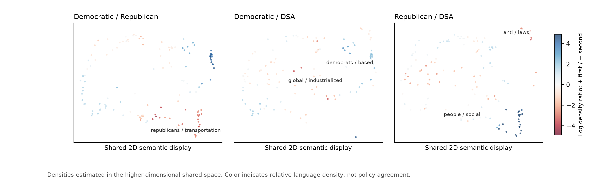
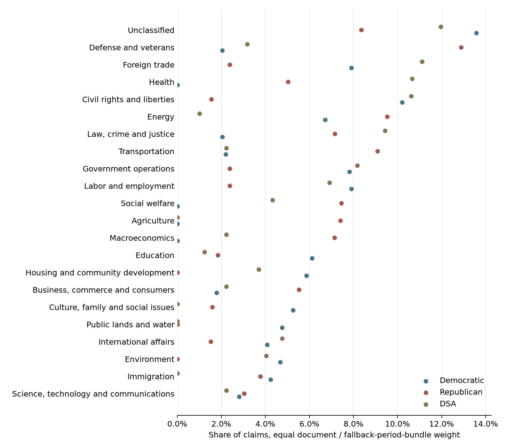

# National platforms: claim-based analysis

**Provisional selected-sample result, not a full-corpus comparison.** This run uses the pilot's individually unflagged assistant-reviewed claims. The original sample covered 60 blocks, not complete documents; selection after review introduces additional bias. These shares do not estimate platform-wide emphasis.

The analytical text is the **claim**, not its original evidence passage. The separate passage-based analysis and its outputs remain unchanged.

| Organization | Claims analyzed | Documents | Document / fallback bundles |
|---|---:|---:|---:|
| Democratic | 59 | 7 | 7 |
| Republican | 82 | 6 | 6 |
| DSA | 58 | 12 | 9 |

## Semantic density

The shared representation uses 5 dimensions for KDE; the two-dimensional display is not the density-estimation space. Sampling balances organizations and gives each document/fallback-period bundle equal aggregate density weight. Positive contrasts mean greater first-organization language density, not agreement, ideological direction, or causal differences.

Platforms/programs-only sensitivity: **complete**. Its independently fitted space has 5 dimensions; its coordinates cannot be compared directly with the expanded map.

## Topics

The existing pinned MiniLM classifier compares normalized claim text with CAP topic descriptions (minimum cosine similarity 0.2). Each claim receives at most one topic; unclassified claims remain in the denominator. This is exploratory classification, not validated topic gold. Topic shares use equal aggregate document/fallback-bundle weights, not raw claim counts.

| Organization | Largest weighted topic shares in this input |
|---|---|
| Democratic | Unclassified 13.6%; Civil rights and liberties 10.2%; Labor and employment 7.9% |
| Republican | Defense and veterans 12.9%; Energy 9.5%; Transportation 9.1% |
| DSA | Unclassified 12.0%; Foreign trade 11.1%; Health 10.7% |

## Provenance and reproduction

Full extraction uses source chunks of at most 240 words, sentence-aware splitting of long paragraphs, and at most 1,200 preceding-context characters. The prompt requires preservation of actors, stance/modality, conditions, temporal scope and reported-speaker attribution; automated revision does not certify that every requirement was met. Source organization remains metadata rather than a mechanically repeated embedding prefix. Exact within-document claim duplicates are retained in downloads but excluded from fitting.

- [Complete claim/source download, not metadata only](../data/analysis/national_claims/reviewed_sample/claim_documents.zip)
- [Claims and exact supporting source offsets](../data/analysis/national_claims/reviewed_sample/claims.csv)
- [Complete source texts](../data/analysis/national_claims/reviewed_sample/complete_sources.csv)
- [Topic assignments](../data/analysis/national_claims/reviewed_sample/topic_assignments.csv)
- [Weighted topic shares, both views](../data/analysis/national_claims/reviewed_sample/topic_emphasis.csv)
- [Machine-readable analysis summary](../data/analysis/national_claims/reviewed_sample/analysis_summary.json)

Source documents retain their original attribution. Claims describe what sources assert; they do not independently establish truth. Pooling mixes periods and genres. Missing historical sources, including the final 2015 DSA strategy, remain missing rather than being inferred from later documents. No website deployment is performed.
