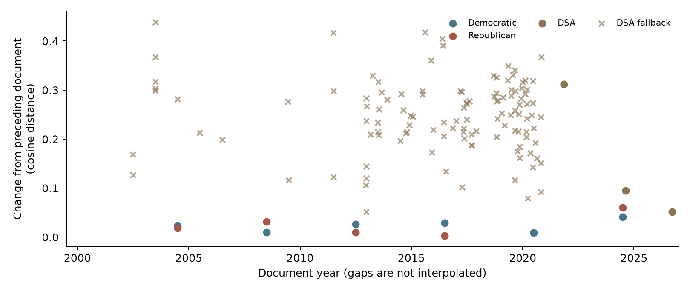

# National platforms: Democratic, Republican, and DSA

National organizational documents, January 1, 2000 through 2026-10-26. Candidate and state/local texts are excluded. This is a pooled comparison of recoverable language, not a continuous history of organizational positions.


## Corpus and sensitivity

| View | Status | Democratic documents / passages | Republican documents / passages | DSA documents / passages |
|---|---|---:|---:|---:|
| expanded | complete | 7 / 2333 | 6 / 2376 | 122 / 1539 |
| strict | complete | 7 / 2333 | 6 / 2376 | 3 / 309 |

The expanded view adds explicitly labeled DSA national statements/resolutions. The strict view uses adopted platforms/programs only. Each view fits its own balanced representation: map coordinates and numerical density scales are not directly comparable across views.

The strict and expanded results both retain the same underlying party-platform documents; only labeled fallback evidence differs. DSA's recovered platforms are from 2021 onward, not a representative sample of its entire 2000–2026 history. The complete adopted 2021 platform is preserved in an immutable December 30, 2021 archive snapshot, whose page metadata records publication and modification on November 9, 2021. It replaces the previously used API page modified in 2025; the versions are not counted as independent platforms.

| View | Balanced passages per organization | KDE dimensions | DSA source composition |
|---|---:|---:|---|
| expanded | 1539 | 5 | 1 platform, 2 program, 18 resolution, 101 statement |
| strict | 309 | 5 | 1 platform, 2 program |

The per-view `pairwise_summary.csv` records document/bundle-weighted density preferences. These fitted-sample diagnostics are not classifier accuracy, policy agreement rates, or directly comparable log-density scales. Smaller DSA corpora constrain both balanced fits. Sparse support and UMAP sampling make individual exploratory regions unstable; reviewed policy examples below are established from sources independently of those regions.

## Historical DSA recovery

Recovered national resolutions include the 2001 priorities and war/terrorism texts, the complete 2003 priorities and accompanying policy resolutions, the 2004 NPC resolution, the 2005 priorities, the November 2007 Economic Justice Agenda, the 2009 priorities, the full ten-page 2011 priorities and accompanying adopted resolutions, the complete 2013 and 2015 priorities, and the 2017 priorities. The 2011 full original replaces its magazine summary in model input; the summary remains in the full-text resolution inventory. The official Social and Economic Bill of Rights, identified as DSA's 2010 document in the adopted 2011 priorities, is recovered from its December 2012 republication. Its bundle follows republication because the original adoption date is not established. The 2016 strategy remains an explicitly labeled summary, not the unrecovered longer 2015 strategy. Complete original pages, PDFs and magazine issues remain downloadable, while model scopes remove other authors' articles, contents, repeated summaries, fundraising, internal administration and candidate-specific sections. Early scan OCR and print hyphenation are retained and can affect the semantic analysis.

| Fallback period bundle | Eligible documents | Model passages |
|---|---:|---:|
| 2000-2003 | 8 | 36 |
| 2004-2007 | 4 | 112 |
| 2008-2011 | 6 | 41 |
| 2012-2015 | 28 | 346 |
| 2016-2019 | 52 | 500 |
| 2020-2023 | 21 | 195 |

The full-text historical statement inventory contains 156 catalog records: 97 included as fallback evidence and 59 excluded with individual reasons. The rule retains nationally issued policy statements and broad policy agendas, but excludes campaign endorsements/results-only pieces, administration, personal tributes/case appeals, chapter authorship, unverified affiliated-body-only positions, link indexes and duplicate translations. Translations remain in complete downloads but do not double-count model passages. Twelve-month or four-year coverage is not inferred from a single document.

The additional full-text recovery inventories screen all five linked 2003 resolution pages, recover all four visibly listed adopted 2011 resolutions (including the already modeled LGBTQ resolution, not counted twice), and retain every entry in the 14-record strategy catalog. The pre-2000 *Where We Stand* text is preserved as applicability context, not mislabeled as a new post-2000 platform. Other background essays are not promoted to adopted organizational policy merely because DSA hosts them.

Bundles follow verified adoption periods where available and otherwise publication; December 2012 migration/republication dates are not original adoption dates. All six fallback period bundles meet the unchanged ten-passage gate, but this does not establish annual or comprehensive platform coverage. The 2000 editorial remains unverified and the full underlying 2015 strategy remains unrecovered despite checks of the convention report, archived convention/FAQ/agenda/resolution pages, strategy pages and official media catalogs. The 2015 priorities are a different, now recovered adopted resolution. The official 2025 post-convention compendium records R34 adopted unamended 900–291 after its substitute was rejected 532–651. R34 supersedes the 2021 platform and retains the current Workers Deserve More program pending revision. The October 16, 2025 site snapshot identifies that current text as the 2024 program. This establishes 2025 reuse, not a newly written platform; the nominal 2025 PDF URL serving 2026-drafted content is not backdated.

## Reviewed policy examples (2024)

These matched-cycle examples distinguish common policy subjects from different proposed mechanisms. They come directly from available 2024 documents, not from KDE labels or a presumed ideological ordering.

| Topic | Democratic | Republican | DSA |
|---|---|---|---|
| Healthcare | Make expanded ACA premium tax credits permanent. | Promote healthcare choice and competition while protecting Medicare. | Medicare for All without premiums or cost-sharing. |
| Energy | Incentivize clean-energy and grid investment. | Remove restrictions on oil and gas and coal production. | Publicly own major energy infrastructure alongside a fossil-fuel transition. |
| Immigration | Combine border enforcement with citizenship pathways for Dreamers and others. | Expand deportation to a historically large operation. | End immigrant detention and deportations and provide immediate amnesty regardless of status. |

The reviewed findings ledger records the source document identifier and an exact supporting span for every recovered cell and the report builder checks each against the complete source text. These examples do not imply that a document lacks other relevant proposals.

## Pooled semantic comparison


All three densities share one representation within each view. Positive log ratios favor the first organization in a panel; negative ratios favor the second. Shared language does not establish shared policy or agreement. Different decades and genres are pooled; historical composition can drive apparent distinctions.

### Exploratory regions

| Comparison | Relative-language zone | Terms | Passages / documents | Source evidence |
|---|---|---|---:|---|
| democratic_vs_republican | shared_language | environmental, water, communities, science | 33 / 10 | `republican-2012-0149`; scoped paragraph 196, chunk 1 |
| democratic_vs_republican | shared_language | president, america, war, world | 30 / 6 | `republican-2004-0041`; scoped paragraph 64, chunk 1 |
| democratic_vs_republican | democratic_relative | workers, believe, work, democrats | 21 / 6 | `democratic-2024-0030`; scoped paragraph 93, chunk 1 |
| democratic_vs_republican | democratic_relative | tribal, indian, nations, lands | 20 / 4 | `democratic-2020-0223`; scoped paragraph 242, chunk 1 |
| democratic_vs_republican | republican_relative | trade, american, agreements, markets | 65 / 6 | `republican-2016-0163`; scoped paragraph 209, chunk 1 |
| democratic_vs_republican | republican_relative | republican, american, republicans, america | 31 / 6 | `republican-2012-0282`; scoped paragraph 359, chunk 1 |
| democratic_vs_dsa | shared_language | immigration, immigrants, democrats, administration | 35 / 12 | `democratic-2000-0201`; scoped paragraph 250, chunk 1 |
| democratic_vs_dsa | shared_language | workers, wage, labor, work | 34 / 9 | `democratic-2020-0060`; scoped paragraph 63, chunk 1 |
| democratic_vs_dsa | democratic_relative | nuclear, weapons, treaty, materials | 32 / 7 | `democratic-2012-0208`; scoped paragraph 217, chunk 1 |
| democratic_vs_dsa | democratic_relative | veterans, families, military, faith | 32 / 6 | `democratic-2012-0198`; scoped paragraph 205, chunk 1 |
| democratic_vs_dsa | dsa_relative | public, dsa, poor, government | 22 / 6 | `dsa-2001-convention-priorities-0001`; scoped paragraph 1, chunk 1 |
| democratic_vs_dsa | dsa_relative | strike, members, workers, dsa | 18 / 5 | `dsa-statement-1081-0007`; scoped paragraph 8, chunk 1 |
| republican_vs_dsa | shared_language | voting, voter, vote, ballots | 24 / 8 | `republican-2008-0147`; scoped paragraph 206, chunk 1 |
| republican_vs_dsa | shared_language | medicare, care, health, seniors | 24 / 7 | `republican-2000-0208`; scoped paragraph 245, chunk 1 |
| republican_vs_dsa | republican_relative | nuclear, weapons, missile, proliferation | 42 / 5 | `republican-2000-0402`; scoped paragraph 459, chunk 1 |
| republican_vs_dsa | republican_relative | platform, party, america, american | 26 / 5 | `republican-2008-0006`; scoped paragraph 15, chunk 1 |
| republican_vs_dsa | dsa_relative | public, dsa, poor, government | 22 / 6 | `dsa-2001-convention-priorities-0001`; scoped paragraph 1, chunk 1 |
| republican_vs_dsa | dsa_relative | strike, members, dsa, workers | 19 / 5 | `dsa-statement-1081-0001`; scoped paragraph 1, chunk 1 |

Terms are descriptive TF-IDF labels, not independently reviewed policy categories. HDBSCAN regions require at least two independent document/period bundles; noise and retained-region counts are recorded in `clustering_audit.csv`. Shared regions must contain passages from both organizations. At most two regions per pairwise zone are shown. Source-linked short excerpts are in `regions.csv`; complete passage text is in `scored_passages.csv`.

## Document chronology



Distances compare adjacent recovered document centroids within an organization in the original normalized GTE space, not on a left–right scale. Fallback statements and full platforms are different genres. Dates retain source precision; no annual interpolation is performed. First documents have no preceding observation. See each view's `document_chronology.csv`.

## Source qualifications

- **republican-2020-reuse**: reused_document. 2020 RNC resolution; applicability record only; no new independent platform text
- **dsa-2021-draft**: found_unverified. Explicit second draft excluded; complete adopted text separately recovered in immutable December 2021 official-page snapshot.
- **dsa-2025-program-reuse**: reused_document. Official post-convention compendium marks R34 adopted; minutes record 900-291 approval after substitute rejected 532-651. R34 retains current 2024 WDM until a replacement and supersedes the 2021 platform. Complete compendium and scoped R34 text preserved in historical_resolution_inventory. The nominal 2025 PDF URL serving text drafted April-June 2026 is not a recovered 2025 version. Reuse does not add another independent platform or model passages.
- **dsa-2000-election-lead**: found_unverified. Full magazine recovered; unsigned electoral editorial and quotation of a 1993 resolution do not establish a newly adopted 2000 policy document. Excluded rather than backdated; 2001 national resolutions cover this four-year fallback period.
- **dsa-2011-priorities-summary**: superseded_summary. Complete original ten-page resolution now recovered as dsa-2011-priorities-full. Magazine summary retained in the complete-text historical resolution inventory; excluded from model to avoid duplicate priorities.

Empty years in `year_coverage.csv` mean no recovered publication in this inventory, not that an organization had no platform or position. The GOP 2020 reuse record contributes no second independent copy of its 2016 text. The DSA 2025 R34 decision likewise retains the 2024 program until replacement without adding a second independent text; the adopted resolution and vote are retained in the full-text resolution inventory. Every currently exposed official statement-catalog entry from December 2012 through December 2020 was screened, with full included and excluded text preserved. This does not recover deleted pages or establish exhaustive coverage of other publication types or all historical years. See the source ledger, full-text historical statement inventory, fetch-attempt log, and `data/manual/national_platform_search_disposition.csv` for period-specific searches and explicit unsearched boundaries.

## Methods and reproduction

GTE: `Alibaba-NLP/gte-multilingual-base` at `9bbca17d9273fd0d03d5725c7a4b0f6b45142062`, normalized embeddings; maximum 256 tokens including special tokens. Long paragraphs are split on original character offsets; short fragments, page markers, and known magazine footers are excluded from model passages. Complete source extraction and exact scoped article text remain separately downloadable.

UMAP uses deterministic, equal-sized organization samples stratified by document or predefined four-year DSA fallback bundle. KDE gives each sampled document/bundle equal total weight within its organization. Bundles need at least ten passages. Both sampling and weighting use the same units. The dimension sweep selects the smallest dimension within 0.005 trustworthiness of the maximum; KDE uses standardized selected-dimensional coordinates and Scott bandwidth. The 2D map is display-only; sparse corpora produce explicit insufficient-evidence results.

```sh
uv run dsa-analysis national-platform-analysis --fetch
uv run dsa-analysis national-platform-analysis
```

Collection is explicit; the default command uses local captures (or hash-verified complete-text exports when captures are absent) and a cached model only. `--download-model` explicitly permits obtaining the pinned model. `--fetch-only` collects without running the model. No candidate pipeline runs.

All outputs: `data/analysis/national_platforms/`. Downloads include `complete_sources.csv` and `.jsonl` (complete extracted and scoped texts), `passages.csv` (full model passages, not metadata alone), `coverage.csv`, `year_coverage.csv`, `historical_statement_inventory.csv` and `.jsonl` (complete text and screening reasons for every catalog entry), `historical_resolution_inventory.csv` and `.jsonl` (original convention documents and adoption evidence, including complete 2025 results with R34 separately scoped), `historical_strategy_inventory.csv` and `.jsonl` (all strategy-catalog texts and screening decisions), `historical_convention_inventory.csv` and `.jsonl` (complete 2019 proposals cross-referenced to final votes), `source_documents.zip` (individual complete texts, scoped texts, deduplicated original PDFs and a provenance manifest), `historical_document_link_disposition.csv` (all 61 final-results links and recovery outcomes), and the expanded/strict analysis tables. Sources retain their original attribution and rights; institutional reproductions are labeled as such rather than represented as party-hosted originals.

Supplementary recovery records preserve the complete 2017 convention minutes, June 2019 proposal packet, official final 2019 results, and six original 2015 proposal PDFs without changing the fitted corpus or figures. All 85 proposals extracted from the June packet are retained with voting-status checks. All 61 final-results links now have complete recovered documents: 60 original PDFs and R41's complete archived Google Doc text, including R34's base text, passed Amendment #1, and separately linked R74. Public archive captures recovered the 87-page Credentials Committee report, the 16-page Medicare for All report, and R41 after their live exports became unavailable. The live failures and successful archive routes remain recorded; R41 is also preserved independently in the public packet. Additional 2017 originals include the complete archived resolution proposal packet, the 18-page results/rationales PDF, and the 13-page harassment policy PDF. All 34 inserted-text operations from an independent archived viewer were checked against the complete packet, including final footnotes. The results PDF contains rationales rather than complete resolutions; the packet's later annotations do not establish blanket final adopted wording, and a live policy export is not independently a frozen 2017 capture. A pre-convention proposal is not automatically adopted: R34 passed as amended, so its unamended packet text is not verified final wording; candidate-specific R74 is absent from this packet. The full final 2015 strategy remains unrecovered.
